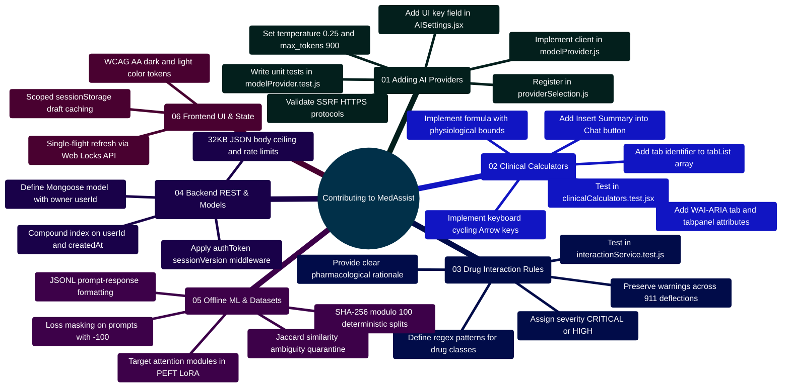

# Contributing to MedAssist AI — Developer & Contributor Guide

Developed by **J Ganesh kumar reddy**  
*Full-Stack Educational Health Assistance, Biomedical Evidence Grounding, & Machine Learning Research Platform*

---

## 1. Architectural Philosophy & Welcome

Thank you for your interest in contributing to **MedAssist AI**! MedAssist AI is an open, modular research and educational platform designed to bridge consumer-facing health inquiry with deterministic biomedical evidence grounding (NCBI PubMed), multi-provider large language model inference (Gemini, Groq, Together AI, local vLLM), deterministic pharmacological safety filters, and offline Low-Rank Adaptation (LoRA) machine learning pipelines.

### Core Architectural Invariants:
1. **Deterministic Safety over Probabilistic Generation**: Medical safety rules (such as acute emergency interception, self-harm crisis deflections, and FDA black-box drug interactions) are executed deterministically before and after LLM synthesis. They are never delegated to probabilistic prompt completions.
2. **Owner-Scoped Tenancy**: Every operational database record in MongoDB is strictly indexed and filtered by `{ userId: req.userId }`. Cross-user data leakage is prevented at the database query level.
3. **SSRF & Network Defense Boundaries**: Remote AI provider endpoints and external webhooks must strictly enforce HTTPS, disallow private subnets (`127.0.0.0/8`, `10.0.0.0/8`, `192.168.0.0/16`, `172.16.0.0/12`), and reject embedded credentials.
4. **Air-Gapped Research Isolation**: Offline data engineering and LoRA fine-tuning scripts in `Model and Dataset/` run strictly offline and are never imported or executed by the Express/Node.js web runtime.

---

## 2. Master System Extension Topology

```
========================================================================================================================
                                     MEDASSIST AI — MASTER EXTENSIBILITY BLUEPRINT
========================================================================================================================

    [ EXTENSION VECTOR 1: FRONTEND REACT 19 / VITE 6 ]
    ├── Clinical Calculators Modal (ClinicalCalculatorsModal.jsx)
    │   └── Invariants: Strict physiological bounds, WAI-ARIA tabpanel semantics, educational inquiry prompts.
    ├── UI Settings & Provider Vault (AISettings.jsx)
    │   └── Invariants: Password masking, client never echoes stored keys, transmits over HTTPS to backend vault.
    └── Chat Workspace & Resilient Tabs (ChatWorkspace.jsx, tabStorage.js)
        └── Invariants: Single-flight Web Locks token refresh, scoped sessionStorage drafts with memory fallback.

                                        │
                                        ▼ HTTPS (Port 443) / WSS (/ws)
    [ EXTENSION VECTOR 2: BACKEND EXPRESS 4 / NODE 24 RUNTIME ]
    ├── Multi-Provider AI Gateway (modelProvider.js, providerSelection.js)
    │   └── Invariants: Validate remote URLs via SSRF parser, enforce temperature=0.25, max_tokens=900, stop finish-reason.
    ├── Deterministic Drug Interaction Engine (interactionService.js)
    │   └── Invariants: Bidirectional regex pattern matching; preserved inside emergency deflection answers.
    ├── Biomedical Grounding & Evidence Harvester (answerService.js, pubmedService.js)
    │   └── Invariants: Multi-stage PubMed Entrez fetch with structured XML parsing; strictly audits [N] citations.
    └── Authenticated Session & Vault Gateway (authToken.js, sessionService.js, providerCredentials.js)
        └── Invariants: Monotonic sessionVersion validation, rotating refresh tokens, AES-256-GCM encrypted personal keys.

                                        │
                                        ▼
    [ EXTENSION VECTOR 3: PERSISTENCE & DATA STORAGE (MongoDB 7) ]
    ├── Mongoose Data Schemas (models/*.js)
    │   └── Invariants: All operational records strictly scoped to owner userId; 24-hour TTL on ephemeral generations.
    └── Schema Versioning & Indexes
        └── Invariants: Compound indexes on { userId: 1, createdAt: -1 } for sub-5ms query resolution.

                                        │
                                        ▼
    [ EXTENSION VECTOR 4: OFFLINE RESEARCH & MACHINE LEARNING (Python 3.10+) ]
    ├── Dataset Profiling, Curation & Deduplication (analyze_dataset.py, audit_dataset.py)
    │   └── Invariants: Pairwise Jaccard similarity audit; quarantine ambiguous groups (e.g. 1,437 questions).
    ├── Zero-Leakage Deterministic Splitting (prepare_dataset.py, verify_splits.py)
    │   └── Invariants: Partitioning strictly on SHA-256 modulo 100; zero patient/question overlap across partitions.
    └── PEFT LoRA Fine-Tuning Pipeline (train_lora.py, validate_lora_setup.py)
        └── Invariants: Target low-rank adapter weights (r=8, alpha=16); mask prompt tokens with -100 cross-entropy loss.
========================================================================================================================
```

---

## 3. Contributor Extensibility Mindmap



---

## 4. Development Environment Setup & Prerequisites

### Toolchain Prerequisites:
- **Node.js**: `v20.x` or `v24.x LTS` (Node 24 recommended)
- **Python**: `3.10` or higher
- **MongoDB**: Community Server `7.x` (or Docker container)
- **Package Managers**: `npm` `10.x+` and Python `venv` / `pip`
- **Optional**: Docker `24.0+` and Docker Compose `v2.20+`

### Step 1: Clone Repository & Install Dependencies

```powershell
# Clone the repository
git clone https://github.com/Ganesh172919/React-App-LLM.git
cd React-App-LLM

# Install backend dependencies
cd backend
npm install

# Install frontend dependencies
cd ../frontend
npm install

# Return to repo root
cd ..
```

### Step 2: Seed Development Secrets

```powershell
# Generate isolated cryptographic secrets for local testing
node deploy/create_env.cjs
```

### Step 3: Launch Local Development Stack

To run the full stack locally with in-memory MongoDB and simulated mock services:

```powershell
# Runs Express backend and serves Vite client with synthetic services
node scripts/run_local.cjs
```
Open [http://localhost:5173](http://localhost:5173) in your browser.

---

## 5. Step-by-Step Developer Implementation Walkthroughs

### 5.1 Guide A: Adding a Custom AI Model Provider / Gateway

MedAssist AI supports multi-provider LLM dispatch. To contribute a new provider (e.g. Anthropic Claude, Mistral API, or a local vLLM gateway):

#### Step 1: Register Identifier in `backend/services/providerSelection.js`

```javascript
// File: backend/services/providerSelection.js
const PROVIDER_CHOICES = [
  "gemini",
  "groq",
  "together",
  "local",
  "custom-ai", // <-- Add unique identifier
];

function resolveProviderSelection(userPreference, personalCredentials, envConfig) {
  const chosen = PROVIDER_CHOICES.includes(userPreference) ? userPreference : "gemini";

  if (chosen === "custom-ai") {
    const personalKey = personalCredentials?.["custom-ai"];
    const deploymentKey = envConfig.CUSTOM_AI_API_KEY;
    return {
      provider: "custom-ai",
      apiKey: personalKey || deploymentKey || null,
      isPersonal: Boolean(personalKey),
      endpoint: envConfig.CUSTOM_AI_ENDPOINT || "https://api.custom-ai.com/v1/chat/completions",
      model: envConfig.CUSTOM_AI_MODEL || "custom-med-model",
    };
  }
  // ... existing provider resolution
}
```

#### Step 2: Implement Completion Client in `backend/services/modelProvider.js`

```javascript
// File: backend/services/modelProvider.js
const { assertSafeRemoteUrl } = require("../lib/securityUtils");

async function generateCustomAICompletion({ prompt, systemPrompt, config }) {
  const { apiKey, endpoint, model } = config;
  if (!apiKey) throw new Error("CUSTOM_AI_ERROR: Missing required API key.");

  // SSRF defense: Enforces HTTPS, blocks private IP subnets & credentials in URL
  assertSafeRemoteUrl(endpoint);

  const payload = {
    model: model || "custom-med-model",
    temperature: 0.25,      // Deterministic sampling invariant
    max_tokens: 900,        // Completion length ceiling
    messages: [
      { role: "system", content: systemPrompt },
      { role: "user", content: prompt }
    ]
  };

  const response = await fetch(endpoint, {
    method: "POST",
    headers: {
      "Content-Type": "application/json",
      "Authorization": `Bearer ${apiKey}`,
      "User-Agent": "MedAssistAI-Core/1.0",
    },
    body: JSON.stringify(payload),
    signal: AbortSignal.timeout(30000),
  });

  if (!response.ok) {
    const errorText = await response.text().catch(() => "");
    throw new Error(`CUSTOM_AI_HTTP_${response.status}: ${errorText.slice(0, 200)}`);
  }

  const data = await response.json();
  const choice = data.choices?.[0];
  if (!choice?.message?.content) throw new Error("CUSTOM_AI_EMPTY: Empty response.");
  if (choice.finish_reason && choice.finish_reason !== "stop") {
    throw new Error(`CUSTOM_AI_TRUNCATED: Response halted due to finish_reason="${choice.finish_reason}".`);
  }

  return {
    content: choice.message.content.trim(),
    provider: "custom-ai",
    model: data.model || model,
    finishReason: choice.finish_reason || "stop",
  };
}
```

---

### 5.2 Guide B: Adding an Evidence-Based Clinical Calculator

All calculators reside in `frontend/src/components/tools/ClinicalCalculatorsModal.jsx`:

1. **Tab Identifier**: Append calculator ID to `tabList`:
   ```javascript
   const tabList = ["bmi", "egfr", "chads", "map", "crcl", "calcium", "aniongap", "fena", "feurea", "fluids", "wells", "curb65", "gcs", "hasbled", "qsofa", "bsa", "apri", "newcalc"];
   ```
2. **Formula State & Bounds**: Define form inputs with strict boundary clamping.
3. **WAI-ARIA Accessibility**: Implement `role="tab"` and `role="tabpanel"` attributes.
4. **Educational Prompt Insertion**: Structure prompt as an educational inquiry rather than an absolute medical command:
   ```javascript
   const prompt = `Educational inquiry regarding risk assessment: Patient reflects a score of ${score} (${interpretation}). What evidence-based clinical considerations and management guidelines apply?`;
   onInsertPrompt(prompt);
   onClose();
   ```

---

### 5.3 Guide C: Adding a High-Risk Drug Interaction Rule

Add your interaction pair to `HIGH_RISK_INTERACTION_RULES` in `backend/services/interactionService.js`:

```javascript
// File: backend/services/interactionService.js
{
  pair: "Drug Class A + Drug Class B",
  drugA: "Class A (e.g., DrugName1, DrugName2)",
  drugB: "Class B (e.g., DrugName3, DrugName4)",
  severity: "CRITICAL", // CRITICAL or HIGH
  drugsA: [/\bdrugone\b/i, /\bbrandone\b/i],
  drugsB: [/\bdrugtwo\b/i, /\bbrandtwo\b/i],
  description: "Detailed pharmacological description of metabolic inhibition, enzyme competition, or synergistic toxicity.",
}
```

---

### 5.4 Guide D: Ingesting Custom Datasets & LoRA Fine-Tuning

To train custom LoRA adapters on domain-specific datasets:

```powershell
# 1. Profile and audit semantic divergence in raw data
python "Model and Dataset/analyze_dataset.py"
python "Model and Dataset/audit_dataset.py"

# 2. Quarantine ambiguous multi-intent records and partition 80/10/10
python "Model and Dataset/prepare_dataset.py"

# 3. Verify zero partition leakage across training, validation, and test sets
python "Model and Dataset/verify_splits.py"

# 4. Verify analytical LoRA parameters without GPU allocation
python "Model and Dataset/lora/validate_lora_setup.py"
```

---

## 6. Verification Harness & Pull Request Checklist

Before submitting a Pull Request, run the automated verification suite to guarantee 100% compliance across all 204 test checks:

```powershell
# Execute the unified multi-tier verification runner
node scripts/verify_project.cjs
```

### Pull Request Checklist:
- [ ] Only `.md` files modified (if documentation PR) OR code modified with corresponding unit tests.
- [ ] All 70 backend integration tests pass (`npm test --prefix backend`).
- [ ] All 54 frontend Vitest tests pass (`npm test --prefix frontend`).
- [ ] ESLint passes with 0 warnings (`npm run lint --prefix frontend`).
- [ ] Vite production bundle compiles cleanly (`npm run build --prefix frontend`).
- [ ] All 19 Python research unit tests pass (`python -m unittest discover -s "Model and Dataset"`).
- [ ] Built HTTP server passes all 7 ingress probes (`node scripts/check_build_serving.cjs`).
- [ ] All 54 Playwright browser workflows pass (21 smoke in `node scripts/browser_smoke.cjs` and 33 assertions in `node scripts/browser_verify_dark_and_tools.cjs`).
- [ ] No secrets, keys, or `.env` files committed.
