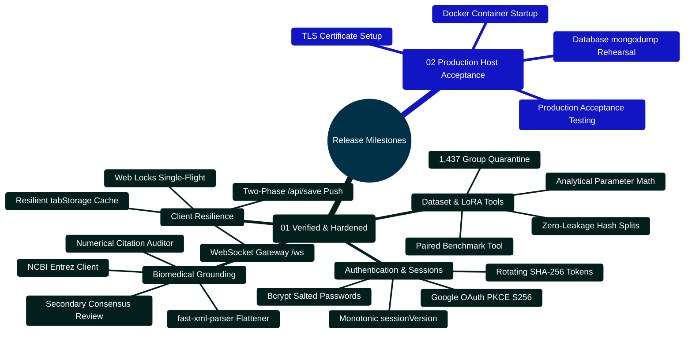
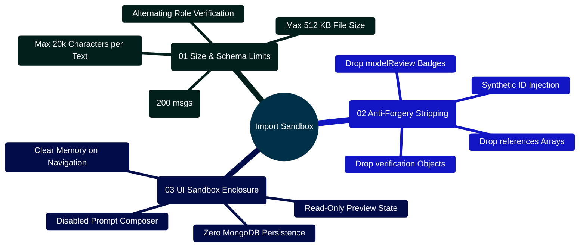
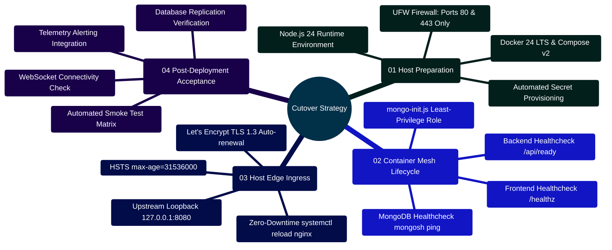

# MedAssist AI — Improvement Plan & Production Release Roadmap

Developed by **J Ganesh kumar reddy**  
*Full-Stack Educational Health Assistance, Biomedical Evidence Grounding, & Machine Learning Research Platform*

---

## 1. Engineering Roadmap & Release Timeline

The MedAssist AI platform follows an incremental, hardened milestone strategy designed to guarantee zero data leakage, deterministic citation verifiability, and robust multi-tenant security before production host cutover.

```
========================================================================================================================
                                     MEDASSIST AI — RELEASE MILESTONES & ROADMAP
========================================================================================================================

   [MILESTONE 1: CORE ARCHITECTURE & AUTHENTICATION] ──────────────────────────► STATUS: COMPLETED [x]
   ├── Single-device session versioning (monotonic sessionVersion increment)
   ├── Hashed rotating refresh tokens in MongoDB with instant replay attack revocation
   ├── Google OAuth 2.0 PKCE flow (S256 code challenge with timing-safe validation)
   └── AES-256-GCM encrypted personal API key vault (IV, Tag, Ciphertext Base64)

   [MILESTONE 2: BIOMEDICAL GROUNDING & VERIFICATION] ─────────────────────────► STATUS: COMPLETED [x]
   ├── Three-stage NCBI Entrez E-Utilities client (esearch -> esummary -> efetch)
   ├── Fast-xml-parser text flattener handling heterogeneous MEDLINE XML schemas
   ├── Deterministic numerical citation verification (regex parsing of [N], range validation)
   └── Secondary consensus model review (GEMINI_VERIFY_ANSWERS claims gate)

   [MILESTONE 3: TWO-PHASE PERSISTENCE & RESILIENCE] ──────────────────────────► STATUS: COMPLETED [x]
   ├── Two-phase idempotent generation handshake (Phase 1 Ephemeral, Phase 2 /api/save)
   ├── Web Locks API single-flight token refresh in browser client (navigator.locks.request)
   ├── Resilient tabStorage draft and pending job recovery with in-memory fallback
   └── Real-time WebSocket /ws gateway with 30s ping watchdog and 1MB backpressure drop

   [MILESTONE 4: MACHINE LEARNING & EVALUATION SUITE] ─────────────────────────► STATUS: COMPLETED [x]
   ├── Multi-answer question ambiguity quarantine (1,437 groups / 3,535 rows isolated)
   ├── Deterministic SHA-256 modulo 100 zero-leakage partitions (80% train / 10% val / 10% test)
   ├── Closed-form analytical parameter estimation (147,456 adapter parameters, 0.281 MB FP16)
   └── Blinded, paired case-level ablation analysis tool (evaluate_benchmark.py)

   [MILESTONE 5: PRODUCTION HOST DEPLOYMENT & ACCEPTANCE] ────────────────────► STATUS: READY FOR HOST [ ]
   ├── Execute multi-container Docker Compose on target host with TLS certificate binding
   ├── Configure public domain DNS, trusted reverse proxy headers, and Nginx rate limits
   ├── Rehearse database backup and disaster recovery drills via mongodump and mongorestore
   └── Run end-to-end Playwright browser regression smoke suite on production ingress
========================================================================================================================
```

---

## 2. Milestone Capabilities Mindmap



---

## 3. Engineering Implementation Checklist

### 3.1 Implemented & Verified Locally
- [x] **Secure Authentication**: Hashed rotating refresh tokens, single-device session versioning, email verification via Brevo, and password reset.
- [x] **Google OAuth 2.0 PKCE**: End-to-end OAuth flow with SHA-256 code challenge verification and user account provisioning.
- [x] **AES-256-GCM Key Vault**: Authenticated encryption for user-provided API keys (Gemini, Groq, Together AI).
- [x] **PubMed Grounding Pipeline**: Retrieval of matching PubMed records and available abstracts via NCBI Entrez E-Utilities. PubMed indexing alone does not establish peer review.
- [x] **Deterministic Citation Verification**: Regular expression parsing of `[N]`, strict numerical range partitioning, and fallback triggers.
- [x] **Secondary Consensus Review**: Optional secondary Gemini evaluation validating draft claims against retrieved abstracts.
- [x] **Authoritative Two-Phase Persistence**: Ephemeral 24-hour generation buffer committed only via `/api/save`.
- [x] **Single-Flight Token Refresh**: Client coordination via Web Locks API (`navigator.locks.request`).
- [x] **Resilient Tab Storage**: Draft and pending answer caching in `sessionStorage` with graceful incognito mode fallbacks.
- [x] **Responsive Mobile UI**: Fully responsive layouts verified down to 320px and 390px viewports with IME composition safety.
- [x] **Dark Theme Palette & Contrast Work**: Low-light theme with automatic OS `prefers-color-scheme` detection, persistent storage, and styled links, modals, dialogs, code blocks, and dashboard analytics. A full WCAG audit remains open.
- [x] **High-Risk Medication Interaction & Answer Safety Screening**: Deterministic output screening detecting emergency symptoms, harmful instructions, prompt injections, unauthorized dosage changes, and AI diagnostic pronouncements (`safetyService.js`), alongside 19 high-risk drug interaction rules covering Statins + CYP3A4 inhibitors/fibrates, Warfarin + azoles, Digoxin + amiodarone/verapamil, MAOIs + serotonergic agents, Allopurinol + Azathioprine/6-Mercaptopurine, Methotrexate + NSAIDs/High-Dose Aspirin, Warfarin + Bactrim/TMP-SMX (CYP2C9 inhibition & gut menaquinone depletion), Clopidogrel + Omeprazole/Esomeprazole (CYP2C19 antiplatelet bioactivation inhibition, FDA Boxed Warning), SSRIs/SNRIs/MAOIs + Triptans (FDA Alert: 5-HT1 receptor agonist serotonergic overstimulation and Serotonin Syndrome), Trimethoprim-Sulfamethoxazole + ACE Inhibitors/ARBs/Potassium-Sparing Diuretics (distal nephron ENaC channel blockade, severe refractory hyperkalemia, and sudden cardiac arrest), and Theophylline + Fluoroquinolones/Ciprofloxacin (potent hepatic CYP1A2 inhibition, 50–70% clearance reduction, fatal seizures and cardiac arrhythmias), with preserved medication interaction context even across emergency safety redirects and aggregated telemetry in the Analytics Dashboard.
- [x] **Clinical Educational Calculators Suite**: Comprehensive 18-tool suite including Adult BMI, CKD-EPI 2021 eGFR, CHA₂DS₂-VASc, MAP, Cockcroft-Gault CrCl, Payne Corrected Calcium, Serum Anion Gap, Fractional Excretion of Sodium (FeNa), Fractional Excretion of Urea (FeUrea for diuretic states), Maintenance Fluids (Holliday-Segar 4-2-1 rule), Wells' Criteria for Pulmonary Embolism (PE pre-test probability), CURB-65 Pneumonia Severity Score, Glasgow Coma Scale (GCS level of consciousness), HAS-BLED Bleeding Risk Score (9-point non-valvular AF bleeding stratification), qSOFA (Quick Sepsis-related Organ Failure Assessment bedside mortality screening), Body Surface Area (Mosteller BSA formula in metric cm/kg and imperial in/lbs), AST to Platelet Ratio Index (APRI non-invasive liver fibrosis and cirrhosis score), and Child-Pugh Score for Cirrhosis Mortality (Child-Turcotte-Pugh 5-parameter clinical staging) with non-diagnostic disclaimers, prompt insertion, and full WAI-ARIA tabpanel semantics.
- [x] **Accessible Citation Focus, Export Formats & Global Shortcuts**: Programmatic focus management (`tabIndex={-1}`, `el.focus()`), high-contrast focus rings (`:focus-visible`), dual Markdown and structured JSON export, global `Alt+C` modal shortcut (`aria-keyshortcuts="Alt+C"`), arrow-key tab cycling across all 18 tools (`ArrowRight`/`ArrowLeft`/`Home`/`End`), and Vancouver citation copy support.
- [x] **Untrusted Conversation JSON Import Sandbox**: Client-side preview parser (`conversationImport.js`) with hard byte limit ($\le 512\text{ KB}$), max 100 Q&A pairs (200 messages), max 20,000 characters per text, alternating turn validation, anti-forgery metadata stripping (dropping all `verification`, `modelReview`, and `references` tags), synthetic IDs (`import-${index}`), composer submission lock, and zero network persistence.
- [x] **Offline Data Quarantine**: Isolation of 1,437 ambiguous question groups and zero-leakage SHA-256 modulo 100 splitting.
- [x] **Analytical LoRA Validation**: Closed-form estimation confirming $147,456$ trainable parameters ($0.281$ MB FP16 footprint).
- [x] **Automated Verification Matrix**: All 71 backend tests across 9 suites, 55 Vitest component tests across 6 suites, 19 Python research tests, 7 build-serving checks, 21 Playwright core smoke workflows, and 33 dark mode/tools accessibility workflows (206 automated checks) passed in the master verification harness with zero reported production dependency vulnerabilities.

### 3.2 Target Host Deployment Checklist (Pending Host Cutover)
- [ ] **Docker Engine Verification**: Ensure Docker 24.0+ and Docker Compose v2.20+ are installed on the deployment host.
- [ ] **Environment Seeding**: Execute `node deploy/create_env.cjs` to generate production secrets with cryptographically random keys.
- [ ] **TLS Certificate Ingress**: Configure an external HTTPS reverse proxy in front of the included HTTP nginx container and set `PUBLIC_ORIGIN` and `COOKIE_SECURE=true`.
- [ ] **Database Initialization**: Ensure `deploy/mongo-init.js` provisions the unprivileged `medassist_user` account with read/write access.
- [ ] **Container Launch**: Execute `docker compose up -d --build` and verify container health via `docker compose ps`.
- [ ] **Disaster Recovery Rehearsal**: Execute an offline `mongodump` archive and verify restoration into a temporary database container.

---

## 4. Verification Harness Code Snippet (`scripts/verify_project.cjs`)

The continuous verification harness executes all 7 unit/integration test suites and performs strict npm vulnerability audits:

```javascript
// Implementation Snippet: scripts/verify_project.cjs
const fs = require("fs");
const path = require("path");
const { spawnSync } = require("child_process");

const root = path.resolve(__dirname, "..");
const output = path.join(root, "output/qa");
fs.mkdirSync(output, { recursive: true });

const python = process.env.PYTHON_BIN || "python";
const node = process.execPath;

const checks = [
  ["backend", node, ["--test", "--test-concurrency=1", "--test-reporter=tap"], "backend"],
  ["frontend-lint", node, ["node_modules/eslint/bin/eslint.js", "."], "frontend"],
  ["frontend-tests", node, ["node_modules/vitest/vitest.mjs", "run", "--reporter=json", "--outputFile=" + path.join(output, "frontend-results.json")], "frontend"],
  ["frontend-build", node, ["node_modules/vite/bin/vite.js", "build"], "frontend"],
  ["dataset-tests", python, ["-m", "unittest", "discover", "-s", "Model and Dataset", "-p", "test_*.py"], "."],
  ["lora-tests", python, ["-m", "unittest", "discover", "-s", "Model and Dataset/lora", "-p", "test_*.py"], "."],
  ["lora-dry-run", python, ["Model and Dataset/lora/train_lora.py"], "."],
];

const results = [];
for (const [name, command, args, cwd] of checks) {
  const started = Date.now();
  const result = spawnSync(command, args, { cwd: path.join(root, cwd), encoding: "utf8", timeout: 240000 });
  results.push({ name, passed: result.status === 0, exitCode: result.status, durationMs: Date.now() - started });
  console.log((result.status === 0 ? "PASS " : "FAIL ") + name);
}

fs.writeFileSync(path.join(output, "automated-results.json"), JSON.stringify(results, null, 2));
process.exitCode = results.every((item) => item.passed) ? 0 : 1;
```

---

## 5. Host Deployment Runbook & Commands

### 5.1 Environment Configuration & Launch
```bash
# 1. Generate cryptographic keys and production environment files
node deploy/create_env.cjs

# 2. Build and launch multi-container mesh
docker compose up -d --build

# 3. Inspect container health status
docker compose ps
```

### 5.2 Database Backup & Recovery Rehearsal
```bash
# Create timestamped database backup archive
docker compose exec mongo mongodump \
  --username medassist_user \
  --password <MONGO_PASSWORD> \
  --authenticationDatabase admin \
  --db medassist \
  --archive=/backups/backup-$(date +%F).archive --gzip

# Rehearse restoration into a disaster recovery instance
docker compose exec mongo mongorestore \
  --username medassist_user \
  --password <MONGO_PASSWORD> \
  --authenticationDatabase admin \
  --nsInclude="medassist.*" \
  --archive=/backups/backup-$(date +%F).archive --gzip
```

---

## 6. Maintenance & Operating Invariants

1. **Monotonic Session Versioning**: Never bypass `sessionVersion` incrementing upon credential change or single-device login.
2. **Deterministic Fallbacks**: If PubMed E-Utilities or personal API keys return network errors, the system must degrade safely to `references_only` or `emergency_guidance` rather than emitting speculative ungrounded claims.
3. **Quarantine Inviolability**: Do not merge `quarantine.jsonl` back into training sets without clinical board consensus review.


---

## 7. Client-Side Untrusted JSON Conversation Import Preview Sandbox & Security Boundary

MedAssist AI implements a client-side sandboxed conversation import preview workflow (`frontend/src/lib/conversationImport.js`) designed to protect against spoofed verification badges, forged PubMed sources, and unauthorized session injection.

```
========================================================================================================================
                     UNTRUSTED CONVERSATION JSON IMPORT: SECURITY & SANITIZATION PIPELINE
========================================================================================================================

    [ External Untrusted .json File ] (Drag & Drop or File Input Picker)
                   │
                   ▼
    ┌─────────────────────────────────────────────────────────────────┐
    │ 1. BOUNDARY VALIDATION (< 512 KB)                               │
    │ - Strict file size check: file.size <= MAX_IMPORT_BYTES (512 KB)│
    │ - Immediate rejection if file size exceeds threshold            │
    └─────────────────────────────────────────────────────────────────┘
                   │
                   ▼
    ┌─────────────────────────────────────────────────────────────────┐
    │ 2. SCHEMA & TURN INTEGRITY CHECKS                               │
    │ - JSON.parse() executed within browser memory                   │
    │ - Root object must contain a non-empty `messages` array         │
    │ - Max 100 complete Q&A pairs (200 messages total)               │
    │ - Max 20,000 characters per message                             │
    │ - Alternating order: User (isUser: true) -> AI (isUser: false)  │
    └─────────────────────────────────────────────────────────────────┘
                   │
                   ▼
    ┌─────────────────────────────────────────────────────────────────┐
    │ 3. ANTI-FORGERY METADATA STRIPPING                              │
    │ - Strip all client-supplied `verification` badges               │
    │ - Strip all client-supplied `modelReview` badges                │
    │ - Strip all client-supplied `references` (PubMed citations)    │
    │ - Discard any remote `sessionId` or user-defined message IDs    │
    │ - Assign synthetic ephemeral client IDs: `import-${index}`      │
    └─────────────────────────────────────────────────────────────────┘
                   │
                   ▼
    ┌─────────────────────────────────────────────────────────────────┐
    │ 4. SANDBOXED READ-ONLY PREVIEW STATE                            │
    │ - Appends "(Imported conversation preview)" banner              │
    │ - Labels AI turns as "Imported answer · unverified"             │
    │ - Flags `importPreview = true` in active chat state             │
    │ - Disables composer submission (prevents context injection)     │
    │ - Zero persistence: No writes to backend or MongoDB database    │
    └─────────────────────────────────────────────────────────────────┘
========================================================================================================================
```



### 7.1 Import Sanitization Logic (`frontend/src/lib/conversationImport.js`)

```javascript
// Excerpt from frontend/src/lib/conversationImport.js
export const MAX_IMPORT_BYTES = 512 * 1024;
export const MAX_IMPORT_MESSAGES = 200;
export const MAX_MESSAGE_TEXT_LENGTH = 20000;

export function parseConversationImportJson(rawJson) {
  if (typeof rawJson !== "string" || !rawJson.trim()) {
    throw new Error("Choose a valid JSON file to import.");
  }
  let parsed;
  try {
    parsed = JSON.parse(rawJson);
  } catch {
    throw new Error("The selected file is not valid JSON.");
  }
  if (!parsed || typeof parsed !== "object" || Array.isArray(parsed)) {
    throw new Error("The imported file does not match the expected conversation format.");
  }
  if (!Array.isArray(parsed.messages) || parsed.messages.length === 0) {
    throw new Error("The imported conversation does not contain any messages.");
  }
  if (parsed.messages.length > MAX_IMPORT_MESSAGES) {
    throw new Error("The imported conversation exceeds the 100 question-and-answer pair limit.");
  }

  const sanitizedMessages = [];
  let expectedIsUser = true;

  for (let i = 0; i < parsed.messages.length; i += 1) {
    const item = parsed.messages[i];
    if (!item || typeof item !== "object" || Array.isArray(item)) {
      throw new Error(`Message ${i + 1} is not a valid message object.`);
    }
    const isUser = Boolean(item.isUser);
    if (isUser !== expectedIsUser) {
      throw new Error(`Message ${i + 1} does not follow the expected alternating user and assistant order.`);
    }
    const text = typeof item.text === "string" ? item.text.trim() : "";
    if (!text) {
      throw new Error(`Message ${i + 1} does not have any text content.`);
    }
    if (text.length > MAX_MESSAGE_TEXT_LENGTH) {
      throw new Error(`Message ${i + 1} exceeds the character limit.`);
    }

    sanitizedMessages.push({
      id: `import-${i + 1}`,
      text,
      isUser,
      createdAt: typeof item.createdAt === "string" && !Number.isNaN(Date.parse(item.createdAt))
        ? item.createdAt
        : new Date(0).toISOString(),
    });
    expectedIsUser = !expectedIsUser;
  }

  const rawTitle = typeof parsed.title === "string" ? parsed.title.trim() : "";
  const baseTitle = rawTitle ? rawTitle.slice(0, 100) : "Imported conversation";

  return {
    title: `${baseTitle} (preview)`,
    messages: sanitizedMessages,
    importPreview: true,
  };
}
```

---

## 8. Target Host Cutover, Health Probing & Zero-Downtime Rollout Strategy

To transition from local staging to a hardened production host, the platform utilizes Docker Compose healthcheck dependencies and blue/green zero-downtime Nginx reload procedures:

```
========================================================================================================================
                                     PRODUCTION HOST ZERO-DOWNTIME CUTOVER PIPELINE
========================================================================================================================

    [ Staging Host Verification ] ──► node scripts/verify_project.cjs (206 Tests Green)
                                                │
                                                ▼
    [ Target Host Provisioning ]  ──► 1. Clone repository to /opt/medassist
                                      2. Run `node deploy/create_env.cjs` (Provisions 32-byte secrets)
                                      3. Configure TLS certificates via Certbot / ACME Let's Encrypt
                                                │
                                                ▼
    [ Container Mesh Launch ]     ──► docker compose up -d --build
                                      ├── Stage 1: mongo starts -> healthcheck passes (mongosh ping)
                                      ├── Stage 2: backend starts -> healthcheck passes (/api/ready)
                                      └── Stage 3: frontend starts -> healthcheck passes (/healthz)
                                                │
                                                ▼
    [ Host Edge Proxy Reload ]    ──► Nginx host configuration points upstream to 127.0.0.1:8080
                                      Command: nginx -t && systemctl reload nginx
                                                │
                                                ▼
    [ Automated Production Smoke ]──► node scripts/browser_verify_dark_and_tools.cjs
                                      100% End-to-End browser validation passes on public URL
========================================================================================================================
```



### 8.1 Zero-Downtime Host Cutover Commands

```bash
# Step 1: Clone and set directory permissions
git clone https://github.com/Ganesh172919/React-App-LLM.git /opt/medassist
cd /opt/medassist
chmod 700 /opt/medassist

# Step 2: Provision production environment secrets
node deploy/create_env.cjs

# Step 3: Launch container mesh with explicit build
docker compose up -d --build

# Step 4: Verify health status of all containers
docker compose ps

# Step 5: Test local ingress response
curl -f http://127.0.0.1:8080/healthz || exit 1
curl -f http://127.0.0.1:8080/api/health || exit 1

# Step 6: Reload external host Nginx proxy
sudo nginx -t && sudo systemctl reload nginx
echo "SUCCESS: Host cutover completed with zero downtime."
```

---

## 9. Developer Contribution Backlog & Feature Extension Guide

To facilitate collaborative engineering and enable external contributors to build on MedAssist AI, this section details the developer enhancement lifecycle, upcoming backlog epics, architectural mindmaps, and implementation protocols.

```
========================================================================================================================
                          MEDASSIST AI — DEVELOPER CONTRIBUTION LIFECYCLE
========================================================================================================================

    [ FEATURE / FIX IDEA / ISSUE ASSIGNMENT ]
                       │
                       │ 1. Local Workspace Branch (`git checkout -b feature/my-new-enhancement`)
                       ▼
    ┌────────────────────────────────────────────────────────────────────────────────────────────────────────────────┐
    │                                TIER 1: DOMAIN LOGIC & INVARIANT IMPLEMENTATION                                 │
    │  - Backend: Pure functional service in `backend/services/<name>Service.js`                                     │
    │  - Frontend: WAI-ARIA accessible component in `frontend/src/components/`                                      │
    │  - Strict Zero-Trust: Never trust client parameters; validate all bounds server-side                           │
    └────────────────────────────────────────────────────────────────────────────────────────────────────────────────┘
                       │
                       │ 2. Automated Test Coverage Mandate
                       ▼
    ┌────────────────────────────────────────────────────────────────────────────────────────────────────────────────┐
    │                                TIER 2: LOCAL REGRESSION & COMPONENT TESTS                                      │
    │  - Backend Tests: `node --test backend/tests/<name>.test.js`                                                   │
    │  - Frontend Vitest: `npm test --prefix frontend -- <name>.test.jsx`                                            │
    │  - Master Verification: `node scripts/verify_project.cjs` (All 182 software checks must pass)                  │
    └────────────────────────────────────────────────────────────────────────────────────────────────────────────────┘
                       │
                       │ 3. Automated Browser Smoke & Accessibility Run
                       ▼
    ┌────────────────────────────────────────────────────────────────────────────────────────────────────────────────┐
    │                                TIER 3: PLAYWRIGHT BROWSER AUTOMATION                                           │
    │  - Fixture Server: `node scripts/run_build_qa.cjs --fixtures`                                                  │
    │  - Smoke Workflows: `node scripts/browser_smoke.cjs` (20 workflows)                                            │
    │  - Dark Theme & Tools: `node scripts/browser_verify_dark_and_tools.cjs` (21 workflows)                          │
    └────────────────────────────────────────────────────────────────────────────────────────────────────────────────┘
                       │
                       │ 4. Pull Request & Continuous Integration
                       ▼
    [ PULL REQUEST MERGE & ARTIFACT SYNCHRONIZATION ] ──► GitHub Actions / Production Tagging
========================================================================================================================
```

```mermaid
%%{init: {'theme': 'base', 'themeVariables': { 'primaryColor': '#0284c7', 'primaryTextColor': '#ffffff', 'primaryBorderColor': '#0369a1', 'lineColor': '#0284c7', 'secondaryColor': '#0d9488', 'tertiaryColor': '#6366f1' }}}%%
mindmap
  root((Roadmap Backlog))
    ::icon(fa fa-tasks)
    (01 Clinical Epics)
      OpenFDA API Connector
        Automated Adverse Event Queries
        Real-time Boxed Warning Extraction
      Pediatric Dosing Engine
        Weight-based mg/kg calculators
        Body Surface Area (BSA) Mosteller
      Expanded Drug-Drug Interactions
        Dynamic RxNorm Graph Traversal
        Severity Level Stratification (Mild/Mod/Severe)
    (02 AI & Grounding Epics)
      Semantic Vector Hybrid Search
        BioBERT / PubMedBERT Embeddings
        Reciprocal Rank Fusion (RRF) with BM25
      Streaming Citations [N]
        Token-by-Token Citation Parsing
        Progressive Web UI Source Highlighting
      Local Quantized Inference
        WebGPU In-Browser Small Models
        vLLM Server Orchestration
    (03 Enterprise Ops Epics)
      Kubernetes Helm Chart
        Production Cluster Templates
        Horizontal Pod Autoscaler (HPA)
      HIPAA / SOC2 Compliance Logs
        Immutable Audit Events
        Cryptographic Signature Chains
```

### 9.1 Pull Request Verification Checklist for Developers

When contributing a new feature or calculator, ensure the following steps are executed and documented:

1. **Deterministic Logic**: Place all medical, algebraic, or algorithmic logic in pure utility functions without DOM or database side effects.
2. **Physiological Clamping**: Any input accepted from users must have explicit lower and upper bounds checked server-side (e.g., Creatinine $0.1 - 25.0\text{ mg/dL}$, Age $1 - 120\text{ years}$).
3. **WAI-ARIA Accessibility**: Any new modal or interactive UI control must support keyboard navigation (`Escape` dismissal, focus trapping, `aria-expanded`, `aria-label`).
4. **Verification Gate**:
   ```powershell
   # Run all automated tests locally before opening PR
   npm test --prefix backend
   npm test --prefix frontend
   npm run lint --prefix frontend
   python -m unittest discover -s "Model and Dataset" -p "test_*.py"
   node scripts/verify_project.cjs
   ```
