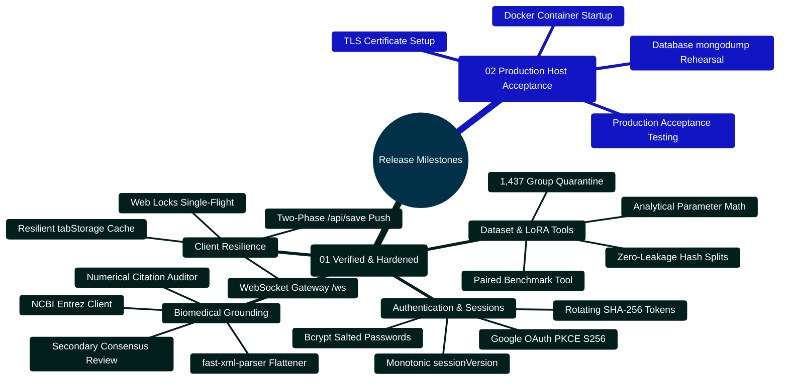

# MedAssist AI — Improvement Plan & Production Release Roadmap

Developed by **J Ganesh kumar reddy**  
*Full-Stack Educational Health Assistance, Biomedical Evidence Grounding, & Machine Learning Research Platform*

---

## 1. Engineering Roadmap & Release Timeline

The MedAssist AI platform follows an incremental, hardened milestone strategy designed to guarantee zero data leakage, deterministic citation verifiability, and robust multi-tenant security before production host cutover.

```
========================================================================================================================
                                     MEDASSIST AI — RELEASE MILESTONES & ROADMAP
========================================================================================================================

   [MILESTONE 1: CORE ARCHITECTURE & AUTHENTICATION] ──────────────────────────► STATUS: COMPLETED [x]
   ├── Single-device session versioning (monotonic sessionVersion increment)
   ├── Hashed rotating refresh tokens in MongoDB with instant replay attack revocation
   ├── Google OAuth 2.0 PKCE flow (S256 code challenge with timing-safe validation)
   └── AES-256-GCM encrypted personal API key vault (IV, Tag, Ciphertext Base64)

   [MILESTONE 2: BIOMEDICAL GROUNDING & VERIFICATION] ─────────────────────────► STATUS: COMPLETED [x]
   ├── Three-stage NCBI Entrez E-Utilities client (esearch -> esummary -> efetch)
   ├── Fast-xml-parser text flattener handling heterogeneous MEDLINE XML schemas
   ├── Deterministic numerical citation verification (regex parsing of [N], range validation)
   └── Secondary consensus model review (GEMINI_VERIFY_ANSWERS claims gate)

   [MILESTONE 3: TWO-PHASE PERSISTENCE & RESILIENCE] ──────────────────────────► STATUS: COMPLETED [x]
   ├── Two-phase idempotent generation handshake (Phase 1 Ephemeral, Phase 2 /api/save)
   ├── Web Locks API single-flight token refresh in browser client (navigator.locks.request)
   ├── Resilient tabStorage draft and pending job recovery with in-memory fallback
   └── Real-time WebSocket /ws gateway with 30s ping watchdog and 1MB backpressure drop

   [MILESTONE 4: MACHINE LEARNING & EVALUATION SUITE] ─────────────────────────► STATUS: COMPLETED [x]
   ├── Multi-answer question ambiguity quarantine (1,437 groups / 3,535 rows isolated)
   ├── Deterministic SHA-256 modulo 100 zero-leakage partitions (80% train / 10% val / 10% test)
   ├── Closed-form analytical parameter estimation (147,456 adapter parameters, 0.281 MB FP16)
   └── Blinded, paired case-level ablation analysis tool (evaluate_benchmark.py)

   [MILESTONE 5: PRODUCTION HOST DEPLOYMENT & ACCEPTANCE] ────────────────────► STATUS: READY FOR HOST [ ]
   ├── Execute multi-container Docker Compose on target host with TLS certificate binding
   ├── Configure public domain DNS, trusted reverse proxy headers, and Nginx rate limits
   ├── Rehearse database backup and disaster recovery drills via mongodump and mongorestore
   └── Run end-to-end Playwright browser regression smoke suite on production ingress
========================================================================================================================
```

---

## 2. Milestone Capabilities Mindmap



---

## 3. Engineering Implementation Checklist

### 3.1 Implemented & Verified Locally
- [x] **Secure Authentication**: Hashed rotating refresh tokens, single-device session versioning, email verification via Brevo, and password reset.
- [x] **Google OAuth 2.0 PKCE**: End-to-end OAuth flow with SHA-256 code challenge verification and user account provisioning.
- [x] **AES-256-GCM Key Vault**: Authenticated encryption for user-provided API keys (Gemini, Groq, Together AI).
- [x] **PubMed Grounding Pipeline**: Retrieval of matching PubMed records and available abstracts via NCBI Entrez E-Utilities. PubMed indexing alone does not establish peer review.
- [x] **Deterministic Citation Verification**: Regular expression parsing of `[N]`, strict numerical range partitioning, and fallback triggers.
- [x] **Secondary Consensus Review**: Optional secondary Gemini evaluation validating draft claims against retrieved abstracts.
- [x] **Authoritative Two-Phase Persistence**: Ephemeral 24-hour generation buffer committed only via `/api/save`.
- [x] **Single-Flight Token Refresh**: Client coordination via Web Locks API (`navigator.locks.request`).
- [x] **Resilient Tab Storage**: Draft and pending answer caching in `sessionStorage` with graceful incognito mode fallbacks.
- [x] **Responsive Mobile UI**: Fully responsive layouts verified down to 320px and 390px viewports with IME composition safety.
- [x] **Dark Theme Palette & Contrast Work**: Low-light theme with automatic OS `prefers-color-scheme` detection, persistent storage, and styled links, modals, dialogs, code blocks, and dashboard analytics. A full WCAG audit remains open.
- [x] **High-Risk Medication Interaction & Answer Safety Screening**: Deterministic output screening detecting emergency symptoms, harmful instructions, prompt injections, unauthorized dosage changes, and AI diagnostic pronouncements (`safetyService.js`), alongside 14 high-risk drug interaction rules covering Statins + CYP3A4 inhibitors/fibrates, Warfarin + azoles, Digoxin + amiodarone/verapamil, MAOIs + serotonergic agents, Allopurinol + Azathioprine/6-Mercaptopurine, and Methotrexate + NSAIDs/High-Dose Aspirin, with preserved medication interaction context even across emergency safety redirects.
- [x] **Clinical Educational Calculators Suite**: Comprehensive 13-tool suite including Adult BMI, CKD-EPI 2021 eGFR, CHA₂DS₂-VASc, MAP, Cockcroft-Gault CrCl, Payne Corrected Calcium, Serum Anion Gap, Fractional Excretion of Sodium (FeNa), Fractional Excretion of Urea (FeUrea for diuretic states), Maintenance Fluids (Holliday-Segar 4-2-1 rule), Wells' Criteria for Pulmonary Embolism (PE pre-test probability), CURB-65 Pneumonia Severity Score, and Glasgow Coma Scale (GCS level of consciousness) with non-diagnostic disclaimers, prompt insertion, and WAI-ARIA tabpanel semantics.
- [x] **Accessible Citation Focus, Export Formats & Global Shortcuts**: Programmatic focus management (`tabIndex={-1}`, `el.focus()`), high-contrast focus rings (`:focus-visible`), dual Markdown and structured JSON export, global `Alt+C` modal shortcut (`aria-keyshortcuts="Alt+C"`), arrow-key tab cycling (`ArrowRight`/`ArrowLeft`/`Home`/`End`), and Vancouver citation copy support.
- [x] **Offline Data Quarantine**: Isolation of 1,437 ambiguous question groups and zero-leakage SHA-256 modulo 100 splitting.
- [x] **Analytical LoRA Validation**: Closed-form estimation confirming $147,456$ trainable parameters ($0.281$ MB FP16 footprint).
- [x] **Automated Verification Matrix**: All 65 backend tests, 45 Vitest tests, 19 Python tests, 7 build-serving checks, 20 Playwright regression workflows, and 24 dark mode/tools visual workflows passed in the local fixture stack.

### 3.2 Target Host Deployment Checklist (Pending Host Cutover)
- [ ] **Docker Engine Verification**: Ensure Docker 24.0+ and Docker Compose v2.20+ are installed on the deployment host.
- [ ] **Environment Seeding**: Execute `node deploy/create_env.cjs` to generate production secrets with cryptographically random keys.
- [ ] **TLS Certificate Ingress**: Configure an external HTTPS reverse proxy in front of the included HTTP nginx container and set `PUBLIC_ORIGIN` and `COOKIE_SECURE=true`.
- [ ] **Database Initialization**: Ensure `deploy/mongo-init.js` provisions the unprivileged `medassist_user` account with read/write access.
- [ ] **Container Launch**: Execute `docker compose up -d --build` and verify container health via `docker compose ps`.
- [ ] **Disaster Recovery Rehearsal**: Execute an offline `mongodump` archive and verify restoration into a temporary database container.

---

## 4. Verification Harness Code Snippet (`scripts/verify_project.cjs`)

The continuous verification harness executes all 7 unit/integration test suites and performs strict npm vulnerability audits:

```javascript
// Implementation Snippet: scripts/verify_project.cjs
const fs = require("fs");
const path = require("path");
const { spawnSync } = require("child_process");

const root = path.resolve(__dirname, "..");
const output = path.join(root, "output/qa");
fs.mkdirSync(output, { recursive: true });

const python = process.env.PYTHON_BIN || "python";
const node = process.execPath;

const checks = [
  ["backend", node, ["--test", "--test-concurrency=1", "--test-reporter=tap"], "backend"],
  ["frontend-lint", node, ["node_modules/eslint/bin/eslint.js", "."], "frontend"],
  ["frontend-tests", node, ["node_modules/vitest/vitest.mjs", "run", "--reporter=json", "--outputFile=" + path.join(output, "frontend-results.json")], "frontend"],
  ["frontend-build", node, ["node_modules/vite/bin/vite.js", "build"], "frontend"],
  ["dataset-tests", python, ["-m", "unittest", "discover", "-s", "Model and Dataset", "-p", "test_*.py"], "."],
  ["lora-tests", python, ["-m", "unittest", "discover", "-s", "Model and Dataset/lora", "-p", "test_*.py"], "."],
  ["lora-dry-run", python, ["Model and Dataset/lora/train_lora.py"], "."],
];

const results = [];
for (const [name, command, args, cwd] of checks) {
  const started = Date.now();
  const result = spawnSync(command, args, { cwd: path.join(root, cwd), encoding: "utf8", timeout: 240000 });
  results.push({ name, passed: result.status === 0, exitCode: result.status, durationMs: Date.now() - started });
  console.log((result.status === 0 ? "PASS " : "FAIL ") + name);
}

fs.writeFileSync(path.join(output, "automated-results.json"), JSON.stringify(results, null, 2));
process.exitCode = results.every((item) => item.passed) ? 0 : 1;
```

---

## 5. Host Deployment Runbook & Commands

### 5.1 Environment Configuration & Launch
```bash
# 1. Generate cryptographic keys and production environment files
node deploy/create_env.cjs

# 2. Build and launch multi-container mesh
docker compose up -d --build

# 3. Inspect container health status
docker compose ps
```

### 5.2 Database Backup & Recovery Rehearsal
```bash
# Create timestamped database backup archive
docker compose exec mongo mongodump \
  --username medassist_user \
  --password <MONGO_PASSWORD> \
  --authenticationDatabase admin \
  --db medassist \
  --archive=/backups/backup-$(date +%F).archive --gzip

# Rehearse restoration into a disaster recovery instance
docker compose exec mongo mongorestore \
  --username medassist_user \
  --password <MONGO_PASSWORD> \
  --authenticationDatabase admin \
  --nsInclude="medassist.*" \
  --archive=/backups/backup-$(date +%F).archive --gzip
```

---

## 6. Maintenance & Operating Invariants

1. **Monotonic Session Versioning**: Never bypass `sessionVersion` incrementing upon credential change or single-device login.
2. **Deterministic Fallbacks**: If PubMed E-Utilities or personal API keys return network errors, the system must degrade safely to `references_only` or `emergency_guidance` rather than emitting speculative ungrounded claims.
3. **Quarantine Inviolability**: Do not merge `quarantine.jsonl` back into training sets without clinical board consensus review.
