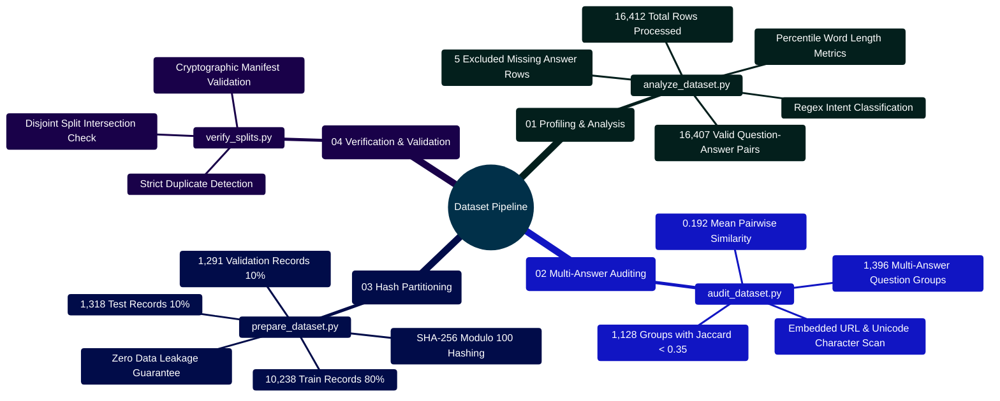

# MedAssist AI — Dataset Profiling, Auditing & Engineering Pipeline

Developed by **J Ganesh kumar reddy**

*Full-Stack Educational Health Assistance, Biomedical Evidence Grounding, & Machine Learning Research Platform*

---

## 1. Pipeline Architecture & Data Flow

The MedAssist AI dataset engineering pipeline operates via standalone, deterministic Python tools designed to profile, audit, clean, partition, and validate the medical question-and-answer dataset (`Final data set for llm based health assitance (1).csv`). Built exclusively with Python's standard library, these tools guarantee 100% reproducibility across environments without requiring GPU acceleration or external ML frameworks.

```
========================================================================================================================
                                     MEDASSIST AI — DATASET ENGINEERING PIPELINE
========================================================================================================================

                ┌─────────────────────────────────────────────────────────────┐
                │ Source Dataset: Final data set...csv (16,412 rows)          │
                └─────────────────────────────────────────────────────────────┘
                               │                               │
                               ▼                               ▼
                ┌─────────────────────────────┐ ┌─────────────────────────────┐
                │     analyze_dataset.py      │ │      audit_dataset.py       │
                │  (Descriptive Profiler)     │ │  (Multi-Answer Divergence)  │
                │  - Length metrics & P95     │ │  - Pairwise Jaccard metric  │
                │  - Question classifications │ │  - URL & non-ASCII scan     │
                └─────────────────────────────┘ └─────────────────────────────┘
                               │                               │
                               ▼                               ▼
                   reports/dataset_analysis.md     reports/dataset_audit.md
                   reports/dataset_analysis.json   reports/dataset_audit.json
                               │                               │
                               └──────────────┬────────────────┘
                                              ▼
                ┌─────────────────────────────────────────────────────────────┐
                │                     prepare_dataset.py                      │
                │  - Collapses whitespace & drops empty-answer rows           │
                │  - Filters truncated answers (< 5 words)                    │
                │  - Quarantines 1,437 multi-answer ambiguous questions       │
                │  - Deterministic SHA-256 Modulo 100 Hashing:                │
                │    ├── [0..79]  ──► train.csv / train.jsonl (80%)           │
                │    ├── [80..89] ──► validation.csv / validation.jsonl (10%) │
                │    └── [90..99] ──► test.csv / test.jsonl (10%)             │
                └─────────────────────────────────────────────────────────────┘
                                              │
                                              ▼
                ┌─────────────────────────────────────────────────────────────┐
                │ Target Split Directory: prepared/                           │
                │ ├── train.csv & train.jsonl (10,238 records)                │
                │ ├── validation.csv & validation.jsonl (1,291 records)       │
                │ ├── test.csv & test.jsonl (1,318 records)                   │
                │ ├── quarantine.jsonl (1,437 ambiguous groups / 3,535 rows)  │
                │ └── manifest.json (Cryptographic SHA-256 checksums)         │
                └─────────────────────────────────────────────────────────────┘
                                              │
                                              ▼
                ┌─────────────────────────────────────────────────────────────┐
                │                      verify_splits.py                       │
                │  - Asserts complete partition file presence                 │
                │  - Enforces zero cross-split question leakage               │
                │  - Validates 80% / 10% / 10% expected proportions           │
                └─────────────────────────────────────────────────────────────┘
========================================================================================================================
```

---

## 2. Dataset Pipeline Mindmap



---

## 3. Dataset Summary & Statistical Breakdown

| Dataset Metric | Count / Measured Value | Context & Clinical Significance |
|:---|---:|:---|
| **Total Processed Rows** | 16,412 | Complete corpus imported from source CSV |
| **Valid Pairs** | 16,407 | Pairs possessing non-null question and answer text |
| **Missing Answer Rows** | 5 | Dropped rows due to empty answer strings |
| **Unique Normalized Questions** | 14,345 | Distinct questions after whitespace normalization |
| **Question Length Median** | 7 words | Concise medical inquiries |
| **Question Length P95** | 11 words | Long-tail descriptive questions |
| **Answer Length Median** | 132 words | Structured informational guidance |
| **Answer Length P95** | 489 words | Detailed monographs and multi-symptom descriptions |
| **Multi-Answer Question Groups** | 1,396 | Questions associated with multiple distinct answers |
| **Divergent Groups (Jaccard < 0.35)** | 1,128 | Question groups exhibiting conflicting clinical statements |
| **Quarantined Rows** | 3,535 | Excluded from training to protect gradient descent |

---

## 4. Key Implementation Code Snippets

### 4.1 Intent Classification Engine (`analyze_dataset.py`)

```python
# Implementation Snippet: Model and Dataset/analyze_dataset.py
import re

QUESTION_TYPES = (
    ("symptoms", re.compile(r"\b(?:symptoms?|signs?)\b", re.I)),
    ("causes", re.compile(r"\b(?:causes?|etiology|why)\b", re.I)),
    ("treatment", re.compile(r"\b(?:treat|treatment|therapy|medicine|drug)\b", re.I)),
    ("diagnosis", re.compile(r"\b(?:diagnos|tests?|screening)\b", re.I)),
    ("prevention", re.compile(r"\b(?:prevent|prevention|avoid)\b", re.I)),
    ("risk", re.compile(r"\b(?:risk|complications?|side effects?)\b", re.I)),
    ("prognosis", re.compile(r"\b(?:prognosis|outlook|recover|survival)\b", re.I)),
    ("definition", re.compile(r"^what\s+(?:is|are)\b", re.I)),
)

def classify_question(question: str) -> str:
    for label, pattern in QUESTION_TYPES:
        if pattern.search(question):
            return label
    return "other"
```

### 4.2 Jaccard Divergence Calculation (`audit_dataset.py`)

```python
# Implementation Snippet: Model and Dataset/audit_dataset.py
TOKEN_PATTERN = re.compile(r"[a-z][a-z'-]+")

def token_set(value: str) -> set[str]:
    return set(TOKEN_PATTERN.findall(value.casefold()))

def jaccard_similarity(left: str, right: str) -> float:
    left_tokens = token_set(left)
    right_tokens = token_set(right)
    if not left_tokens and not right_tokens:
        return 1.0
    union = left_tokens | right_tokens
    return len(left_tokens & right_tokens) / len(union) if union else 0.0
```

### 4.3 Zero-Leakage Hash Partitioning (`prepare_dataset.py`)

```python
# Implementation Snippet: Model and Dataset/prepare_dataset.py
import hashlib

def split_hash(key_str: str) -> int:
    """Returns integer 0..99 from SHA-256 digest to enforce deterministic splits."""
    return int(hashlib.sha256(key_str.encode("utf-8")).hexdigest()[:8], 16) % 100

def assign_split(question_key: str) -> str:
    bucket = split_hash(question_key)
    if bucket < 80:
        return "train"
    elif bucket < 90:
        return "validation"
    else:
        return "test"
```

### 4.4 Disjoint Partition Leakage Validation (`verify_splits.py`)

```python
# Implementation Snippet: Model and Dataset/verify_splits.py
def assert_zero_leakage(train_keys, val_keys, test_keys):
    train_val = train_keys.intersection(val_keys)
    train_test = train_keys.intersection(test_keys)
    val_test = val_keys.intersection(test_keys)

    if train_val or train_test or val_test:
        raise AssertionError(
            f"Cross-partition leakage detected! "
            f"Train/Val: {len(train_val)}, Train/Test: {len(train_test)}, Val/Test: {len(val_test)}"
        )
    print("Zero-leakage proof confirmed: All evaluation partitions are strictly disjoint.")
```

---

## 5. Execution Commands & Pipeline Verification

```powershell
# 1. Profile dataset lengths, word statistics, and question intent
python "Model and Dataset/analyze_dataset.py"

# 2. Audit multi-answer semantic divergence and content flags
python "Model and Dataset/audit_dataset.py"

# 3. Clean records, quarantine ambiguous groups, and construct 80/10/10 splits
python "Model and Dataset/prepare_dataset.py"

# 4. Verify split completeness, record counts, and zero data leakage
python "Model and Dataset/verify_splits.py"

# 5. Execute all dataset automated unit tests
python -m unittest discover -s "Model and Dataset" -p "test_*.py"
```

---

## 6. Data Hygiene Invariants

1. **Deterministic Hashing**: Partitions are never assigned randomly. Hashing the normalized question string guarantees identical assignments across every run.
2. **Ambiguity Isolation**: Questions with contradictory answer texts are stored in `quarantine.jsonl` and excluded from model training to prevent conflicting gradient updates.
3. **Immutability of Source**: The source CSV is treated as read-only; all outputs are written to dedicated `reports/` and `prepared/` directories.
