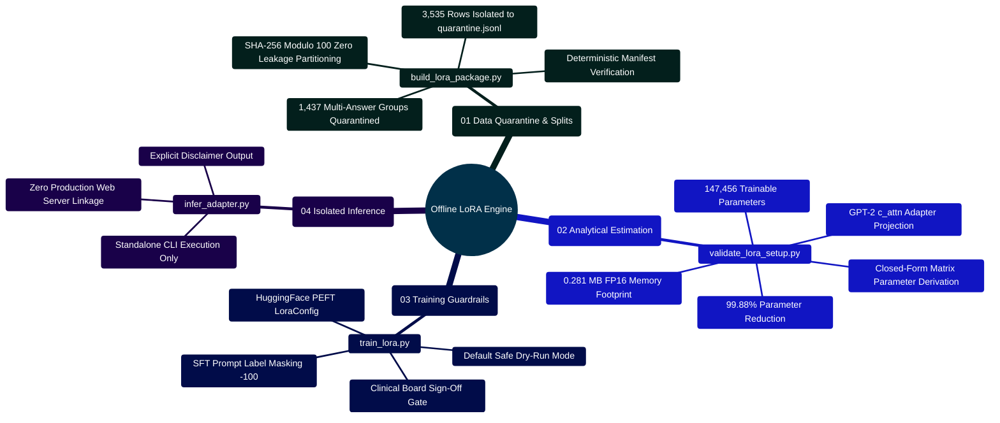

# MedAssist AI — Offline LoRA Parameter-Efficient Fine-Tuning Package

Developed by **J Ganesh kumar reddy**

*Full-Stack Educational Health Assistance, Biomedical Evidence Grounding, & Machine Learning Research Platform*

---

## 1. Architectural Role & Execution Isolation

The operational MedAssist AI web application never imports or executes these machine learning training routines. The offline LoRA package is strictly an isolated research and data engineering scaffold designed for:

1. **Dataset Integrity Auditing**: Profiling the raw medical dataset and isolating ambiguous records.
2. **Ambiguity Quarantine**: Isolating $1,437$ question groups ($3,535$ rows) that exhibit contradictory or divergent answers into `quarantine.jsonl`.
3. **Zero-Leakage Partitioning**: Constructing reproducible, deterministic training, validation, and test splits using cryptographic SHA-256 modulo 100 hashing.
4. **Closed-Form Parameter Estimation**: Analytically calculating trainable parameters and memory footprints without initializing base models or consuming GPU resources.
5. **Review-Gated SFT Scaffold**: Enforcing clinical board sign-off and license verification gates before any neural network gradient backpropagation can take place.

> [!IMPORTANT]
> Running data preparation or dry-run inspection **does not download base model weights, allocate GPU VRAM, train neural networks, or emit production adapter checkpoints**. GPT-2 is retained purely as a tiny, reproducible historical baseline for parameter math, not as a clinically certified model.

```
========================================================================================================================
                                     MEDASSIST AI — OFFLINE LoRA PIPELINE ARCHITECTURE
========================================================================================================================

      ┌─────────────────────────────────────────────────────────────┐
      │ Raw Medical Dataset: Final data set...csv (16,412 rows)     │
      └─────────────────────────────────────────────────────────────┘
                                     │
                                     ▼
      ┌─────────────────────────────────────────────────────────────┐
      │ 1. AMBIGUITY QUARANTINE & PARTITIONING                      │
      │    (build_lora_package.py)                                  │
      │    ├── Scans for question keys with divergent answer variants│
      │    ├── Quarantines 1,437 groups (3,535 rows) -> quarantine   │
      │    ├── Partitions clean pairs via SHA-256 modulo 100:       │
      │    │   ├── [0..79]  ──► train.jsonl (80% / 10,238 records)   │
      │    │   ├── [80..89] ──► validation.jsonl (10% / 1,291 recs) │
      │    │   └── [90..99] ──► test.jsonl (10% / 1,318 records)    │
      │    └── Writes cryptographically verified manifest.json       │
      └─────────────────────────────────────────────────────────────┘
                                     │
                                     ▼
      ┌─────────────────────────────────────────────────────────────┐
      │ 2. CLOSED-FORM ANALYTICAL PARAMETER ESTIMATION               │
      │    (validate_lora_setup.py)                                 │
      │    ├── Evaluates low-rank bottleneck: d_model * r * 2 * L   │
      │    ├── GPT-2 target c_attn: 768 * 8 * 2 * 12 = 147,456 params│
      │    ├── Evaluates FP16 weight footprint: 0.281 MB storage     │
      │    └── Emits structured report: reports/lora_validation.json │
      └─────────────────────────────────────────────────────────────┘
                                     │
                                     ▼
      ┌─────────────────────────────────────────────────────────────┐
      │ 3. REVIEW-GATED TRAINING SCAFFOLD & INFERENCE               │
      │    (train_lora.py & infer_adapter.py)                       │
      │    ├── Default: Dry-run hash verification & manifest audit   │
      │    ├── Gate: --train requires clinical approval signature   │
      │    ├── Tokenization: SFT prompt label masking (-100 tokens) │
      │    └── Inference: CLI-only adapter execution (never web)    │
      └─────────────────────────────────────────────────────────────┘
========================================================================================================================
```

---

## 2. LoRA Pipeline Capabilities Mindmap



---

## 3. Mathematical Foundations of Low-Rank Adaptation (LoRA)

Low-Rank Adaptation freezes the pre-trained model parameter matrix $W_0 \in \mathbb{R}^{d \times k}$ and constrains parameter updates by decomposing the intrinsic delta weight matrix $\Delta W$ into two low-rank matrices $B \in \mathbb{R}^{d \times r}$ and $A \in \mathbb{R}^{r \times k}$, where rank $r \ll \min(d, k)$:

$$W = W_0 + \Delta W = W_0 + \frac{\alpha}{r} B A$$

```
========================================================================================================================
                                     FORWARD PASS & GRADIENT BACKPROPAGATION FLOW
========================================================================================================================

                         ┌──────────────────────────┐
                         │   Frozen Base Weights    │
      Input Vector x ──┬─►│           W0             │─────────────────────────(+)──► Output Vector h
                       │ │         (d x k)          │                          ▲
                       │ └──────────────────────────┘                          │
                       │                                                       │
                       │ ┌──────────────────────────┐     ┌─────────────────┐  │
                       │ │   Down-Projection A      │     │  Up-Proj B      │  │
                       └─►│   (Dimension r x k)      │────►│  (Dimension d x r)│──┘
                         │   Gaussian ~ N(0, 1/r)   │     │  Initialized = 0│  Scaled by (alpha / r)
                         └──────────────────────────┘     └─────────────────┘
========================================================================================================================
```

### 3.1 Closed-Form Parameter Calculation
For GPT-2 (`gpt2`), the projection layers are combined into a single matrix $W_{\text{c\_attn}} \in \mathbb{R}^{768 \times 2304}$ projecting the hidden state into Query, Key, and Value vectors.
Applying LoRA to `c_attn` with rank $r = 8$:
- Matrix $A$: $8 \times 768 = 6,144$ parameters per layer.
- Matrix $B$: $768 \times 8 = 6,144$ parameters per layer.
- Parameters per layer: $6,144 + 6,144 = 12,288$ parameters.
- Total adapter parameters across all 12 transformer layers:
  $$P_{\text{adapter}} = 12 \times 12,288 = \mathbf{147,456 \text{ parameters}}$$

Compared to GPT-2's $124,439,808$ baseline parameters, the adapter trains only **0.118%** of the model, achieving a **99.88% parameter reduction**.

### 3.2 Storage Footprint
$$\text{Storage}_{\text{FP16}} = \frac{147,456 \times 2 \text{ bytes}}{1,048,576 \text{ bytes/MB}} = \mathbf{0.28125 \text{ MB}} \approx 288 \text{ KB}$$

---

## 4. Key Implementation Code Snippets

### 4.1 Ambiguity Quarantine & Hash Partitioning (`build_lora_package.py`)

```python
# Implementation Snippet: Model and Dataset/lora/build_lora_package.py
import hashlib
from collections import defaultdict

def split_hash(key_str: str) -> int:
    """Calculates a deterministic 0..99 integer bucket from a normalized question key."""
    return int(hashlib.sha256(key_str.encode("utf-8")).hexdigest()[:8], 16) % 100

def partition_and_quarantine(records):
    grouped = defaultdict(list)
    for r in records:
        grouped[r["question"].strip().lower()].append(r)

    clean_records = {}
    quarantine_records = []

    for q_key, variants in grouped.items():
        distinct_answers = {v["answer"].strip() for v in variants}
        if len(distinct_answers) > 1:
            # Contradictory or divergent answers isolated to protect gradient descent
            quarantine_records.extend(variants)
        else:
            clean_records[q_key] = variants

    train, val, test = [], [], []
    for q_key, pairs in clean_records.items():
        bucket = split_hash(q_key)
        if bucket < 80:
            train.extend(pairs)
        elif bucket < 90:
            val.extend(pairs)
        else:
            test.extend(pairs)

    return train, val, test, quarantine_records
```

### 4.2 Closed-Form Parameter Math (`validate_lora_setup.py`)

```python
# Implementation Snippet: Model and Dataset/lora/validate_lora_setup.py
def estimate_adapter_parameters(hidden_size: int, layers: int, projections_per_layer: int, rank: int) -> int:
    """Calculate the exact number of trainable parameters in the LoRA matrices.

    Args:
        hidden_size: Transformer embedding / hidden dimension H.
        layers: Total transformer blocks L.
        projections_per_layer: Count of targeted linear projection heads P.
        rank: Low-rank dimension R.

    Returns:
        int: Trainable parameter count.
    """
    if min(hidden_size, layers, projections_per_layer, rank) <= 0:
        raise ValueError("All estimator inputs must be greater than zero")
    return layers * projections_per_layer * 2 * hidden_size * rank

def build_report(config_path: Path | None, hidden_size: int, layers: int) -> dict[str, object]:
    """Assemble a comprehensive analytical report of the LoRA configuration."""
    settings, _ = load_lora_config(config_path)
    estimated_parameters = estimate_adapter_parameters(
        hidden_size, layers, len(settings.target_modules), settings.rank
    )
    return {
        "valid": True,
        "training_performed": False,
        "base_model": settings.base_model,
        "task_type": settings.task_type,
        "rank": settings.rank,
        "alpha": settings.alpha,
        "dropout": settings.dropout,
        "target_modules": list(settings.target_modules),
        "max_sequence_length": settings.max_sequence_length,
        "estimate_assumptions": {
            "hidden_size": hidden_size,
            "layers": layers,
            "projections_per_layer": len(settings.target_modules),
        },
        "estimated_adapter_parameters": estimated_parameters,
        "estimated_fp16_megabytes": round(estimated_parameters * 2 / 1_048_576, 3),
        "note": "Analytical estimate only; no model was downloaded or trained.",
    }
```

### 4.3 SFT Prompt Label Masking (`train_lora.py`)

```python
# Implementation Snippet: Model and Dataset/lora/train_lora.py
def tokenize_and_mask_prompt(record, tokenizer, max_length=512):
    prompt_text = f"Question: {record['question']}\nAnswer: "
    full_text = prompt_text + record['answer']

    prompt_ids = tokenizer(prompt_text, truncation=True, max_length=max_length)["input_ids"]
    full_ids = tokenizer(full_text, truncation=True, max_length=max_length)["input_ids"]

    # Label masking: Assign -100 to all prompt tokens so loss is computed solely on the answer
    labels = [-100] * len(prompt_ids) + full_ids[len(prompt_ids):]
    return {
        "input_ids": full_ids,
        "labels": labels
    }
```

### 4.4 Air-Gapped CLI Inference (`infer_adapter.py`)

```python
# Implementation Snippet: Model and Dataset/lora/infer_adapter.py
from peft import AutoPeftModelForCausalLM
from transformers import AutoTokenizer

def run_isolated_adapter(adapter_dir, user_query):
    model = AutoPeftModelForCausalLM.from_pretrained(adapter_dir)
    tokenizer = AutoTokenizer.from_pretrained(adapter_dir)
    prompt = f"Question: {user_query}\nAnswer: "
    tokens = tokenizer(prompt, return_tensors="pt")
    output = model.generate(**tokens, max_new_tokens=150, do_sample=False)
    response = tokenizer.decode(output[0][tokens["input_ids"].shape[1]:], skip_special_tokens=True)
    return response
```

---

## 5. Execution Commands & Operational Runbook

```powershell
# 1. Quarantine ambiguous records and construct deterministic splits
python "Model and Dataset/lora/build_lora_package.py"

# 2. Run safe dry-run inspection (verifies manifest hashes, requires zero GPU)
python "Model and Dataset/lora/train_lora.py"

# 3. Calculate analytical parameter and storage metrics
python "Model and Dataset/lora/validate_lora_setup.py" --output "Model and Dataset/reports/lora_validation.json"

# 4. Run automated test suites
python -m unittest discover -s "Model and Dataset/lora" -p "test_*.py"

# 5. Execute isolated CLI inference (optional, research only)
python "Model and Dataset/lora/infer_adapter.py" --adapter "output/adapters/gpt2-med" --prompt "What is hypertension?"
```

---

## 6. Safety & Clinical Invariants

1. **Isolation from Web Server**: No API endpoint in Express connects to or imports from `Model and Dataset/lora/`.
2. **Clinical Sign-Off Required**: `train_lora.py` explicitly rejects execution unless the `--train` flag is passed and clinical approval metadata is verified.
3. **Loss Integrity**: Prompt tokens are always masked with `-100` to prevent catastrophic memorization of user phrasing.
