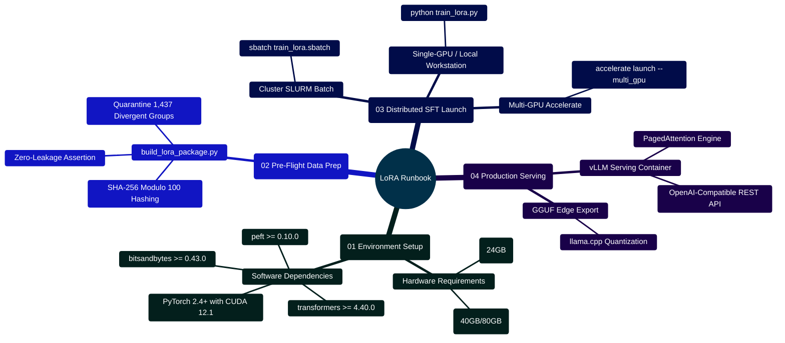

# MedAssist AI — Machine Learning Fine-Tuning & LoRA Production Runbook

Developed by **J Ganesh kumar reddy**  
*Full-Stack Educational Health Assistance, Biomedical Evidence Grounding, & Machine Learning Research Platform*

---

## 1. Executive Operations Summary & Training Topology

This operational runbook provides production-ready procedures for fine-tuning Parameter-Efficient Low-Rank Adapters (LoRA) and 4-bit Quantized Adapters (QLoRA) on clinical question-and-answer corpora. Training is strictly decoupled from the live web application; adapters are trained, evaluated, and verified offline prior to inference deployment.

```
========================================================================================================================
                          MEDASSIST AI — PRODUCTION FINE-TUNING PIPELINE
========================================================================================================================

    [ SOURCE RAW CORPUS: Final data set for llm based health assitance (1).csv ]
                                │
                                │ 1. Ingestion & Quality Profiling
                                ▼
    ┌────────────────────────────────────────────────────────────────────────────────────────────────────────────────┐
    │                                TIER 1: DATASET HYGIENE & AMBIGUITY QUARANTINE                                  │
    │  - Script: Model and Dataset/lora/build_lora_package.py                                                        │
    │  - Quarantine Isolation: 1,437 ambiguous question groups (3,535 rows) moved to `quarantine.jsonl`             │
    │  - Deterministic Zero-Leakage Split: SHA-256 modulo 100 hashing on normalized questions                       │
    │  - Generates: `train.jsonl` (80%), `val.jsonl` (10%), `test.jsonl` (10%)                                       │
    └────────────────────────────────────────────────────────────────────────────────────────────────────────────────┘
                                │
                                │ 2. Parameter Math & Review Gate Check
                                ▼
    ┌────────────────────────────────────────────────────────────────────────────────────────────────────────────────┐
    │                                TIER 2: CLOSED-FORM PARAMETER ESTIMATION                                        │
    │  - Script: Model and Dataset/lora/validate_lora_setup.py                                                       │
    │  - Closed-Form Equation: P = L * P_heads * 2 * d_model * r = 147,456 params (0.281 MB FP16 for GPT-2)          │
    │  - SFT Gate Check: Requires clinical and license review approvals before actual GPU execution                 │
    └────────────────────────────────────────────────────────────────────────────────────────────────────────────────┘
                                │
                                │ 3. Multi-GPU Distributed SFT Training
                                ▼
    ┌────────────────────────────────────────────────────────────────────────────────────────────────────────────────┐
    │                                TIER 3: DISTRIBUTED TRAINING CLUSTER (DDP / Accelerate)                         │
    │  - Framework: Hugging Face PEFT + Transformers + bitsandbytes                                                  │
    │  - QLoRA NF4 Double Quantization + Paged AdamW 8-bit Optimizer                                                 │
    │  - Prompt Token Loss Masking: labels = [-100] * prompt_len + target_tokens                                     │
    │  - Saves Adapter Artifact: `adapter_model.safetensors` + `adapter_config.json`                                 │
    └────────────────────────────────────────────────────────────────────────────────────────────────────────────────┘
                                │
                                │ 4. Offline Inference & Edge Serving
                                ▼
    ┌────────────────────────────────────────────────────────────────────────────────────────────────────────────────┐
    │                                TIER 4: VALIDATION & DEPLOYMENT                                                 │
    │  - Evaluation Benchmark: Model and Dataset/evaluate_benchmark.py                                               │
    │  - Standalone Test CLI: Model and Dataset/lora/infer_adapter.py                                                │
    │  - Serving Options: Local vLLM instance (:8000/v1) or Ollama GGUF export                                       │
    └────────────────────────────────────────────────────────────────────────────────────────────────────────────────┘
========================================================================================================================
```

---

## 2. Fine-Tuning Operations Mindmap



---

## 3. Step-by-Step Training Execution Procedures

### Step 1: Environment Provisioning
Ensure CUDA drivers and virtual environment are initialized:
```bash
# Provision isolated Python virtual environment
python3 -m venv .venv
source .venv/bin/activate  # On Windows: .venv\Scripts\Activate.ps1

# Install training dependencies
pip install -r "Model and Dataset/lora/requirements-training.txt"
pip install -r "Model and Dataset/lora/requirements-qlora.txt"
```

### Step 2: Dataset Partitioning & Quarantine
Execute deterministic zero-leakage hash partitioning:
```bash
python "Model and Dataset/lora/build_lora_package.py"
python "Model and Dataset/verify_splits.py"
```

### Step 3: SFT Training Launch (Multi-GPU via Accelerate)
For multi-GPU clusters (e.g., $4 \times \text{NVIDIA A100}$):
```bash
accelerate launch \
  --multi_gpu \
  --num_processes=4 \
  --mixed_precision=bf16 \
  "Model and Dataset/lora/train_lora.py" \
  --train \
  --clinical-review-approved \
  --license-review-approved \
  --reviewer "Qualified Biomedical ML Reviewer"
```

---

## 4. Production SLURM Batch Script (`train_lora.sbatch`)

For academic and enterprise HPC environments:

```bash
#!/usr/bin/env bash
#SBATCH --job-name=medassist-lora-train
#SBATCH --nodes=1
#SBATCH --ntasks-per-node=1
#SBATCH --cpus-per-task=16
#SBATCH --gres=gpu:a100:4
#SBATCH --time=12:00:00
#SBATCH --mem=128GB
#SBATCH --partition=gpu
#SBATCH --output=logs/slurm-%j.out
#SBATCH --error=logs/slurm-%j.err

set -euo pipefail

module load cuda/12.1
source /opt/medassist-env/bin/activate

echo "[$(date)] Starting Distributed LoRA Training Job on $SLURM_NODELIST"

accelerate launch \
  --num_processes=4 \
  --mixed_precision=bf16 \
  "Model and Dataset/lora/train_lora.py" \
  --train \
  --clinical-review-approved \
  --license-review-approved \
  --reviewer "Institutional Clinical ML Reviewer"

echo "[$(date)] LoRA Fine-Tuning Completed Successfully!"
```

---

## 5. Serving Trained Adapters with vLLM

After training, serve the resulting adapter artifact using an OpenAI-compatible REST API:

```bash
# Launch vLLM with dynamic LoRA adapter support
python3 -m vllm.entrypoints.openai.api_server \
  --model "meta-llama/Meta-Llama-3-8B-Instruct" \
  --enable-lora \
  --lora-modules "medassist-adapter=Model and Dataset/lora/modern_adapter" \
  --port 8000 \
  --dtype bfloat16 \
  --max-model-len 2048
```

Developers can configure MedAssist AI to connect to this local instance by selecting **Local Model** in `AISettings.jsx` with endpoint `http://127.0.0.1:8000/v1/chat/completions`.
