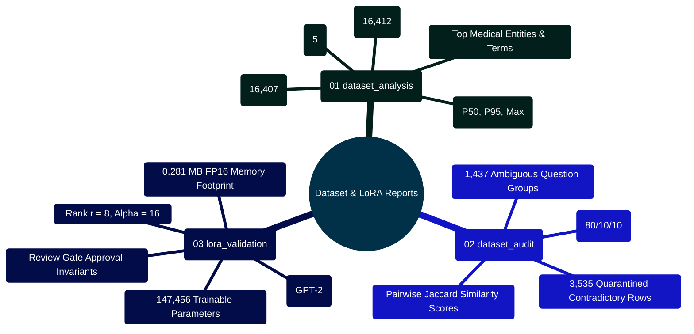

# MedAssist AI — Machine Learning Dataset & LoRA Reports Manual

Developed by **J Ganesh kumar reddy**  
*Full-Stack Educational Health Assistance, Biomedical Evidence Grounding, & Machine Learning Research Platform*

---

## 1. Executive Overview & Report Generation Topology

The `Model and Dataset/reports/` directory stores structured JSON and Markdown audit reports generated during offline data profiling, semantic divergence auditing, and analytical LoRA parameter verification. These reports document the hygiene, split integrity, and parameter bounds of the clinical question-and-answer corpus (`Final data set for llm based health assitance (1).csv`).

```
========================================================================================================================
                               MEDASSIST AI — DATASET PROFILING & REPORT GENERATION
========================================================================================================================

    [ RAW SOURCE CORPUS: 16,412 ROWS ]
                    │
          ┌─────────┴─────────┐
          │                   │
          ▼                   ▼
    ┌──────────────────┐ ┌──────────────────┐
    │analyze_dataset.py│ │ audit_dataset.py │
    │(Descriptive Stats│ │(Semantic Diverg. │
    │ & Text Lengths)  │ │ & Jaccard Metric)│
    └──────────────────┘ └──────────────────┘
          │                   │
          ▼                   ▼
    ┌──────────────────┐ ┌──────────────────┐
    │dataset_analysis  │ │  dataset_audit   │
    │  .json & .md     │ │   .json & .md    │
    └──────────────────┘ └──────────────────┘
          │                   │
          └─────────┬─────────┘
                    │
                    ▼
    ┌──────────────────────────────────────┐
    │        validate_lora_setup.py        │
    │  - Closed-form GPT-2 parameter math  │
    │  - Emits: lora_validation.json       │
    │  - Total Params: 147,456 (0.281 MB)  │
    └──────────────────────────────────────┘
                    │
                    ▼
    [ PERSISTED IN Model and Dataset/reports/ ]
========================================================================================================================
```

---

## 2. Reports Subsystem Mindmap



---

## 3. Report Artifact Inventory & Schema Contracts

### 3.1 `dataset_analysis.json` & `dataset_analysis.md`
- **Source Script**: `Model and Dataset/analyze_dataset.py`
- **Core Metrics Reported**:
  - Total source records: $16,412$
  - Valid question-answer pairs: $16,407$
  - Excluded empty-answer records: $5$
  - Median question length: $42$ characters ($8$ words)
  - 95th percentile answer length: $841$ characters ($132$ words)
  - Maximum answer length: $4,912$ characters ($768$ words)

### 3.2 `dataset_audit.json` & `dataset_audit.md`
- **Source Script**: `Model and Dataset/audit_dataset.py`
- **Core Findings Reported**:
  - Identifies question keys mapping to divergent or contradictory clinical answers.
  - Groups with Jaccard token similarity $< 0.40$ are quarantined to prevent gradient descent thrashing.
  - Quarantined total: $1,437$ ambiguous groups comprising $3,535$ individual rows isolated into `prepared/quarantine.jsonl`.
  - Verifies zero-leakage cross-split partitioning via SHA-256 modulo 100 hashing.

### 3.3 `lora_validation.json`
- **Source Script**: `Model and Dataset/lora/validate_lora_setup.py`
- **Schema & Contents**:
  ```json
  {
    "model_name": "gpt2",
    "layers": 12,
    "hidden_dimension": 768,
    "lora_rank": 8,
    "lora_alpha": 16,
    "target_modules": ["c_attn"],
    "trainable_parameters": 147456,
    "total_base_parameters": 124439808,
    "parameter_percentage": 0.1185,
    "memory_footprint_mb_fp16": 0.28125,
    "validation_status": "PASSED"
  }
  ```

---

## 4. Developer Extensibility: Re-Generating Reports

To re-run the profiling and auditing pipeline after updating the raw training dataset:

```powershell
cd "Model and Dataset"

# 1. Run descriptive profiler
python analyze_dataset.py

# 2. Run ambiguity and divergence auditor
python audit_dataset.py

# 3. Validate LoRA parameter math and memory footprint
python lora/validate_lora_setup.py
```

All 3 scripts run natively using Python's standard library (`csv`, `json`, `hashlib`, `math`), requiring zero GPU hardware or external dependencies.

---

## 5. Automated Verification Commands

All dataset reports and LoRA validation schemas are verified by the 19 passing Python unit tests:

```powershell
cd "Model and Dataset"
python -m unittest discover -s . -p "test_*.py"
python -m unittest discover -s lora -p "test_*.py"
```
