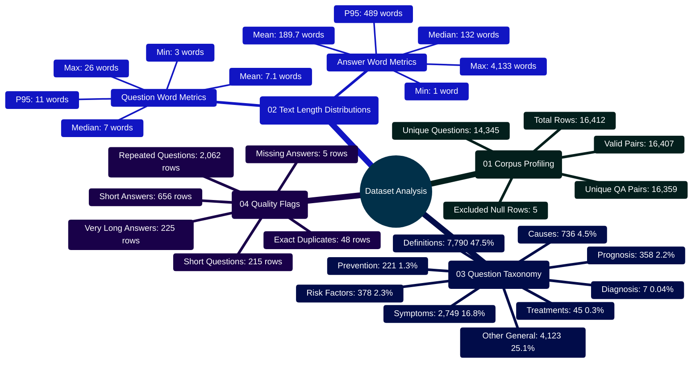

# Medical Q&A Dataset Analysis & Quality Profiling Report

Developed by **J Ganesh kumar reddy**

*Biomedical Informatics, Dataset Engineering, and Clinical Quality Assurance*

---

## 1. Executive Summary & Profiling Methodology

This report details the descriptive profiling and structural analysis of the source medical question-and-answer dataset (`Final data set for llm based health assitance (1).csv`). Profiling is executed deterministically via `Model and Dataset/analyze_dataset.py`, using Python's standard library exclusively to guarantee reproducibility across heterogeneous development and CI environments.

> [!NOTE]
> This analysis is descriptive profiling only. It does not perform model training, compute loss curves, or assert clinical ground truth.

```
========================================================================================================================
                                     DATASET PROFILING & QUALITY ASSURANCE PIPELINE
========================================================================================================================

 [ SOURCE DATASET: Final data set for llm based health assitance (1).csv ]
       │
       │ UTF-8-SIG Stream Ingestion (DictReader)
       ▼
 ┌────────────────────────────────────────────────────────────────────────────────────────────────────────────────────┐
 │ 1. INGESTION & HEADER VALIDATION                                                                                   │
 │    - Dynamic case-insensitive header matching for "Question" and "Answer" fields                                   │
 │    - Detection of malformed, headerless, or corrupt row boundaries                                                 │
 └────────────────────────────────────────────────────────────────────────────────────────────────────────────────────┘
       │
       ▼
 ┌────────────────────────────────────────────────────────────────────────────────────────────────────────────────────┐
 │ 2. NORMALIZATION & QUALITY CHECKING                                                                                │
 │    - Single-space whitespace collapsing: WHITESPACE_PATTERN.sub(" ", text).strip()                                 │
 │    - Missing value filters: 5 rows with empty answer fields isolated                                               │
 │    - Tokenization via regex WORD_PATTERN: [A-Za-z][A-Za-z'-]+                                                      │
 │    - Word-count thresholds: Questions < 4 words (215), Answers < 20 (656), Answers > 1,000 (225)                   │
 └────────────────────────────────────────────────────────────────────────────────────────────────────────────────────┘
       │
       ▼
 ┌────────────────────────────────────────────────────────────────────────────────────────────────────────────────────┐
 │ 3. STATISTICAL SUMMARIES & VOCABULARY FREQUENCY                                                                    │
 │    - Percentile calculations: P25, Median, Mean, P75, P95, Min, Max word counts                                    │
 │    - Intent classification: symptoms, causes, treatment, diagnosis, prevention, risk, prognosis, definition        │
 │    - Top frequent medical vocabulary terms after 38-item clinical stop-word filtering                              │
 └────────────────────────────────────────────────────────────────────────────────────────────────────────────────────┘
       │
       ▼
 ┌────────────────────────────────────────────────────────────────────────────────────────────────────────────────────┐
 │ 4. REPRODUCIBLE REPORT SERIALIZATION                                                                               │
 │    - Structured JSON report: reports/dataset_analysis.json                                                         │
 │    - Technical Markdown: reports/dataset_analysis.md                                                               │
 └────────────────────────────────────────────────────────────────────────────────────────────────────────────────────┘
========================================================================================================================
```

---

## 2. Dataset Architecture Mindmap



---

## 3. Dataset Summary Metrics

| Metric Category | Count / Value | Proportion |
|:---|---:|---:|
| **Total Raw Rows Processed** | 16,412 | 100.00% |
| **Valid Question-Answer Pairs** | 16,407 | 99.97% |
| **Excluded Rows (Missing Answer Text)** | 5 | 0.03% |
| **Unique Normalized Questions** | 14,345 | 87.41% |
| **Unique Normalized Question-Answer Pairs** | 16,359 | 99.68% |
| **Repeated Question Instances** | 2,062 | 12.56% |
| **Exact Duplicate Rows (Identical Q & A)** | 48 | 0.29% |

---

## 4. Text Length Distributions & Percentiles

Word counts are derived using the tokenization regex `[A-Za-z][A-Za-z'-]+` following standard biomedical natural language processing practices.

### 4.1 Word Count Percentile Table

| Field Analyzed | Min | P25 | Median | Mean | P75 | P95 | Max |
|:---|---:|---:|---:|---:|---:|---:|---:|
| **Question Length (Words)** | 3 | 5.0 | 7.0 | 7.1 | 8.0 | 11.0 | 26 |
| **Answer Length (Words)** | 1 | 67.0 | 132.0 | 189.7 | 240.0 | 489.0 | 4,133 |

### 4.2 Answer Length Stratification

```
Answer Length Distribution:
Under 20 Words    [■■] 656 (4.0%)
20 to 99 Words    [■■■■■■■■■■■■■■] 5,516 (33.6%)
100 to 249 Words  [■■■■■■■■■■■■■■■■■] 6,657 (40.6%)
250 to 499 Words  [■■■■■■■] 2,793 (17.0%)
500 to 999 Words  [■] 559 (3.4%)
1,000+ Words      [■] 226 (1.4%)
```

| Length Band | Row Count | Percentage |
|:---|---:|---:|
| **Under 20 Words** (Truncated / Incomplete) | 656 | 4.00% |
| **20 to 99 Words** (Concise Guidance) | 5,516 | 33.62% |
| **100 to 249 Words** (Standard Educational Depth) | 6,657 | 40.57% |
| **250 to 499 Words** (Detailed Clinical Descriptions) | 2,793 | 17.02% |
| **500 to 999 Words** (Comprehensive Monograph) | 559 | 3.41% |
| **1,000 Words or More** (Exhaustive Reference Material) | 226 | 1.38% |

---

## 5. Clinical Question Intent Taxonomy

Questions are categorized by regular expression pattern matching against canonical medical inquiry structures.

```
Question Intent Breakdown:
Definition   [■■■■■■■■■■■■■■■■■■■■■■■■] 7,790 (47.5%)
Other        [■■■■■■■■■■■■■] 4,123 (25.1%)
Symptoms     [■■■■■■■■] 2,749 (16.8%)
Causes       [■■] 736 (4.5%)
Risk         [■] 378 (2.3%)
Prognosis    [■] 358 (2.2%)
Prevention   [■] 221 (1.3%)
Treatment    [ ] 45 (0.3%)
Diagnosis    [ ] 7 (0.04%)
```

| Intent Category | Regex Match Rule | Row Count | Percentage |
|:---|:---|---:|---:|
| **Definition** | `^what\s+(?:is\|are)\b` | 7,790 | 47.48% |
| **Other / General** | Default fallback | 4,123 | 25.13% |
| **Symptoms** | `\b(?:symptoms?\|signs?)\b` | 2,749 | 16.76% |
| **Causes & Etiology**| `\b(?:causes?\|etiology\|why)\b` | 736 | 4.49% |
| **Risk & Complications**| `\b(?:risk\|complications?\|side effects?)\b`| 378 | 2.30% |
| **Prognosis & Outlook** | `\b(?:prognosis\|outlook\|recover\|survival)\b` | 358 | 2.18% |
| **Prevention** | `\b(?:prevent\|prevention\|avoid)\b` | 221 | 1.35% |
| **Treatment & Therapy** | `\b(?:treat\|treatment\|therapy\|medicine\|drug)\b`| 45 | 0.27% |
| **Diagnosis & Screening**| `\b(?:diagnos\|tests?\|screening)\b` | 7 | 0.04% |

---

## 6. High-Frequency Biomedical Vocabulary

Top terms extracted after filtering numbers, short tokens ($\le 3$ characters), and standard English/medical stop words:

| Rank | Biomedical Term | Occurrence Count | Typical Clinical Context |
|:---|:---|---:|:---|
| 1 | `syndrome` | 3,626 | Genetic and congenital disorder profiles |
| 2 | `symptoms` | 2,748 | Clinical presentation and sign inquiries |
| 3 | `treatments` | 2,437 | Therapeutic intervention discussions |
| 4 | `inherited` | 1,459 | Familial and autosomal transmission modes |
| 5 | `related` | 1,169 | Comorbidities and associated syndromes |
| 6 | `affected` | 1,117 | Demographic and physiological impact |
| 7 | `genetic` | 1,097 | Genomic etiology and chromosomal anomalies |
| 8 | `changes` | 1,088 | Histopathological and cellular modifications |
| 9 | `type` | 899 | Subtyping (e.g., Diabetes Type 1 vs Type 2) |
| 10 | `deficiency` | 861 | Enzyme, nutritional, and immunologic deficiencies |
| 11 | `causes` | 755 | Etiological mechanisms and pathology |

---

## 7. Implementation Code Snippets (`analyze_dataset.py`)

### 7.1 Percentile Calculation Engine

```python
# Implementation Snippet: Model and Dataset/analyze_dataset.py
def percentile(values: list[int], percentile_value: float) -> float:
    """Computes exact linear interpolation percentiles."""
    if not values:
        return 0.0
    ordered = sorted(values)
    position = (len(ordered) - 1) * percentile_value
    lower = math.floor(position)
    upper = math.ceil(position)
    if lower == upper:
        return float(ordered[lower])
    return ordered[lower] + (ordered[upper] - ordered[lower]) * (position - lower)

def length_summary(values: list[int]) -> dict[str, float | int]:
    if not values:
        return {"min": 0, "p25": 0, "median": 0, "mean": 0, "p75": 0, "p95": 0, "max": 0}
    return {
        "min": min(values),
        "p25": round(percentile(values, 0.25), 1),
        "median": round(median(values), 1),
        "mean": round(mean(values), 1),
        "p75": round(percentile(values, 0.75), 1),
        "p95": round(percentile(values, 0.95), 1),
        "max": max(values),
    }
```

### 7.2 Intent Classification & Stream Ingestion

```python
# Implementation Snippet: Model and Dataset/analyze_dataset.py
QUESTION_TYPES = (
    ("symptoms", re.compile(r"\b(?:symptoms?|signs?)\b", re.I)),
    ("causes", re.compile(r"\b(?:causes?|etiology|why)\b", re.I)),
    ("treatment", re.compile(r"\b(?:treat|treatment|therapy|medicine|drug)\b", re.I)),
    ("diagnosis", re.compile(r"\b(?:diagnos|tests?|screening)\b", re.I)),
    ("prevention", re.compile(r"\b(?:prevent|prevention|avoid)\b", re.I)),
    ("risk", re.compile(r"\b(?:risk|complications?|side effects?)\b", re.I)),
    ("prognosis", re.compile(r"\b(?:prognosis|outlook|recover|survival)\b", re.I)),
    ("definition", re.compile(r"^what\s+(?:is|are)\b", re.I)),
)

def classify_question(question: str) -> str:
    for label, pattern in QUESTION_TYPES:
        if pattern.search(question):
            return label
    return "other"
```

---

## 8. Data Engineering Recommendations

1. **Purge Missing Values**: Always eliminate rows with empty answers (5 rows detected) prior to embedding generation or fine-tuning.
2. **Ambiguity Quarantine**: Questions mapping to divergent answers must be quarantined to prevent supervised fine-tuning from learning contradictory loss gradients (see [`dataset_audit.md`](file:///c:/Users/RAVIPRAKASH/React-App-LLM/Model%20and%20Dataset/reports/dataset_audit.md)).
3. **Deterministic Partitioning**: Evaluation splits must be keyed strictly on normalized question strings via SHA-256 modulo 100 hashing to guarantee zero train-to-test data leakage.
4. **License & Provenance Tracking**: Capture source attribution and licensing metadata as structured columns rather than bare text pairs.
