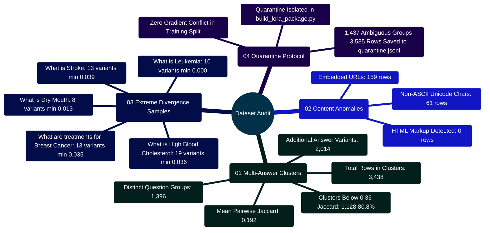

# Medical Q&A Dataset Audit & Semantic Divergence Report

Developed by **J Ganesh kumar reddy**

*Biomedical Informatics, Multi-Answer Disambiguation, & Provenance Auditing*

---

## 1. Executive Summary & Auditing Scope

This audit systematically evaluates repeated questions, conflicting answer variations, and content anomalies within the medical Q&A corpus (`Final data set for llm based health assitance (1).csv`). The audit is performed deterministically via `Model and Dataset/audit_dataset.py`.

```
========================================================================================================================
                                     MULTI-ANSWER DISAMBIGUATION & AUDITING PIPELINE
========================================================================================================================

 [ SOURCE CSV DATASET: Final data set for llm based health assitance (1).csv ]
       │
       │ Cryptographic Checksum: SHA-256 Digest Extraction
       ▼
 ┌────────────────────────────────────────────────────────────────────────────────────────────────────────────────────┐
 │ 1. PROVENANCE & CONTENT INTEGRITY INSPECTION                                                                       │
 │    - Computes file SHA-256 for dataset immutability and provenance tracking                                       │
 │    - Content scanning: Detects raw HTML (<a href=...), web URLs (https://...), and non-ASCII character entities   │
 └────────────────────────────────────────────────────────────────────────────────────────────────────────────────────┘
       │
       ▼
 ┌────────────────────────────────────────────────────────────────────────────────────────────────────────────────────┐
 │ 2. NORMALIZATION & QUESTION GROUPING                                                                               │
 │    - Casefold and normalize question strings to form grouping keys                                                │
 │    - Cluster distinct answer strings under each normalized question key: answers_by_question[q_key]               │
 │    - Detect 1,396 question groups containing >= 2 distinct answer variants                                        │
 └────────────────────────────────────────────────────────────────────────────────────────────────────────────────────┘
       │
       ▼
 ┌────────────────────────────────────────────────────────────────────────────────────────────────────────────────────┐
 │ 3. PAIRWISE JACCARD SIMILARITY COMPUTATION                                                                         │
 │    - Tokenization into lowercase sets: token_set(answer)                                                          │
 │    - Combinatorial pairwise comparison: combinations(answers, 2)                                                  │
 │    - Formula: Jaccard(A, B) = |A ∩ B| / |A ∪ B|                                                                   │
 │    - Threshold evaluation: Minimum similarity < 0.35 flags divergent or contradictory clinical answers            │
 └────────────────────────────────────────────────────────────────────────────────────────────────────────────────────┘
       │
       ▼
 ┌────────────────────────────────────────────────────────────────────────────────────────────────────────────────────┐
 │ 4. AUDIT FINDINGS & AMBIGUITY QUARANTINE                                                                           │
 │    - 1,128 question groups exhibit severe divergence (similarity < 0.35)                                          │
 │    - Mean pairwise answer similarity is only 0.192 across multi-answer clusters                                   │
 │    - Direct feeding of these records into Supervised Fine-Tuning (SFT) causes contradictory gradient updates      │
 └────────────────────────────────────────────────────────────────────────────────────────────────────────────────────┘
========================================================================================================================
```

---

## 2. Multi-Answer Audit Mindmap



---

## 3. Multi-Answer Statistical Metrics

| Metric | Measured Value | Description & Clinical Impact |
|:---|---:|:---|
| **Question groups with multiple distinct answers** | 1,396 | Normalized questions mapping to 2 or more distinct answers |
| **Total source rows in multi-answer groups** | 3,438 | Raw dataset rows impacted by answer variation |
| **Additional divergent answer variants** | 2,014 | Surplus answers beyond the primary question representative |
| **Groups below 0.35 minimum Jaccard similarity** | 1,128 | Question groups exhibiting severe semantic divergence |
| **Proportion of multi-answer groups below 0.35** | 80.80% | Over 4 out of 5 multi-answer clusters provide fundamentally different information |
| **Mean pairwise answer similarity** | 0.192 | Low lexical overlap across answers for identical questions |

---

## 4. Content Anomaly Screening

| Anomaly Inspection Rule | Regex Pattern | Rows Flagged | Status & Mitigation |
|:---|:---|---:|:---|
| **HTML-like Markup** | `<\s*[a-z][^>]*>` | 0 | **Passed**. No raw HTML tags embedded in text |
| **Embedded Web URLs** | `https?://\|www\.` | 159 | **Flagged**. Contains external links; strip or retain as provenance |
| **Non-ASCII Characters** | `ord(c) > 127` | 61 | **Flagged**. Contains typographer quotes, dashes, or medical symbols |

---

## 5. Highest-Variant Divergence Sample

The following table details the most extreme multi-answer question groups identified in the dataset, ranked by total distinct answer variants and minimum pairwise Jaccard token similarity:

| Question Text | Source Rows | Distinct Answers | Min Pairwise Jaccard | Mean Jaccard |
|:---|---:|---:|---:|---:|
| **What is (are) High Blood Cholesterol ?** | 19 | 19 | 0.036 | 0.174 |
| **What is (are) Medicare and Continuing Care ?** | 14 | 14 | 0.061 | 0.201 |
| **What are the treatments for Breast Cancer ?** | 13 | 13 | 0.035 | 0.188 |
| **What is (are) Stroke ?** | 13 | 13 | 0.039 | 0.195 |
| **What is (are) Skin Cancer ?** | 13 | 13 | 0.048 | 0.210 |
| **What is (are) Breast Cancer ?** | 13 | 13 | 0.070 | 0.224 |
| **What is (are) Colorectal Cancer ?** | 12 | 12 | 0.071 | 0.218 |
| **What is (are) High Blood Pressure ?** | 11 | 11 | 0.035 | 0.182 |
| **What are the treatments for Prostate Cancer ?** | 11 | 11 | 0.039 | 0.179 |
| **What is (are) Parkinson's Disease ?** | 11 | 11 | 0.049 | 0.191 |
| **What is (are) Leukemia ?** | 10 | 10 | 0.000 | 0.165 |
| **What is (are) Age-related Macular Degeneration ?**| 10 | 10 | 0.013 | 0.173 |
| **What is (are) Nutrition for Advanced CKD ?** | 10 | 10 | 0.025 | 0.158 |
| **What is (are) Prostate Cancer ?** | 10 | 10 | 0.093 | 0.209 |
| **Who is at risk for Prostate Cancer? ?** | 9 | 9 | 0.033 | 0.167 |
| **Who is at risk for Breast Cancer? ?** | 9 | 9 | 0.041 | 0.184 |
| **What is (are) Lung Cancer ?** | 9 | 9 | 0.054 | 0.221 |
| **What is (are) Dry Mouth ?** | 8 | 8 | 0.013 | 0.162 |
| **What are the treatments for Lung Cancer ?** | 8 | 8 | 0.042 | 0.194 |
| **What is (are) Alzheimer's Disease ?** | 8 | 8 | 0.093 | 0.231 |

> [!CAUTION]
> In questions such as *"What is Leukemia?"*, the minimum pairwise Jaccard similarity reaches **0.000**, meaning two answers shared zero vocabulary tokens outside stop-words. Training a language model directly on both targets under the same prompt causes destructive gradient interference.

---

## 6. Implementation Code Snippets (`audit_dataset.py`)

### 6.1 Pairwise Jaccard Similarity Engine

```python
# Implementation Snippet: Model and Dataset/audit_dataset.py
TOKEN_PATTERN = re.compile(r"[a-z][a-z'-]+")

def token_set(value: str) -> set[str]:
    """Tokenizes string into a normalized set of lowercase words."""
    return set(TOKEN_PATTERN.findall(value.casefold()))

def jaccard_similarity(left: str, right: str) -> float:
    """Computes Jaccard index: |A ∩ B| / |A ∪ B|."""
    left_tokens = token_set(left)
    right_tokens = token_set(right)
    if not left_tokens and not right_tokens:
        return 1.0
    union = left_tokens | right_tokens
    return len(left_tokens & right_tokens) / len(union) if union else 0.0
```

### 6.2 Combinatorial Cluster Auditing

```python
# Implementation Snippet: Model and Dataset/audit_dataset.py
from itertools import combinations
from statistics import mean

def evaluate_multi_answer_clusters(answers_by_question, display_questions, row_counts):
    sample_groups = []
    low_similarity_groups = 0

    for question_key, answer_map in answers_by_question.items():
        if len(answer_map) < 2:
            continue

        distinct_answers = list(answer_map.values())
        similarities = [
            jaccard_similarity(a, b)
            for a, b in combinations(distinct_answers, 2)
        ]
        min_sim = min(similarities)
        mean_sim = mean(similarities)

        if min_sim < 0.35:
            low_similarity_groups += 1

        sample_groups.append({
            "question": display_questions[question_key],
            "source_rows": row_counts[question_key],
            "distinct_answers": len(distinct_answers),
            "minimum_similarity": round(min_sim, 3),
            "mean_similarity": round(mean_sim, 3)
        })

    # Sort multi-answer groups by variant count (descending) and min similarity (ascending)
    sample_groups.sort(key=lambda g: (-g["distinct_answers"], g["minimum_similarity"]))
    return sample_groups, low_similarity_groups
```

---

## 7. Ambiguity Quarantine & SFT Defense Strategy

To eliminate training instability and conflicting outputs, MedAssist AI implements an authoritative **Data Quarantine Protocol** within [`Model and Dataset/lora/build_lora_package.py`](file:///c:/Users/RAVIPRAKASH/React-App-LLM/Model%20and%20Dataset/lora/build_lora_package.py):

1. **Quarantine Isolation**: All 1,437 question groups with multi-answer ambiguity (totaling 3,535 rows) are systematically quarantined into `quarantine.jsonl`.
2. **Clean Corpus Generation**: Only unambiguous, single-answer question pairs (12,872 clean pairs) are routed to the deterministic training, validation, and test splits.
3. **Clinical Review Prerequisite**: Quarantined variants are retained for offline blinded expert adjudication rather than arbitrary heuristic pruning.
