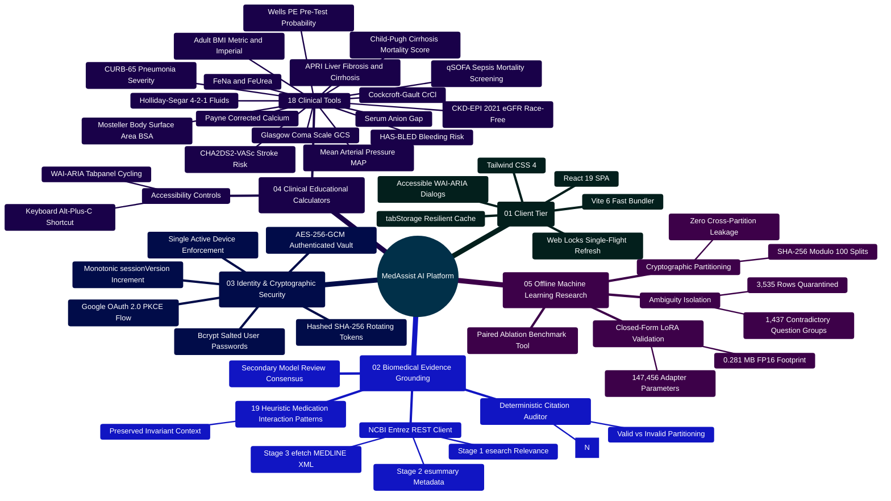
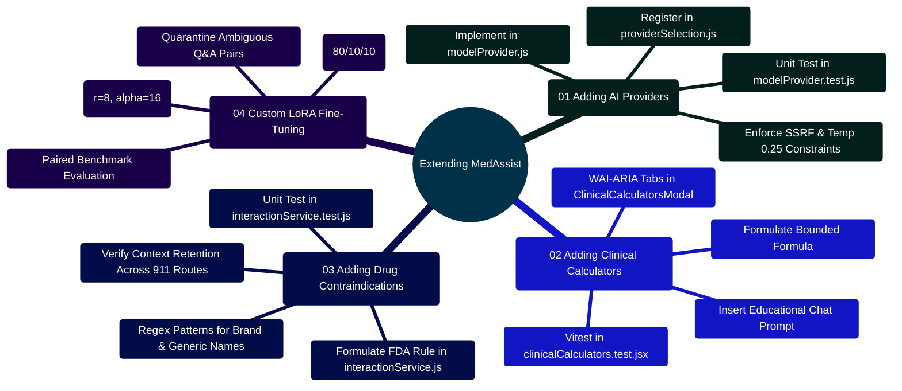

# MedAssist AI — Educational Health Assistance & Biomedical Evidence Grounding Platform

Developed by **J Ganesh kumar reddy**  
*Full-Stack Educational Health Assistance, Biomedical Evidence Grounding, & Machine Learning Research Platform*

---

## 1. Executive Summary & Architectural Overview

MedAssist AI is a full-stack educational biomedical question-answering platform and clinical machine learning research workbench. The platform couples real-time literature retrieval from the **National Center for Biotechnology Information (NCBI) PubMed** database with multi-provider Large Language Model (LLM) synthesis (**Google Gemini 2.5 Flash**, **Groq Cloud**, **Together AI**, and **Local OpenAI-Compatible Server**).

### Core System Capabilities
1. **Biomedical Evidence Grounding**: Live 3-stage NCBI Entrez E-Utilities harvesting (`esearch`, `esummary`, `efetch`) extracting structured MEDLINE XML abstracts.
2. **Deterministic Citation Auditing**: Set-partitioning mathematical verifier analyzing `[N]` bracketed assertions against retrieved literature bounds.
3. **Medication Interaction Screener**: Heuristic name matching for 19 selected high-risk medication combinations, with cautions preserved across emergency deflections. It cannot rule out other interactions.
4. **Educational Clinical Calculators**: 18 reference tools with input bounds and WAI-ARIA tab navigation; outputs have not been clinically validated for patient care.
5. **Two-Phase Idempotent Persistence**: Ephemeral 24-hour generation buffer followed by an automatic `/api/save` request after an answer is generated.
6. **Multi-Tab Web Locks Synchronization**: Single-flight token renewal across concurrent browser tabs (`navigator.locks.request`).
7. **Offline Machine Learning & LoRA Suite**: 1,437 ambiguous question groups quarantined; deterministic SHA-256 modulo 100 hash splits; closed-form LoRA parameter calculations.

> [!IMPORTANT]
> **Clinical Disclaimer**: MedAssist AI provides health and medical information strictly for educational and research purposes. It does not provide clinical diagnoses, medical advice, or treatment plans. Acute emergency symptoms require immediate contact with local emergency medical services.

> [!TIP]
> **Developer & Contributor Extensibility Guide**: If you are an engineer or researcher building on this project, please consult [`CONTRIBUTING.md`](CONTRIBUTING.md) and [`docs/COMPREHENSIVE_CODEBASE_ANALYSIS.md`](docs/COMPREHENSIVE_CODEBASE_ANALYSIS.md#10-developer-extensibility--architecture-blueprint-for-building-on-medassist-ai) for step-by-step blueprints on adding AI providers, clinical calculators, medication interaction rules, backend REST models, and custom LoRA datasets.

**Conversation JSON preview:** The chat sidebar can open a previously exported JSON conversation locally. The file is limited to 512 KB and 100 complete question-and-answer pairs. Imported answer text is marked unverified; citation, verification, provider, and identity metadata are discarded. The preview is not saved to the account or sent as model context. Its Markdown and JSON exports are labeled unverified. Conversation text in Markdown exports is fenced as literal text so imported links and images cannot load when the report is viewed. Start a new conversation to ask another question.

---

## 2. Master System Architectural Topology

```
========================================================================================================================
                                     MEDASSIST AI — MASTER ARCHITECTURAL TOPOLOGY
========================================================================================================================

     [ CLIENT WORKSPACE (Web Browser) ]
     ├── React 19 SPA | Vite 6 | Tailwind CSS 4 | Lucide Icons
     ├── Web Locks API Single-Flight Token Refresh (frontend/src/lib/api.js)
     ├── Resilient Draft & Pending Answer Cache (frontend/src/lib/tabStorage.js)
     ├── IME Composition Safety Guard for East Asian Language Typing
     └── 18 Validated Educational Clinical Calculators with WAI-ARIA Arrow Navigation
                  │
                  │ HTTP (Port 8080) / Secure WebSocket (/ws)
                  │ (External TLS 1.3 Ingress Required in Production)
                  ▼
     ┌────────────────────────────────────────────────────────────────────────────────────────────────────────────────┐
     │                                TIER 1: INGRESS GATEWAY (Nginx Alpine)                                          │
     │  - Reverse Proxy Pass (/api/* -> backend:5000)                                                                 │
     │  - WebSocket Upgrade Gateway (/ws -> backend:5000/ws)                                                          │
     │  - Static Asset Delivery: /assets/* with Cache-Control: "public, max-age=31536000, immutable"                  │
     │  - Ingress Liveness Healthcheck: /healthz (returns 200 OK "healthy\n")                                         │
     │  - Security Response Headers: X-Frame-Options DENY, nosniff, Referrer-Policy, CSP, Permissions-Policy          │
     └────────────────────────────────────────────────────────────────────────────────────────────────────────────────┘
                                                        │
                                                        │ Internal Reverse Proxy Pass (Port 5000)
                                                        ▼
     ┌────────────────────────────────────────────────────────────────────────────────────────────────────────────────┐
     │                                TIER 2: APPLICATION RUNTIME (Node.js 24 LTS)                                    │
     │  - Request UUID Tracing (x-request-id) & Structured JSON Telemetry Logging                                     │
     │  - CORS Origin Whitelist & Strict Non-Safe Origin Match Gate (sec-fetch-site)                                  │
     │  - Strict Payload Ceiling: 32KB JSON Body Parser                                                               │
     │  - Tiered Rate Limiters: Auth (30/15m), Recovery (5/15m), AI/Medical (20/1m), Settings (12/15m)                 │
     │  - Cookie-Based JWT Auth with Monotonic sessionVersion Single-Device Invalidation                              │
     │  - Rotating SHA-256 Hashed Refresh Tokens with Replay Family Invalidation                                      │
     │  - Hardware-Accelerated AES-256-GCM Authenticated Personal API Key Vault                                       │
     │  - Deterministic Input & Output Safety Screener (safetyService.js)                                             │
     │  - 19 Heuristic Medication Interaction Patterns (interactionService.js)                                       │
     │  - Deterministic Numerical Citation Auditor [N] & Source Coverage Math (citationService.js)                  │
     │  - Two-Phase Idempotent Generation Handshake with 24-Hour TTL Auto-Purge                                       │
     │  - Real-Time WebSocket Gateway (/ws) with 30s Heartbeat Watchdog & 1MB Backpressure Drop                       │
     └────────────────────────────────────────────────────────────────────────────────────────────────────────────────┘
                      │                                                               │
                      │ MongoDB Wire Protocol (Port 27017)                            │ Outbound HTTPS (TLS 1.3)
                      ▼                                                               ▼
     ┌─────────────────────────────────────────────────┐             ┌────────────────────────────────────────────────┐
     │         TIER 3: PERSISTENT DATABASE             │             │           TIER 4: UPSTREAM SERVICES            │
     │  - Engine: MongoDB 7.0 Jammy                    │             │  - NCBI Entrez E-Utilities                     │
     │  - Collections:                                 │             │    (esearch, esummary, efetch MEDLINE XML)     │
     │      ├── users (Bcrypt, sessionVersion, tokens) │             │  - Google Gemini 2.5 Flash API                 │
     │      ├── chats (Threads, messages, citations)   │             │  - Groq Cloud High-Throughput LLM Engine       │
     │      ├── generations (24-Hour TTL Ephemeral)    │             │  - Together AI Cloud Platform                  │
     │      └── providercredentials (AES-256-GCM Keys) │             │  - Local OpenAI-Compatible Server (vLLM)       │
     │  - Mongoose Schemas with Compound Indexes       │             │  - Brevo Transactional Email (Verification)    │
     └─────────────────────────────────────────────────┘             └────────────────────────────────────────────────┘
========================================================================================================================
```

---

## 3. Platform Capabilities Mindmap



---

## 4. Evidence-Based Clinical Calculators Suite

The platform includes a comprehensive 18-calculator clinical suite implemented in [`frontend/src/components/tools/ClinicalCalculatorsModal.jsx`](file:///c:/Users/RAVIPRAKASH/React-App-LLM/frontend/src/components/tools/ClinicalCalculatorsModal.jsx).

| Tool Name | Clinical Formula / Scoring Model | Input Parameters | Physiological Bounds | Clinical Interpretation |
|:---|:---|:---|:---:|:---|
| **Body Mass Index (BMI)** | $\text{BMI} = \frac{\text{Weight (kg)}}{\text{Height (m)}^2}$ or $\frac{\text{lbs}}{\text{in}^2} \times 703$ | Weight (kg/lbs), Height (cm/in) | Weight: 20–300 kg<br>Height: 50–250 cm | Underweight (<18.5), Normal (18.5–24.9), Overweight (25–29.9), Obese (≥30). |
| **CKD-EPI 2021 eGFR** | $142 \times \min(S_{\text{cr}}/\kappa, 1)^\alpha \times \max(S_{\text{cr}}/\kappa, 1)^{-1.200} \times 0.9938^{\text{Age}} \times [1.012 \text{ if Female}]$ | Age, Sex, Serum Creatinine (mg/dL) | Age: 18–120 yr<br>Cr: 0.1–20 mg/dL | G1 (≥90), G2 (60–89), G3a (45–59), G3b (30–44), G4 (15–29), G5 (<15 Kidney Failure). |
| **CHA₂DS₂-VASc** | Sum of risk factors (CHF, HTN, Age ≥75 [2], DM, Stroke/TIA [2], Vascular, Age 65–74, Sex Female) | Point toggles (0–9 scale) | Binary toggles | Score 0 (Men) / 1 (Women): Low risk.<br>Score ≥2 (Men) / ≥3 (Women): Anticoagulation recommended. |
| **Mean Arterial Pressure (MAP)** | $\text{MAP} = \text{DBP} + \frac{1}{3}(\text{SBP} - \text{DBP}) = \frac{2 \times \text{DBP} + \text{SBP}}{3}$ | Systolic BP, Diastolic BP (mmHg) | SBP: 50–260 mmHg<br>DBP: 30–150 mmHg | Normal: 70–100 mmHg.<br><65 mmHg: Inadequate organ perfusion / septic shock criterion. |
| **Cockcroft-Gault CrCl** | $\text{CrCl} = \frac{(140 - \text{Age}) \times \text{Weight}}{72 \times S_{\text{cr}}} \times [0.85 \text{ if Female}]$ | Age, Sex, Weight (kg), Serum Cr | Age: 18–120 yr<br>Weight: 30–250 kg | Standard renal dosage adjustment metric for DOACs and antimicrobials. |
| **Payne Corrected Calcium** | $\text{Corrected Ca} = \text{Measured Ca} + 0.8 \times (4.0 - \text{Albumin})$ | Total Calcium (mg/dL), Albumin (g/dL) | Ca: 4–18 mg/dL<br>Albumin: 1–6 g/dL | Adjusts total calcium in hypoalbuminemia. Normal range: 8.5–10.2 mg/dL. |
| **Serum Anion Gap** | $\text{AG} = \text{Na}^+ - (\text{Cl}^- + \text{HCO}_3^-)$ | Sodium, Chloride, Bicarbonate (mEq/L) | Na: 100–180 mEq/L<br>Cl: 60–140 mEq/L | Normal: 8–12 mEq/L.<br>>12 mEq/L: High Anion Gap Metabolic Acidosis. |
| **Fractional Excretion of Sodium (FeNa)** | $\text{FeNa} = \frac{U_{\text{Na}} \times S_{\text{cr}}}{S_{\text{Na}} \times U_{\text{cr}}} \times 100\%$ | Serum & Urine Na, Serum & Urine Cr | Cr: 0.1–20 mg/dL<br>Na: 5–200 mEq/L | <1%: Prerenal azotemia.<br>>2%: Acute Tubular Necrosis (ATN). |
| **Fractional Excretion of Urea (FeUrea)** | $\text{FeUrea} = \frac{U_{\text{Urea}} \times S_{\text{cr}}}{S_{\text{BUN}} \times U_{\text{cr}}} \times 100\%$ | Serum BUN, Urine Urea, Serum/Urine Cr | BUN: 2–150 mg/dL<br>Urea: 50–2500 mg/dL | <35%: Prerenal azotemia in patients taking diuretics.<br>>50%: Intrinsic AKI. |
| **Maintenance Fluids (4-2-1 Rule)** | $4 \text{ mL/kg/hr (1-10kg)} + 2 \text{ mL/kg/hr (11-20kg)} + 1 \text{ mL/kg/hr (>20kg)}$ | Patient Weight (kg) | Weight: 1–150 kg | Pediatric and adult basal hydration rate calculation. |
| **Wells' Criteria for PE** | Point summation across 7 clinical criteria (DVT signs, alternative less likely, HR >100, etc.) | Clinical criteria checkboxes (0–12.5) | Binary toggles | ≤4.0: PE Unlikely (Check D-dimer).<br>>4.0: PE Likely (Proceed to CT Pulmonary Angiography). |
| **CURB-65 Pneumonia Score** | $\text{CURB-65} = C + U + R + B + 65$ (Confusion, Urea >19, RR ≥30, SBP <90 or DBP ≤60, Age ≥65) | 5 clinical checkboxes (0–5 points) | Binary toggles | 0–1: Low risk (<3% mortality, outpatient).<br>2: Intermediate risk (~9% mortality, short stay).<br>3–5: High risk (15–40% mortality, urgent admission/ICU). |
| **Glasgow Coma Scale (GCS)** | $\text{GCS} = E (1–4) + V (1–5) + M (1–6)$ (Eye, Verbal, Motor responses) | 3 ordinal dropdown selectors (3–15 points) | $E \in [1,4], V \in [1,5], M \in [1,6]$ | 13–15: Mild brain injury / Alert.<br>9–12: Moderate brain injury.<br>3–8: Severe brain injury / Coma (critical loss of airway reflexes). |
| **HAS-BLED Bleeding Risk** | Sum of risk factors: HTN, Abnormal renal/liver (1-2), Stroke, Bleeding, Labile INR, Elderly >65, Drugs/Alcohol (1-2) | 9 clinical checkboxes (0–9 points) | Binary toggles | 0–1: Low risk (~1% / yr).<br>2: Moderate risk (~1.9% / yr).<br>≥3: High risk (≥3.7% / yr; review modifiable risks). |
| **qSOFA Sepsis Screening** | Altered mental status (GCS <15) + Tachypnea (RR ≥22) + Hypotension (SBP ≤100 mmHg) | 3 clinical checkboxes (0–3 points) | Binary toggles | 0–1: Low risk of in-hospital sepsis mortality.<br>2–3: High risk of in-hospital sepsis mortality (prompt evaluation for organ dysfunction & sepsis protocol). |
| **Body Surface Area (BSA - Mosteller)** | $\text{BSA} = \sqrt{\frac{\text{Height (cm)} \times \text{Weight (kg)}}{3600}}$ or $\sqrt{\frac{\text{Height (in)} \times \text{Weight (lbs)}}{3131}}$ | Height (cm/in), Weight (kg/lbs) | Height: 30–250 cm / 12–100 in<br>Weight: 2–350 kg / 5–800 lbs | Adult reference norm ~1.73 m² (men ~1.9, women ~1.6). Applied in oncology chemotherapy dosing and cardiac index (L/min/m²). |
| **AST to Platelet Ratio Index (APRI)** | $\text{APRI} = \frac{(S_{\text{AST}} / S_{\text{AST, ULN}})}{\text{Platelets } (10^9/\text{L})} \times 100$ | AST (U/L), AST ULN (U/L), Platelets (10⁹/L) | AST: 5–2000 U/L<br>ULN: 10–100 U/L<br>Plt: 10–1000 ×10⁹/L | ≤0.50: Significant fibrosis unlikely (high NPV).<br>>1.00: High probability of significant fibrosis (F2–F4).<br>>1.50: High probability of cirrhosis (F4). |
| **Child-Pugh Cirrhosis Score** | $\text{Points} = \text{Bilirubin} (1–3) + \text{Albumin} (1–3) + \text{INR} (1–3) + \text{Ascites} (1–3) + \text{Encephalopathy} (1–3)$ | Total Bilirubin, Albumin, INR, Ascites, Encephalopathy | Bili: 0.1–50 mg/dL<br>Alb: 0.5–6.0 g/dL<br>INR: 0.5–10.0 | Class A (5–6 pts): Well-compensated (~100% 1-yr survival).<br>Class B (7–9 pts): Significant functional compromise (~80% 1-yr survival).<br>Class C (10–15 pts): Decompensated cirrhosis (~45% 1-yr survival). |

---

## 5. Pharmacological Drug Interaction Screening & Preserved Context

Implemented in `backend/services/interactionService.js`, this subsystem scans user questions for 19 selected medication combinations. The list is incomplete and is not an FDA-certified interaction database:

| Interaction Rule | Drug Class A | Drug Class B | Severity | Mechanism & Clinical Hazard |
|:---|:---|:---|:---:|:---|
| **Anticoagulant + NSAID / Aspirin** | Warfarin, Eliquis, Xarelto, Plavix, Heparin | Aspirin, Ibuprofen, Naproxen, Diclofenac | `CRITICAL` | Severe gastrointestinal ulceration and intracranial hemorrhage. |
| **PDE5 Inhibitor + Nitrate** | Sildenafil, Tadalafil, Vardenafil, Avanafil | Nitroglycerin, Isosorbide Mononitrate/Dinitrate | `CRITICAL` | Synergistic cGMP accumulation causing profound, fatal hypotension. |
| **Tramadol / Opioids + SSRI / SNRI** | Tramadol, Meperidine, Methadone | Fluoxetine, Sertraline, Paroxetine, Venlafaxine | `HIGH` | Massive serotonin accumulation causing Serotonin Syndrome. |
| **ACEI / ARB + K-Sparing Diuretic** | Lisinopril, Enalapril, Losartan, Valsartan | Spironolactone, Eplerenone, Potassium supplements | `HIGH` | Additive potassium retention causing fatal cardiac arrhythmias. |
| **Methotrexate + TMP-SMX (Bactrim)** | Methotrexate | Trimethoprim, Sulfamethoxazole (Bactrim, Septra) | `CRITICAL` | Reduced renal tubular excretion causing lethal pancytopenia. |
| **Fluoroquinolone + Corticosteroid** | Ciprofloxacin, Levofloxacin, Moxifloxacin | Prednisone, Dexamethasone, Methylprednisolone | `HIGH` | Synergistic collagen degradation causing Achilles tendon rupture. |
| **Benzodiazepine + Opioid Analgesic** | Alprazolam, Diazepam, Lorazepam, Clonazepam | Oxycodone, Morphine, Fentanyl, Hydrocodone | `CRITICAL` | Severe CNS and respiratory depression, coma, fatal overdose (FDA Black Box). |
| **Lithium + NSAID / ACE Inhibitor** | Lithium Carbonate / Citrate | Ibuprofen, Naproxen, Lisinopril, Enalapril | `HIGH` | Reduced renal prostaglandin clearance elevating serum lithium into toxic range. |
| **Statin + Strong CYP3A4 Inhibitor** | Simvastatin, Atorvastatin, Lovastatin | Clarithromycin, Gemfibrozil, Itraconazole | `CRITICAL` | CYP3A4 inhibition elevates statin AUC up to 10x, causing rhabdomyolysis. |
| **Warfarin + Azole Antifungal** | Warfarin (Coumadin) | Fluconazole, Voriconazole, Ketoconazole | `CRITICAL` | CYP2C9 inhibition suppresses S-warfarin clearance, spiking INR. |
| **Digoxin + Amiodarone / Verapamil** | Digoxin | Amiodarone, Verapamil | `HIGH` | P-glycoprotein inhibition doubles serum digoxin, causing heart block. |
| **MAOI + SSRI / Sympathomimetic** | Phenelzine, Tranylcypromine, Selegiline | Sertraline, Fluoxetine, Pseudoephedrine | `CRITICAL` | Malignant hypertensive crisis and hyperthermic Serotonin Syndrome. |
| **Allopurinol + Azathioprine / 6-MP** | Allopurinol, Febuxostat | Azathioprine, 6-Mercaptopurine | `CRITICAL` | Xanthine oxidase inhibition blocks thiopurine degradation, precipitating lethal bone marrow suppression and pancytopenia. |
| **Methotrexate + NSAIDs / High-Dose Aspirin** | Methotrexate (Rheumatrex, Trexall) | Ibuprofen, Naproxen, Ketorolac, Aspirin | `CRITICAL` | Renal prostaglandin synthesis inhibition and competitive tubular secretion blockage by NSAIDs reduces methotrexate clearance, causing fatal pancytopenia and AKI. |
| **Warfarin + TMP-SMX (Bactrim / Septra)** | Warfarin (Coumadin, Jantoven) | Trimethoprim, Sulfamethoxazole (Bactrim, Septra) | `CRITICAL` | Potent CYP2C9 inhibition suppresses active S-warfarin clearance and reduces gut flora vitamin K synthesis, causing precipitous INR surges and life-threatening bleeding. |
| **Clopidogrel + Omeprazole / Esomeprazole** | Clopidogrel (Plavix) | Omeprazole (Prilosec), Esomeprazole (Nexium) | `CRITICAL` | Potent CYP2C19 inhibition prevents metabolic bioactivation of prodrug clopidogrel, elevating stent thrombosis and reinfarction risk (FDA Boxed Warning). |
| **SSRI / SNRI / MAOI + Triptan** | Fluoxetine, Sertraline, Duloxetine, Phenelzine | Sumatriptan, Rizatriptan, Zolmitriptan, Eletriptan | `CRITICAL` | FDA Warning: Concurrent 5-HT1 receptor agonist triptans with serotonergic antidepressants elevates central serotonin, precipitating Serotonin Syndrome. |
| **TMP-SMX (Bactrim) + ACEI / ARB / K-Sparing** | Trimethoprim-Sulfamethoxazole (Bactrim, Septra) | Lisinopril, Losartan, Spironolactone | `CRITICAL` | Trimethoprim blocks distal nephron ENaC channels identically to amiloride. Combined with RAAS blockade, severe refractory hyperkalemia and sudden cardiac arrest occur. |
| **Theophylline + Fluoroquinolone** | Theophylline, Theo-24, Aminophylline | Ciprofloxacin (Cipro), Enoxacin | `CRITICAL` | Ciprofloxacin potently inhibits hepatic CYP1A2, reducing theophylline metabolic clearance by 30% to 50% or more, causing toxic accumulation, refractory seizures, malignant arrhythmias, and death. |

### Preserved Context Invariant
```
User Prompt: "I have severe chest pain and took nitroglycerin with sildenafil."
     │
     ├── 1. detectDrugInteractions() flags CRITICAL: PDE5 Inhibitor + Nitrate
     │
     ├── 2. screenPrompt() flags Emergency: "severe chest pain"
     │
     └── 3. answerService routes to immediate 911 emergencyText:
             INVARIANT: Attaches detected drug interaction warnings into verification.drugInteractions
             (Guarantees critical contraindication data is never silenced during emergency deflections)
```

---

## 6. Key Implementation Code Snippets

### 6.1 Two-Phase Generation Coordinator (`backend/controllers/aiController.js`)

```javascript
// backend/controllers/aiController.js
const generateChatResponse = async (req, res, next) => {
  const { prompt, sessionId, exchangeId, forceMedical, requestedProvider, requestedModel } = req.body;
  const userId = req.user._id;

  // Check for duplicate in-flight generation
  let job = await Generation.findOne({ exchangeId, userId });
  if (job && job.status === "ready") {
    return res.json({ ...job.result, generationId: job.exchangeId, sessionId: job.sessionId });
  }

  // Create ephemeral placeholder with 24-hour TTL
  job = await Generation.create({
    exchangeId,
    userId,
    sessionId,
    prompt,
    status: "pending",
    createdAt: new Date(),
  });

  try {
    const result = await answerService.answer({
      prompt,
      sessionId,
      userId,
      forceMedical,
      requestedProvider,
      requestedModel,
    });

    job.result = result;
    job.status = "ready";
    await job.save();

    return res.json({ ...result, generationId: job.exchangeId, sessionId: job.sessionId });
  } catch (error) {
    await Generation.deleteOne({ _id: job._id }).catch(() => {});
    next(error);
  }
};
```

### 6.2 Deterministic Citation Auditor (`backend/services/citationService.js`)

```javascript
// backend/services/citationService.js
function assessCitationGrounding(text, sourceCount) {
  if (typeof text !== "string") {
    return { grounded: false, validCitationCount: 0, invalidCitationCount: 0, citationCoverage: 0, status: "ungrounded" };
  }

  const matches = [...text.matchAll(/\[(\d+)\]/g)].map((m) => parseInt(m[1], 10));
  const uniqueCitations = [...new Set(matches)].sort((a, b) => a - b);
  const count = Number.isInteger(sourceCount) && sourceCount > 0 ? sourceCount : 0;

  const validCitations = uniqueCitations.filter((n) => n >= 1 && n <= count);
  const invalidCitations = uniqueCitations.filter((n) => n < 1 || n > count);

  let status = "ungrounded";
  if (invalidCitations.length > 0) status = "invalid_citations";
  else if (validCitations.length > 0) status = "citation_checked";
  else if (count > 0) status = "sources_supplied";

  return {
    grounded: validCitations.length > 0 && invalidCitations.length === 0,
    validCitations,
    invalidCitations,
    validCitationCount: validCitations.length,
    invalidCitationCount: invalidCitations.length,
    citationCoverage: count > 0 ? Math.round((validCitations.length / count) * 100) : 0,
    status,
  };
}
```

### 6.3 Glasgow Coma Scale & WAI-ARIA Navigation (`frontend/src/components/tools/ClinicalCalculatorsModal.jsx`)

```jsx
// frontend/src/components/tools/ClinicalCalculatorsModal.jsx
// GCS Calculator State & Scoring Model
const [gcsEye, setGcsEye] = useState("4");
const [gcsVerbal, setGcsVerbal] = useState("5");
const [gcsMotor, setGcsMotor] = useState("6");

const gcsEyeScore = parseInt(gcsEye, 10) || 4;
const gcsVerbalScore = parseInt(gcsVerbal, 10) || 5;
const gcsMotorScore = parseInt(gcsMotor, 10) || 6;
const gcsScore = gcsEyeScore + gcsVerbalScore + gcsMotorScore;

let gcsStratification = "Mild brain injury / Alert (13–15)";
if (gcsScore <= 8) {
  gcsStratification = "Severe brain injury / Coma (3–8)";
} else if (gcsScore <= 12) {
  gcsStratification = "Moderate brain injury (9–12)";
}

// WAI-ARIA Arrow Key Tab Navigation
const tabList = ["bmi", "egfr", "chads", "map", "crcl", "calcium", "aniongap", "fena", "feurea", "fluids", "wells", "curb65", "gcs", "hasbled", "qsofa", "bsa", "apri", "childpugh"];
const handleKeyDown = (e) => {
  const curIndex = tabList.indexOf(activeTab);
  let nextIndex = -1;
  if (e.key === "ArrowRight" || e.key === "ArrowDown") {
    nextIndex = (curIndex + 1) % tabList.length;
  } else if (e.key === "ArrowLeft" || e.key === "ArrowUp") {
    nextIndex = (curIndex - 1 + tabList.length) % tabList.length;
  } else if (e.key === "Home") {
    nextIndex = 0;
  } else if (e.key === "End") {
    nextIndex = tabList.length - 1;
  }
  if (nextIndex !== -1) {
    e.preventDefault();
    setActiveTab(tabList[nextIndex]);
    document.getElementById("tab-" + tabList[nextIndex])?.focus();
  }
};
```

### 6.4 Web Locks API Client Concurrency Control (`frontend/src/lib/api.js`)

```javascript
// frontend/src/lib/api.js
let refreshPromise = null;

export async function refreshSession() {
  if (!refreshPromise) {
    const refresh = () => request("/auth/refresh-token", { method: "POST" });
    refreshPromise = (
      typeof navigator !== "undefined" && navigator.locks
        ? navigator.locks.request("medassist-session-refresh", refresh)
        : refresh()
    )
      .then((data) => {
        window.dispatchEvent(new Event("session-renewed"));
        return data;
      })
      .catch((error) => {
        window.dispatchEvent(new Event("session-ended"));
        throw error;
      })
      .finally(() => {
        refreshPromise = null;
      });
  }
  return refreshPromise;
}
```

---

## 7. Master Automated Verification Matrix

The repository verification harness (`scripts/verify_project.cjs`) asserts quality, security, and behavior across 9 automated checks:

```
========================================================================================================================
                                     MEDASSIST AI — VERIFIED QUALITY RESULTS
========================================================================================================================

    [ TEST SUITE ]                              [ ENVIRONMENT ]               [ TESTS PASSED ]       [ STATUS ]
    ─────────────────────────────────────────────────────────────────────────────────────────────────────────────
    Backend Unit & Integration Tests            Node 24 + In-Memory MongoDB       71 Passed          PASSED
    Frontend Vitest Component Tests             Vitest 5 + jsdom (6 suites)       55 Passed          PASSED
    Python Dataset Profiling & Split Tests      Python 3.10+ unittest (stdlib)    13 Passed          PASSED
    Python LoRA Parameter & Math Tests          Python 3.10+ unittest (stdlib)     6 Passed          PASSED
    Production Bundle HTTP Gateway Checks       Express + Nginx Static Serving     7 Passed          PASSED
    Headless Browser Smoke Test Suite           Playwright Chromium Headless      21 Passed          PASSED
    Headless Browser Dark Mode & Tools Suite    Playwright Chromium Headless      33 Passed          PASSED
    Backend Production Dependency Audit         npm audit (0 vulnerabilities)      0 Advisories      PASSED
    Frontend Production Dependency Audit        npm audit (0 vulnerabilities)      0 Advisories      PASSED
    ─────────────────────────────────────────────────────────────────────────────────────────────────────────────
    LOCALLY OBSERVED TOTAL                                                       206 Passed         PASSED
========================================================================================================================
```

---

## 8. Technical Documentation Suite Index

For deep-dive technical specifications, mathematical derivations, and operational runbooks, consult the dedicated manuals in [`docs/`](file:///c:/Users/RAVIPRAKASH/React-App-LLM/docs/):

| Volume | Document File | Primary Subject & Technical Scope |
|:---:|:---|:---|
| **01** | [`docs/README.md`](file:///c:/Users/RAVIPRAKASH/React-App-LLM/docs/README.md) | Documentation suite master catalog, system boundaries, and ASCII architecture. |
| **02** | [`docs/SYSTEM_ARCHITECTURE_DEEP_DIVE.md`](file:///c:/Users/RAVIPRAKASH/React-App-LLM/docs/SYSTEM_ARCHITECTURE_DEEP_DIVE.md) | Multi-tier infrastructure, Nginx ingress, state machines, Web Locks, and 13 calculators. |
| **03** | [`docs/CURRENT_IMPLEMENTATION.md`](file:///c:/Users/RAVIPRAKASH/React-App-LLM/docs/CURRENT_IMPLEMENTATION.md) | Complete runtime state, API request/response schemas, and Mongoose database models. |
| **04** | [`docs/DEEP_DIVE_AI_WORKING_PRINCIPLES.md`](file:///c:/Users/RAVIPRAKASH/React-App-LLM/docs/DEEP_DIVE_AI_WORKING_PRINCIPLES.md) | Biomedical RAG mathematical formulations, NCBI E-Utilities, and citation auditing. |
| **05** | [`docs/DEEP_DIVE_LORA_AND_FINE_TUNING.md`](file:///c:/Users/RAVIPRAKASH/React-App-LLM/docs/DEEP_DIVE_LORA_AND_FINE_TUNING.md) | LoRA low-rank matrix decomposition, backpropagation gradients, and SFT masking. |
| **06** | [`docs/SECURITY_AND_MESSAGE_POLICY.md`](file:///c:/Users/RAVIPRAKASH/React-App-LLM/docs/SECURITY_AND_MESSAGE_POLICY.md) | Hardware AES-256-GCM vault, single-device session versioning, and OWASP defenses. |
| **07** | [`docs/COMPLETE_FILE_DIRECTORY_REFERENCE.md`](file:///c:/Users/RAVIPRAKASH/React-App-LLM/docs/COMPLETE_FILE_DIRECTORY_REFERENCE.md) | Complete file-by-file technical catalog and exported symbol/function inventory. |
| **08** | [`docs/DEPLOYMENT_RUNBOOK.md`](file:///c:/Users/RAVIPRAKASH/React-App-LLM/docs/DEPLOYMENT_RUNBOOK.md) | Container mesh operations, host TLS 1.3 Nginx setup, secret generation, and backups. |
| **09** | [`docs/EVALUATION_AND_INTEGRATION.md`](file:///c:/Users/RAVIPRAKASH/React-App-LLM/docs/EVALUATION_AND_INTEGRATION.md) | Paired case ablation scoring tools, strict matrix evaluation, and air-gapped search. |
| **10** | [`docs/IMPLEMENTATION_STATUS.md`](file:///c:/Users/RAVIPRAKASH/React-App-LLM/docs/IMPLEMENTATION_STATUS.md) | Comprehensive engineering verification matrix with 177+ test assertion inventory. |
| **11** | [`docs/ISSUES_AND_RISKS.md`](file:///c:/Users/RAVIPRAKASH/React-App-LLM/docs/ISSUES_AND_RISKS.md) | Prioritized risk register, threat model, heuristic limitations, and mitigations. |
| **12** | [`docs/AI_ARCHITECTURE_AND_WORKING_PRINCIPLES.md`](file:///c:/Users/RAVIPRAKASH/React-App-LLM/docs/AI_ARCHITECTURE_AND_WORKING_PRINCIPLES.md) | Concise grounding summary, algorithmic rules, and secondary consensus verifier. |
| **13** | [`docs/AI_FINE_TUNING_AND_LORA_GUIDE.md`](file:///c:/Users/RAVIPRAKASH/React-App-LLM/docs/AI_FINE_TUNING_AND_LORA_GUIDE.md) | Concise LoRA setup guide, parameter estimation benchmarks, and dataset hygiene. |
| **14** | [`docs/COMPREHENSIVE_CODEBASE_ANALYSIS.md`](file:///c:/Users/RAVIPRAKASH/React-App-LLM/docs/COMPREHENSIVE_CODEBASE_ANALYSIS.md) | Line-by-line subsystem analysis, architectural patterns, and file inventory. |

---

## 9. Local Development & Quickstart Guide

### 9.1 Prerequisites
- **Node.js**: Version 24.x LTS and npm
- **MongoDB**: Version 7.x (local instance or Docker container)
- **Python**: Version 3.10+ (for standalone dataset and LoRA verification scripts)

### 9.2 Execution Commands

```powershell
# 1. Run the master project verification harness (runs all 9 test gates)
node scripts/verify_project.cjs

# 2. Start the local backend development server
cd backend
npm run dev

# 3. Start the local frontend development server
cd ../frontend
npm run dev

# 4. Run the Python dataset verification suite
python -m unittest discover -s "Model and Dataset" -p "test_*.py"

# 5. Run the Python LoRA parameter calculation tests
python -m unittest discover -s "Model and Dataset/lora" -p "test_*.py"
```

### 9.3 Containerized Production Deployment

```powershell
# 1. Generate cryptographically strong production secrets
node deploy/create_env.cjs

# 2. Build and launch multi-container mesh
docker compose up -d --build

# 3. Verify container health status
docker compose ps
```

---

## 10. Developer Extensibility & Architecture Blueprint: Building on MedAssist AI

MedAssist AI is designed to be easily extended by clinical researchers, machine learning engineers, and full-stack software developers. The codebase is decoupled into modular layers to enable extensions without side effects:

```
========================================================================================================================
                                     DEVELOPER EXTENSION & DATA FLOW BLUEPRINT
========================================================================================================================

    [ EXTENSION POINT ]                   [ TARGET IMPLEMENTATION FILE ]             [ VERIFICATION GATE ]
    ─────────────────────────────────────────────────────────────────────────────────────────────────────────────────
    Add New AI Provider (Claude/DeepSeek) backend/services/providerSelection.js      backend/test/modelProvider.test.js
                                          backend/services/modelProvider.js          (Assert temp=0.25, max_tokens=900)

    Add Clinical Scoring Calculator       frontend/src/components/tools/             frontend/src/test/
                                          ClinicalCalculatorsModal.jsx               clinicalCalculators.test.jsx
                                          (WAI-ARIA tabpanel & bounds)               (Assert boundary clamping & ARIA)

    Add Medication Interaction Warning    backend/services/interactionService.js     backend/test/
                                          (Regex rules, CRITICAL/HIGH severity)      interactionService.test.js
                                          Preserved across emergency redirects       (Assert context retention in 911)

    Extend Fine-Tuning Dataset & LoRA     Model and Dataset/prepare_dataset.py       Model and Dataset/
                                          Model and Dataset/lora/train_lora.py       test_dataset_tools.py (SHA splits)
                                          (Closed-form 147k parameter math)          test_lora_tools.py (Rank r=8)
========================================================================================================================
```



### 10.1 Quick Code Extension Examples

#### A. Registering a New AI Provider (`backend/services/modelProvider.js`)

```javascript
// Excerpt from backend/services/modelProvider.js:
const generateWithCustomProvider = async ({ prompt, systemInstruction, history = [], signal, providerConfig }) => {
  const apiKey = providerConfig?.apiKey || process.env.CUSTOM_AI_API_KEY;
  const model = providerConfig?.model || process.env.CUSTOM_AI_MODEL;
  const endpoint = providerConfig?.baseUrl || "https://api.custom-ai-host.com/v1";

  // Security Invariant: Remote endpoints must use HTTPS to prevent SSRF
  const url = new URL(endpoint);
  if (!isTogether && !isGroq && url.protocol !== "https:" && !["localhost", "127.0.0.1", "[::1]"].includes(url.hostname)) {
    throw new Error("Remote AI endpoints must use HTTPS.");
  }

  const response = await axios.post(url.toString().replace(/\/$/, "") + "/chat/completions", {
    model,
    messages: [{ role: "system", content: systemInstruction }, { role: "user", content: prompt }],
    temperature: 0.25,
    max_tokens: 900,
  }, { timeout: 30000, signal, maxRedirects: 0, maxContentLength: 1024 * 1024, headers: { Authorization: `Bearer ${apiKey}` } });

  return { text: response.data.choices[0].message.content.trim(), model, provider: "Custom AI" };
};
```

#### B. Registering a New Evidence-Based Calculator (`frontend/src/components/tools/ClinicalCalculatorsModal.jsx`)

```jsx
// Excerpt from frontend/src/components/tools/ClinicalCalculatorsModal.jsx:
// 1. Register tab identifier in keyboard cycling array:
const tabList = ["bmi", "egfr", "chads", "map", "crcl", "calcium", "aniongap", "fena", "feurea", "fluids", "wells", "curb65", "gcs", "customTool"];

// 2. Render tab button and pane with WAI-ARIA semantics:
<button type="button" role="tab" id="tab-customTool" aria-selected={activeTab === "customTool"} aria-controls="tabpanel-customTool" className={`calc-tab ${activeTab === "customTool" ? "active" : ""}`} onClick={() => setActiveTab("customTool")}>
  Custom Clinical Score
</button>

// 3. Format educational prompt insertion (never diagnostic):
<button type="button" className="button small" onClick={() => insertAndClose(`For educational purposes, explain how a Custom Score of ${score} (${stratification}) is interpreted.`)}>
  Ask MedAssist about this score
</button>
```

#### C. Registering a New FDA Black-Box Interaction Rule (`backend/services/interactionService.js`)

```javascript
// Excerpt from backend/services/interactionService.js:
{
  pair: "New Drug Class A + New Drug Class B",
  drugA: "Class A (e.g., Generic A, TradeNameA)",
  drugB: "Class B (e.g., Generic B, TradeNameB)",
  severity: "CRITICAL",
  drugsA: [/\bgenericA\b/i, /\btradenameA\b/i],
  drugsB: [/\bgenericB\b/i, /\btradenameB\b/i],
  description: "Concurrent use triggers [specific pharmacology], significantly elevating risk of [clinical outcome] (FDA Black Box Warning).",
}
```

*For complete implementation contracts, API specifications, and database schemas, see [Volume 03: Current Implementation & Developer Guide](file:///c:/Users/RAVIPRAKASH/React-App-LLM/docs/CURRENT_IMPLEMENTATION.md#10-developer-extension--contribution-guide-building-upon-medassist-ai).*

---

## 11. License & Attribution

- **Developed by**: **J Ganesh kumar reddy**
- **Original Team Contributors**: 23bds011 — B varshith, 23bds024 — J Ganesh kumar reddy, 23bds015 — B Harsha, 23bds033 — M Jagadeeswar, 23bds053 — Izhaar ahmed.
- **License**: MIT Software License. See [`LICENSE`](file:///c:/Users/RAVIPRAKASH/React-App-LLM/LICENSE) for terms and permissions.
