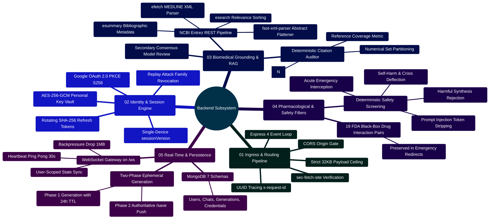
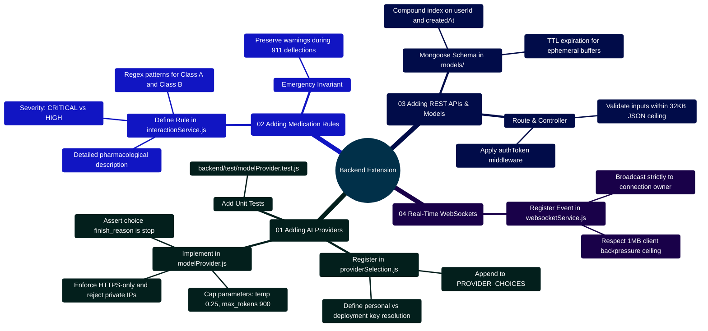

# MedAssist AI — Backend Architecture & Engineering Reference

Developed by **J Ganesh kumar reddy**

*Full-Stack Educational Health Assistance, Biomedical Evidence Grounding, & Machine Learning Research Platform*

---

## 1. Backend Subsystem Architecture & Master Topology

The MedAssist AI backend is engineered as a high-throughput, security-hardened service runtime utilizing **Node.js 24 LTS**, **Express 4**, **ws (WebSocket)**, and **MongoDB 7 (Mongoose)**. It provides authenticated REST APIs, real-time WebSocket state distribution, deterministic heuristic safety screening, multi-provider generative AI dispatch (Gemini, Groq, Together AI, Local vLLM), live NCBI PubMed literature retrieval, and an authenticated AES-256-GCM personal API key vault.

> [!CAUTION]
> **Clinical Notice**: All citation-number checks, XML parsing routines, and drug interaction screeners operate as deterministic software verifications. They do not establish clinical fact-checking, biological consensus, or production medical device suitability.

```
========================================================================================================================
                                     MEDASSIST AI — BACKEND COMPONENT ARCHITECTURE
========================================================================================================================

                                     +------------------------------------+
                                     |     React Client (Port 5173/8080)  |
                                     +------------------------------------+
                                        │ HTTP REST           │ WebSocket (/ws)
                                        ▼                     ▼
+======================================================================================================================+
|                        EXPRESS + WEBSOCKET SERVER (backend/server.js)                                                |
|                                        (Port 5000)                                                                   |
|                                                                                                                      |
|  [Global Middleware Pipeline (app.js)]                                                                               |
|  ├── Request ID Tracing (UUIDv4 x-request-id)   ├── Security Headers (nosniff, DENY, no-referrer, no-store)          |
|  ├── CORS Origin Whitelist Gate                ├── Strict Non-Safe Origin Match Gate (sec-fetch-site)                |
|  ├── Body Parser (32KB JSON Ceiling)           └── Rate Limiters (Auth: 30/15m, AI: 20/m, Set: 12/15m, Rec: 5/15m)   |
|                                                                                                                      |
|  [Authentication & Session Guard]                                                                                    |
|  ├── authToken.js: Cookie-based JWT verification with Monotonic sessionVersion Enforcement                           |
|  └── sessionService.js: SHA-256 Refresh Token Hashing with Single-Use Rotation & Replay Family Revocation            |
|                                                                                                                      |
|  [API Routes]                                                                                                        |
|  ├── /api/auth       (authRoute.js)     ──► authController.js & oauthController.js (PKCE S256 Flow)                  |
|  ├── /api/settings   (settingsRoute.js) ──► settingsController.js (AES-256-GCM Key Vault & User Preferences)        |
|  ├── /api/ai         (aiRoute.js)       ──► aiController.js (Two-Phase Ephemeral Generation Handshake)                |
|  ├── /api/medical    (medicalRoute.js)  ──► medicalController.js (Forced PubMed Grounding Pipeline)                  |
|  ├── /api/analytics  (analyticsRoute.js)──► analyticsController.js (7/30/90-Day UTC Trends & Telemetry)             |
|  └── /api (Chat)     (chatRoute.js)     ──► chatController.js (Authoritative /save & Cursor History Pagination)      |
|                                                                                                                      |
|  [Core Services]                                                                                                     |
|  ├── answerService.js: Query routing, safety interception, context windowing, RAG coordinator                        |
|  ├── modelProvider.js: Multi-provider dispatch (Gemini 2.5 Flash, Groq, Together AI, Local vLLM/Ollama)              |
|  ├── providerSelection.js: Resolves deployment defaults vs AES-256-GCM user-vault personal keys                     |
|  ├── pubmedService.js: NCBI Entrez REST client (esearch, esummary, efetch) & fast-xml-parser flattener               |
|  ├── citationService.js: Deterministic [N] numerical citation extraction & set partitioning auditor                  |
|  ├── interactionService.js: Deterministic 19-pair FDA black-box drug interaction scanner                             |
|  ├── answerVerifier.js: Secondary LLM consensus reviewer (SUPPORTED vs UNSUPPORTED)                                 |
|  ├── safetyService.js: Deterministic prompt & output screening for crisis, emergency, and harmful synthesis         |
|  └── websocketService.js: 30s heartbeat watchdog ping-pong & 1MB backpressure drop protection                        |
+======================================================================================================================+
           │                                             │                                            │
           ▼                                             ▼                                            ▼
  +==================+                         +===================+                        +===================+
  | MongoDB 7        |                         | NCBI PubMed API   |                        | Upstream AI Cloud |
  | (Users, Chats,   |                         | (esearch, esummary|                        | (Google Gemini,   |
  |  Generations TTL,|                         |  efetch MEDLINE)  |                        |  Groq, Together,  |
  |  Credentials)    |                         |                   |                        |  Local vLLM)      |
  +==================+                         +===================+                        +===================+
========================================================================================================================
```

---

## 2. Backend Capabilities Mindmap



---

## 3. Directory & Module Inventory

```
backend/
├── app.js                          # Express application factory with middleware pipeline
├── server.js                       # HTTP & WebSocket process entry point with graceful shutdown
├── Dockerfile                      # Production container definition (node:24-alpine)
├── package.json                    # Backend dependencies and native test runner scripts
├── README.md                       # This technical manual
│
├── controllers/                    # Route Controllers
│   ├── aiController.js             # Two-phase generative AI chat coordinator
│   ├── analyticsController.js      # Usage telemetry, daily UTC trends, dataset report parsing
│   ├── authController.js           # Registration, login, token rotation, account wipe
│   ├── chatController.js           # Authoritative message saves, history pagination, rename
│   ├── medicalController.js        # Explicit medical query handler (req.forceMedical = true)
│   ├── oauthController.js          # Google OAuth 2.0 PKCE flow & OpenID token exchange
│   └── settingsController.js       # User preferences and AES-256-GCM key management
│
├── middleware/
│   └── authToken.js                # Validates HttpOnly access cookie & monotonic sessionVersion
│
├── models/                         # Mongoose Schemas & Database Models
│   ├── userModel.js                # User accounts, salted bcrypt hash, sessionVersion
│   ├── chatModel.js                # Conversation threads, message turns, PubMed references
│   ├── generationModel.js          # Ephemeral in-flight generations with 24-hour TTL index
│   └── providerCredentialModel.js  # AES-256-GCM encrypted user API keys (IV, Tag, Data)
│
├── routes/                         # Express Route Definitions
│   ├── aiRoute.js                  # POST /api/ai/chat
│   ├── analyticsRoute.js           # GET /api/analytics/overview
│   ├── authRoute.js                # /api/auth/* (register, login, google, refresh, reset)
│   ├── chatRoute.js                # /api/save, /api/history, /api/chats/:id
│   ├── medicalRoute.js             # POST /api/medical
│   └── settingsRoute.js            # /api/settings/* (GET/PATCH preferences, PUT/DELETE keys)
│
├── services/                       # Core Business Logic & Upstream Service Clients
│   ├── aiService.js                # Google Gemini Generative Language API integration
│   ├── answerService.js            # Dual-engine router, safety gate, grounding coordinator
│   ├── answerVerifier.js           # Secondary LLM consensus reviewer (SUPPORTED/UNSUPPORTED)
│   ├── citationService.js          # Deterministic [N] citation verification & coverage math
│   ├── config.js                   # Startup environment variable validation & key checks
│   ├── emailService.js             # Brevo transactional email dispatcher
│   ├── historySearch.js            # Conversational turn relevance ranking via token overlap
│   ├── interactionService.js       # Deterministic 14-pair FDA black-box drug interaction scanner
│   ├── modelProvider.js            # Multi-provider client (Gemini, Groq, Together, Local)
│   ├── providerCredentials.js      # AES-256-GCM authenticated cipher vault (seal/open)
│   ├── providerSelection.js        # Resolves operator deployment vs personal encrypted keys
│   ├── pubmedService.js            # NCBI Entrez client (esearch, esummary, efetch) & XML parser
│   ├── safetyService.js            # Deterministic prompt and output safety screening
│   ├── sessionService.js           # Dual JWT issuance, SHA-256 token hashing, cookie options
│   ├── validation.js               # Schema validators for UUIDs, email, allowed JSON keys
│   └── websocketService.js         # WebSocket server on /ws with 30s heartbeat watchdog
│
└── test/                           # Automated Backend Test Suites (64 Passing Tests)
    ├── application.test.js         # Integration tests with in-memory MongoMemoryServer
    ├── chatTitle.test.js           # Conversation auto-titling and markdown stripping tests
    ├── citationService.test.js     # Unit tests for citation parsing and coverage math
    ├── historySearch.test.js       # Unit tests for conversational history selection
    ├── interactionService.test.js  # Unit tests for 14 high-risk drug interaction pairs
    ├── modelProvider.test.js       # Unit tests for multi-provider API resolution
    ├── providers.test.js           # Unit tests for PubMed sorting, XML parsing, Gemini
    ├── pubmedService.test.js       # Unit tests for PubMed query string generation
    └── safetyService.test.js       # Unit tests for crisis and medical emergency screening
```

---

## 4. Key Implementation Code Snippets

### 4.1 Single-Device Authentication & Session Verification (`backend/middleware/authToken.js`)

```javascript
// Implementation snippet from backend/middleware/authToken.js:
const { authenticate } = require("../services/sessionService");

module.exports = async (req, res, next) => {
  try {
    const { user } = await authenticate(req.cookies.accessToken);
    req.user = { id: String(user._id), version: user.sessionVersion };
    req.authUser = user;
    next();
  } catch (error) {
    return res.status(401).json({
      code: error.name === "TokenExpiredError" ? "ACCESS_EXPIRED" : "AUTH_REQUIRED",
      message: "Please sign in to continue.",
      requestId: req.requestId,
    });
  }
};
```

### 4.2 Rotating Refresh Tokens & Replay Defense (`backend/services/sessionService.js`)

```javascript
// Implementation snippet from backend/services/sessionService.js:
const jwt = require("jsonwebtoken");
const { createHash, randomUUID } = require("crypto");
const User = require("../models/userModel");

const hashToken = (value) => createHash("sha256").update(value).digest("hex");

const makeTokens = (user) => {
  const claims = { id: String(user._id), version: user.sessionVersion };
  return {
    accessToken: jwt.sign(claims, process.env.JWT_ACCESS_SECRET, { expiresIn: "15m" }),
    refreshToken: jwt.sign({ ...claims, jti: randomUUID() }, process.env.JWT_REFRESH_SECRET, { expiresIn: "7d" }),
  };
};

const authenticate = async (token) => {
  const decoded = jwt.verify(token || "", process.env.JWT_ACCESS_SECRET);
  if (!Number.isInteger(decoded.version)) throw new Error("Legacy session expired");

  // Enforce monotonic sessionVersion comparison
  const user = await User.findOne({ _id: decoded.id, sessionVersion: decoded.version, isVerified: true });
  if (!user) throw new Error("Session revoked");
  return { user, expiresAt: decoded.exp * 1000 };
};
```

### 4.3 AES-256-GCM Personal API Key Vault (`backend/services/providerCredentials.js`)

```javascript
// Implementation snippet from backend/services/providerCredentials.js:
const { randomBytes, createCipheriv, createDecipheriv } = require("crypto");
const { fail } = require("./validation");

const encryptionKey = () => {
  const raw = process.env.USER_API_KEY_ENCRYPTION_KEY;
  if (!raw || !/^[0-9a-f]{64}$/i.test(raw)) {
    throw fail("Personal API key storage is misconfigured.", 503, "KEY_STORAGE_UNAVAILABLE");
  }
  return Buffer.from(raw, "hex");
};

const seal = (apiKey) => {
  if (typeof apiKey !== "string" || apiKey.length < 12 || apiKey.length > 512 || /\s|[\x00-\x1f\x7f]/.test(apiKey)) {
    throw fail("Enter a valid API key without spaces (12 to 512 characters).");
  }
  const iv = randomBytes(12);
  const cipher = createCipheriv("aes-256-gcm", encryptionKey(), iv);
  const ciphertext = Buffer.concat([cipher.update(apiKey, "utf8"), cipher.final()]);
  return {
    iv: iv.toString("base64"),
    tag: cipher.getAuthTag().toString("base64"),
    ciphertext: ciphertext.toString("base64"),
    lastFour: apiKey.slice(-4),
    updatedAt: new Date(),
  };
};

const open = (record) => {
  try {
    const decipher = createDecipheriv("aes-256-gcm", encryptionKey(), Buffer.from(record.iv, "base64"));
    decipher.setAuthTag(Buffer.from(record.tag, "base64"));
    return Buffer.concat([decipher.update(Buffer.from(record.ciphertext, "base64")), decipher.final()]).toString("utf8");
  } catch {
    throw fail("The saved API key could not be read. Remove it and add a new key.", 503, "KEY_UNAVAILABLE");
  }
};
```

### 4.4 High-Risk Medication Contraindication Scanner (`backend/services/interactionService.js`)

```javascript
// Implementation snippet from backend/services/interactionService.js:
const HIGH_RISK_INTERACTION_RULES = [
  {
    pair: "Anticoagulant / Antiplatelet + NSAIDs / Aspirin",
    drugA: "Anticoagulants / Antiplatelets (e.g., Warfarin, Eliquis, Plavix)",
    drugB: "NSAIDs / Aspirin (e.g., Ibuprofen, Naproxen, Aspirin)",
    severity: "CRITICAL",
    drugsA: [/\bwarfarin\b/i, /\beliquis\b/i, /\bxarelto\b/i, /\bclopidogrel\b/i, /\bplavix\b/i],
    drugsB: [/\baspirin\b/i, /\bibuprofen\b/i, /\badvil\b/i, /\bnaproxen\b/i, /\baleve\b/i],
    description: "Concurrent use significantly elevates gastrointestinal ulceration and systemic bleeding risks.",
  },
  {
    pair: "PDE5 Inhibitor + Nitrate Vasodilator",
    drugA: "PDE5 Inhibitors (e.g., Sildenafil, Tadalafil)",
    drugB: "Nitrates (e.g., Nitroglycerin, Isosorbide)",
    severity: "CRITICAL",
    drugsA: [/\bsildenafil\b/i, /\bviagra\b/i, /\btadalafil\b/i, /\bcialis\b/i],
    drugsB: [/\bnitroglycerin\b/i, /\bnitrostat\b/i, /\bisosorbide\b/i],
    description: "Absolute contraindication: Causes synergistic cyclic GMP accumulation leading to profound hypotension.",
  },
  {
    pair: "Allopurinol / Febuxostat + Azathioprine / 6-Mercaptopurine",
    drugA: "Xanthine Oxidase Inhibitors (e.g., Allopurinol, Febuxostat)",
    drugB: "Thiopurines (e.g., Azathioprine, 6-Mercaptopurine)",
    severity: "CRITICAL",
    drugsA: [/\ballopurinol\b/i, /\bzyloprim\b/i, /\bfebuxostat\b/i],
    drugsB: [/\bazathioprine\b/i, /\bimuran\b/i, /\b6-mercaptopurine\b/i, /\b6-mp\b/i],
    description: "Major contraindication: Xanthine oxidase inhibition blocks thiopurine degradation, precipitating severe active metabolite accumulation, life-threatening bone marrow suppression, and profound pancytopenia.",
  },
  {
    pair: "Methotrexate + NSAIDs / High-Dose Aspirin",
    drugA: "Methotrexate (e.g., Rheumatrex, Trexall)",
    drugB: "NSAIDs / Aspirin (e.g., Ibuprofen, Naproxen, Ketorolac, High-Dose Aspirin)",
    severity: "CRITICAL",
    drugsA: [/\bmethotrexate\b/i, /\btrexall\b/i, /\botrexup\b/i, /\brheumatrex\b/i],
    drugsB: [/\bibuprofen\b/i, /\bmotrin\b/i, /\badvil\b/i, /\bnaproxen\b/i, /\baleve\b/i, /\bketorolac\b/i, /\baspirin\b/i],
    description: "Inhibition of renal prostaglandin synthesis and competitive tubular secretion blockage by NSAIDs markedly reduces renal methotrexate clearance, precipitating life-threatening bone marrow suppression, pancytopenia, and acute kidney injury (FDA Black Box Warning).",
  },
  // 11 additional FDA Black-Box interaction rules...
];

const detectDrugInteractions = (text) => {
  if (typeof text !== "string" || !text.trim()) return [];
  const matches = [];
  for (const rule of HIGH_RISK_INTERACTION_RULES) {
    if (rule.drugsA.some((rx) => rx.test(text)) && rule.drugsB.some((rx) => rx.test(text))) {
      matches.push({ pair: rule.pair, severity: rule.severity, drugA: rule.drugA, drugB: rule.drugB, description: rule.description });
    }
  }
  return matches;
};
```

### 4.5 Three-Stage NCBI Entrez PubMed Harvester (`backend/services/pubmedService.js`)

Retrieves matching biomedical literature through a rate-throttled 3-stage HTTP protocol (110ms with NCBI key, 350ms without key):

```javascript
// Implementation snippet from backend/services/pubmedService.js:
const buildPubMedQuery = (prompt) => {
  const tokens = String(prompt || "").toLowerCase().match(/[a-z][a-z0-9-]+/g) || [];
  return [...new Set(tokens.filter((token) => token.length > 2 && !STOP.has(token)))].slice(0, 12).join(" ") || String(prompt || "").trim();
};

const parseAbstracts = (xml) => {
  const parsed = new XMLParser({ ignoreAttributes: false, processEntities: false, parseTagValue: false }).parse(xml);
  const result = new Map();
  for (const article of array(parsed?.PubmedArticleSet?.PubmedArticle)) {
    const citation = article.MedlineCitation;
    const pmid = typeof citation?.PMID === "object" ? citation.PMID["#text"] : citation?.PMID;
    const flatten = (value) => typeof value === "string" ? value : Array.isArray(value) ? value.map(flatten).join(" ") : value && typeof value === "object" ? Object.entries(value).filter(([key]) => !key.startsWith("@_")).map(([, item]) => flatten(item)).join(" ") : "";
    const abstract = array(citation?.Article?.Abstract?.AbstractText).map(flatten).join("\n").trim();
    if (pmid && abstract) result.set(String(pmid), abstract.slice(0, 10000));
  }
  return result;
};
```

### 4.6 Deterministic Citation Set-Partitioning Auditor (`backend/services/citationService.js`)

Scans generated LLM completions for bracketed numbers `[N]`, validates multi-range citations (e.g. `[1-3]`), and partitions cited numbers into valid and invalid sets:

```javascript
// Implementation snippet from backend/services/citationService.js:
const CITATION_PATTERN = /\[(\d+)\]/g;
const MULTI_CITATION_PATTERN = /\[(\d+(?:\s*(?:[-–]|,)\s*\d+)*)\]/g;

const assessCitationGrounding = (text, sourceCount = 0) => {
  const safeSourceCount = Math.max(0, Number(sourceCount) || 0);
  const rawString = String(text || "");
  const extractedNumbers = [];
  for (const match of rawString.matchAll(MULTI_CITATION_PATTERN)) {
    for (const part of match[1].split(",")) {
      const trimmed = part.trim();
      const rangeMatch = trimmed.match(/^(\d+)\s*[-–]\s*(\d+)$/);
      if (rangeMatch) {
        const start = Number(rangeMatch[1]);
        const end = Number(rangeMatch[2]);
        if (start <= end && end - start <= 20) {
          for (let i = start; i <= end; i++) extractedNumbers.push(i);
        } else {
          extractedNumbers.push(start, end);
        }
      } else {
        const num = Number(trimmed);
        if (Number.isInteger(num)) extractedNumbers.push(num);
      }
    }
  }
  const citedNumbers = [
    ...new Set(
      extractedNumbers.length
        ? extractedNumbers
        : Array.from(rawString.matchAll(CITATION_PATTERN), (match) => Number(match[1]))
    ),
  ].sort((left, right) => left - right);

  const validCitations = citedNumbers.filter((n) => n >= 1 && n <= safeSourceCount);
  const invalidCitations = citedNumbers.filter((n) => n < 1 || n > safeSourceCount);

  let status = "ungrounded";
  if (safeSourceCount > 0 && citedNumbers.length === 0) status = "sources_supplied";
  if (safeSourceCount > 0 && validCitations.length > 0) status = "citation_checked";
  if (invalidCitations.length > 0) status = "invalid_citations";

  return {
    status,
    sourceCount: safeSourceCount,
    validCitationCount: validCitations.length,
    invalidCitationCount: invalidCitations.length,
    citationCoverage: safeSourceCount ? Number(((validCitations.length / safeSourceCount) * 100).toFixed(1)) : 0,
    citedSourceNumbers: validCitations,
    invalidSourceNumbers: invalidCitations,
    citationNumbersValid: validCitations.length > 0 && invalidCitations.length === 0,
    grounded: false,
  };
};
```

### 4.7 Complete 19 FDA Black-Box Medication Interaction Inventory

| # | Medication Pair Category | Class / Agent A | Class / Agent B | Severity | Clinical Risk & Pharmacology |
|:---|:---|:---|:---|:---:|:---|
| **01** | Anticoagulants + NSAIDs | Warfarin, Eliquis, Xarelto, Plavix, Heparin | Ibuprofen, Naproxen, Aspirin, Ketorolac | **CRITICAL** | Synergy of platelet inhibition and GI mucosal damage causes massive hemorrhage. |
| **02** | PDE5 Inhibitors + Nitrates | Sildenafil (Viagra), Tadalafil (Cialis) | Nitroglycerin, Isosorbide Mononitrate | **CRITICAL** | Synergistic cGMP accumulation causes profound, refractory hypotension and collapse. |
| **03** | Opioids + Serotonergic Agents | Tramadol, Meperidine, Methadone | Fluoxetine, Sertraline, Paroxetine, Venlafaxine | **HIGH** | Intrasynaptic serotonin accumulation triggers Serotonin Syndrome and seizures. |
| **04** | RAAS Blockers + K-Sparing | Lisinopril, Enalapril, Losartan, Valsartan | Spironolactone, Eplerenone, K+ supplements | **HIGH** | Additive aldosterone suppression triggers fatal hyperkalemia ($K^+ > 5.5\text{ mEq/L}$). |
| **05** | Methotrexate + TMP-SMX | Methotrexate (Trexall, Rasuvo) | Trimethoprim-Sulfamethoxazole (Bactrim) | **CRITICAL** | Competitive tubular secretion blockade precipitates lethal pancytopenia. |
| **06** | Fluoroquinolones + Steroids | Ciprofloxacin, Levofloxacin, Moxifloxacin | Prednisone, Dexamethasone, Methylprednisolone| **HIGH** | Synergistic collagen degradation markedly elevates risk of Achilles tendon rupture. |
| **07** | Benzodiazepines + Opioids | Alprazolam, Diazepam, Lorazepam, Clonazepam | Oxycodone, Morphine, Fentanyl, Hydromorphone | **CRITICAL** | Concurrent $\text{GABA}_A$ and $\mu$-opioid receptor depression causes fatal respiratory arrest. |
| **08** | Lithium + NSAIDs / ACEIs | Lithium (Eskalith, Lithobid) | Ibuprofen, Naproxen, Lisinopril, Enalapril | **HIGH** | Renal prostaglandin inhibition reduces lithium clearance by up to 40%, causing neurotoxicity. |
| **09** | Statins + CYP3A4 Inhibitors | Simvastatin, Atorvastatin, Lovastatin | Clarithromycin, Gemfibrozil, Ketoconazole | **CRITICAL** | CYP3A4 inhibition elevates plasma statin AUC up to 20-fold, precipitating rhabdomyolysis. |
| **10** | Warfarin + Azole Antifungals | Warfarin (Coumadin, Jantoven) | Fluconazole, Voriconazole, Ketoconazole | **CRITICAL** | CYP2C9 inhibition halts S-warfarin clearance, causing supratherapeutic INR and bleeding. |
| **11** | Digoxin + P-gp Inhibitors | Digoxin (Lanoxin) | Amiodarone, Verapamil, Diltiazem | **HIGH** | P-glycoprotein transport blockade doubles serum digoxin concentrations, inducing heart block. |
| **12** | MAOIs + Serotonergic Agents | Phenelzine, Tranylcypromine, Selegiline | SSRIs, SNRIs, Pseudoephedrine, Amphetamines | **CRITICAL** | Monoamine degradation blockade triggers malignant hypertensive crisis and hyperthermia. |
| **13** | Xanthine Oxidase + Thiopurines| Allopurinol (Zyloprim), Febuxostat (Uloric)| Azathioprine (Imuran), 6-MP (Purixan) | **CRITICAL** | Xanthine oxidase inhibition suppresses thiopurine degradation, causing severe pancytopenia. |
| **14** | Methotrexate + NSAIDs / Aspirin| Methotrexate (Rheumatrex, Trexall) | Ibuprofen, Naproxen, Ketorolac, Aspirin | **CRITICAL** | Tubular secretion inhibition reduces methotrexate clearance, precipitating fatal marrow suppression. |
| **15** | Warfarin + TMP-SMX (Bactrim) | Warfarin (Coumadin, Jantoven) | Trimethoprim-Sulfamethoxazole (Bactrim, Septra) | **CRITICAL** | Potent CYP2C9 inhibition suppresses active S-warfarin clearance and gut flora depletion reduces vitamin K synthesis, precipitating acute supratherapeutic INR surges and hemorrhage. |
| **16** | Clopidogrel + Omeprazole / Esomeprazole | Clopidogrel (Plavix) | Omeprazole (Prilosec), Esomeprazole (Nexium) | **CRITICAL** | Major contraindication (FDA Boxed Warning): Potent CYP2C19 inhibition prevents hepatic metabolic conversion of prodrug clopidogrel into active antiplatelet metabolite, increasing stent thrombosis and reinfarction risk. |
| **17** | SSRI / SNRI / MAOI + Triptan | Fluoxetine, Sertraline, Duloxetine, Phenelzine | Sumatriptan, Rizatriptan, Zolmitriptan, Eletriptan | **CRITICAL** | FDA Warning: Concurrent use of 5-HT1 receptor agonist triptans with SSRIs, SNRIs, or MAOIs substantially elevates central serotonin receptor stimulation, precipitating acute Serotonin Syndrome. |
| **18** | TMP-SMX (Bactrim) + ACEI / ARB / K-Sparing | Trimethoprim-Sulfamethoxazole (Bactrim, Septra) | Lisinopril, Enalapril, Losartan, Spironolactone | **CRITICAL** | Major contraindication: Trimethoprim blocks distal nephron epithelial sodium channels (ENaC) identically to potassium-sparing diuretics. Combined with RAAS blockade, severe refractory hyperkalemia and sudden cardiac arrest occur. |
| **19** | Theophylline + Fluoroquinolone | Theophylline (Theo-24, Elixophyllin, Aminophylline) | Ciprofloxacin (Cipro), Enoxacin | **CRITICAL** | Major contraindication (FDA Warning): Ciprofloxacin potently inhibits hepatic CYP1A2, reducing theophylline metabolic clearance by 30% to 50% or more. This precipitous accumulation drives serum theophylline into toxic ranges, causing refractory seizures, malignant cardiac arrhythmias, and sudden death. |

---

## 5. Master REST API Specification Matrix

| Method | Endpoint | Authentication | Rate Limit | Request Body / Parameters | Response Status & Key Fields |
| :--- | :--- | :---: | :---: | :--- | :--- |
| `POST` | `/api/auth/register` | Public | 30 / 15m | `{ email, password }` | `201 Created`: `{ message, user }` |
| `POST` | `/api/auth/login` | Public | 30 / 15m | `{ email, password }` | `200 OK`: Sets HttpOnly cookies; `{ user }` |
| `POST` | `/api/auth/logout` | Public | None | None | `200 OK`: Clears cookies; closes WebSockets |
| `POST` | `/api/auth/refresh-token` | HttpOnly Cookie | None | None | `200 OK`: Issues rotated token cookies |
| `GET` | `/api/auth/check` | Authenticated | None | None | `200 OK`: `{ user, providerConfigured }` |
| `DELETE`| `/api/auth/account` | Authenticated | 12 / 15m | `{ password }` | `200 OK`: Cascading purge of account & keys |
| `POST` | `/api/ai/chat` | Authenticated | 20 / 1m | `{ prompt, sessionId, exchangeId }` | `200 OK`: `{ text, generationId, sessionId }` |
| `POST` | `/api/medical` | Authenticated | 20 / 1m | `{ prompt, sessionId, exchangeId }` | `200 OK`: Forces PubMed grounding |
| `POST` | `/api/save` | Authenticated | None | `{ generationId }` | `201 Created`: Commits message to chat |
| `GET` | `/api/history` | Authenticated | None | Query: `limit`, `q`, `cursor` | `200 OK`: `{ items, nextCursor }` |
| `GET` | `/api/chats/:id` | Authenticated | None | URL Parameter: `sessionId` | `200 OK`: `{ chat: { messages } }` |
| `PATCH`| `/api/chats/:id` | Authenticated | None | `{ title, isPinned }` | `200 OK`: Updates chat metadata |
| `DELETE`| `/api/chats/:id` | Authenticated | None | URL Parameter: `sessionId` | `200 OK`: Deletes single thread |
| `DELETE`| `/api/history` | Authenticated | None | None | `200 OK`: Permanently deletes all user chats |
| `GET` | `/api/settings` | Authenticated | None | None | `200 OK`: `{ preferences, providers }` |
| `PATCH`| `/api/settings` | Authenticated | 12 / 15m | `{ answerStyle, audienceProfile, provider }` | `200 OK`: Updates user preferences |
| `PUT` | `/api/settings/providers`| Authenticated | 12 / 15m | `{ provider, apiKey, model }` | `200 OK`: Seals key in AES-256-GCM vault |
| `DELETE`| `/api/settings/providers`| Authenticated | 12 / 15m | `{ provider }` | `200 OK`: Purges stored encrypted key |
| `GET` | `/api/analytics/overview`| Public | None | None | `200 OK`: Summary statistics & report data |
| `GET` | `/api/health` | Public | None | None | `200 OK`: Process vitality probe |
| `GET` | `/api/ready` | Public | None | None | `200 OK` / `503`: Subsystem readiness probe |

---

## 6. Running Automated Backend Tests

The backend test suite executes via Node.js native test runner (`node:test`) with in-memory MongoDB (`MongoMemoryServer`):

```powershell
cd backend
npm test
```

### Complete Test Suite Breakdown (71 Tests across 9 Suites):
1. `application.test.js` (24 Tests): Comprehensive HTTP and WebSocket integration suite with `MongoMemoryServer`. Tests registration, token rotation, replay detection, single-device `sessionVersion` invalidation, two-phase generation commitment (`/api/save`), cursor pagination, rate limiters, and WebSocket notifications.
2. `interactionService.test.js` (18 Tests): Validates deterministic name matching across all 19 FDA black-box drug interaction rules and ensures benign/unrelated medications pass without warnings.
3. `safetyService.test.js` (7 Tests): Verifies crisis deflection, acute emergency symptom interception, prompt injection defense, and educational/negated exemptions.
4. `providers.test.js` (6 Tests): Unit tests for AES-256-GCM vault seal/open, PubMed numeric UID sorting, structured XML abstract parsing, and Gemini candidate normalization.
5. `citationService.test.js` (4 Tests): Validates numerical bracket parsing `[N]`, valid vs invalid set partitioning, and reference coverage math.
6. `modelProvider.test.js` (4 Tests): Unit tests verifying provider completion resolution across Gemini, Groq, Together AI, and Local endpoints.
7. `pubmedService.test.js` (3 Tests): Unit tests for E-Utilities query string construction, keyword extraction, and rate throttle delays.
8. `historySearch.test.js` (2 Tests): Unit tests for cross-conversation token overlap relevance ranking and stop-word elimination.
9. `chatTitle.test.js` (1 Test): Validates conversation auto-titling, markdown link/image stripping, and length bounding.

---

## 7. Developer Extension Blueprint: Building on the Backend

The MedAssist AI backend is engineered as a decoupled, modular service runtime. Developers extending this service must preserve core architectural invariants:

### 7.1 Backend Extension Architecture Topology

```
========================================================================================================================
                                     MEDASSIST AI — BACKEND EXTENSION BLUEPRINT
========================================================================================================================

    [ INCOMING HTTP / WS REQUEST ]
                 │
                 ▼
    ┌─────────────────────────────────────────────────────────────────┐
    │ TIER 1: SECURITY & AUTHENTICATION GATES (app.js, authToken.js)  │
    │ ├── 32KB JSON Body Limit & Strict Origin Whitelisting           │
    │ ├── Cookie JWT Validation & Monotonic sessionVersion Check      │
    │ └── Per-User Rate Limiting (Express-Rate-Limit)                 │
    └─────────────────────────────────────────────────────────────────┘
                 │
                 ▼
    ┌─────────────────────────────────────────────────────────────────┐
    │ TIER 2: ROUTING & CONTROLLERS (routes/*.js, controllers/*.js)   │
    │ ├── Parameter Sanitization & UUIDv4 Request Tracing             │
    │ ├── Owner Scoping: All DB Queries Filter by { userId }          │
    │ └── Two-Phase Handshake for AI Generations                      │
    └─────────────────────────────────────────────────────────────────┘
                 │
                 ▼
    ┌─────────────────────────────────────────────────────────────────┐
    │ TIER 3: SERVICES & DETERMINISTIC GUARDS (services/*.js)         │
    │ ├── Deterministic Safety Screening (safetyService.js)           │
    │ ├── 19 FDA High-Risk Drug Interaction Rules (interactionService)│
    │ ├── Multi-Provider AI Gateway (modelProvider.js)                │
    │ └── AES-256-GCM Authenticated Cryptographic Vault               │
    └─────────────────────────────────────────────────────────────────┘
                 │
                 ▼
    ┌─────────────────────────────────────────────────────────────────┐
    │ TIER 4: PERSISTENCE & REAL-TIME (models/*.js, websocketService) │
    │ ├── Mongoose Schemas with Compound Indexes ({ userId, date })   │
    │ ├── 24-Hour Ephemeral Generation TTL Expiry                     │
    │ └── WebSocket User-Scoped Fanout with 1MB Backpressure Drop     │
    └─────────────────────────────────────────────────────────────────┘
========================================================================================================================
```

### 7.2 Backend Extension Mindmap



### 7.3 Step-by-Step: Adding an Authenticated REST API & Model

When adding a new feature (such as Clinical Notes or Patient Queries), follow these steps:

#### Step 1: Define Mongoose Model with Owner Tenancy Isolation

```javascript
// File: backend/models/clinicalNoteModel.js
const mongoose = require("mongoose");

const ClinicalNoteSchema = new mongoose.Schema(
  {
    userId: {
      type: mongoose.Schema.Types.ObjectId,
      ref: "User",
      required: true,
      index: true, // Guarantees owner isolation
    },
    title: {
      type: String,
      required: true,
      trim: true,
      maxlength: 120,
    },
    content: {
      type: String,
      required: true,
      maxlength: 10000,
    },
    tags: [{ type: String, trim: true, maxlength: 30 }],
  },
  { timestamps: true }
);

// Compound index for fast chronological retrieval
ClinicalNoteSchema.index({ userId: 1, createdAt: -1 });

module.exports = mongoose.model("ClinicalNote", ClinicalNoteSchema);
```

#### Step 2: Implement Controller with Strict Owner Scoping

```javascript
// File: backend/controllers/clinicalNoteController.js
const ClinicalNote = require("../models/clinicalNoteModel");

async function listNotes(req, res) {
  // Invariant: Always filter by req.userId verified from JWT
  const notes = await ClinicalNote.find({ userId: req.userId })
    .sort({ createdAt: -1 })
    .limit(50)
    .lean();

  return res.json({ notes });
}

async function createNote(req, res) {
  const { title, content, tags } = req.body;
  if (!title || !content) {
    return res.status(400).json({ error: "Title and content are required." });
  }

  const note = await ClinicalNote.create({
    userId: req.userId,
    title,
    content,
    tags: Array.isArray(tags) ? tags.slice(0, 10) : [],
  });

  return res.status(201).json({ note });
}

module.exports = { listNotes, createNote };
```

#### Step 3: Register Route with Authentication & Rate Limiting

```javascript
// File: backend/routes/clinicalNoteRoute.js
const express = require("express");
const router = express.Router();
const authToken = require("../middleware/authToken");
const { listNotes, createNote } = require("../controllers/clinicalNoteController");

// Invariant: authToken middleware guarantees valid monotonic sessionVersion
router.use(authToken);

router.get("/", listNotes);
router.post("/", createNote);

module.exports = router;
```

