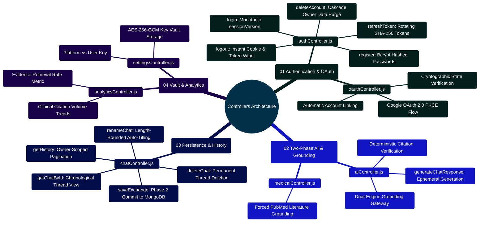

# MedAssist AI — Backend Controllers Architecture & API Reference Manual

Developed by **J Ganesh kumar reddy**  
*Full-Stack Educational Health Assistance, Biomedical Evidence Grounding, & Machine Learning Research Platform*

---

## 1. Executive Overview & Controller Request Pipeline

The MedAssist AI controller tier (`backend/controllers/`) acts as the HTTP interface boundary between incoming Express requests and core domain services. Controllers strictly enforce input validation, parameter bounds, owner tenancy isolation, and standardized JSON responses. They never contain raw SQL/database queries or low-level crypto math; all persistence and business logic are delegated to Mongoose models and dedicated services.

```
========================================================================================================================
                          MEDASSIST AI — CONTROLLER INGRESS & MIDDLEWARE PIPELINE
========================================================================================================================

    [ INCOMING HTTP CLIENT REQUEST ]
                 │
                 ▼
    ┌────────────────────────────────────────────────────────────────────────────────────────────────────────────────┐
    │                                     TIER 1: GLOBAL EXPRESS MIDDLEWARE STACK                                    │
    │  - Request ID Injection: Attaches cryptographically random UUIDv4 `req.id` & `x-request-id` response header   │
    │  - CORS Gate: Validates `Origin` header against whitelist & checks `sec-fetch-site` on state-changing requests │
    │  - JSON Body Parser: Strict 32KB payload size cap to prevent memory exhaustion and DoS attacks                 │
    │  - Cookie Parser: Reads secure `HttpOnly` session tokens                                                       │
    └────────────────────────────────────────────────────────────────────────────────────────────────────────────────┘
                 │
                 ▼
    ┌────────────────────────────────────────────────────────────────────────────────────────────────────────────────┐
    │                                     TIER 2: RATE LIMITING & AUTHENTICATION GATES                               │
    │  - Tiered Rate Limiters:                                                                                       │
    │      ├── Auth Limiter: 30 requests / 15 minutes (Registration, Login, Refresh)                                 │
    │      ├── Recovery Limiter: 5 requests / 15 minutes (Password Reset, Email Verification)                        │
    │      ├── AI Limiter: 20 requests / 1 minute (Two-Phase Chat & Medical Grounding)                               │
    │      └── Settings Limiter: 12 requests / 15 minutes (Key Vault & Account Settings)                             │
    │  - authToken Middleware:                                                                                       │
    │      ├── Decodes JWT access token from `accessToken` cookie                                                    │
    │      ├── Loads User from MongoDB & verifies `token.sessionVersion === user.sessionVersion`                     │
    │      └── Attaches sanitized `req.user` payload to request object                                               │
    └────────────────────────────────────────────────────────────────────────────────────────────────────────────────┘
                 │
                 ▼
    ┌────────────────────────────────────────────────────────────────────────────────────────────────────────────────┐
    │                                     TIER 3: TARGET CONTROLLER EXECUTION                                        │
    │  - authController.js: Authentication, JWT rotation, email verification, password reset, account deletion       │
    │  - oauthController.js: Google OAuth 2.0 PKCE flow, state challenge validation, OpenID Connect user sync       │
    │  - aiController.js: Two-phase AI generation, PubMed evidence retrieval, citation grounding audits              │
    │  - chatController.js: Authoritative message persistence (/api/save), owner-scoped chat history, search & export │
    │  - medicalController.js: Forced medical grounding query handler                                               │
    │  - settingsController.js: User preference updates, AES-256-GCM encrypted provider key vault management         │
    │  - analyticsController.js: Telemetry aggregation, evidence citation rates, and dataset profiling statistics    │
    └────────────────────────────────────────────────────────────────────────────────────────────────────────────────┘
========================================================================================================================
```

---

## 2. Controllers Architecture Mindmap



---

## 3. Controller Specifications & Endpoint Matrix

### 3.1 `authController.js` — Authentication & Lifecycle
- **Routes Covered**: `POST /api/auth/register`, `POST /api/auth/login`, `POST /api/auth/logout`, `POST /api/auth/refresh-token`, `GET /api/auth/verify-email`, `POST /api/auth/forgot-password`, `POST /api/auth/reset-password`, `DELETE /api/auth/account`.
- **Security Invariant**: Monotonic `sessionVersion` increments on every successful authentication, instantly revoking older active sessions across other devices.

### 3.2 `oauthController.js` — Google OAuth 2.0 PKCE
- **Routes Covered**: `GET /api/auth/google/status`, `GET /api/auth/google/start`, `GET /api/auth/google/callback`.
- **Security Invariant**: Uses PKCE `S256` code challenges and signed, timing-safe state parameter verification to eliminate authorization code injection and CSRF attacks.

### 3.3 `aiController.js` — Two-Phase Generation Coordinator
- **Routes Covered**: `POST /api/ai/chat`.
- **Security Invariant**: Generated responses are written to an ephemeral `Generation` document (24-hour TTL) rather than committed directly to conversation history.

### 3.4 `chatController.js` — Authoritative Conversation Storage
- **Routes Covered**: `POST /api/save`, `GET /api/history`, `GET /api/chats/:id`, `PATCH /api/chats/:id`, `DELETE /api/chats/:id`.
- **Security Invariant**: Strict tenant isolation. All database lookups enforce `{ _id: chatId, owner: req.user._id }`.

### 3.5 `settingsController.js` — Encrypted Key Vault Management
- **Routes Covered**: `GET /api/settings`, `PATCH /api/settings`, `PUT /api/settings/keys/:provider`, `DELETE /api/settings/keys/:provider`.
- **Security Invariant**: User API keys are sealed using AES-256-GCM with unique 12-byte IVs; cleartext keys are never echoed back in API responses.

---

## 4. Developer Extensibility: Adding a New Controller Endpoint

Follow this blueprint when adding a new HTTP controller (e.g., `feedbackController.js`):

```javascript
// backend/controllers/feedbackController.js
// Handles clinical feedback on generated answers
import mongoose from "mongoose";

export async function submitClinicalFeedback(req, res) {
  const { generationId, accuracyRating, clinicalComments } = req.body;

  // 1. Strict Input Validation
  if (!mongoose.Types.ObjectId.isValid(generationId)) {
    return res.status(400).json({ error: "Invalid generation ID format." });
  }

  const rating = Number(accuracyRating);
  if (!Number.isInteger(rating) || rating < 1 || rating > 5) {
    return res.status(400).json({ error: "Rating must be an integer between 1 and 5." });
  }

  const comments = typeof clinicalComments === "string" ? clinicalComments.trim().slice(0, 1000) : "";

  // 2. Delegate persistence to model with owner isolation
  try {
    const feedbackRecord = await mongoose.model("ClinicalFeedback").create({
      owner: req.user._id,
      generationId,
      rating,
      comments,
      createdAt: new Date()
    });

    return res.status(201).json({
      success: true,
      feedbackId: feedbackRecord._id
    });
  } catch (err) {
    console.error("[submitClinicalFeedback] Database error:", err);
    return res.status(500).json({ error: "Failed to submit clinical feedback." });
  }
}
```

---

## 5. Automated Verification Commands

All controllers are verified by the backend Node.js integration test runner:

```powershell
# Run the complete backend test suite (71 tests passing)
npm test --prefix backend

# Run controller integration tests directly
node --test backend/test/application.test.js
node --test backend/test/chatTitle.test.js
```
