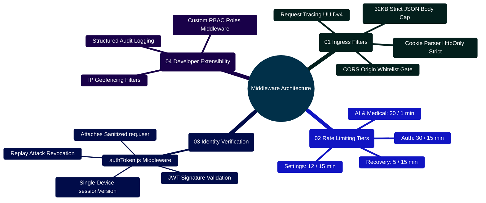

# MedAssist AI — Backend Middleware Architecture & Security Manual

Developed by **J Ganesh kumar reddy**  
*Full-Stack Educational Health Assistance, Biomedical Evidence Grounding, & Machine Learning Research Platform*

---

## 1. Executive Middleware Overview & Ingress Topology

The MedAssist AI middleware layer (`backend/middleware/`) enforces zero-trust boundary verification on all incoming HTTP requests. Middlewares run in strict sequential priority inside `backend/app.js`, ensuring request tracing, CORS gates, strict body bounds, rate limits, and cryptographic JWT session audits occur before any controller logic executes.

```
========================================================================================================================
                          MEDASSIST AI — MIDDLEWARE EXECUTION PIPELINE
========================================================================================================================

    [ INCOMING HTTP REQUEST ]
                 │
                 ▼
    ┌────────────────────────────────────────────────────────────────────────────────────────────────────────────────┐
    │ 1. REQUEST TRACING (uuidv4)                                                                                    │
    │    - Attaches unique `req.id = crypto.randomUUID()` to every request                                           │
    │    - Injects `x-request-id` response header for distributed tracing & log correlation                          │
    └────────────────────────────────────────────────────────────────────────────────────────────────────────────────┘
                 │
                 ▼
    ┌────────────────────────────────────────────────────────────────────────────────────────────────────────────────┐
    │ 2. CORS GATE & METHOD VERIFICATION                                                                             │
    │    - Validates `Origin` against configured whitelist (default: localhost:5173, localhost:8080)                 │
    │    - Rejects cross-origin state changes when `sec-fetch-site === "cross-site"`                                 │
    └────────────────────────────────────────────────────────────────────────────────────────────────────────────────┘
                 │
                 ▼
    ┌────────────────────────────────────────────────────────────────────────────────────────────────────────────────┐
    │ 3. STRICT BODY PARSER & COOKIE PARSER                                                                          │
    │    - Enforces 32KB JSON payload limit (`express.json({ limit: "32kb" })`) to prevent heap starvation attacks   │
    │    - Reads `HttpOnly`, `SameSite=Strict` cookies (`cookieParser()`)                                            │
    └────────────────────────────────────────────────────────────────────────────────────────────────────────────────┘
                 │
                 ▼
    ┌────────────────────────────────────────────────────────────────────────────────────────────────────────────────┐
    │ 4. TIERED RATE LIMITERS                                                                                        │
    │    - Tier A: `authLimiter` (30 requests / 15m) — Login, register, token refresh                                │
    │    - Tier B: `recoveryLimiter` (5 requests / 15m) — Forgot password, email verification                        │
    │    - Tier C: `aiLimiter` (20 requests / 1m) — Generative chat & PubMed retrieval                               │
    │    - Tier D: `settingsLimiter` (12 requests / 15m) — Vault updates & telemetry                                 │
    └────────────────────────────────────────────────────────────────────────────────────────────────────────────────┘
                 │
                 ▼
    ┌────────────────────────────────────────────────────────────────────────────────────────────────────────────────┐
    │ 5. AUTHENTICATION & SESSION AUDIT (backend/middleware/authToken.js)                                            │
    │    - Extracts JWT access token from `accessToken` HttpOnly cookie                                              │
    │    - Cryptographically verifies signature using `ACCESS_TOKEN_SECRET`                                          │
    │    - MONOTONIC VERSION AUDIT: Loads User & asserts `token.sessionVersion === user.sessionVersion`              │
    │    - If mismatched: Returns 401 Unauthorized (session revoked by concurrent sign-in elsewhere)                 │
    │    - Attaches authenticated user object to `req.user`                                                          │
    └────────────────────────────────────────────────────────────────────────────────────────────────────────────────┘
                 │
                 ▼
    [ AUTHORIZED CONTROLLER EXECUTION ]
========================================================================================================================
```

---

## 2. Middleware Architecture Mindmap



---

## 3. Middleware Specifications & Security Invariants

### 3.1 `authToken.js` Implementation
```javascript
// backend/middleware/authToken.js
import jwt from "jsonwebtoken";
import { User } from "../models/userModel.js";

export async function authToken(req, res, next) {
  const token = req.cookies?.accessToken;
  if (!token) {
    return res.status(401).json({ error: "Authentication required." });
  }

  try {
    const decoded = jwt.verify(token, process.env.ACCESS_TOKEN_SECRET);
    const user = await User.findById(decoded.userId).select("+sessionVersion");

    if (!user) {
      return res.status(401).json({ error: "User account not found." });
    }

    // Monotonic session versioning check: Enforces single active device session
    if (user.sessionVersion !== decoded.sessionVersion) {
      return res.status(401).json({ error: "Session expired. Another login occurred." });
    }

    req.user = user;
    next();
  } catch (err) {
    return res.status(401).json({ error: "Invalid or expired access token." });
  }
}
```

---

## 4. Developer Extensibility: Adding a Custom Express Middleware

Follow this pattern when authoring new security or audit middlewares (e.g., `auditLog.js`):

```javascript
// backend/middleware/auditLog.js
// Structured audit logger for clinical and security events

export function createAuditLogger() {
  return (req, res, next) => {
    const startTime = Date.now();
    const requestId = req.id || "unassigned";

    res.on("finish", () => {
      const durationMs = Date.now() - startTime;
      const logEntry = {
        requestId,
        timestamp: new Date().toISOString(),
        method: req.method,
        path: req.originalUrl,
        statusCode: res.statusCode,
        durationMs,
        userId: req.user?._id?.toString() || "unauthenticated",
        ip: req.ip
      };

      // Structured JSON output for Datadog / CloudWatch / ELK Stack
      if (res.statusCode >= 400) {
        console.warn("[HTTP_WARN]", JSON.stringify(logEntry));
      } else {
        console.log("[HTTP_ACCESS]", JSON.stringify(logEntry));
      }
    });

    next();
  };
}
```
