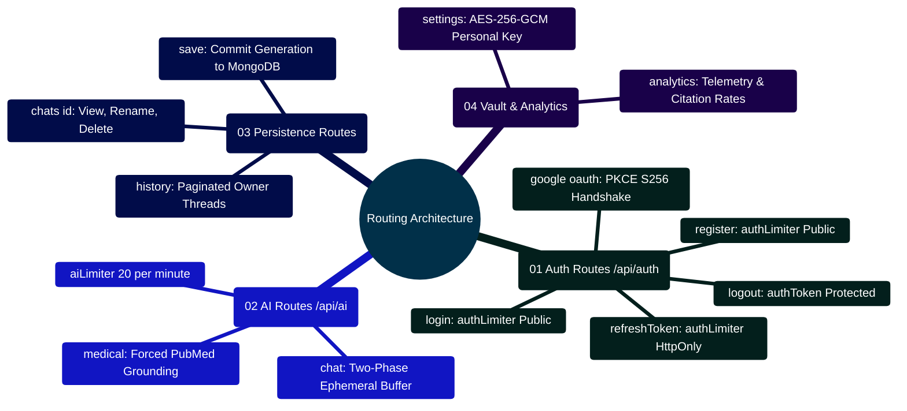

# MedAssist AI — Express Routing Architecture & Endpoint Manual

Developed by **J Ganesh kumar reddy**  
*Full-Stack Educational Health Assistance, Biomedical Evidence Grounding, & Machine Learning Research Platform*

---

## 1. Executive Routing Architecture & Ingress Map

The MedAssist AI routing tier (`backend/routes/`) structures the REST API into decoupled, domain-specific modules mounted within `backend/app.js`. Each route definition binds specific security middlewares, rate limiters, and authentication guards prior to controller execution.

```
========================================================================================================================
                          MEDASSIST AI — ROUTING HIERARCHY & MIDDLEWARE BINDINGS
========================================================================================================================

    [ EXPRESS APPLICATION ROUTER (/api) ]
                 │
                 ├── /auth/* ──────────► authRoute.js
                 │                         ├── Limiter: authLimiter (30/15m) / recoveryLimiter (5/15m)
                 │                         ├── Auth: Public for login/register; authToken for logout/account
                 │                         └── Handlers: authController.*, oauthController.*
                 │
                 ├── /ai/* ────────────► aiRoute.js
                 │                         ├── Limiter: aiLimiter (20/1m)
                 │                         ├── Auth: authToken Required (req.user validated)
                 │                         └── Handler: aiController.generateChatResponse
                 │
                 ├── /chat/* & /save ──► chatRoute.js
                 │                         ├── Limiter: aiLimiter / Standard Express
                 │                         ├── Auth: authToken Required (req.user validated)
                 │                         └── Handlers: chatController.saveExchange, getHistory, etc.
                 │
                 ├── /medical ─────────► medicalRoute.js
                 │                         ├── Limiter: aiLimiter (20/1m)
                 │                         ├── Auth: authToken Required (req.user validated)
                 │                         └── Handler: medicalController.handleMedicalQuery
                 │
                 ├── /settings/* ──────► settingsRoute.js
                 │                         ├── Limiter: settingsLimiter (12/15m)
                 │                         ├── Auth: authToken Required (req.user validated)
                 │                         └── Handlers: settingsController.*
                 │
                 └── /analytics/* ─────► analyticsRoute.js
                                           ├── Limiter: settingsLimiter (12/15m)
                                           ├── Auth: authToken Required (req.user validated)
                                           └── Handler: analyticsController.getOverview
========================================================================================================================
```

---

## 2. Express Routing Mindmap



---

## 3. Complete Route Inventory & Security Specifications

| Route Path | HTTP Method | Middleware Pipeline | Controller Action | Rate Limit Tier |
|:---|:---:|:---|:---|:---:|
| `/api/auth/register` | `POST` | `authLimiter` | `authController.register` | 30 / 15m |
| `/api/auth/login` | `POST` | `authLimiter` | `authController.login` | 30 / 15m |
| `/api/auth/logout` | `POST` | `authToken` | `authController.logout` | Standard |
| `/api/auth/refresh-token` | `POST` | `authLimiter` | `authController.refreshToken` | 30 / 15m |
| `/api/auth/verify-email` | `GET` | `recoveryLimiter` | `authController.verifyEmail` | 5 / 15m |
| `/api/auth/forgot-password` | `POST` | `recoveryLimiter` | `authController.forgotPassword` | 5 / 15m |
| `/api/auth/reset-password` | `POST` | `recoveryLimiter` | `authController.resetPassword` | 5 / 15m |
| `/api/auth/account` | `DELETE` | `authToken` | `authController.deleteAccount` | Standard |
| `/api/auth/google/status` | `GET` | Public | `oauthController.status` | Standard |
| `/api/auth/google/start` | `GET` | `authLimiter` | `oauthController.start` | 30 / 15m |
| `/api/auth/google/callback` | `GET` | `authLimiter` | `oauthController.callback` | 30 / 15m |
| `/api/ai/chat` | `POST` | `aiLimiter`, `authToken` | `aiController.generateChatResponse` | 20 / 1m |
| `/api/medical` | `POST` | `aiLimiter`, `authToken` | `medicalController.handleMedicalQuery` | 20 / 1m |
| `/api/save` | `POST` | `authToken` | `chatController.saveExchange` | Standard |
| `/api/history` | `GET` | `authToken` | `chatController.getHistory` | Standard |
| `/api/chats/:id` | `GET` | `authToken` | `chatController.getChatById` | Standard |
| `/api/chats/:id` | `PATCH` | `authToken` | `chatController.renameChat` | Standard |
| `/api/chats/:id` | `DELETE` | `authToken` | `chatController.deleteChat` | Standard |
| `/api/settings` | `GET` | `settingsLimiter`, `authToken` | `settingsController.getSettings` | 12 / 15m |
| `/api/settings` | `PATCH` | `settingsLimiter`, `authToken` | `settingsController.updateSettings` | 12 / 15m |
| `/api/settings/keys/:provider` | `PUT` | `settingsLimiter`, `authToken` | `settingsController.saveKey` | 12 / 15m |
| `/api/settings/keys/:provider` | `DELETE` | `settingsLimiter`, `authToken` | `settingsController.deleteKey` | 12 / 15m |
| `/api/analytics/overview` | `GET` | `settingsLimiter`, `authToken` | `analyticsController.getOverview` | 12 / 15m |

---

## 4. Developer Extensibility: Adding a New Route Module

Follow this blueprint when creating a new route module (e.g., `feedbackRoute.js`):

```javascript
// backend/routes/feedbackRoute.js
import express from "express";
import { submitClinicalFeedback } from "../controllers/feedbackController.js";
import { authToken } from "../middleware/authToken.js";

export function createFeedbackRoute({ rateLimiters }) {
  const router = express.Router();

  // Enforce rate limiter and authentication gate
  router.post("/", rateLimiters.aiLimiter, authToken, submitClinicalFeedback);

  return router;
}
```

Then register the module inside `backend/app.js`:

```javascript
// Inside backend/app.js:
import { createFeedbackRoute } from "./routes/feedbackRoute.js";

// Mount router under /api/feedback:
app.use("/api/feedback", createFeedbackRoute({ rateLimiters }));
```
