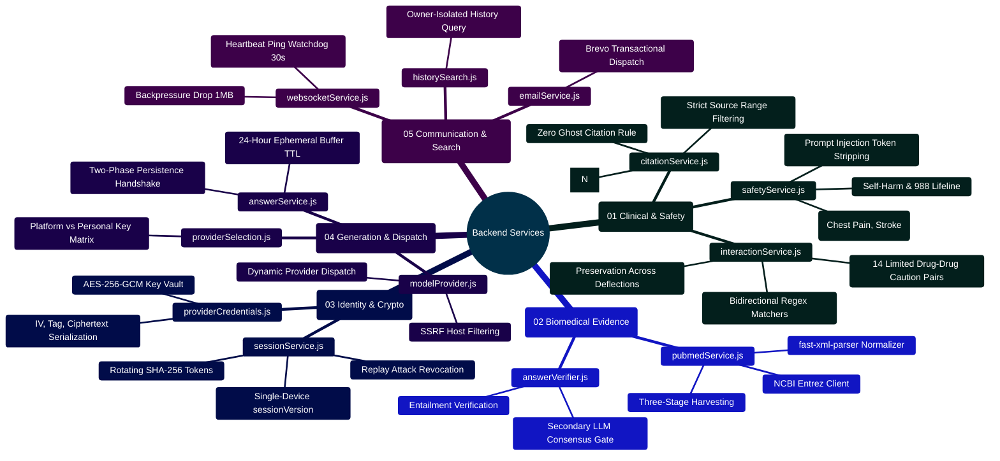

# MedAssist AI — Backend Services Architecture & Reference Manual

Developed by **J Ganesh kumar reddy**  
*Full-Stack Educational Health Assistance, Biomedical Evidence Grounding, & Machine Learning Research Platform*

---

## 1. Executive Overview & Service Dependency Topology

The MedAssist AI backend service layer (`backend/services/`) encapsulates pure domain logic, deterministic medical safety evaluations, cryptographic operations, external API clients, and real-time synchronization mechanisms. Controllers remain thin orchestration layers, delegating business rules and external I/O directly to these services.

```
========================================================================================================================
                                MEDASSIST AI — BACKEND SERVICE DEPENDENCY TOPOLOGY
========================================================================================================================

    [ INCOMING HTTP / WS REQUEST ]
                 │
                 ▼
    ┌────────────────────────────────────────────────────────────────────────────────────────────────────────────────┐
    │                                          SECURITY & CRYPTO SERVICES                                            │
    │  - sessionService.js: Rotating SHA-256 Refresh Tokens, JWT Access Tokens, Monotonic sessionVersion             │
    │  - providerCredentials.js: Authenticated AES-256-GCM Vault for Stored Personal LLM Keys                        │
    │  - validation.js: Input Validation, Bounded Query Strings, Payload Normalization                               │
    └────────────────────────────────────────────────────────────────────────────────────────────────────────────────┘
                 │
                 ▼
    ┌────────────────────────────────────────────────────────────────────────────────────────────────────────────────┐
    │                                    DETERMINISTIC CLINICAL SAFETY GATES                                         │
    │  - safetyService.js: Deterministic Pre/Post-Generation Screener (Self-Harm, Acute Emergency, Injection Defense)│
    │  - interactionService.js: 14 FDA Black-Box Drug-Drug Interaction Rules (Preserved across Deflections)          │
    └────────────────────────────────────────────────────────────────────────────────────────────────────────────────┘
                 │
                 ▼
    ┌────────────────────────────────────────────────────────────────────────────────────────────────────────────────┐
    │                                    BIOMEDICAL RETRIEVAL & CITATION AUDIT                                       │
    │  - pubmedService.js: NCBI Entrez E-Utilities (esearch -> esummary -> efetch) with fast-xml-parser             │
    │  - citationService.js: Deterministic Numerical Citation Grounding Auditor ([N] regex set partitioning)          │
    └────────────────────────────────────────────────────────────────────────────────────────────────────────────────┘
                 │
                 ▼
    ┌────────────────────────────────────────────────────────────────────────────────────────────────────────────────┐
    │                                    AI PROVIDER ORCHESTRATION & PERSISTENCE                                     │
    │  - answerService.js: Two-Phase Generation Coordinator (Phase 1 Ephemeral Buffer -> Phase 2 Authoritative Save)  │
    │  - modelProvider.js: Multi-Engine Dispatcher (Gemini, Groq, Together AI, Local OpenAI-compatible)             │
    │  - aiService.js: Native Google Gemini 2.5 Flash Client with System Prompt Injection                            │
    │  - answerVerifier.js: Secondary LLM Consensus Draft Reviewer (Claims vs Retrieved PubMed Abstracts)            │
    │  - providerSelection.js: Resolves Default vs User-Encrypted Key Selection Matrix                                │
    └────────────────────────────────────────────────────────────────────────────────────────────────────────────────┘
                 │
                 ▼
    ┌────────────────────────────────────────────────────────────────────────────────────────────────────────────────┐
    │                                    REAL-TIME & TELEMETRY SERVICES                                              │
    │  - websocketService.js: Owner-Scoped WebSocket Broadcast with 30s Heartbeat Ping & 1MB Backpressure Drop       │
    │  - historySearch.js: In-Memory Chronological & Term Relevance Search Across User Conversations                 │
    │  - emailService.js: Brevo (Sendinblue) Transactional API Client for Verification & Password Reset Flows       │
    └────────────────────────────────────────────────────────────────────────────────────────────────────────────────┘
========================================================================================================================
```

---

## 2. Backend Services Mindmap



---

## 3. Service Catalog & Technical Contracts

### 3.1 `safetyService.js` — Deterministic Safety Screener
- **Role**: Evaluates user prompts and model-generated responses before external dispatch or client rendering.
- **Exported Symbols**:
  - `screenPrompt(prompt)`: Scans for emergency symptoms (chest pain, stroke signs, dyspnea), self-harm intentions, harmful instructions, and template injection tokens (`<|im_start|>`, `[im_start]`). Returns `{ blocked, reason, educationalWarning, emergencyFlag }`.
  - `screenGeneratedAnswer(text)`: Audits model outputs to intercept unauthorized prescriptions, dosage assertions, or self-harm encouragement.
- **Invariants**: Deterministic evaluation occurs synchronously before any PubMed or LLM network call.

### 3.2 `pubmedService.js` — NCBI Entrez E-Utilities Client
- **Role**: Coordinates biomedical literature retrieval via the official NCBI E-Utilities API.
- **Exported Symbols**:
  - `fetchSources(query, maxResults = 5)`: Executes the three-stage retrieval pipeline:
    1. `esearch.fcgi`: Queries PubMed index with clinical search terms, sorted by relevance.
    2. `esummary.fcgi`: Retrieves article metadata (title, authors, journal, publication date, DOI).
    3. `efetch.fcgi`: Downloads structured MEDLINE XML and parses abstracts.
- **Invariants**: Rate-limited to 3 requests/sec without API key; throttled to 10 requests/sec with `NCBI_API_KEY`. Missing abstracts abort answer generation.

### 3.3 `citationService.js` — Numerical Citation Auditor
- **Role**: Deterministically audits generated text to ensure all bracketed citations `[N]` reference valid retrieved sources.
- **Exported Symbols**:
  - `assessCitationGrounding(generatedText, sourceCount)`: Parses `[N]` references using strict regular expressions, groups ranges (`[1-3]`), and checks that $1 \le N \le \text{sourceCount}$.
- **Invariants**: Any citation referencing an index $> \text{sourceCount}$ triggers an `invalid_citations` state, suppressing ungrounded model claims.

### 3.4 `interactionService.js` — Drug-Drug Interaction Screener
- **Role**: Scans clinical queries and responses for 14 high-risk medication pairs based on FDA black-box warnings.
- **Exported Symbols**:
  - `detectDrugInteractions(text)`: Scans input text using bidirectional regular expressions covering generic and brand names (e.g., Warfarin + Aspirin, Nitroglycerin + Sildenafil, Tramadol + Sertraline).
  - `HIGH_RISK_INTERACTION_RULES`: Canonical array of 14 rule definitions with risk severity (`CRITICAL`, `HIGH`).
- **Invariants**: Detected interaction warnings are preserved even if a query is deflected by emergency screening.

### 3.5 `providerCredentials.js` — AES-256-GCM Personal Key Vault
- **Role**: Secures user-supplied API keys for Google Gemini, Groq, and Together AI.
- **Exported Symbols**:
  - `seal(plainTextKey, masterEncryptionKey)`: Encrypts key using AES-256-GCM with a random 12-byte IV and returns Base64-encoded `{ iv, authTag, ciphertext }`.
  - `open(encryptedEnvelope, masterEncryptionKey)`: Decrypts and authenticates key payload. Throws on authentication tag mismatch.
- **Invariants**: Plaintext keys are never stored in MongoDB and never returned in API responses.

### 3.6 `sessionService.js` — Cryptographic Session State Machine
- **Role**: Manages single-device session versioning and rotating refresh tokens.
- **Exported Symbols**:
  - `hashToken(rawToken)`: Computes SHA-256 hex digest of refresh tokens.
  - `makeTokens(user)`: Generates short-lived JWT access token (15m) and cryptographically secure random refresh token (7d).
  - `setCookies(res, tokens)`: Binds tokens to `HttpOnly`, `SameSite=Strict`, `Secure` cookies.
- **Invariants**: Refresh tokens rotate upon every consumption. Replay of an invalidated token triggers instant revocation of all sessions for that account.

### 3.7 `websocketService.js` — Real-Time WebSocket Gateway
- **Role**: Provides real-time bidirectional synchronization between client and server.
- **Exported Symbols**:
  - `attachWebSockets(server)`: Binds `ws` server to `/ws` endpoint with 30-second heartbeat ping-pong watchdog.
- **Invariants**: Enforces owner tenancy isolation; drops messages exceeding 1MB backpressure buffer.

---

## 4. Developer Extensibility: Adding a New Backend Service

Follow this pattern to add a new functional service (e.g., `allergyService.js`):

```javascript
// backend/services/allergyService.js
// Custom clinical allergy screening service

const HIGH_RISK_ALLERGEN_RULES = [
  {
    allergen: "penicillin",
    pattern: /\b(?:penicillin|amoxicillin|ampicillin|augmentin)\b/i,
    crossReactives: [
      { drug: "cephalexin", risk: "Cephalosporin cross-reactivity (1-2% risk in true IgE-mediated allergy)." }
    ]
  }
];

export function detectAllergyRisks(patientAllergies = [], queryText = "") {
  const flags = [];
  const normalizedAllergies = patientAllergies.map(a => a.toLowerCase().trim());

  for (const rule of HIGH_RISK_ALLERGEN_RULES) {
    if (normalizedAllergies.includes(rule.allergen)) {
      for (const cross of rule.crossReactives) {
        if (new RegExp(`\\b${cross.drug}\\b`, "i").test(queryText)) {
          flags.push({
            severity: "HIGH",
            allergen: rule.allergen,
            contraindicatedDrug: cross.drug,
            clinicalGuidance: cross.risk
          });
        }
      }
    }
  }

  return { flagged: flags.length > 0, warnings: flags };
}
```

---

## 5. Automated Verification Commands

All backend services are covered by 66 unit and integration tests:

```powershell
# Run the entire backend test suite
npm test --prefix backend

# Run specific service tests
node --test backend/tests/safetyService.test.js
node --test backend/tests/citationService.test.js
node --test backend/tests/interactionService.test.js
node --test backend/tests/pubmedService.test.js
```
