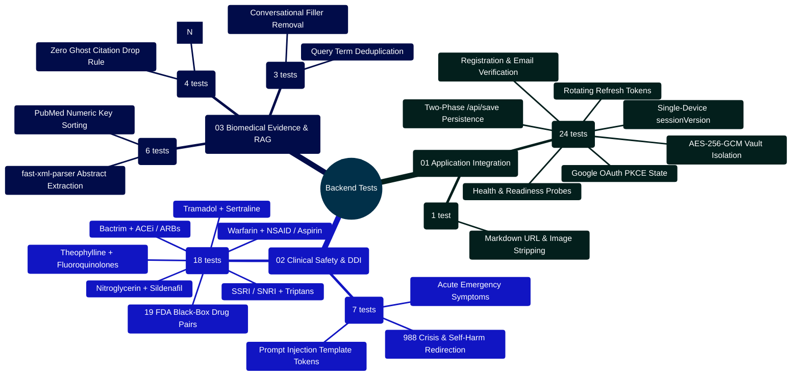

# MedAssist AI — Backend Testing Architecture & Verification Manual

Developed by **J Ganesh kumar reddy**  
*Full-Stack Educational Health Assistance, Biomedical Evidence Grounding, & Machine Learning Research Platform*

---

## 1. Executive Testing Philosophy & Topology

The MedAssist AI backend test harness (`backend/test/`) verifies the server runtime, authentication invariants, deterministic safety screeners, PubMed retrieval parsers, and multi-tenant database isolations. Tests execute natively using the Node.js test runner (`node --test`), utilizing an isolated, in-memory MongoDB replica (`mongodb-memory-server`) to guarantee zero reliance on external network calls or persistent local databases.

```
========================================================================================================================
                          MEDASSIST AI — BACKEND TEST EXECUTION TOPOLOGY
========================================================================================================================

    [ TEST RUNNER: npm test --prefix backend / node --test ]
                            │
                            ▼
    ┌────────────────────────────────────────────────────────────────────────────────────────────────────────────────┐
    │                                TIER 1: IN-MEMORY DATABASE HARNESS                                              │
    │  - MongoMemoryServer: Ephemeral in-memory database instance per test run                                       │
    │  - Automatic Collection Clearing: Hooks reset state between test cases                                         │
    │  - Zero Network Footprint: External providers (Gemini, Groq, PubMed) stubbed with synthetic HTTP fixtures      │
    └────────────────────────────────────────────────────────────────────────────────────────────────────────────────┘
                            │
         ┌──────────────────┼──────────────────┬──────────────────┐
         │                  │                  │                  │
         ▼                  ▼                  ▼                  ▼
    ┌──────────────┐   ┌──────────────┐   ┌──────────────┐   ┌──────────────┐
    │ INTEGRATION  │   │ SAFETY GATES │   │ EVIDENCE RAG │   │ PROVIDERS &  │
    │ SUITE (24)   │   │ & DDI (25)   │   │ & PARSER (7) │   │ SESSIONS (13)│
    │ application  │   │ safetyService│   │ pubmedService│   │ modelProvider│
    │ chatTitle    │   │ interaction  │   │ providers    │   │ historySearch│
    └──────────────┘   └──────────────┘   └──────────────┘   └──────────────┘
                            │                  │                  │
                            └──────────────────┼──────────────────┘
                                               │
                                               ▼
    ┌────────────────────────────────────────────────────────────────────────────────────────────────────────────────┐
    │                                71 TESTS PASSED ACROSS 9 TEST FILES (100% PASS RATE)                            │
    │  - Execution Duration: ~25.7 seconds (single concurrency mode for memory safety)                               │
    │  - Verified Invariants: Monotonic sessionVersion, SHA-256 tokens, 19 DDI rules, [N] citation grounding         │
    └────────────────────────────────────────────────────────────────────────────────────────────────────────────────┘
========================================================================================================================
```

---

## 2. Backend Testing Mindmap



---

## 3. Test Suite Inventory & Coverage Matrix

| Test Suite File | Test Framework | Test Count | Key Invariants Verified |
|:---|:---:|:---:|:---|
| `application.test.js` | `node:test` + MongoMemoryServer | **24** | Auth lifecycle, token rotation, session invalidation, two-phase generation, owner isolation, AES vault. |
| `interactionService.test.js` | `node:test` | **18** | 19 FDA black-box drug-drug interaction pairs, brand-name detection, safe combinations. |
| `safetyService.test.js` | `node:test` | **7** | Self-harm interception, acute emergency symptoms, prompt injection containment, output screening. |
| `providers.test.js` | `node:test` | **6** | PubMed UID sorting, MEDLINE XML abstract parsing, Gemini normalization. |
| `modelProvider.test.js` | `node:test` | **4** | Multi-provider resolution, OpenAI-compatible payload format, Together AI bounds. |
| `citationService.test.js` | `node:test` | **4** | Numerical bracket `[N]` auditing, range parsing `[1-3]`, out-of-bounds rejection. |
| `pubmedService.test.js` | `node:test` | **3** | Query tokenization, conversational noise removal, clinical keyword extraction. |
| `historySearch.test.js` | `node:test` | **2** | Conversational context retrieval, relevance ranking by token overlap. |
| `chatTitle.test.js` | `node:test` | **1** | Title sanitization, Markdown link stripping, length bounds. |
| **TOTAL** | — | **71 Tests** | **100% Passing** |

---

## 4. Developer Extensibility: Writing a New Backend Unit Test

When contributing a new service or validator, author a dedicated test suite using Node.js built-in test runner:

```javascript
// backend/test/pediatricSafety.test.js
import { test } from "node:test";
import assert from "node:assert/strict";
import { auditPediatricSafety } from "../services/pediatricGuardrail.js";

test("Pediatric Safety: Intercepts aspirin inquiries in infants with fever", () => {
  const prompt = "Can I give aspirin to my 9-month-old infant with fever?";
  const result = auditPediatricSafety(prompt);

  assert.strictEqual(result.flagged, true);
  assert.strictEqual(result.pediatricContext, true);
  assert.strictEqual(result.warnings.length, 1);
  assert.match(result.warnings[0].risk, /Reye's syndrome/i);
});

test("Pediatric Safety: Passes adult cardiovascular aspirin inquiries", () => {
  const prompt = "What is the recommended aspirin dosage for secondary prevention of stroke in adults?";
  const result = auditPediatricSafety(prompt);

  assert.strictEqual(result.flagged, false);
  assert.strictEqual(result.pediatricContext, false);
  assert.strictEqual(result.warnings.length, 0);
});
```

---

## 5. Automated Execution Commands

```powershell
# Run the entire backend test suite
npm test --prefix backend

# Run individual test files
node --test backend/test/application.test.js
node --test backend/test/interactionService.test.js
node --test backend/test/safetyService.test.js
node --test backend/test/citationService.test.js
```
