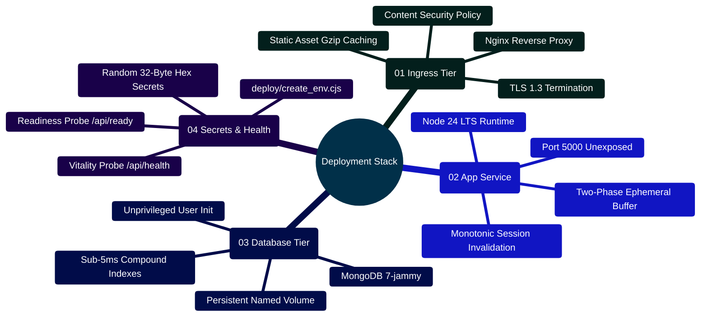

# MedAssist AI — Deployment, Infrastructure & Operations Guide

Developed by **J Ganesh kumar reddy**  
*Full-Stack Educational Health Assistance, Biomedical Evidence Grounding, & Machine Learning Research Platform*

---

## 1. Multi-Container Production Infrastructure Topology

MedAssist AI deploys as an isolated multi-container architecture orchestrated via Docker Compose:

```
========================================================================================================================
                                     MEDASSIST AI — PRODUCTION DEPLOYMENT TOPOLOGY
========================================================================================================================

    [ INTERNET / CLIENT TRAFFIC ]
                 │
                 │ HTTPS (Port 443 / 80)
                 ▼
    ┌─────────────────────────────────────────────────────────────────┐
    │ REVERSE PROXY & STATIC ASSET INGRESS (Nginx: frontend/nginx.conf)│
    │ ├── TLS v1.3 Termination, HSTS (max-age=31536000)               │
    │ ├── CSP: default-src 'self'; script-src 'self'; style-src 'self'│
    │ ├── Static Asset Caching (immutable cache-control headers)      │
    │ ├── Path Routing: /api/* -> Express (Port 5000), /ws -> WS Gateway│
    │ └── Rate Limiting: auth_limit (5 req/m), api_limit (60 req/m)   │
    └─────────────────────────────────────────────────────────────────┘
                 │
                 ▼ Internal Docker Network (medassist-network)
    ┌─────────────────────────────────────────────────────────────────┐
    │ BACKEND APPLICATION CONTAINER (backend/Dockerfile - Node 24 LTS)│
    │ ├── Port 5000 (Internal Only - Unexposed to Host)               │
    │ ├── Monotonic sessionVersion Token Invalidation                 │
    │ ├── AES-256-GCM Authenticated Personal Key Vault                │
    │ ├── Multi-Provider AI Gateway & PubMed E-Utilities Client       │
    │ └── Health Probes: GET /api/health (Vitality), GET /api/ready   │
    └─────────────────────────────────────────────────────────────────┘
                 │
                 ▼ Internal Docker Network
    ┌─────────────────────────────────────────────────────────────────┐
    │ DATABASE CONTAINER (mongo:7-jammy)                              │
    │ ├── Port 27017 (Internal Only - Unexposed to Host)              │
    │ ├── Authentication: App User (medassist_app) via mongo-init.js  │
    │ ├── Persistent Volume: medassist-mongo:/data/db                 │
    │ └── Health Check: mongosh ping command on admin database        │
    └─────────────────────────────────────────────────────────────────┘
========================================================================================================================
```

---

## 2. Infrastructure Deployment Mindmap



---

## 3. Automated Production Secret Seeding (`deploy/create_env.cjs`)

The `deploy/create_env.cjs` script generates production-grade, cryptographically independent secrets without leaking them to the console or logs:

```javascript
// File: deploy/create_env.cjs
const fs = require("fs");
const path = require("path");
const { randomBytes } = require("crypto");

const output = path.resolve(__dirname, "../.env");
if (fs.existsSync(output)) throw new Error(".env already exists; keep existing deployment configuration.");

const values = {};
for (const key of [
  "MONGO_ROOT_PASSWORD", 
  "MONGO_APP_PASSWORD", 
  "JWT_ACCESS_TOKEN", 
  "JWT_REFRESH_TOKEN", 
  "JWT_VERIFICATION_TOKEN", 
  "JWT_RESET_TOKEN", 
  "USER_API_KEY_ENCRYPTION_KEY"
]) {
  values[key] = randomBytes(32).toString("hex");
}

Object.assign(values, {
  PUBLIC_ORIGIN: "http://localhost:8080",
  COOKIE_SECURE: "false",
  AI_PROVIDER: "gemini",
  GEMINI_API_KEY: "",
  GEMINI_MODEL: "gemini-2.5-flash",
  GROQ_API_KEY: "",
  GROQ_MODEL: "openai/gpt-oss-20b",
  TOGETHER_API_KEY: "",
  TOGETHER_MODEL: "",
  BREVO_API_KEY: "",
  EMAIL_FROM_ADDRESS: "no-reply@example.com",
  EMAIL_FROM_NAME: "MedAssist AI"
});

fs.writeFileSync(output, Object.entries(values).map(([k, v]) => `${k}=${v}`).join("\n") + "\n", { mode: 0o600 });
console.log("Created ignored .env with random secrets. Configure email, optional AI, and HTTPS settings before deployment.");
```

---

## 4. Unprivileged Database Provisioning (`deploy/mongo-init.js`)

To prevent the application from running with administrative database privileges, `deploy/mongo-init.js` initializes an unprivileged `medassist_app` user:

```javascript
// File: deploy/mongo-init.js
const appPassword = process.env.MONGO_APP_PASSWORD;
if (!appPassword) throw new Error("MONGO_APP_PASSWORD is required to provision the database.");

db = db.getSiblingDB("medassist");
db.createUser({
  user: "medassist_app",
  pwd: appPassword,
  roles: [{ role: "readWrite", db: "medassist" }]
});
```

---

## 5. Deployment Step-by-Step Runbook

### Step 1: Clone Repository & Generate Secrets
```powershell
git clone https://github.com/Ganesh172919/React-App-LLM.git
cd React-App-LLM
node deploy/create_env.cjs
```

### Step 2: Configure Environment Variables
Edit `.env` to supply:
- `PUBLIC_ORIGIN`: Your public domain (e.g. `https://medassist.example.com`).
- `COOKIE_SECURE`: Set to `true` when terminating TLS via HTTPS.
- `AI_PROVIDER`: Default model (`gemini`, `groq`, `together`, or `local`).
- API keys for Gemini, Groq, or Together AI.

### Step 3: Launch Containers
```bash
docker compose up -d --build
```

### Step 4: Verify Deployment Health
```bash
# Check container status
docker compose ps

# Check backend vitality probe
curl http://localhost:8080/api/health

# Check full readiness probe (verifies MongoDB connection)
curl http://localhost:8080/api/ready
```

---

## 6. Zero-Downtime Rolling Deployment & Cutover Workflow

```
========================================================================================================================
                          MEDASSIST AI — ZERO-DOWNTIME ROLLING DEPLOYMENT FLOW
========================================================================================================================

    [ STEP 1: PULL & BUILD STAGED IMAGES ]
    ├── docker compose build --pull backend
    └── docker compose build --pull frontend

                                │
                                ▼
    [ STEP 2: SPIN UP BLUE/GREEN STAGING CONTAINERS ]
    ├── Launch standby backend-green on ephemeral port (e.g., 5001)
    └── Poll readiness probe: curl http://localhost:5001/api/ready
          ├── If /api/ready returns 200 OK within 30s -> Proceed
          └── If probe fails -> Abort deployment, keep blue active

                                │
                                ▼
    [ STEP 3: NGINX UPSTREAM ATOMIC SWITCH ]
    ├── Reload Nginx config pointing proxy_pass to green: `nginx -s reload`
    └── Active TCP connections seamlessly drain from blue container

                                │
                                ▼
    [ STEP 4: DECOMMISSION OLD RUNTIME ]
    ├── Send SIGTERM to backend-blue (allows active LLM generations to finish up to 30s)
    └── Terminate backend-blue container: `docker stop medassist-backend-blue`
========================================================================================================================
```

---

## 7. Incident Response, Triage & Health Remediation Matrix

| Symptom / Alert | Root Cause | Diagnosis Command | Remediation Runbook |
|:---|:---|:---|:---|
| **`/api/health` 200, but `/api/ready` 503** | MongoDB disconnected or replica election failed. | `docker compose logs backend --tail 50` | Verify MongoDB container status (`docker compose ps mongodb`). Check network connectivity and credentials in `MONGO_APP_PASSWORD`. |
| **HTTP 504 Gateway Timeout on Chat** | External LLM provider latency exceeded 30s circuit breaker ceiling. | `grep "AI_TIMEOUT" /var/log/nginx/error.log` | Switch provider to Groq or local vLLM via `AI_PROVIDER` in `.env`. Instruct users to use alternative provider keys in Account Settings. |
| **HTTP 429 Too Many Requests on Login** | Rate limiter triggered (authLimiter: 30 req / 15 min). | `docker compose logs backend \| grep "Too many requests"` | Normal brute-force mitigation. For load testing, set `RATE_LIMIT_DISABLED=true` in testing environment only. |
| **WebSocket Connection Failure (Code 4001)** | Expired or mismatched `sessionVersion` due to login on another device. | Inspect browser DevTools Console | Normal single-device session behavior. Client will auto-trigger refreshSession via Web Locks or prompt re-login. |

---

## 8. Automated SSL/TLS Let's Encrypt Certbot Configuration

To configure automatic SSL/TLS certificate issuance and renewal via Certbot:

```bash
# Initial certificate request (standalone HTTP challenge)
docker run -it --rm --name certbot \
  -v "$(pwd)/certbot/conf:/etc/letsencrypt" \
  -v "$(pwd)/certbot/www:/var/www/certbot" \
  certbot/certbot certonly --webroot \
  -w /var/www/certbot \
  -d medassist.yourdomain.com \
  --email admin@yourdomain.com \
  --agree-tos --no-eff-email

# Test automated certificate dry-run renewal
docker run --rm -v "$(pwd)/certbot/conf:/etc/letsencrypt" certbot/certbot renew --dry-run
```
