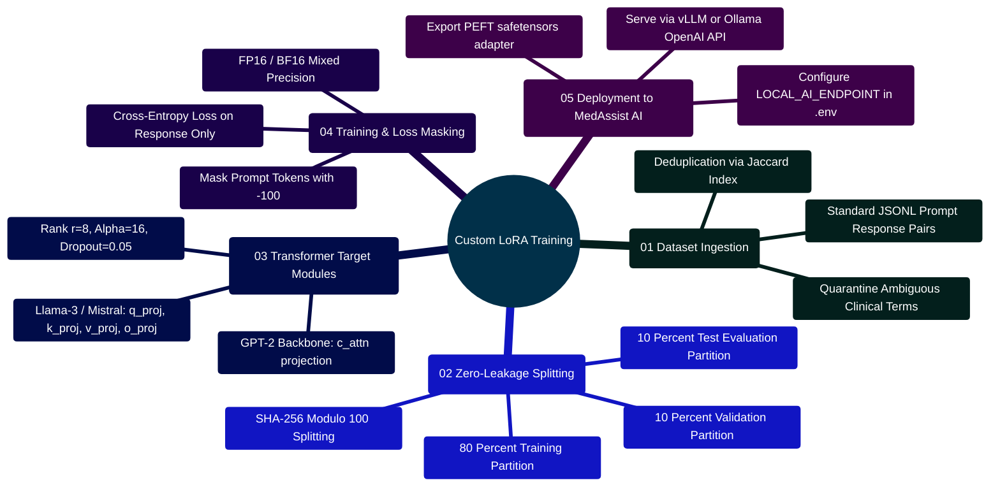

# MedAssist AI — AI Fine-Tuning, Low-Rank Adaptation (LoRA) & Dataset Guide

Developed by **J Ganesh kumar reddy**  
*Full-Stack Educational Health Assistance, Biomedical Evidence Grounding, & Machine Learning Research Platform*

---

## 1. Theoretical Foundations of Model Fine-Tuning

### 1.1 Pre-Training vs. Instruction Fine-Tuning
Modern Large Language Models (LLMs) are trained in two distinct phases:

1. **Self-Supervised Pre-Training**: The model processes trillions of general text tokens predicting the next token ($P(w_t \mid w_{<t})$). This produces broad linguistic fluency and world knowledge, but the model behaves as a raw text completer rather than an aligned, instruction-following assistant.
2. **Supervised Fine-Tuning (SFT)**: The pre-trained base model is adapted to a curated dataset of instruction-response pairs $(x, y)$. The objective is to maximize the likelihood of generating the target answer $y = (y_1, y_2, \dots, y_m)$ given user prompt $x = (x_1, x_2, \dots, x_n)$:
   $$\mathcal{L}_{\text{SFT}}(\theta) = - \sum_{i=1}^{m} \log P_\theta(y_i \mid x, y_{<i})$$

### 1.2 The Bottleneck of Full Fine-Tuning (FFT)
In Full Fine-Tuning, every parameter $\theta$ in the neural network is updated via backpropagation:
- **Optimizer Memory Explosion**: Training with AdamW requires maintaining the model weights $\theta$ (FP16/BF16: 2 bytes/param), gradients $\nabla \mathcal{L}$ (2 bytes/param), first momentum buffer $m_t$ (FP32: 4 bytes/param), and second variance buffer $v_t$ (FP32: 4 bytes/param). A 7B parameter model requires upwards of 80 to 120 GB of VRAM solely for optimizer states.
- **Catastrophic Forgetting**: Updating all weights disrupts representations learned during pre-training, causing degradation in general reasoning and factual accuracy outside the training distribution.
- **Storage & Deployment Costs**: Storing complete model checkpoints for every specialized domain or task is impractical.

```
========================================================================================================================
                                     LOW-RANK ADAPTATION (LoRA) BOTTLENECK MECHANISM
========================================================================================================================

                         ┌──────────────────────────┐
                         │   Frozen Base Weights    │
      Input Vector x ──┬─►│           W0             │─────────────────────────(+)──► Output Vector h
                       │ │         (d x k)          │                          ▲
                       │ └──────────────────────────┘                          │
                       │                                                       │
                       │ ┌──────────────────────────┐     ┌─────────────────┐  │
                       │ │   Down-Projection A      │     │  Up-Proj B      │  │
                       └─►│   (Dimension r x k)      │────►│  (Dimension d x r)│──┘
                         │   Gaussian ~ N(0, 1/r)   │     │  Initialized = 0│  Scaled by (alpha / r)
                         └──────────────────────────┘     └─────────────────┘
========================================================================================================================
```

---

## 2. LoRA Capabilities Mindmap

```mermaid
%%{init: {'theme': 'base', 'themeVariables': { 'primaryColor': '#0284c7', 'primaryTextColor': '#ffffff', 'primaryBorderColor': '#0369a1', 'lineColor': '#0284c7', 'secondaryColor': '#0d9488', 'tertiaryColor': '#6366f1' }}}%%
mindmap
  root((LoRA & PEFT Guide))
    ::icon(fa fa-brain)
    (01 Low-Rank Mathematics)
      Intrinsic Dimensionality
      Delta W equals alpha over r times B A
      Forward Pass h equals W0 x plus Delta W x
      Gradients Propagate Only Through A and B
    (02 Parameter Estimation)
      Target c_attn in GPT-2
      12 Layers, 768 Hidden, Rank 8
      147,456 Trainable Parameters
      0.281 MB FP16 Adapter Size
      99.88% Parameter Reduction
    (03 Dataset Hygiene & Splits)
      1,437 Ambiguous Question Groups Quarantined
      SHA-256 Modulo 100 Splitting
      Zero-Leakage Guarantee
      Train (80%), Val (10%), Test (10%)
    (04 SFT Training Controls)
      Prompt Label Masking (-100)
      Zero Loss on Prompt Prefix
      Clinical Review Approval Gate
      Dry-Run Verification Script
```

---

## 3. Mathematical Parameter Derivations & Memory Profile

Trainable adapter parameters for GPT-2 are derived analytically:

$$P_{\text{adapter}} = L \times P \times 2 \times d_{\text{model}} \times r$$

Where:
- Transformer Layers $L = 12$
- Target Projection Heads $P = 1$ (`c_attn`, fusing Query, Key, and Value)
- Hidden Dimension $d_{\text{model}} = 768$
- LoRA Bottleneck Rank $r = 8$

$$P_{\text{adapter}} = 12 \times 1 \times 2 \times 768 \times 8 = \mathbf{147,456 \text{ trainable parameters}}$$

### Memory Footprint:
$$\text{Storage}_{\text{FP16}} = \frac{147,456 \times 2 \text{ bytes}}{1,048,576 \text{ bytes/MB}} = \mathbf{0.28125 \text{ MB}} \approx 288 \text{ KB}$$

### Gradient Flow Equations:
During backpropagation, gradients are only calculated and stored for $A$ and $B$, while base weights $W_0$ receive zero updates:

$$\frac{\partial \mathcal{L}}{\partial A} = \frac{\alpha}{r} B^T \left(\frac{\partial \mathcal{L}}{\partial h}\right) x^T$$

$$\frac{\partial \mathcal{L}}{\partial B} = \frac{\alpha}{r} \left(\frac{\partial \mathcal{L}}{\partial h}\right) (Ax)^T$$

```
========================================================================================================================
                                     GRADIENT BACKPROPAGATION THROUGH LOW-RANK BOTTLENECK
========================================================================================================================

                 Loss Function L
                       │
                       ▼
             dL/dh (Output Gradient)
                  ┌────┴──────────────────────────┐
                  │                               │
                  ▼                               ▼
          dL/dB = (dL/dh)(Ax)^T           dL/dA = B^T(dL/dh)x^T
        Updated via AdamW               Updated via AdamW
                  │                               │
                  └───────────────┬───────────────┘
                                  │
                                  ▼
                     dL/dW0 = 0 (Frozen Base Weights)
========================================================================================================================
```

---

## 4. Key Implementation Code Snippets

### 4.1 Closed-Form Parameter Calculation (`Model and Dataset/lora/validate_lora_setup.py`)

```python
# Implementation Snippet: Model and Dataset/lora/validate_lora_setup.py
def estimate_adapter_parameters(hidden_size: int, layers: int, projections_per_layer: int, rank: int) -> int:
    """Calculate exact number of trainable parameters in LoRA matrices."""
    return layers * projections_per_layer * 2 * hidden_size * rank

def calculate_memory_footprint_mb(parameter_count: int, bytes_per_param: int = 2) -> float:
    """Compute FP16 storage footprint in megabytes."""
    return (parameter_count * bytes_per_param) / (1024 * 1024)
```

### 4.2 SFT Prompt Label Masking (`Model and Dataset/lora/train_lora.py`)

```python
# Implementation Snippet: Model and Dataset/lora/train_lora.py
def tokenize_and_mask(record, tokenizer, max_length=512):
    prompt_text = f"Question: {record['question']}\nAnswer: "
    full_text = prompt_text + record['answer']
    
    prompt_ids = tokenizer(prompt_text, truncation=True, max_length=max_length)["input_ids"]
    full_ids = tokenizer(full_text, truncation=True, max_length=max_length)["input_ids"]
    
    # Mask prompt tokens with -100 so they are ignored in cross-entropy loss calculation
    labels = [-100] * len(prompt_ids) + full_ids[len(prompt_ids):]
    return {"input_ids": full_ids, "labels": labels}
```

### 4.3 Isolated Adapter Inference (`Model and Dataset/lora/infer_adapter.py`)

```python
# Implementation Snippet: Model and Dataset/lora/infer_adapter.py
from peft import AutoPeftModelForCausalLM
from transformers import AutoTokenizer

def run_isolated_inference(adapter_path, prompt):
    model = AutoPeftModelForCausalLM.from_pretrained(adapter_path)
    tokenizer = AutoTokenizer.from_pretrained(adapter_path)
    tokens = tokenizer("Question: " + prompt + "\nAnswer: ", return_tensors="pt")
    outputs = model.generate(**tokens, max_new_tokens=150, do_sample=False, pad_token_id=tokenizer.eos_token_id)
    return tokenizer.decode(outputs[0][tokens["input_ids"].shape[1]:], skip_special_tokens=True)
```

### 4.4 Ambiguity Quarantine & Package Manifest (`Model and Dataset/lora/build_lora_package.py`)

```python
# Implementation Snippet: Model and Dataset/lora/build_lora_package.py
def build(source: Path, output: Path) -> dict:
    source = source.resolve()
    output = output.resolve()
    if output == source.parent or source == output:
        raise ValueError("Choose a separate output directory.")

    variants = defaultdict(set)
    with source.open(encoding="utf-8-sig", newline="") as handle:
        for row in csv.DictReader(handle):
            question = " ".join((row.get("question") or "").split())
            answer = " ".join((row.get("answer") or "").split())
            if question and answer:
                variants[leakage_key(question)].add(answer.casefold())

    # Quarantine any question associated with divergent answers
    ambiguous = {key for key, values in variants.items() if len(values) > 1}
    records, cleaning = load_and_clean(source, 5)
    accepted = [row for row in records if leakage_key(row["question"]) not in ambiguous]

    output.mkdir(parents=True, exist_ok=True)
    splits = {name: [row for row in accepted if stable_split(row["question"]) == name]
              for name in ("train", "validation", "test")}

    for name, rows in splits.items():
        write_split(output / (name + ".csv"), rows)
        convert_csv(output / (name + ".csv"), output / (name + ".jsonl"))

    source_hash = file_sha256(source)
    manifest = {
        "schema_version": 1,
        "source_file": source.name,
        "source_sha256": source_hash,
        "method": "Canonical question SHA-256 groups, approximate 80/10/10",
        "cleaning": cleaning,
        "quarantined_question_groups": len(ambiguous),
        "splits": {name: len(rows) for name, rows in splits.items()},
        "split_sha256": {name: file_sha256(output / (name + ".csv")) for name in splits},
        "jsonl_sha256": {name: file_sha256(output / (name + ".jsonl")) for name in splits},
        "clinical_review_approved": False,
        "license_review_approved": False,
        "reviewer": None,
        "training_performed": False,
    }

    (output / "manifest.json").write_text(json.dumps(manifest, indent=2) + "\n", encoding="utf-8")
    return manifest
```

### 4.5 Clinical Board Approval Enforcement (`Model and Dataset/lora/train_lora.py`)

```python
# Implementation Snippet: Model and Dataset/lora/train_lora.py
def enforce_training_guardrails(manifest, execute_training=False):
    if not execute_training:
        print("SAFE MODE: Dry-run manifest inspection complete. Zero GPU allocation or gradient descent.")
        return False

    if not manifest.get("clinical_review_approved"):
        raise PermissionError(
            "TRAINING HALTED: Dataset manifest lacks verified clinical board approval. "
            "Supervised fine-tuning cannot proceed on unreviewed biomedical data."
        )

    if not manifest.get("license_review_approved"):
        raise PermissionError(
            "TRAINING HALTED: Source data license has not been signed off for ML training."
        )

    return True
```

---

## 5. Parameter-Efficient Fine-Tuning (PEFT) Paradigm Comparison

| Adaptation Technique | Trainable Parameters | Optimizer Memory Overhead | Storage per Task | Latency Overhead | Catastrophic Forgetting Risk |
|:---|---:|---:|---:|:---:|:---:|
| **Full Fine-Tuning (FFT)** | 100% ($|\theta|$) | $16\times |\theta|$ bytes ($>112\text{ GB}$) | $100\%$ ($\approx 14\text{ GB}$) | None | High |
| **Prompt Tuning / Prefix** | $< 0.05\%$ | Minimal ($< 1\text{ GB}$) | $< 5\text{ MB}$ | Minor (consumes context tokens) | Very Low |
| **Low-Rank Adaptation (LoRA)** | **0.12% (147,456)** | **$16\times |P_{\text{adapter}}|$ ($< 2.4\text{ MB}$)** | **0.281 MB** | **Zero (Linear Fold into $W_0$)** | **Minimal** |
| **Quantized LoRA (QLoRA)** | 0.12% (NF4 base) | Minimal (4-bit dequantization) | 0.281 MB | Slight (Dequantization overhead) | Minimal |

---

## 6. Execution & Verification Commands

```powershell
# 1. Build LoRA package: quarantine ambiguous groups & partition splits
python "Model and Dataset/lora/build_lora_package.py"

# 2. Execute dry-run inspection to verify hashes and manifests
python "Model and Dataset/lora/train_lora.py"

# 3. Calculate analytical parameter and memory metrics
python "Model and Dataset/lora/validate_lora_setup.py" --output "Model and Dataset/reports/lora_validation.json"

# 4. Run automated test suites
python -m unittest discover -s "Model and Dataset/lora" -p "test_*.py"
```

---

## 7. Safety & Clinical Invariants

1. **Air-Gapped Decoupling**: LoRA scripts run offline in standalone Python environments; they are never imported, required, or executed by the Express/Node.js web backend.
2. **Deterministic Manifest Verification**: Training scripts calculate SHA-256 digests of all split CSV and JSONL files and match them strictly against `manifest.json`.
3. **Loss Gradient Masking**: Prompts are masked with $-100$ so cross-entropy loss is computed strictly on response tokens, preventing memorization of user phrasing.
4. **Clinical Gate Invariant**: Untrusted or unreviewed dataset records cannot trigger model backpropagation without programmatic clinical approval flags.

---

## 8. Developer Extensibility: Training Custom Adapters on New Biomedical Datasets

Researchers and ML engineers can extend MedAssist AI's fine-tuning pipeline to adapt new domain-specific datasets (e.g., oncology trials, pediatric dosing guidelines, pharmacogenomics) or target contemporary open-weights models (such as Llama-3-8B, Mistral-7B, or Gemma-2-9B).

### 8.1 Custom Dataset Ingestion & LoRA Pipeline Topology

```
========================================================================================================================
                          MEDASSIST AI — CUSTOM BIOMEDICAL ADAPTER TRAINING PIPELINE
========================================================================================================================

  [ RAW CLINICAL RECORDS ] (CSV / JSON / Parquet)
             │
             ▼
  ┌────────────────────────────────────────────────────────────────────────┐
  │ STAGE 1: HYGIENE & AUDITING (audit_dataset.py)                         │
  │ ├── Tokenization & Medical Lexicon Regex Extraction                    │
  │ ├── Pairwise Jaccard Similarity Matrix Computation (Threshold >= 0.85)  │
  │ └── Ambiguous Question Group Detection & Quarantine Extraction         │
  └────────────────────────────────────────────────────────────────────────┘
             │
             ▼
  ┌────────────────────────────────────────────────────────────────────────┐
  │ STAGE 2: DETERMINISTIC PARTITIONING (prepare_dataset.py)               │
  │ ├── Canonical SHA-256 Hash of Normalized Question String               │
  │ ├── Modulo 100 Integer Mapping: [0..79] -> Train, [80..89] -> Val,    │
  │ │                               [90..99] -> Test                       │
  │ └── Zero-Leakage Assertion: Set intersection of question hashes is {}  │
  └────────────────────────────────────────────────────────────────────────┘
             │
             ▼
  ┌────────────────────────────────────────────────────────────────────────┐
  │ STAGE 3: SFT INSTRUCTION FORMATTING (build_lora_package.py)            │
  │ ├── Schema: {"prompt": "<bos>System: ...\nUser: ...", "response": ...}│
  │ ├── Tokenizer Padding & Dynamic Sequence Truncation (Max Seq: 1024)    │
  │ └── Loss Masking: Set prompt labels to -100 (Backprop on response only)│
  └────────────────────────────────────────────────────────────────────────┘
             │
             ▼
  ┌────────────────────────────────────────────────────────────────────────┐
  │ STAGE 4: PEFT LORA ADAPTER INJECTION (train_lora.py)                   │
  │ ├── Target Attention Weights: W = W0 + (alpha / r) * (B @ A)           │
  │ ├── Freeze Base Backbone (Requires Grad = False)                       │
  │ └── Optimization: AdamW (LR=2e-4, Cosine Decay, Warmup Ratio=0.03)     │
  └────────────────────────────────────────────────────────────────────────┘
             │
             ▼
  ┌────────────────────────────────────────────────────────────────────────┐
  │ STAGE 5: ADAPTER EXPORT & SERVING INFERENCE (vLLM / Ollama)            │
  │ ├── Save adapter_model.safetensors & adapter_config.json               │
  │ └── Deploy OpenAI-compatible endpoint for MedAssist AI backend         │
  └────────────────────────────────────────────────────────────────────────┘
========================================================================================================================
```

### 8.2 Custom Dataset Extensibility Mindmap



### 8.3 Step-by-Step Implementation Guide for Custom Biomedical LoRA

#### Step 1: Format Records to Standard SFT Schema

Place your domain records in `Model and Dataset/raw/` in JSONL format:

```json
{"prompt": "What are the first-line therapeutic options for severe hyperkalemia with ECG changes?", "response": "In severe hyperkalemia with electrocardiographic changes (such as peaked T waves or widened QRS), immediate intravenous calcium gluconate (10%) or calcium chloride is indicated for myocardial membrane stabilization. This is followed by intracellular potassium shifting agents including intravenous regular insulin with 50% dextrose, and nebulized albuterol. Definitive potassium elimination requires potassium binders, loop diuretics, or emergent hemodialysis."}
```

#### Step 2: Adapt LoRA Configuration for Contemporary Models (e.g. Llama-3-8B)

If adapting modern Llama or Mistral architectures instead of the reference GPT-2 configuration, update target modules in your PEFT configuration:

```python
# Model and Dataset/lora/custom_peft_config.py
from peft import LoraConfig, TaskType

def get_biomedical_lora_config(model_family="llama3"):
    if model_family == "llama3":
        # Target all linear attention projections
        target_modules = ["q_proj", "k_proj", "v_proj", "o_proj", "gate_proj", "up_proj", "down_proj"]
    elif model_family == "gpt2":
        target_modules = ["c_attn"]
    else:
        target_modules = ["q_proj", "v_proj"]

    return LoraConfig(
        task_type=TaskType.CAUSAL_LM,
        r=8,                     # Rank dimension
        lora_alpha=16,           # Scaling coefficient (alpha / r = 2.0)
        lora_dropout=0.05,       # Dropout regularization
        bias="none",
        target_modules=target_modules,
    )
```

#### Step 3: Analytical Parameter & Memory Formulation

For a modern 8B parameter model with $L = 32$ layers, hidden dimension $d_{\text{model}} = 4,096$, intermediate dimension $d_{\text{ffn}} = 14,336$, and rank $r = 8$:
- **Attention Projections** ($q, k, v, o$):
  - $q\_proj$: $2 \times (4096 \times 8) = 65,536$
  - $k\_proj$: $2 \times (1024 \times 8) = 16,384$ (Grouped Query Attention)
  - $v\_proj$: $2 \times (1024 \times 8) = 16,384$
  - $o\_proj$: $2 \times (4096 \times 8) = 65,536$
  - Attention Subtotal: $163,840\text{ parameters per layer}$
- **MLP Projections** ($gate, up, down$):
  - $gate\_proj$: $2 \times (4096 \times 8) = 65,536$
  - $up\_proj$: $2 \times (4096 \times 8) = 65,536$
  - $down\_proj$: $2 \times (14336 \times 8) = 229,376$
  - MLP Subtotal: $360,448\text{ parameters per layer}$
- **Total Trainable Parameters across 32 layers**:
  $$\text{Params}_{\text{Total}} = 32 \times (163,840 + 360,448) = 32 \times 524,288 = 16,777,216\text{ parameters} \approx 16.78\text{M}$$
- **Adapter Weight Footprint in BF16** ($2\text{ bytes per weight}$):
  $$\text{Memory}_{\text{Adapter}} = 16,777,216 \times 2\text{ bytes} \approx 33.55\text{ MB}$$

This represents merely $0.21\%$ of the base 8B model's footprint, making it deployable on low-cost consumer hardware or embedded edge systems.

#### Step 4: Connecting the Custom Fine-Tuned Model to MedAssist AI

Once fine-tuned, serve the model with an OpenAI-compatible runtime such as **vLLM**:

```bash
# Launch vLLM with base model and PEFT adapter
vllm serve meta-llama/Meta-Llama-3-8B-Instruct \
  --enable-lora \
  --lora-modules medassist-adapter=/path/to/exported/adapter \
  --port 8000 \
  --host 127.0.0.1
```

Then configure MedAssist AI's `backend/.env` to point to the local instance:

```env
LOCAL_AI_ENDPOINT="http://127.0.0.1:8000/v1/chat/completions"
LOCAL_AI_MODEL="medassist-adapter"
```

The Express backend will automatically route queries to your custom fine-tuned model via `backend/services/modelProvider.js` while maintaining PubMed evidence retrieval and deterministic drug interaction safety gating.

