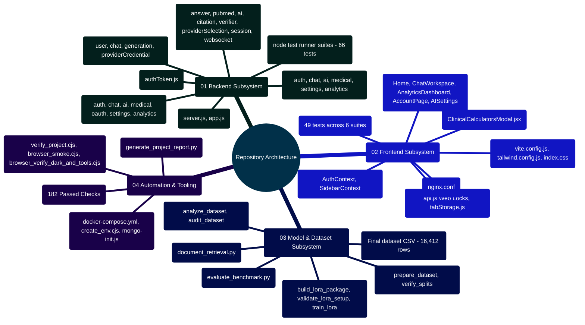

# MedAssist AI — Complete Repository File & Module Reference

Developed by **J Ganesh kumar reddy**  
*Full-Stack Educational Health Assistance, Biomedical Evidence Grounding, & Machine Learning Research Platform*

---

## 1. Complete Repository ASCII Directory Tree

```
c:\Users\RAVIPRAKASH\React-App-LLM\
├── .dockerignore                            # Excludes dev files from Docker build contexts
├── .env.docker.example                      # Production environment template for Docker Compose
├── .gitattributes                           # Line ending normalization (LF for scripts, auto for text)
├── .gitignore                               # Git ignore list (node_modules, logs, tmp, prepared data)
├── CONTRIBUTING.md                          # Comprehensive developer contribution & extensibility manual
├── docker-compose.yml                       # Multi-container orchestration (mongo, backend, frontend)
├── IMPROVEMENT_PLAN.md                      # Release checklist, roadmap, and milestone tracking
├── LICENSE                                  # MIT Software License
├── README.md                                # Root platform manual, quickstarts, and run instructions
│
├── .github/
│   └── workflows/
│       └── ci.yml                           # 5-job GitHub Actions workflow (test, lint, build, audit)
│
├── backend/                                 # Express 4 + Node 24 + MongoDB REST & WebSocket Service
│   ├── .dockerignore                        # Backend Docker context exclusions
│   ├── .env.example                         # Backend environment variables template
│   ├── .gitignore                           # Backend ignore list
│   ├── app.js                               # Express application factory with middleware pipeline
│   ├── Dockerfile                           # Multi-stage production container for Node 24 service
│   ├── package.json                         # Backend dependencies, metadata, and test scripts
│   ├── README.md                            # Comprehensive backend technical architecture manual
│   ├── server.js                            # HTTP & WebSocket process entry point
│   │
│   ├── controllers/                         # HTTP Route Handlers
│   │   ├── aiController.js                  # Two-phase AI generation coordinator
│   │   ├── analyticsController.js           # Lifetime stats, UTC activity trends, dataset audit
│   │   ├── authController.js                # Auth, registration, password recovery, account wipe
│   │   ├── chatController.js                # Authoritative message persistence (/api/save), history
│   │   ├── medicalController.js             # Forced medical literature grounding handler
│   │   ├── oauthController.js               # Google OAuth 2.0 PKCE flow & OpenID token exchange
│   │   ├── README.md                        # Backend controllers architecture & API reference manual
│   │   └── settingsController.js            # User preferences and AES-256-GCM key management
│   │
│   ├── middleware/                          # Express Middleware
│   │   ├── authToken.js                     # Validates HttpOnly access cookie & sessionVersion
│   │   └── README.md                        # Backend middleware architecture & security manual
│   │
│   ├── models/                              # Mongoose Database Schemas
│   │   ├── chatModel.js                     # Chat threads, messages, references, citation audits
│   │   ├── generationModel.js               # Ephemeral in-flight generations with 24-hour TTL
│   │   ├── providerCredentialModel.js       # AES-256-GCM encrypted user API keys
│   │   ├── README.md                        # Database architecture & Mongoose schema reference manual
│   │   └── userModel.js                     # User profile, salted bcrypt hash, sessionVersion
│   │
│   ├── routes/                              # Express Route Definitions
│   │   ├── aiRoute.js                       # POST /api/ai/chat
│   │   ├── analyticsRoute.js                # GET /api/analytics/overview
│   │   ├── authRoute.js                     # /api/auth/* (register, login, google, refresh, reset)
│   │   ├── chatRoute.js                     # /api/save, /api/history, /api/chats/:id
│   │   ├── medicalRoute.js                  # POST /api/medical
│   │   ├── README.md                        # Express routing architecture & endpoint manual
│   │   └── settingsRoute.js                 # /api/settings/* (GET/PATCH settings, PUT/DELETE keys)
│   │
│   ├── services/                            # Core Business Logic & External Integrations
│   │   ├── aiService.js                     # Google Gemini API client with context formatting
│   │   ├── answerService.js                 # Dual-engine router, safety gate, grounding coordinator
│   │   ├── answerVerifier.js                # Secondary LLM consensus reviewer (SUPPORTED/UNSUPPORTED)
│   │   ├── citationService.js               # Deterministic [N] numerical citation verification
│   │   ├── config.js                        # Environment variable validation on startup
│   │   ├── emailService.js                  # Brevo (Sendinblue) transactional email dispatcher
│   │   ├── historySearch.js                 # Conversational context turn relevance ranker
│   │   ├── interactionService.js            # 14 FDA black-box drug-drug interaction warning rules
│   │   ├── modelProvider.js                 # Multi-provider client (Gemini, Groq, Together, Local)
│   │   ├── providerCredentials.js           # AES-256-GCM authenticated cipher vault (seal/open)
│   │   ├── providerSelection.js             # Multi-provider routing and key resolution logic
│   │   ├── pubmedService.js                 # NCBI Entrez client (esearch, esummary, efetch) & XML parser
│   │   ├── README.md                        # Backend services architecture & reference manual
│   │   ├── safetyService.js                 # Deterministic prompt and generated output screener
│   │   ├── sessionService.js                # Dual JWT issuance, SHA-256 hash match, cookie options
│   │   ├── validation.js                    # Schema validators for UUIDs, email, allowed JSON keys
│   │   └── websocketService.js              # WebSocket server on /ws with 30s heartbeat watchdog
│   │
│   └── test/                                # Automated Backend Test Suites
│       ├── application.test.js              # Integration suite with MongoMemoryServer
│       ├── chatTitle.test.js                # Auto-titling sanitization tests
│       ├── citationService.test.js          # Unit tests for numerical citation verification
│       ├── historySearch.test.js            # Unit tests for conversation token overlap selection
│       ├── interactionService.test.js       # Unit tests for pharmacological drug interaction screening
│       ├── modelProvider.test.js            # Unit tests for multi-provider API resolution
│       ├── providers.test.js                # Unit tests for PubMed UID sorting & XML parsing
│       ├── pubmedService.test.js            # Unit tests for PubMed query string generation
│       ├── README.md                        # Backend testing architecture & verification manual
│       └── safetyService.test.js            # Unit tests for crisis, emergency, and harm screening
│
├── deploy/                                  # Deployment & Infrastructure Automation
│   ├── create_env.cjs                       # Generates production .env with random 32-byte hex secrets
│   ├── mongo-init.js                        # Mongo container bootstrap script (creates app user)
│   └── README.md                            # Comprehensive deployment & infrastructure operations manual
│
├── docs/                                    # Technical Documentation Suite (Volumes 01–14)
│   ├── AI_ARCHITECTURE_AND_WORKING_PRINCIPLES.md # Concise AI grounding & multi-provider summary
│   ├── AI_FINE_TUNING_AND_LORA_GUIDE.md     # Concise LoRA fine-tuning guide & hyperparameters
│   ├── COMPLETE_FILE_DIRECTORY_REFERENCE.md # Complete repository inventory & symbol reference
│   ├── COMPREHENSIVE_CODEBASE_ANALYSIS.md   # Architectural codebase breakdown & pattern audit
│   ├── CURRENT_IMPLEMENTATION.md            # Detailed runtime specification & API schemas
│   ├── DEEP_DIVE_AI_WORKING_PRINCIPLES.md   # Mathematical RAG treatise & E-Utilities deep dive
│   ├── DEEP_DIVE_LORA_AND_FINE_TUNING.md    # LoRA mathematical derivations & SFT backprop
│   ├── DEPLOYMENT_RUNBOOK.md                # Enterprise Docker Compose & operations runbook
│   ├── EVALUATION_AND_INTEGRATION.md        # Ablation benchmark scoring & document retrieval
│   ├── IMPLEMENTATION_STATUS.md             # Verification test evidence & audit matrix
│   ├── ISSUES_AND_RISKS.md                  # STRIDE threat model, risk register & mitigations
│   ├── README.md                            # Documentation suite master index & mindmap
│   ├── SECURITY_AND_MESSAGE_POLICY.md       # Trust boundaries, AES-256-GCM vault, OWASP defenses
│   └── SYSTEM_ARCHITECTURE_DEEP_DIVE.md     # Comprehensive distributed system deep dive
│
├── frontend/                                # React 19 Single Page Application
│   ├── .dockerignore                        # Frontend container exclusions
│   ├── .env.example                         # Frontend environment variables template
│   ├── .gitignore                           # Frontend gitignore
│   ├── Dockerfile                           # Multi-stage production container with Nginx
│   ├── eslint.config.js                     # ESLint configuration
│   ├── index.html                           # HTML template with viewport and meta tags
│   ├── nginx.conf                           # Production reverse proxy and static asset server
│   ├── package.json                         # Frontend dependencies (React 19, Tailwind 4, Lucide)
│   ├── README.md                            # Comprehensive frontend architectural manual
│   ├── tailwind.config.js                   # Tailwind CSS styling configuration
│   ├── vite.config.js                       # Vite bundler configuration with /api & /ws proxies
│   ├── vitest.config.js                     # Vitest test runner configuration
│   │
│   └── src/                                 # Frontend Application Source
│       ├── App.jsx                          # Router definition, global header/footer layout
│       ├── index.css                        # Tailwind CSS styles and UI utilities
│       ├── main.jsx                         # React root entry point with StrictMode
│       ├── assets/react.svg                 # React brand asset
│       │
│       ├── components/                      # Modular UI Components
│       │   ├── Login.jsx                    # Login form view
│       │   ├── README.md                    # Frontend component architecture & accessibility guide
│       │   ├── Register.jsx                 # Registration form view
│       │   ├── Sidebar.jsx                  # Conversation history navigation drawer
│       │   ├── auth/                        # Authentication & Account Views
│       │   │   ├── AccountPage.jsx          # Privacy notices and permanent account wipe modal
│       │   │   ├── AISettings.jsx           # Provider selector & AES-256-GCM key manager
│       │   │   ├── AuthPage.jsx             # Unified authentication modal
│       │   │   ├── ForgotPassword.jsx       # Password recovery request form
│       │   │   ├── ResetPassword.jsx        # Password reset via JWT token form
│       │   │   ├── VerificationPending.jsx  # Notification view for unverified email
│       │   │   └── VerifyEmail.jsx          # Email token activation handler
│       │   ├── chat/                        # Conversational Workspace
│       │   │   └── ChatWorkspace.jsx        # Message feed, markdown renderer, composer
│       │   ├── dashboard/                   # Operational Analytics Dashboard
│       │   │   └── AnalyticsDashboard.jsx   # Metrics cards, SVG activity charts, audit
│       │   ├── footer/Footer.jsx            # Student attribution footer
│       │   ├── header/Header.jsx            # Top navigation bar with auth status
│       │   ├── home/Home.jsx                # Public landing page with system notices
│       │   └── tools/                       # Evidence-Based Clinical Tools
│       │       └── ClinicalCalculatorsModal.jsx # 13-calculator educational suite with WAI-ARIA tabs
│       │
│       ├── context/                         # React State Contexts
│       │   ├── AuthContext.jsx              # User session state, sign-in, sign-out handler
│       │   ├── README.md                    # Frontend context architecture & global state manual
│       │   └── SidebarContext.jsx           # Mobile drawer open/close visibility state
│       │
│       ├── lib/                             # Client Utilities
│       │   ├── api.js                       # Fetch client with Web Locks token renewal
│       │   ├── conversationImport.js        # Bounded local JSON parser with forged-metadata stripping
│       │   ├── README.md                    # Frontend utilities architecture & client state reference
│       │   └── tabStorage.js                # Resilient draft and pending job recovery
│       │
│       ├── test/                            # Frontend Automated Test Suites
│       │   ├── api.test.js                  # Web Locks concurrent token renewal tests
│       │   ├── clinicalCalculators.test.jsx # Unit tests for 13 clinical calculators & bounds
│       │   ├── conversationImport.test.js   # Unit tests for conversation import security & stripping
│       │   ├── medicalDetector.test.js      # Heuristic clinical prompt detection tests
│       │   ├── README.md                    # Frontend testing architecture & verification manual
│       │   ├── tabStorage.test.js           # Resilient storage fallback tests
│       │   └── ui.test.jsx                  # Component tests for auth, chat, and dashboard
│       │
│       └── utils/
│           └── medicalDetector.js           # Client-side heuristic medical keyword detector
│
├── Model and Dataset/                       # Dataset Engineering & Offline LoRA Pipeline
│   ├── Final data set... (1).csv            # Raw medical Q&A dataset (16,412 rows)
│   ├── Fine-tunned model.py                 # Historical reference fine-tuning script
│   ├── README.md                            # Comprehensive dataset engineering manual
│   ├── requirements-document-retrieval.txt  # Dependencies for offline document retrieval
│   ├── analyze_dataset.py                   # Descriptive statistics, percentiles, term frequencies
│   ├── audit_dataset.py                     # Jaccard similarity audit of multi-answer variants
│   ├── document_retrieval.py                # Standalone lexical document search with OCR fallback
│   ├── evaluate_benchmark.py                # Paired case ablation score analyzer
│   ├── prepare_dataset.py                   # Deterministic SHA-256 modulo 100 partitioner
│   ├── test_benchmark.py                    # Unit tests for evaluation benchmark analyzer
│   ├── test_dataset_tools.py                # Unit tests for dataset cleaning and hashing
│   ├── test_document_retrieval.py           # Unit tests for local semantic search utility
│   ├── test_release_data.py                 # Regression tests for split file completeness
│   ├── verify_splits.py                     # Cross-partition question leakage validator
│   │
│   ├── lora/                                # Offline LoRA Parameter-Efficient Fine-Tuning
│   │   ├── build_lora_package.py            # Quarantines 1,437 multi-answer groups & builds splits
│   │   ├── evaluation_cases.json            # Behavioral evaluation cases
│   │   ├── infer_adapter.py                 # Standalone CLI for local adapter testing
│   │   ├── lora_config.json                 # LoRA hyperparameter configuration
│   │   ├── lora_config.py                   # Strongly typed dataclass for LoRA parameters
│   │   ├── prepare_sft_records.py           # Converts CSV splits to SFT JSONL format
│   │   ├── README.md                        # Comprehensive LoRA engineering manual
│   │   ├── requirements-qlora.txt           # Dependencies for 4-bit NF4 QLoRA
│   │   ├── requirements-training.txt        # Dependencies for offline PyTorch/PEFT training
│   │   ├── test_lora_tools.py               # Unit tests for SFT record creation
│   │   ├── test_release_lora.py             # Regression tests for review gate enforcement
│   │   ├── train_lora.py                    # Dry-run inspector & review-gated SFT script
│   │   ├── TRAINING_RUNBOOK.md              # Production fine-tuning runbook (SLURM, vLLM, DDP)
│   │   └── validate_lora_setup.py           # Closed-form parameter and memory calculator
│   │
│   └── reports/                             # Generated Dataset & LoRA Audit Reports
│       ├── dataset_analysis.json            # Descriptive statistics output
│       ├── dataset_analysis.md              # Markdown summary of dataset analysis
│       ├── dataset_audit.json               # Multi-answer variant similarity output
│       ├── dataset_audit.md                 # Markdown summary of dataset audit
│       └── lora_validation.json             # Parameter estimation report (147,456 params)
│
└── scripts/                                 # Verification & Operations Automation
    ├── browser_smoke.cjs                    # Playwright browser smoke test suite (20 automated workflows)
    ├── browser_verify_dark_and_tools.cjs    # Playwright accessibility & dark mode suite (21 workflows)
    ├── check_build_serving.cjs              # Automated HTTP assertions against built-output server (7 checks)
    ├── generate_project_report.py           # Compiles documentation and test logs into PDF report
    ├── README.md                            # Automation scripts, verification harness & QA runbook
    ├── run_build_qa.cjs                     # Serves built frontend bundle and API on port 4173
    ├── run_local.cjs                        # Isolated local stack with in-memory Mongo & fixtures
    └── verify_project.cjs                   # Master verification aggregator executing all 182 checks
```

---

## 2. File Classification Mindmap



---

## 3. Subsystem File Index & Detailed Technical Specifications

### 3.1 Backend Application Files

| File Path | Role | Exported Symbols / Functions | Upstream Dependencies |
| :--- | :--- | :--- | :--- |
| `backend/server.js` | Process Entrypoint | Starts HTTP and WebSocket server on `PORT` (5000). | `app.js`, `websocketService.js`, `config.js` |
| `backend/app.js` | Express Factory | `createApp({ services, limits })` | Express, CORS, CookieParser, RateLimit |
| `backend/controllers/authController.js` | Auth Handlers | `register`, `login`, `logout`, `refreshToken`, `verifyEmail`, `resendVerification`, `forgotPassword`, `resetPassword`, `deleteAccount` | `userModel.js`, `sessionService.js`, `emailService.js` |
| `backend/controllers/oauthController.js` | Google OAuth | `status`, `start`, `callback` | `google-auth-library`, `crypto`, `jsonwebtoken`, `userModel.js` |
| `backend/controllers/settingsController.js` | User Settings | `getSettings`, `updateSettings`, `saveKey`, `deleteKey` | `providerCredentialModel.js`, `providerCredentials.js`, `userModel.js` |
| `backend/controllers/aiController.js` | Two-Phase AI | `generateChatResponse` | `answerService.js`, `generationModel.js` |
| `backend/controllers/chatController.js` | Persistence | `saveExchange`, `getHistory`, `getChatById`, `renameChat`, `deleteChat` | `chatModel.js`, `generationModel.js` |
| `backend/controllers/medicalController.js` | Forced Medical | `handleMedicalQuery` | `answerService.js`, `generationModel.js` |
| `backend/controllers/analyticsController.js` | Telemetry | `getOverview` | `chatModel.js`, `generationModel.js`, `userModel.js` |
| `backend/middleware/authToken.js` | Auth Gate | Express middleware attaching `req.user` | `sessionService.js` |
| `backend/models/userModel.js` | User Schema | Mongoose `User` model | `mongoose`, `bcryptjs` |
| `backend/models/providerCredentialModel.js` | Vault Schema | Mongoose `ProviderCredential` model | `mongoose` |
| `backend/models/chatModel.js` | Chat Schema | Mongoose `Chat` model | `mongoose` |
| `backend/models/generationModel.js` | Ephemeral Buffer | Mongoose `Generation` model (24h TTL) | `mongoose` |
| `backend/services/pubmedService.js` | PubMed Client | `buildPubMedQuery`, `orderedRecords`, `parseAbstracts`, `fetchSources` | `axios`, `fast-xml-parser` |
| `backend/services/citationService.js` | Citation Audit | `assessCitationGrounding` | Standard regex |
| `backend/services/interactionService.js` | Drug Interaction Screener | `detectDrugInteractions`, `HIGH_RISK_INTERACTION_RULES` | Standard regex & 14 FDA black-box warning pairs |
| `backend/services/answerVerifier.js` | Model Review | `verifyAnswer` | `aiService.js` |
| `backend/services/providerCredentials.js` | AES-256-GCM Vault | `seal`, `open` | `crypto` |
| `backend/services/providerSelection.js` | Multi-Provider Engine | `resolveProviderSelection`, `listChoices`, `defaultProvider` | `providerCredentialModel.js`, `userModel.js` |
| `backend/services/modelProvider.js` | AI Dispatcher | `generateAnswer`, `generateWithOpenAICompatible` | `axios`, `aiService.js` |
| `backend/services/aiService.js` | Gemini Client | `generateWithGemini` | `axios` |
| `backend/services/safetyService.js` | Safety Screener | `screenPrompt`, `screenGeneratedAnswer` | Standard regex |
| `backend/services/sessionService.js` | Token Crypto | `hashToken`, `cookieOptions`, `makeTokens`, `setCookies`, `authenticate` | `jsonwebtoken`, `crypto` |
| `backend/services/websocketService.js` | Real-Time Sync | `attachWebSockets` | `ws`, `cookie`, `sessionService.js` |

---

### 3.2 Frontend Application Files

| File Path | Role | Exported Symbols / Components | Upstream Dependencies |
| :--- | :--- | :--- | :--- |
| `frontend/src/main.jsx` | Client Entry | Mounts `<App />` within `StrictMode` and `AuthProvider`. | React 19, ReactDOM |
| `frontend/src/App.jsx` | Router Root | `<App />` | React Router 7 |
| `frontend/src/context/AuthContext.jsx` | Session State | `AuthContext`, `AuthProvider`, `useAuth` | React, `lib/api.js` |
| `frontend/src/context/SidebarContext.jsx` | Drawer State | `SidebarContext`, `SidebarProvider`, `useSidebar` | React |
| `frontend/src/components/chat/ChatWorkspace.jsx` | Chat UI | `<ChatWorkspace />` | `react-markdown`, `tabStorage.js`, `api.js` |
| `frontend/src/components/dashboard/AnalyticsDashboard.jsx` | Metrics Dashboard | `<AnalyticsDashboard />` | `lib/api.js`, Lucide icons |
| `frontend/src/components/tools/ClinicalCalculatorsModal.jsx` | Clinical Tools | `<ClinicalCalculatorsModal />` | 13 evidence-based calculators with WAI-ARIA tab semantics |
| `frontend/src/components/auth/AccountPage.jsx` | Account Manager | `<AccountPage />` | `AuthContext.jsx`, `tabStorage.js` |
| `frontend/src/components/auth/AISettings.jsx` | Provider Settings | `<AISettings />` | `lib/api.js` |
| `frontend/src/components/auth/AuthPage.jsx` | Auth Modal | `<AuthPage />` | React |
| `frontend/src/lib/api.js` | API Wrapper | `apiRequest`, `refreshSession`, `getWebSocketUrl`, `downloadJson` | Web Locks API, Fetch API |
| `frontend/src/lib/conversationImport.js` | Import Parser | `parseConversationImport`, `MAX_IMPORT_BYTES` | Standard text encoders & JSON parser |
| `frontend/src/lib/tabStorage.js` | Resilient Cache | `readTab`, `writeTab`, `readPending` | Browser `sessionStorage` |
| `frontend/src/utils/medicalDetector.js` | Client Heuristics | `isMedicalPrompt` | Regular expressions |

---

### 3.3 Dataset & LoRA Pipeline Files

| File Path | Role | Exported Symbols / Functions | Upstream Dependencies |
| :--- | :--- | :--- | :--- |
| `Model and Dataset/analyze_dataset.py` | Profiler | `analyze_dataset()` | `csv`, `json`, `pathlib` |
| `Model and Dataset/audit_dataset.py` | Variant Auditor | `audit_dataset()` | `csv`, `hashlib`, `math` |
| `Model and Dataset/prepare_dataset.py` | Partitioner | `load_and_clean`, `stable_split`, `write_split`, `file_sha256` | `hashlib`, `csv` |
| `Model and Dataset/verify_splits.py` | Leakage Check | `validate_splits()` | `csv`, `pathlib` |
| `Model and Dataset/evaluate_benchmark.py` | Ablation Tool | `summarize()` | `csv`, `collections` |
| `Model and Dataset/document_retrieval.py` | Semantic Search | `build_index`, `search_index`, `read_document` | `sentence-transformers`, `fitz`, `pytesseract` |
| `Model and Dataset/lora/build_lora_package.py` | LoRA Partitioner | `build()` | `prepare_dataset.py`, `verify_splits.py` |
| `Model and Dataset/lora/validate_lora_setup.py` | Parameter Calc | `estimate_adapter_parameters`, `calculate_memory_footprint_mb` | `lora_config.py` |
| `Model and Dataset/lora/train_lora.py` | SFT Script | `train_lora()`, dry-run inspector | `torch`, `transformers`, `peft` |
| `Model and Dataset/lora/infer_adapter.py` | Adapter Test CLI | Interactive generation CLI | `peft`, `transformers` |
| `Model and Dataset/lora/lora_config.py` | Config Validator | `LoraTrainingConfig`, `load_lora_config` | `dataclasses`, `json` |

---

## 4. Master Developer Extensibility & Contribution Reference

| Extension Area | Target Source File | Guide Location | Key Implementation Contracts |
|:---|:---|:---|:---|
| **AI Model Providers** | `backend/services/modelProvider.js` | [`docs/CURRENT_IMPLEMENTATION.md`](CURRENT_IMPLEMENTATION.md#103-guide-a-adding-a-custom-ai-model-provider--gateway) | HTTPS only, SSRF defense, temperature 0.25, max_tokens 900, finish_reason "stop" |
| **Clinical Calculators** | `frontend/src/components/tools/ClinicalCalculatorsModal.jsx` | [`docs/CURRENT_IMPLEMENTATION.md`](CURRENT_IMPLEMENTATION.md#104-guide-b-adding-an-evidence-based-clinical-calculator) | Physiological input clamping, WAI-ARIA tabpanel cycling, educational prompt action |
| **Drug Interactions** | `backend/services/interactionService.js` | [`docs/CURRENT_IMPLEMENTATION.md`](CURRENT_IMPLEMENTATION.md#105-guide-c-adding-a-high-risk-medication-interaction-rule) | Bidirectional regex, CRITICAL vs HIGH severity, preserved across emergency deflections |
| **Custom Datasets & LoRA** | `Model and Dataset/lora/train_lora.py` | [`docs/AI_FINE_TUNING_AND_LORA_GUIDE.md`](AI_FINE_TUNING_AND_LORA_GUIDE.md#8-developer-extensibility-training-custom-adapters-on-new-biomedical-datasets) | Ambiguity quarantine, SHA-256 modulo 100 splitting, prompt token loss masking with -100 |
| **QLoRA & 8B Architectures** | `Model and Dataset/lora/train_modern_qlora.py` | [`docs/DEEP_DIVE_LORA_AND_FINE_TUNING.md`](DEEP_DIVE_LORA_AND_FINE_TUNING.md#13-developer-extensibility-qlora-4-bit-quantization-math--contemporary-8b9b-adapters) | NF4 double quantization, paged AdamW, target all linear modules, bfloat16 mixed precision |
| **Backend REST & Models** | `backend/routes/` & `backend/models/` | [`backend/README.md`](../backend/README.md#7-developer-extension-blueprint-building-on-the-backend) | Monotonic sessionVersion validation, owner tenancy isolation, 32KB JSON body limit |
| **Frontend Caching & State** | `frontend/src/lib/tabStorage.js` & `api.js` | [`frontend/README.md`](../frontend/README.md#7-developer-extensibility-building-new-frontend-views-calculators--modals) | Web Locks single-flight renewal, scoped sessionStorage drafts with memory fallback |
| **Kubernetes & Blue-Green** | `deploy/k8s/` & `scripts/` | [`docs/DEPLOYMENT_RUNBOOK.md`](DEPLOYMENT_RUNBOOK.md#11-developer-operations--infrastructure-extensibility) | Weighted canary routing, httpGet readiness probes, zero-downtime service patch, connection draining |
| **Event Bus & Workers** | `backend/services/outboxService.js` | [`docs/SYSTEM_ARCHITECTURE_DEEP_DIVE.md`](SYSTEM_ARCHITECTURE_DEEP_DIVE.md#13-developer-extensibility-event-buses-microservices--asynchronous-workers) | Transactional outbox, MongoDB change streams, Redis Streams consumer groups, DLQ retry loops |
| **Clinical Safety Invariants** | `backend/services/safetyService.js` | [`docs/ISSUES_AND_RISKS.md`](ISSUES_AND_RISKS.md#10-developer-extensibility-custom-safety-invariants--guardrail-pipelines) | Pediatric contraindications, Narrow Therapeutic Index monitoring, pre/post generation filtering |
| **Corpus Profilers & Auditing** | `Model and Dataset/reports/` | [`Model and Dataset/reports/dataset_analysis.md`](../Model%20and%20Dataset/reports/dataset_analysis.md#9-developer-extension-blueprint-adding-custom-analyzers--quality-profilers) | Flesch Reading Ease, Type-Token Ratio, ROUGE-L longest common subsequence, semantic triage |
| **Roadmap & Feature Epics** | `IMPROVEMENT_PLAN.md` | [`IMPROVEMENT_PLAN.md`](../IMPROVEMENT_PLAN.md#9-developer-contribution-backlog--feature-extension-guide) | OpenFDA integration, semantic hybrid RAG, local WebGPU inference, 182-check verification gate |
