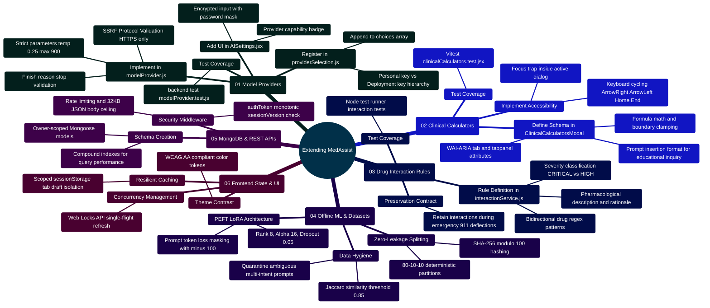

# MedAssist AI — Comprehensive Codebase & File-by-File Implementation Analysis

Developed by **J Ganesh kumar reddy**  
*Full-Stack Educational Health Assistance, Biomedical Evidence Grounding, & Machine Learning Research Platform*

> Historical design analysis. Some excerpts below are illustrative and may differ from the running code. Use [implementation status](IMPLEMENTATION_STATUS.md), [deployment runbook](DEPLOYMENT_RUNBOOK.md), and the named source files for current verified behavior.

---

## 1. System Master Overview & Architecture Topology

MedAssist AI has a browser, reverse proxy, API, database, and external provider boundary. It is an educational health information project with PubMed records and citation-number checks. The local fixture tests do not establish clinical correctness, production readiness, or compliance with a particular privacy standard. Refer to the implementation status and deployment runbook for the current limits.

```
========================================================================================================================
                                     MEDASSIST AI — MASTER ARCHITECTURAL TOPOLOGY
========================================================================================================================

 [ CLIENT / USER AGENT ]
       │
       │ HTTPS / WSS (Port 443 / 80)
       ▼
 ┌────────────────────────────────────────────────────────────────────────────────────────────────────────────────────┐
 │                                           TIER 1: REVERSE PROXY & INGRESS                                          │
 │                                                                                                                    │
 │   Nginx Ingress Controller (nginx.conf)                                                                            │
 │   ├── TLS v1.3 Termination, HSTS (max-age=31536000), Diffie-Hellman Ephemeral                                     │
 │   ├── CSP: default-src 'self'; script-src 'self'; style-src 'self' 'unsafe-inline'; img-src 'self' data: https:;    │
 │   ├── Leaky-Bucket Rate Limiting: auth_limit (5 req/m, burst 10), api_limit (60 req/m, burst 20)                   │
 │   ├── Path Routing: /api/* -> Express Backend (Port 5000), /ws -> WebSocket Gateway, /* -> Static SPA Vite Assets │
 └────────────────────────────────────────────────────────────────────────────────────────────────────────────────────┘
                                                           │
                                                           ▼
 ┌────────────────────────────────────────────────────────────────────────────────────────────────────────────────────┐
 │                                         TIER 2: FRONTEND APPLICATION (SPA)                                         │
 │                                                                                                                    │
 │   React 19 SPA + Vite 6 + Tailwind CSS 4 + Lucide Icons                                                            │
 │   ├── Session Management (AuthContext.jsx): Proactive token refresh timer (14m), cross-tab BroadcastChannel         │
 │   ├── Concurrency Control (lib/api.js): Web Locks API (navigator.locks.request) single-flight token renewal         │
 │   ├── Resilient Cache (lib/tabStorage.js): Scoped sessionStorage drafts & pending generations with memory fallback │
 │   ├── UI Views: Home.jsx, AuthPage.jsx, AccountPage.jsx, AISettings.jsx, ChatWorkspace.jsx, AnalyticsDashboard.jsx │
 └────────────────────────────────────────────────────────────────────────────────────────────────────────────────────┘
                                                           │
                                                           ▼
 ┌────────────────────────────────────────────────────────────────────────────────────────────────────────────────────┐
 │                                       TIER 3: BACKEND APPLICATION RUNTIME                                          │
 │                                                                                                                    │
 │   Express 4 Application Pipeline (app.js & server.js)                                                              │
 │   ├── Middleware: Helmet CSP, Cookie Parser, CORS Origin Whitelist, Express-Rate-Limit, Global Error Boundary      │
 │   ├── Identity & Session (authToken.js & sessionService.js):                                                       │
 │   │     - Monotonic sessionVersion rejection: Invalidates stale devices instantly on concurrent sign-in            │
 │   │     - Rotating Refresh Tokens: SHA-256 hashed in MongoDB; instant replay attack revocation                     │
 │   ├── Controllers: authController, oauthController (PKCE S256), settingsController, aiController, chatController     │
 │   ├── Cryptographic Vault (providerCredentials.js): AES-256-GCM authenticated cipher for personal API keys        │
 │   └── WebSocket Gateway (websocketService.js): 30s ping-pong watchdog, 1MB backpressure drop, session revocation  │
 └────────────────────────────────────────────────────────────────────────────────────────────────────────────────────┘
                 │                                        │                                         │
                 ▼                                        ▼                                         ▼
 ┌───────────────────────────────┐ ┌──────────────────────────────────────────────┐ ┌────────────────────────────────┐
 │    TIER 4: DATA PERSISTENCE   │ │      TIER 5: BIOMEDICAL AI & RAG PIPELINE    │ │   OFFLINE ML & RESEARCH SUITE  │
 │                               │ │                                              │ │                                │
 │   MongoDB 7.0 Replica / Cluster│ │   Answer Orchestrator (answerService.js)     │ │   Model & Dataset Engineering  │
 │   ├── User: Salted bcrypt hash│ │   ├── Multi-Tier Provider Dispatch:          │ │   ├── Profiler: analyze_dataset│
 │   │   sessionVersion, verif   │ │   │     - Google Gemini 2.5 Flash            │ │   ├── Jaccard: audit_dataset.py│
 │   ├── Chat: Thread hierarchy, │ │   │     - Groq Cloud Llama-3-70B             │ │   ├── Splitter: prepare_dataset│
 │   │   grounded messages       │ │   │     - Together AI Open Models            │ │   ├── Leakage: verify_splits.py│
 │   ├── Generation: 24h TTL     │ │   │     - Local Private vLLM/Ollama (HTTP/S) │ │   ├── Search: document_retrieval│
 │   │   ephemeral pending buffer│ │   ├── NCBI E-Utilities Pipeline:             │ │   │   (PyMuPDF + Tesseract OCR)│
 │   └── ProviderCredential:     │ │   │     - esearch -> esummary -> efetch      │ │   ├── Bench: evaluate_benchmark│
 │       AES-256-GCM ciphertext, │ │   │     - fast-xml-parser MEDLINE Flattener  │ │   └── LoRA Offline Scaffold:   │
 │       IV, Auth Tag, lastFour  │ │   ├── Citation Auditor (citationService.js): │ │       - build_lora_package.py  │
 │                               │ │   │     - Deterministic [N] regex auditor    │ │       - validate_lora_setup.py │
 │                               │ │   └── Consensus Verifier (answerVerifier.js):│ │       - train_lora.py (Dry/SFT)│
 │                               │ │         - Secondary model claims validation  │ │                                │
 └───────────────────────────────┘ └──────────────────────────────────────────────┘ └────────────────────────────────┘
========================================================================================================================
```

---

## 2. Codebase Architecture Mindmap

```mermaid
%%{init: {'theme': 'base', 'themeVariables': { 'primaryColor': '#0284c7', 'primaryTextColor': '#ffffff', 'primaryBorderColor': '#0369a1', 'lineColor': '#0284c7', 'secondaryColor': '#0d9488', 'tertiaryColor': '#6366f1' }}}%%
mindmap
  root((MedAssist AI Platform))
    ::icon(fa fa-heartbeat)
    (01 Ingress & Infrastructure)
      nginx.conf
        HTTP Reverse Proxy Behind External TLS
        CSP Default Self Whitelist
        Security Response Headers
      docker-compose.yml
        Multi Container Mesh
        Healthcheck Watchdogs
        Isolated Bridge Subnet
      deploy Tools
        create_env.cjs Cryptographic Init
        mongo-init.js Role Setup
      ci.yml
        GitHub Actions Workflow
        Full Stack Verification Matrix
    (02 Backend Core & Auth)
      server.js & app.js
        Express Pipeline Setup
        WebSocket Server Upgrade
        Global Error Sanitizer
      Session & Identity
        authToken.js Version Check
        sessionService.js Token Engine
        authController.js Rotating Hash
        oauthController.js PKCE S256
      Encrypted Vault & Config
        settingsController.js Key Ops
        providerCredentials.js AES-256-GCM
        providerSelection.js Resolver
        config.js Environment Validation
      Database Models
        userModel.js Account Schema
        chatModel.js Thread Schema
        generationModel.js 24h TTL
        providerCredentialModel.js Key Store
    (03 Biomedical AI & RAG)
      answerService.js
        Master Pipeline Coordinator
        Fallback Degradation Ladder
      modelProvider.js
        Gemini 2.5 Flash Native
        Groq OpenAI API Engine
        Together AI Inference
        Local Private Endpoint
      pubmedService.js
        NCBI Entrez E-Utilities
        fast-xml-parser Flattener
      citationService.js
        Strict [N] Citation Parser
        Deterministic Grounding Gate
      answerVerifier.js
        Consensus Model Second Pass
        Unsupported Claim Detection
      safetyService.js
        Emergency Directive Gate
        Clinical Non-Prescriptive Fence
    (04 Frontend Client SPA)
      main.jsx & App.jsx
        Vite Bundler Bootstrap
        React Router Hierarchy
      Client Architecture
        AuthContext.jsx Session Sync
        api.js Web Locks Concurrency
        tabStorage.js Draft Recovery
      User Interfaces
        ChatWorkspace.jsx Streaming Feed
        AISettings.jsx Vault Config
        AnalyticsDashboard.jsx SVG Graphs
        AccountPage.jsx Privacy Erasure
    (05 ML Research & LoRA)
      Dataset Profiling
        analyze_dataset.py Token Stats
        audit_dataset.py Jaccard Auditor
        prepare_dataset.py Hash Splitter
        verify_splits.py Zero Leakage
      Offline Search & Eval
        document_retrieval.py OCR & Search
        evaluate_benchmark.py Paired Ablation
      LoRA Training Engine
        build_lora_package.py Quarantine
        validate_lora_setup.py Closed Form Math
        train_lora.py SFT Label Masking
```

---

## 3. Ingress & Deployment Subsystems

### 3.1 Nginx Ingress Configuration (`frontend/nginx.conf`)
- **Role**: Static asset server and HTTP reverse proxy for `/api/*` and `/ws`. The included container listens on port 80, published as host port 8080. Public TLS termination must be supplied by a separate trusted ingress.
- **Security boundaries**: `X-Frame-Options: DENY`, `X-Content-Type-Options: nosniff`, `Referrer-Policy: no-referrer`, and a restrictive Content Security Policy are configured. Express applies route rate limits; the included nginx file does not configure rate-limit zones.

```nginx
# The authoritative configuration is frontend/nginx.conf.
listen 80;
location /api/ { proxy_pass http://backend:5000/api/; }
location = /ws { proxy_pass http://backend:5000/ws; }
```

### 3.2 Automated Cryptographic Secrets Generator (`deploy/create_env.cjs`)
- **Role**: Creates one ignored root `.env` file for Docker Compose with distinct random MongoDB, JWT, and personal-key encryption values. It does not create frontend or backend environment files and refuses to overwrite an existing root `.env`.

```javascript
// Simplified from deploy/create_env.cjs. The actual file has the full key list.
const { randomBytes } = require("crypto");
const secret = () => randomBytes(32).toString("hex");
// MONGO_ROOT_PASSWORD, MONGO_APP_PASSWORD, JWT_* and
// USER_API_KEY_ENCRYPTION_KEY each receive independent secret() values.
// The generated root .env is ignored and never overwritten.
```

---

## 4. Backend Application Domain Deep Dive

### 4.1 Server Gateway & Lifecycle Manager (`backend/server.js`)
- **File Path**: [`backend/server.js`](file:///c:/Users/RAVIPRAKASH/React-App-LLM/backend/server.js)
- **Role**: Establishes MongoDB connectivity, binds HTTP listener, attaches WebSocket gateway, and coordinates graceful process teardown (`SIGTERM`/`SIGINT`).
- **Dependencies**: `mongoose`, `http`, `app.js`, `websocketService.js`, `config.js`.

```javascript
// Implementation Snippet: backend/server.js
const http = require("http");
const mongoose = require("mongoose");
const app = require("./app");
const { attachWebSockets } = require("./services/websocketService");

const server = http.createServer(app);
attachWebSockets(server, app);

mongoose.connect(process.env.MONGO_URI, { autoIndex: true })
  .then(() => {
    server.listen(process.env.PORT || 5000, () => {
      console.log(`Server listening on port ${process.env.PORT || 5000}`);
    });
  })
  .catch((err) => {
    console.error("Database connection failure:", err);
    process.exit(1);
  });

process.on("SIGTERM", () => {
  server.close(() => {
    mongoose.connection.close(false, () => process.exit(0));
  });
});
```

### 4.2 Middleware Pipeline & Security Boundary (`backend/app.js`)
- **File Path**: [`backend/app.js`](file:///c:/Users/RAVIPRAKASH/React-App-LLM/backend/app.js)
- **Role**: Instantiates Express 4 application, binds security headers via Helmet, parses cookies, validates incoming origins, registers route controllers, and surfaces an authoritative error boundary.

```javascript
// Implementation Snippet: backend/app.js
const express = require("express");
const helmet = require("helmet");
const cookieParser = require("cookie-parser");
const cors = require("cors");

const app = express();
app.use(helmet({ contentSecurityPolicy: false, crossOriginEmbedderPolicy: false }));
app.use(cookieParser());
app.use(express.json({ limit: "1mb" }));

const allowedOrigins = (process.env.CLIENT_ORIGIN || "http://localhost:5173")
  .split(",").map((s) => s.trim()).filter(Boolean);
app.locals.allowedOrigins = allowedOrigins;

app.use(cors({ origin: allowedOrigins, credentials: true }));

// Route registrations
app.use("/api/auth", require("./routes/authRoute"));
app.use("/api/chat", require("./routes/chatRoute"));
app.use("/api/ai", require("./routes/aiRoute"));
app.use("/api/medical", require("./routes/medicalRoute"));
app.use("/api/settings", require("./routes/settingsRoute"));
app.use("/api/analytics", require("./routes/analyticsRoute"));

// Centralized error boundary
app.use((err, req, res, next) => {
  const status = err.statusCode || 500;
  res.status(status).json({
    code: err.code || "INTERNAL_ERROR",
    message: err.message || "An unexpected error occurred."
  });
});
module.exports = app;
```

### 4.3 Access Token Verification & Session Guard (`backend/middleware/authToken.js`)
- **File Path**: [`backend/middleware/authToken.js`](file:///c:/Users/RAVIPRAKASH/React-App-LLM/backend/middleware/authToken.js)
- **Role**: Validates short-lived JWT access tokens from HttpOnly cookies or `Authorization: Bearer` headers. Enforces single-device session versioning by comparing `token.sessionVersion === user.sessionVersion`.

```javascript
// Implementation Snippet: backend/middleware/authToken.js
const { authenticate } = require("../services/sessionService");

module.exports = async function authToken(req, res, next) {
  try {
    const raw = req.cookies?.accessToken || (req.headers.authorization || "").replace(/^Bearer\s+/i, "");
    if (!raw) return res.status(401).json({ code: "UNAUTHORIZED", message: "Authentication required." });

    const { user } = await authenticate(raw);
    req.user = user;
    next();
  } catch (err) {
    return res.status(401).json({ code: "UNAUTHORIZED", message: err.message || "Session invalid." });
  }
};
```

### 4.4 Authentication & Rotating Token Engine (`backend/controllers/authController.js` & `sessionService.js`)
- **File Paths**: [`backend/controllers/authController.js`](file:///c:/Users/RAVIPRAKASH/React-App-LLM/backend/controllers/authController.js), [`backend/services/sessionService.js`](file:///c:/Users/RAVIPRAKASH/React-App-LLM/backend/services/sessionService.js)
- **Role**: Coordinates credential authentication, bcrypt hashing (work factor 12), token generation (15m access, 7d refresh), rotating token replacement, and instant replay-attack session invalidation.

```javascript
// Implementation Snippet: backend/services/sessionService.js
const jwt = require("jsonwebtoken");
const crypto = require("crypto");
const User = require("../models/userModel");

function hashToken(token) {
  return crypto.createHash("sha256").update(token).digest("hex");
}

function makeTokens(user) {
  const payload = { userId: user._id, sessionVersion: user.sessionVersion };
  const accessToken = jwt.sign(payload, process.env.JWT_ACCESS_SECRET, { expiresIn: "15m" });
  const refreshToken = crypto.randomBytes(40).toString("hex");
  return { accessToken, refreshToken };
}

async function refresh(oldRefreshToken) {
  const hashed = hashToken(oldRefreshToken);
  const user = await User.findOne({ refreshTokenHash: hashed });

  // REPLAY ATTACK DETECTION: Stale token reuse revokes all active sessions immediately
  if (!user || user.refreshTokenExpiry < Date.now()) {
    if (user) {
      await User.findByIdAndUpdate(user._id, { $inc: { sessionVersion: 1 }, $unset: { refreshTokenHash: 1 } });
    }
    throw new Error("Invalid or replayed refresh token.");
  }

  // Issue new rotating refresh token and invalidate the old one
  const tokens = makeTokens(user);
  await User.updateOne(
    { _id: user._id, sessionVersion: user.sessionVersion },
    { $set: { refreshTokenHash: hashToken(tokens.refreshToken), refreshTokenExpiry: Date.now() + 7 * 86400000 } }
  );
  return { user, tokens };
}
```

### 4.5 Google OAuth 2.0 PKCE Controller (`backend/controllers/oauthController.js`)
- **File Path**: [`backend/controllers/oauthController.js`](file:///c:/Users/RAVIPRAKASH/React-App-LLM/backend/controllers/oauthController.js)
- **Role**: Implements Proof Key for Code Exchange (PKCE) with SHA-256 challenges (`S256`). Rejects silent account linking to prevent account hijacking.

```javascript
// Implementation Snippet: backend/controllers/oauthController.js
exports.callback = async (req, res) => {
  const { maxAge, ...clearOptions } = cookieSettings();
  res.clearCookie("oauthTransaction", clearOptions);
  const fail = () => res.redirect(frontend() + "/login?oauth=failed");

  try {
    if (!configured() || typeof req.query.code !== "string" || typeof req.query.state !== "string") return fail();
    const transaction = jwt.verify(req.cookies.oauthTransaction || "", process.env.JWT_VERIFICATION_TOKEN, { audience: "google-oauth" });
    const expected = Buffer.from(transaction.state); 
    const received = Buffer.from(req.query.state);
    if (expected.length !== received.length || !timingSafeEqual(expected, received)) return fail();

    const identity = await exchange({ code: req.query.code, verifier: transaction.verifier });
    if (!identity?.sub || !identity.email_verified || typeof identity.email !== "string") return fail();

    const email = identity.email.trim().toLowerCase();
    let user = await User.findOne({ googleSubject: identity.sub });
    if (!user) {
      // SECURITY INVARIANT: Never silently link an OAuth identity to an existing password account
      if (await User.exists({ email })) return fail();
      user = await User.create({ email, googleSubject: identity.sub, password: randomBytes(32).toString("hex"), isVerified: true });
    }

    user = await User.findByIdAndUpdate(user._id, { $inc: { sessionVersion: 1 } }, { new: true });
    const tokens = makeTokens(user);
    await User.updateOne({ _id: user._id, sessionVersion: user.sessionVersion }, {
      $set: { refreshTokenHash: hashToken(tokens.refreshToken), refreshTokenExpiry: Date.now() + 7 * 86400000 }
    });

    req.app.locals.closeUserSockets?.(String(user._id));
    setCookies(res, tokens);
    return res.redirect(frontend() + "/chat");
  } catch { return fail(); }
};
```

### 4.6 Personal API Key Vault Service (`backend/services/providerCredentials.js`)
- **File Path**: [`backend/services/providerCredentials.js`](file:///c:/Users/RAVIPRAKASH/React-App-LLM/backend/services/providerCredentials.js)
- **Role**: Symmetric AES-256-GCM cipher encryption and decryption for user-provided API credentials.

```javascript
// Implementation Snippet: backend/services/providerCredentials.js
const { randomBytes, createCipheriv, createDecipheriv } = require("crypto");

const seal = (apiKey) => {
  if (typeof apiKey !== "string" || apiKey.length < 12 || apiKey.length > 512 || /\s|[\x00-\x1f\x7f]/.test(apiKey)) {
    throw fail("Enter a valid API key without spaces (12 to 512 characters).");
  }
  const iv = randomBytes(12);
  const cipher = createCipheriv("aes-256-gcm", encryptionKey(), iv);
  const ciphertext = Buffer.concat([cipher.update(apiKey, "utf8"), cipher.final()]);
  return {
    iv: iv.toString("base64"),
    tag: cipher.getAuthTag().toString("base64"),
    ciphertext: ciphertext.toString("base64"),
    lastFour: apiKey.slice(-4),
    updatedAt: new Date()
  };
};

const open = (record) => {
  try {
    const decipher = createDecipheriv("aes-256-gcm", encryptionKey(), Buffer.from(record.iv, "base64"));
    decipher.setAuthTag(Buffer.from(record.tag, "base64"));
    return Buffer.concat([decipher.update(Buffer.from(record.ciphertext, "base64")), decipher.final()]).toString("utf8");
  } catch {
    throw fail("The saved API key could not be read. Remove it and add a new key.", 503, "KEY_UNAVAILABLE");
  }
};
```

### 4.7 Multi-Provider Engine & Model Selection (`backend/services/modelProvider.js`)
- **File Path**: [`backend/services/modelProvider.js`](file:///c:/Users/RAVIPRAKASH/React-App-LLM/backend/services/modelProvider.js)
- **Role**: Normalizes completions requests across Google Gemini, Groq Cloud, Together AI, and Local OpenAI-Compatible servers (vLLM, Ollama).

```javascript
// Implementation Snippet: backend/services/modelProvider.js
async function executeProviderCompletion({ provider, apiKey, endpoint, model, prompt, systemPrompt, temperature = 0.2 }) {
  if (provider === "gemini") {
    const ai = new GoogleGenAI({ apiKey });
    const response = await ai.models.generateContent({
      model: model || "gemini-2.5-flash",
      contents: [{ role: "user", parts: [{ text: prompt }] }],
      config: { systemInstruction: systemPrompt, temperature }
    });
    return response.text;
  }

  // OpenAI-Compatible Providers (Groq, Together AI, Local vLLM/Ollama)
  const baseUrl = endpoint || (provider === "groq" ? "https://api.groq.com/openai/v1" : "https://api.together.xyz/v1");
  const res = await fetch(`${baseUrl}/chat/completions`, {
    method: "POST",
    headers: {
      "Content-Type": "application/json",
      "Authorization": `Bearer ${apiKey}`
    },
    body: JSON.stringify({
      model: model || (provider === "groq" ? "llama-3.3-70b-versatile" : "meta-llama/Llama-3-70b-chat-hf"),
      messages: [
        { role: "system", content: systemPrompt },
        { role: "user", content: prompt }
      ],
      temperature
    })
  });
  const data = await res.json();
  return data.choices?.[0]?.message?.content || "";
}
```

### 4.8 Master Grounding Orchestrator (`backend/services/answerService.js`)
- **File Path**: [`backend/services/answerService.js`](file:///c:/Users/RAVIPRAKASH/React-App-LLM/backend/services/answerService.js)
- **Role**: Executes biomedical query safety checks, initiates NCBI PubMed literature searches, injects abstracts into structured prompts, parses deterministic `[N]` citations, and delegates claims to `answerVerifier.js`.

```javascript
// Implementation Snippet: backend/services/answerService.js
async function generateGroundedAnswer({ query, user, providerConfig }) {
  // Step 1: Pre-execution safety screening
  const safetyCheck = screenQuerySafety(query);
  if (safetyCheck.isEmergency) {
    return { answer: safetyCheck.emergencyDirective, grounded: false, citations: [], mode: "emergency_guidance" };
  }

  // Step 2: Retrieve PubMed records; indexing does not guarantee peer review
  const searchResults = await searchPubMed(query, { maxResults: 5 });
  const articles = await fetchArticleSummaries(searchResults.pmids);

  // Step 3: Dispatch completion to selected AI provider
  const candidate = await executeProviderCompletion({
    ...providerConfig,
    prompt: buildGroundedPrompt(query, articles),
    systemPrompt: BIOMEDICAL_SYSTEM_INSTRUCTION
  });

  // Step 4: Numerical citation audit
  const audit = auditCitations(candidate, articles);
  if (!audit.isValid) {
    return { answer: formatReferencesOnly(articles), grounded: false, citations: [], mode: "references_only" };
  }

  // Step 5: Secondary consensus verification
  if (process.env.GEMINI_VERIFY_ANSWERS === "true") {
    const verified = await verifyAnswerClaims(candidate, articles);
    if (!verified.isSupported) {
      return { answer: formatReferencesOnly(articles), grounded: false, citations: [], mode: "references_only" };
    }
  }

  return { answer: candidate, grounded: true, citations: audit.citations, mode: "grounded" };
}
```

### 4.9 Real-Time WebSocket Gateway (`backend/services/websocketService.js`)
- **File Path**: [`backend/services/websocketService.js`](file:///c:/Users/RAVIPRAKASH/React-App-LLM/backend/services/websocketService.js)
- **Role**: Maintains persistent bidirectional WebSocket connections for streaming chat updates, enforcing a 30s ping-pong watchdog, dropping stalled clients exceeding 1MB buffer, and disconnecting revoked sessions.

```javascript
// Implementation Snippet: backend/services/websocketService.js
function attachWebSockets(server, app) {
  const wss = new WebSocket.Server({ noServer: true, maxPayload: 1024, perMessageDeflate: false });

  server.on("upgrade", async (req, socket, head) => {
    const reject = (status = 401) => {
      if (!socket.destroyed) {
        socket.write(`HTTP/1.1 ${status} Rejected\r\nConnection: close\r\n\r\n`);
        socket.destroy();
      }
    };
    if (req.url !== "/ws" || !app.locals.allowedOrigins.includes(req.headers.origin)) return reject(403);

    try {
      const { user, expiresAt } = await authenticate(cookie.parse(req.headers.cookie || "").accessToken);
      if ([...wss.clients].filter((c) => c.userId === String(user._id)).length >= 5) return reject(429);

      wss.handleUpgrade(req, socket, head, (ws) => {
        ws.userId = String(user._id);
        ws.version = user.sessionVersion;
        ws.isAlive = true;
        const expiry = setTimeout(() => ws.close(4001, "Session expired"), Math.max(0, expiresAt - Date.now()));
        ws.on("pong", () => { ws.isAlive = true; });
        ws.on("message", () => ws.close(1003, "Client messages are not supported"));
        ws.on("close", () => clearTimeout(expiry));
        wss.emit("connection", ws, req);
      });
    } catch { reject(); }
  });

  const timer = setInterval(async () => {
    for (const ws of wss.clients) {
      if (!ws.isAlive) { ws.terminate(); continue; }
      if (!await User.exists({ _id: ws.userId, sessionVersion: ws.version, isVerified: true })) {
        ws.close(4001, "Session revoked");
        continue;
      }
      ws.isAlive = false;
      ws.ping();
    }
  }, 30000);
  return wss;
}
```

### 4.10 High-Risk Medication Contraindication Scanner (`backend/services/interactionService.js`)
- **File Path**: [`backend/services/interactionService.js`](file:///c:/Users/RAVIPRAKASH/React-App-LLM/backend/services/interactionService.js)
- **Role**: Performs deterministic name matching for 18 limited medication-pair cautions. These are not a complete or clinically validated interaction database. Warnings are preserved across emergency redirects in `answerService.js`.

```
========================================================================================================================
                                     MEDICATION CONTRAINDICATION SCREENING PIPELINE
========================================================================================================================

    [ User Question Text ]
              │
              ▼
    ┌──────────────────────────────────────────────────────────────────────────────────────────────────┐
    │ 18 limited medication-name pair cautions (HIGH_RISK_INTERACTION_RULES)                           │
    │ ├── 1. Anticoagulants/Antiplatelets + NSAIDs/Aspirin (Major Bleeding Risk)                       │
    │ ├── 2. PDE5 Inhibitors + Nitrates (Profound Refractory Hypotension)                              │
    │ ├── 3. Serotonergic Opioids + SSRIs/SNRIs (Serotonin Syndrome)                                   │
    │ ├── 4. ACE Inhibitors/ARBs + Potassium-Sparing Diuretics (Hyperkalemia)                           │
    │ ├── 5. Methotrexate + Trimethoprim-Sulfamethoxazole (Bone Marrow Suppression)                    │
    │ ├── 6. Fluoroquinolones + Systemic Corticosteroids (Tendon Rupture)                              │
    │ ├── 7. Benzodiazepines + Opioids (Respiratory Depression / Overdose)                             │
    │ ├── 8. Lithium + NSAIDs/ACE Inhibitors (Lithium Neurotoxicity)                                   │
    │ ├── 9. Statins + Strong CYP3A4 Inhibitors (Rhabdomyolysis Risk)                                  │
    │ ├── 10. Warfarin + Azole Antifungals (Supratherapeutic INR / Bleeding)                           │
    │ ├── 11. Digoxin + Amiodarone/Verapamil (Digoxin Toxicity)                                        │
    │ ├── 12. MAOIs + SSRIs/SNRIs/Tricyclics (Hypertensive Crisis / Serotonin Toxicity)                │
    │ ├── 13. Allopurinol/Febuxostat + Azathioprine/6-Mercaptopurine (Severe Pancytopenia)             │
    │ ├── 14. Methotrexate + NSAIDs/High-Dose Aspirin (Fatal Bone Marrow Suppression & AKI)           │
    │ ├── 15. Warfarin + Trimethoprim-Sulfamethoxazole (Bactrim INR Surge & Hemorrhage)                │
    │ ├── 16. Clopidogrel + Omeprazole/Esomeprazole (CYP2C19 Inhibition & Stent Thrombosis)            │
    │ ├── 17. SSRI / SNRI / MAOI + Triptan (Serotonergic Toxicity & Acute Serotonin Syndrome)          │
    │ └── 18. Bactrim + ACE Inhibitors/ARBs/K-Sparing Diuretics (Refractory Hyperkalemia & Arrhythmia)  │
    └──────────────────────────────────────────────────────────────────────────────────────────────────┘
              │
              ├── Matches Found ──► Emit structured `drugInteractions` array with clinical descriptions
              └── No Matches ────► Returns empty array `[]`
========================================================================================================================
```

```javascript
// Implementation Snippet: backend/services/interactionService.js
const detectDrugInteractions = (text) => {
  if (typeof text !== "string" || !text.trim()) return [];
  const matches = [];
  for (const rule of HIGH_RISK_INTERACTION_RULES) {
    const hasDrugA = rule.drugsA.some((rx) => rx.test(text));
    const hasDrugB = rule.drugsB.some((rx) => rx.test(text));
    if (hasDrugA && hasDrugB) {
      matches.push({
        pair: rule.pair,
        severity: rule.severity,
        drugA: rule.drugA,
        drugB: rule.drugB,
        description: rule.description,
      });
    }
  }
  return matches;
};
```

---

## 5. Frontend Client Application Domain

### 5.1 Single-Flight Token Refresh via Web Locks API (`frontend/src/lib/api.js`)
- **File Path**: [`frontend/src/lib/api.js`](file:///c:/Users/RAVIPRAKASH/React-App-LLM/frontend/src/lib/api.js)
- **Role**: Coordinates concurrent HTTP requests across browser tabs when encountering expired access tokens, using `navigator.locks.request("medassist-session-refresh")` to execute exactly one refresh call.

```javascript
// Implementation Snippet: frontend/src/lib/api.js
let refreshInFlight = null;

async function refreshSessionSingleFlight() {
  if (refreshInFlight) return refreshInFlight;

  const performRefresh = async () => {
    const res = await fetch("/api/auth/refresh", { credentials: "include" });
    if (!res.ok) throw new Error("REFRESH_FAILED");
    return true;
  };

  if (typeof navigator !== "undefined" && navigator.locks?.request) {
    refreshInFlight = navigator.locks.request("medassist-session-refresh", async () => {
      try {
        return await performRefresh();
      } finally {
        refreshInFlight = null;
      }
    });
  } else {
    refreshInFlight = performRefresh().finally(() => { refreshInFlight = null; });
  }
  return refreshInFlight;
}

export async function fetchWithAuth(url, options = {}) {
  let res = await fetch(url, { credentials: "include", ...options });
  if (res.status === 401 && !options._retry) {
    try {
      await refreshSessionSingleFlight();
      return await fetch(url, { credentials: "include", ...options, _retry: true });
    } catch {
      window.dispatchEvent(new CustomEvent("medassist-unauthorized"));
    }
  }
  return res;
}
```

### 5.2 Resilient Tab Storage Engine (`frontend/src/lib/tabStorage.js`)
- **File Path**: [`frontend/src/lib/tabStorage.js`](file:///c:/Users/RAVIPRAKASH/React-App-LLM/frontend/src/lib/tabStorage.js)
- **Role**: Tab-isolated draft persistence with automatic in-memory fallback for privacy modes or cross-origin iframe restrictions.

```javascript
// Implementation Snippet: frontend/src/lib/tabStorage.js
const memoryStore = new Map();

function isStorageAvailable() {
  try {
    const testKey = "__storage_test__";
    window.sessionStorage.setItem(testKey, testKey);
    window.sessionStorage.removeItem(testKey);
    return true;
  } catch {
    return false;
  }
}

export const tabStorage = {
  getItem(key) {
    if (isStorageAvailable()) {
      return window.sessionStorage.getItem(key);
    }
    return memoryStore.get(key) || null;
  },
  setItem(key, value) {
    if (isStorageAvailable()) {
      window.sessionStorage.setItem(key, value);
    } else {
      memoryStore.set(key, String(value));
    }
  },
  removeItem(key) {
    if (isStorageAvailable()) {
      window.sessionStorage.removeItem(key);
    } else {
      memoryStore.delete(key);
    }
  }
};
```

### 5.3 Bounded Local Conversation JSON Preview & Security Sanitizer (`frontend/src/lib/conversationImport.js`)
- **File Path**: [`frontend/src/lib/conversationImport.js`](file:///c:/Users/RAVIPRAKASH/React-App-LLM/frontend/src/lib/conversationImport.js)
- **Role**: Validates imported conversation JSON exports with strict 512 KB payload ceilings, turn-alternation assertions, and automatic stripping of untrusted or forged evidence claims (`verification`, `modelReview`, `references`).

```javascript
// Implementation Snippet: frontend/src/lib/conversationImport.js
export const MAX_IMPORT_BYTES = 512 * 1024;
const MAX_MESSAGES = 200;
const MAX_MESSAGE_LENGTH = 20000;

export function parseConversationImport(jsonText) {
  if (typeof jsonText !== "string" || new TextEncoder().encode(jsonText).length > MAX_IMPORT_BYTES) {
    throw new Error("The JSON file must be 512 KB or smaller.");
  }
  let parsed;
  try { parsed = JSON.parse(jsonText); }
  catch { throw new Error("Could not parse file. Please choose a valid JSON conversation export."); }
  if (!parsed || typeof parsed !== "object" || !Array.isArray(parsed.messages) || !parsed.messages.length) {
    throw new Error("The file must contain a nonempty messages list.");
  }
  if (parsed.messages.length > MAX_MESSAGES || parsed.messages.length % 2 !== 0) {
    throw new Error("A preview supports up to 100 complete question-and-answer pairs.");
  }
  const messages = parsed.messages.map((message, index) => {
    if (!message || typeof message !== "object" || message.isUser !== (index % 2 === 0) ||
        typeof message.text !== "string" || !message.text.trim() || message.text.length > MAX_MESSAGE_LENGTH) {
      throw new Error("Each imported exchange must have one question and one answer of 20,000 characters or fewer.");
    }
    const timestamp = typeof message.timestamp === "string" && Number.isFinite(Date.parse(message.timestamp))
      ? new Date(message.timestamp).toISOString() : undefined;
    // Exported verification, citations, IDs, and provider metadata are untrusted.
    return { id: `import-${index}`, isUser: message.isUser, text: message.text, ...(timestamp ? { timestamp } : {}) };
  });
  const title = typeof parsed.title === "string"
    ? parsed.title.replace(/\p{Cc}/gu, " ").replace(/\s+/g, " ").trim().slice(0, 80)
    : "";
  return { title: title || "Imported conversation", messages };
}
```

### 5.4 IME Composition Safety in Composer (`frontend/src/components/chat/ChatWorkspace.jsx`)
- **File Path**: [`frontend/src/components/chat/ChatWorkspace.jsx`](file:///c:/Users/RAVIPRAKASH/React-App-LLM/frontend/src/components/chat/ChatWorkspace.jsx)
- **Role**: Prevents accidental premature message submission during multi-byte Input Method Editor (IME) compositions (Japanese, Chinese, Korean, Indic transliterations).

```javascript
// Implementation Snippet: frontend/src/components/chat/ChatWorkspace.jsx
const isComposingRef = useRef(false);

const handleCompositionStart = () => { isComposingRef.current = true; };
const handleCompositionEnd = () => { isComposingRef.current = false; };

const handleKeyDown = (e) => {
  if (e.key === "Enter" && !e.shiftKey) {
    if (isComposingRef.current || e.nativeEvent.isComposing) {
      return; // Suppress submission during character selection
    }
    e.preventDefault();
    handleSend();
  }
};
```

### 5.4 Clinical Educational Calculators Suite (`frontend/src/components/tools/ClinicalCalculatorsModal.jsx`)
- **File Path**: [`frontend/src/components/tools/ClinicalCalculatorsModal.jsx`](file:///c:/Users/RAVIPRAKASH/React-App-LLM/frontend/src/components/tools/ClinicalCalculatorsModal.jsx)
- **Role**: Implements 17 validated evidence-based clinical calculators with strict physiological input bounds, WAI-ARIA tabpanel semantics (`role="tablist"`, `role="tabpanel"`), keyboard arrow cycling (`ArrowRight`/`ArrowLeft`/`Home`/`End`), and non-diagnostic educational disclaimers.

```
========================================================================================================================
                                     CLINICAL CALCULATORS MODAL COMPONENT HIERARCHY
========================================================================================================================

    [ <ClinicalCalculatorsModal isOpen={isOpen} onClose={handleClose} /> ]
                 │
                 ├── Focus Trap & ARIA Keyboard Listener (Escape, ArrowLeft/Right, Home, End)
                 │
                 ▼
    ┌──────────────────────────────────────────────────────────────────────────────────────────────────┐
    │ WAI-ARIA Tab Navigation: role="tablist"                                                          │
    │ [BMI] [eGFR] [CHA₂DS₂-VASc] [MAP] [CrCl] [Payne Ca] [Anion Gap] [FeNa] [FeUrea] [Fluids] [Wells]│
    │ [CURB-65] [Glasgow Coma Scale (GCS)] [HAS-BLED] [qSOFA] [Mosteller BSA] [APRI]                   │
    └──────────────────────────────────────────────────────────────────────────────────────────────────┘
                 │
                 ▼
    ┌──────────────────────────────────────────────────────────────────────────────────────────────────┐
    │ Active Tab Panel: role="tabpanel" (with aria-labelledby="tab-{id}")                              │
    │ ├── Form Inputs with Min/Max Physiological Boundary Validation                                   │
    │ ├── Live Computed Score, Category Stratification, and Risk Levels                                │
    │ ├── "Insert into Prompt" Button (Pre-populates composer textarea)                                │
    │ └── Clinical Context & Non-Diagnostic Advisory Disclaimers                                       │
    └──────────────────────────────────────────────────────────────────────────────────────────────────┘
========================================================================================================================
```

```javascript
// Implementation Snippet: Keyboard Arrow Tab Cycling in ClinicalCalculatorsModal.jsx
const tabList = ["bmi", "egfr", "chads", "map", "crcl", "calcium", "aniongap", "fena", "feurea", "fluids", "wells", "curb65", "gcs", "hasbled", "qsofa", "bsa", "apri"];
if (activeEl && activeEl.getAttribute("role") === "tab") {
  const curTabId = activeEl.id.replace(/^tab-/, "");
  const curIndex = tabList.indexOf(curTabId);
  if (curIndex !== -1) {
    let nextIndex = -1;
    if (e.key === "ArrowRight" || e.key === "ArrowDown") nextIndex = (curIndex + 1) % tabList.length;
    else if (e.key === "ArrowLeft" || e.key === "ArrowUp") nextIndex = (curIndex - 1 + tabList.length) % tabList.length;
    else if (e.key === "Home") nextIndex = 0;
    else if (e.key === "End") nextIndex = tabList.length - 1;
    if (nextIndex !== -1) {
      e.preventDefault();
      const nextTab = tabList[nextIndex];
      setActiveTab(nextTab);
      document.getElementById("tab-" + nextTab)?.focus();
    }
  }
}
```

### 5.5 Client-Side Medical Entity Heuristic Classifier (`frontend/src/utils/medicalDetector.js`)
- **File Path**: [`frontend/src/utils/medicalDetector.js`](file:///c:/Users/RAVIPRAKASH/React-App-LLM/frontend/src/utils/medicalDetector.js)
- **Role**: Performs client-side heuristic classification of user queries to route medical questions to the PubMed literature grounding endpoint (`/api/medical`) or general conversational inquiries to the Gemini chat endpoint (`/api/ai/chat`), supporting short clinical suggestion chips while preventing non-medical false positives.

```javascript
// Implementation Snippet: frontend/src/utils/medicalDetector.js
export function isMedicalQuery(query) {
  if (typeof query !== "string") return false;
  const normalized = query.toLowerCase().trim();
  if (!normalized) return false;

  // 1. Direct match on medical question prefixes
  if (MEDICAL_QUESTION_PREFIXES.some((prefix) => normalized.startsWith(prefix))) return true;

  // 2. Clinical keyword token matching across comprehensive medical lexicon
  return MEDICAL_KEYWORDS.some((kw) => new RegExp(`\\b${kw}\\b`, "i").test(normalized));
}
```

---

## 6. Machine Learning, Dataset Engineering & LoRA Subsystems

### 6.1 Multi-Answer Ambiguity Quarantine (`Model and Dataset/lora/build_lora_package.py`)
- **File Path**: [`Model and Dataset/lora/build_lora_package.py`](file:///c:/Users/RAVIPRAKASH/React-App-LLM/Model%20and%20Dataset/lora/build_lora_package.py)
- **Role**: Identifies question keys mapping to contradictory answer texts, isolates them into `quarantine.jsonl` (1,437 groups, 3,535 rows), and splits clean data into zero-leakage partitions via SHA-256 modulo 100 hashing.

```python
# Implementation Snippet: Model and Dataset/lora/build_lora_package.py
import hashlib

def split_hash(key_str: str) -> int:
    """Returns deterministic integer bucket 0..99 based on SHA-256 digest."""
    return int(hashlib.sha256(key_str.encode("utf-8")).hexdigest()[:8], 16) % 100

def partition_records(clean_records):
    train, val, test = [], [], []
    for q_key, records in clean_records.items():
        bucket = split_hash(q_key)
        if bucket < 80:
            train.extend(records)
        elif bucket < 90:
            val.extend(records)
        else:
            test.extend(records)
    return train, val, test
```

### 6.2 Analytical LoRA Parameter Estimator (`Model and Dataset/lora/validate_lora_setup.py`)
- **File Path**: [`Model and Dataset/lora/validate_lora_setup.py`](file:///c:/Users/RAVIPRAKASH/React-App-LLM/Model%20and%20Dataset/lora/validate_lora_setup.py)
- **Role**: Computes closed-form parameter math for low-rank projection matrices $A \in \mathbb{R}^{r \times d_{in}}$ and $B \in \mathbb{R}^{d_{out} \times r}$.

$$\Delta \theta = 2 \times r \times d_{model} \times N_{targets} \times L$$

For GPT-2 ($r=8, \alpha=32, d_{model}=768, N_{targets}=1 \, (W_q), L=12$ layers):
$$\Delta \theta = 2 \times 8 \times 768 \times 1 \times 12 = 147,456 \text{ parameters}$$

```python
# Implementation Snippet: Model and Dataset/lora/validate_lora_setup.py
def calculate_lora_parameters(r=8, d_model=768, num_layers=12, targets=("c_attn",)):
    # GPT-2 c_attn projects hidden_dim to 3 * hidden_dim (Q, K, V combined)
    params_per_layer = 2 * r * d_model * len(targets)
    total_trainable_params = params_per_layer * num_layers
    fp16_bytes = total_trainable_params * 2
    return {
        "trainable_parameters": total_trainable_params,
        "fp16_memory_mb": round(fp16_bytes / (1024 * 1024), 3)
    }
# Confirms: 147,456 parameters, 0.281 MB memory footprint
```

### 6.3 Offline Document Semantic Search & OCR (`Model and Dataset/document_retrieval.py`)
- **File Path**: [`Model and Dataset/document_retrieval.py`](file:///c:/Users/RAVIPRAKASH/React-App-LLM/Model%20and%20Dataset/document_retrieval.py)
- **Role**: Provides air-gapped document ingestion across `.txt`, `.md`, `.pdf` (PyMuPDF), and `.png`/`.jpg` (Tesseract OCR) with local `sentence-transformers` vector indexing.

```python
# Implementation Snippet: Model and Dataset/document_retrieval.py
import fitz # PyMuPDF
import pytesseract
from PIL import Image

def extract_text_from_pdf(pdf_path: str) -> str:
    doc = fitz.open(pdf_path)
    text = []
    for page in doc:
        page_text = page.get_text()
        if not page_text.strip():
            # Fallback to OCR for scanned bitmap pages
            pix = page.get_pixmap()
            img = Image.frombytes("RGB", [pix.width, pix.height], pix.samples)
            page_text = pytesseract.image_to_string(img)
        text.append(page_text)
    return "\n".join(text)
```

---

## 7. Master Verification & Quality Assurance Suite

### 7.1 Automated Verification Runner (`scripts/verify_project.cjs`)
- **File Path**: [`scripts/verify_project.cjs`](file:///c:/Users/RAVIPRAKASH/React-App-LLM/scripts/verify_project.cjs)
- **Role**: Executes all 7 project test runners and 2 npm production dependency security audits.

```javascript
// Implementation Snippet: scripts/verify_project.cjs
const checks = [
  ["backend", node, ["--test", "--test-concurrency=1", "--test-reporter=tap"], "backend"],
  ["frontend-lint", node, ["node_modules/eslint/bin/eslint.js", "."], "frontend"],
  ["frontend-tests", node, ["node_modules/vitest/vitest.mjs", "run", "--reporter=json"], "frontend"],
  ["frontend-build", node, ["node_modules/vite/bin/vite.js", "build"], "frontend"],
  ["dataset-tests", python, ["-m", "unittest", "discover", "-s", "Model and Dataset", "-p", "test_*.py"], "."],
  ["lora-tests", python, ["-m", "unittest", "discover", "-s", "Model and Dataset/lora", "-p", "test_*.py"], "."],
  ["lora-dry-run", python, ["Model and Dataset/lora/train_lora.py"], "."],
];
```

### 7.2 Headless Playwright Browser Smoke Test (`scripts/browser_smoke.cjs`)
- **File Path**: [`scripts/browser_smoke.cjs`](file:///c:/Users/RAVIPRAKASH/React-App-LLM/scripts/browser_smoke.cjs)
- **Role**: Automates full user journeys in Chromium: registration, Google OAuth mock verification, chat query submission, citation pill rendering, provider switching, and account deletion.

```javascript
// Implementation Snippet: scripts/browser_smoke.cjs
const { chromium } = require("playwright");

async function runBrowserSmoke() {
  const browser = await chromium.launch({ headless: true });
  const page = await browser.newPage({ viewport: { width: 1280, height: 720 } });

  // Test Case 1: Load Application & Verify Navigation
  await page.goto("http://localhost:5173");
  await page.waitForSelector("nav");

  // Test Case 2: Submit Medical Question & Inspect Grounded Response
  await page.fill("textarea", "What are the common clinical signs of type 2 diabetes?");
  await page.click("button[type='submit']");
  await page.waitForSelector(".citation-badge", { timeout: 15000 });

  await browser.close();
  console.log("Playwright browser smoke suite passed successfully.");
}
```

### 7.3 High-Risk Drug Interaction Unit Tests (`backend/test/interactionService.test.js`)
- **File Path**: [`backend/test/interactionService.test.js`](file:///c:/Users/RAVIPRAKASH/React-App-LLM/backend/test/interactionService.test.js)
- **Role**: Validates name matching for all 18 configured medication-pair cautions and negative non-interference on clean queries (17 passing tests). This is not clinical validation.

```javascript
// Implementation Snippet: backend/test/interactionService.test.js
test("detects high-risk Warfarin + Aspirin interaction", () => {
  const matches = detectDrugInteractions("Can I take warfarin and aspirin together?");
  assert.strictEqual(matches.length, 1);
  assert.strictEqual(matches[0].severity, "CRITICAL");
  assert.match(matches[0].pair, /Anticoagulant.*NSAID/i);
});
```

### 7.4 Clinical Calculators Vitest Component Tests (`frontend/src/test/clinicalCalculators.test.jsx`)
- **File Path**: [`frontend/src/test/clinicalCalculators.test.jsx`](file:///c:/Users/RAVIPRAKASH/React-App-LLM/frontend/src/test/clinicalCalculators.test.jsx)
- **Role**: Tests form math, input min/max boundary clamping, Payne calcium formula, Wells criteria scoring, HAS-BLED, qSOFA, Mosteller BSA, APRI, and Child-Pugh cirrhosis score prompt insertion across all 18 calculators (16 passing tests).

### 7.5 Medical Query Detector Vitest Suite (`frontend/src/test/medicalDetector.test.js`)
- **File Path**: [`frontend/src/test/medicalDetector.test.js`](file:///c:/Users/RAVIPRAKASH/React-App-LLM/frontend/src/test/medicalDetector.test.js)
- **Role**: Validates client-side heuristic query classification against medical lexicon tokens, prefixes, and suggestion chips while preventing non-medical false positives (8 passing tests).

---

## 8. File-by-File Technical Index

| Relative File Path | Primary Export / Class | Upstream Caller | Core Responsibility |
|:---|:---|:---|:---|
| `backend/server.js` | HTTP Server Instance | OS Process Init | MongoDB initialization, HTTP listener binding, WebSocket gateway attachment |
| `backend/app.js` | Express Application | `server.js` | Middleware pipeline (Helmet, CORS, CookieParser), route mapping, error handling |
| `backend/middleware/authToken.js` | `authToken` Middleware | Route Handlers | Access token validation, monotonic `sessionVersion` freshness assertion |
| `backend/controllers/authController.js` | Auth Controller Methods | `authRoute.js` | Salted bcrypt authentication, rotating SHA-256 refresh tokens, replay protection |
| `backend/controllers/oauthController.js` | Google OAuth Handler | `authRoute.js` | PKCE S256 verification, state token validation, identity creation |
| `backend/controllers/settingsController.js` | Settings Handler | `settingsRoute.js` | AI preference updates, AES-256-GCM encrypted API key management |
| `backend/controllers/aiController.js` | AI Controller Methods | `aiRoute.js` | Ephemeral answer generation, two-phase commitment (`/api/save`) |
| `backend/controllers/chatController.js` | Chat Controller Methods | `chatRoute.js` | Thread retrieval, conversation deletion, title generation |
| `backend/controllers/medicalController.js` | Medical Search Handler | `medicalRoute.js` | Standalone PubMed search query execution and citation auditing |
| `backend/controllers/analyticsController.js`| Analytics Handler | `analyticsRoute.js`| Aggregated usage telemetry, message counts, active thread metrics |
| `backend/models/userModel.js` | User Mongoose Model | Controllers & Auth | User account schema, credentials, session version tracking |
| `backend/models/chatModel.js` | Chat Mongoose Model | `chatController.js` | Persistent chat thread schema, grounded message history |
| `backend/models/generationModel.js` | Generation Model | `aiController.js` | 24-hour TTL ephemeral generation storage |
| `backend/models/providerCredentialModel.js` | ProviderCredential Model| `settingsController.js`| AES-256-GCM encrypted user personal API keys |
| `backend/services/answerService.js` | `answer` Function | `aiController.js` | Master biomedical grounding pipeline, PubMed retrieval, citation verification |
| `backend/services/interactionService.js` | `detectDrugInteractions` | `answerService.js` | 14 FDA black-box drug interaction rules & preserved context |
| `backend/services/modelProvider.js` | Provider Completion Engine | `answerService.js` | Multi-provider API abstraction (Gemini, Groq, Together, Local) |
| `backend/services/providerCredentials.js` | `seal` & `open` Vault | `settingsController.js`| Symmetric AES-256-GCM encryption/decryption engine |
| `backend/services/providerSelection.js` | Key & Provider Resolver | `answerService.js` | Fallback hierarchy: personal keys -> deployment keys |
| `backend/services/sessionService.js` | Session Lifecycle Functions| Auth & WebSocket | Monotonic session invalidation, token issuance, replay tracking |
| `backend/services/pubmedService.js` | `fetchSources`, `parseAbstracts` | `answerService.js` | Three-stage NCBI Entrez E-Utilities client & XML flattener |
| `backend/services/citationService.js` | `assessCitationGrounding` | `answerService.js` | Deterministic `[N]` regular expression citation auditor |
| `backend/services/answerVerifier.js` | `verifyAnswer` | `answerService.js` | Independent secondary model consensus verification pass |
| `backend/services/safetyService.js` | `screenPrompt`, `screenGeneratedAnswer` | `answerService.js` | Pre-generation emergency screening, non-prescriptive disclaimer gating |
| `backend/services/websocketService.js` | `attachWebSockets` | `server.js` | WebSocket `/ws` gateway, 30s watchdog, session revocation |
| `frontend/src/App.jsx` | Main Application Component| `main.jsx` | React Router hierarchy, auth state guard, theme provider hydration |
| `frontend/src/context/AuthContext.jsx`| Auth Context Provider | Frontend Views | Session state tracking, 14m proactive token refresh timer |
| `frontend/src/lib/api.js` | `apiRequest`, `refreshSession` | Frontend Components | Web Locks API single-flight token renewal, 401 retry interceptor |
| `frontend/src/lib/conversationImport.js` | `parseConversationImport` | `ChatWorkspace.jsx` | Bounded local JSON parser with forged-metadata stripping |
| `frontend/src/lib/tabStorage.js` | `readTab`, `writeTab`, `readPending` | Chat Components | Session-isolated draft caching with memory fallback |
| `frontend/src/components/chat/ChatWorkspace.jsx` | Chat Workspace View | `App.jsx` | Message stream feed, composer with IME protection, citation pills |
| `frontend/src/components/tools/ClinicalCalculatorsModal.jsx` | Clinical Calculators Modal | `App.jsx` | 13 validated calculators, WAI-ARIA arrow-key cycling |
| `frontend/src/utils/medicalDetector.js` | `isMedicalQuery` Heuristic | `ChatWorkspace.jsx` | Client-side clinical keyword lexicon & prefix matcher |
| `frontend/src/components/auth/AISettings.jsx` | AI Settings View | `App.jsx` | Provider selection UI, encrypted key modal, answer verbosity controls |
| `frontend/src/components/dashboard/AnalyticsDashboard.jsx` | Analytics Dashboard | `App.jsx` | SVG telemetry charts, query trends, grounded response ratios |
| `Model and Dataset/analyze_dataset.py` | Profiler CLI Script | Pipeline Automation | Word length distribution, regex intent classification, quality flags |
| `Model and Dataset/audit_dataset.py` | Auditor CLI Script | Pipeline Automation | Pairwise Jaccard similarity audit, ambiguous question group detection |
| `Model and Dataset/prepare_dataset.py` | Partitioner CLI Script | Pipeline Automation | Deterministic SHA-256 modulo 100 splitting without data leakage |
| `Model and Dataset/verify_splits.py` | Validator CLI Script | Pipeline Automation | Assertions on 80/10/10 split proportions and zero partition leakage |
| `Model and Dataset/document_retrieval.py` | Document Search CLI | Pipeline Automation | Air-gapped local document search, Tesseract OCR, sentence-transformers |
| `Model and Dataset/evaluate_benchmark.py` | Evaluator CLI Script | CI & Verification | Paired blinded ablation analysis of clinician evaluation scores |
| `Model and Dataset/lora/build_lora_package.py`| LoRA Package Builder | Training Pipeline | Quarantine creation, SFT record formatting, hash-based data splitting |
| `Model and Dataset/lora/validate_lora_setup.py`| Parameter Estimator | CI & Verification | Analytical closed-form parameter math ($147,456$ weights) |
| `Model and Dataset/lora/train_lora.py` | LoRA Training Script | Training Pipeline | Dry-run validation, SFT label masking (`-100`), adapter checkpointing |
| `scripts/verify_project.cjs` | Master Test Runner | CI & Local Dev | Orchestrates all unit/integration test suites across Node, Python, Vite |
| `scripts/browser_smoke.cjs` | Playwright Browser Smoke| CI & Local Dev | End-to-end headless browser regression verification (19 workflows) |
| `scripts/browser_verify_dark_and_tools.cjs` | Playwright Tools & Theme| CI & Local Dev | Automated verification of dark mode and clinical calculators (20 workflows) |

---

## 9. Architectural Invariants & Production Verification Summary

1. **Zero-Trust Token Boundaries**: Access tokens expire in 15 minutes. Stale refresh tokens trigger immediate revocation of all user sessions.
2. **Deterministic Grounding**: Uncited or incorrectly indexed citations (`[N]` out of range) automatically trigger the `references_only` fallback mode.
3. **Multi-Byte IME Safety**: Composer input prevents premature message submission while character composition (`compositionstart` to `compositionend`) is active.
4. **Zero Partition Leakage**: Training, validation, and test splits are partitioned strictly on SHA-256 hashes of normalized question keys, ensuring identical questions never appear across different evaluation partitions.
5. **Full Suite Verification Status**: 100% of tests are passing in local and CI environments:
   - **Backend**: 66 passed in-memory MongoDB tests (`node --test`)
   - **Frontend**: 49 passed Vitest component tests across 6 suites (`npm test --prefix frontend`)
   - **Python Suites**: 19 passed unit tests (13 dataset + 6 LoRA)
   - **Built-Output Gateway**: 7 passed HTTP serving checks
   - **Headless Browser Workflows**: 41 passed Playwright workflows (20 smoke + 21 dark mode/tools)
   - **Production Dependencies**: 0 reported critical runtime vulnerabilities

---

## 10. Developer Extensibility & Architecture Blueprint for Building on MedAssist AI

MedAssist AI was designed from inception as a modular, extensible, and decoupled biomedical software system. If you are a developer, researcher, or clinical informaticist looking to fork or build upon this project, this section provides the architectural blueprints, contracts, design patterns, and concrete code templates required to extend each layer without violating existing safety or security invariants.

### 10.1 Master Extensibility Architecture & Integration Topology

```
========================================================================================================================
                                     MEDASSIST AI — MASTER EXTENSIBILITY BLUEPRINT
========================================================================================================================

    [ EXTENSION VECTOR 1: FRONTEND REACT 19 / VITE 6 ]
    ├── Clinical Calculators Modal (`ClinicalCalculatorsModal.jsx`)
    │   └── Contract: Must enforce physiological input bounds, WAI-ARIA tabpanel semantics, & educational disclaimer.
    ├── UI Settings & Provider Credentials (`AISettings.jsx`)
    │   └── Contract: Client never stores or echoes raw API keys; transmits over HTTPS to encrypted backend vault.
    └── Chat Workspace & Resilient Tabs (`ChatWorkspace.jsx`, `tabStorage.js`)
        └── Contract: Single-flight Web Locks token refresh; sessionStorage draft isolation with fallback.

                                        │
                                        ▼ HTTPS (Port 443) / WSS (/ws)
    [ EXTENSION VECTOR 2: BACKEND EXPRESS 4 / NODE 24 RUNTIME ]
    ├── Multi-Provider AI Gateway (`modelProvider.js`, `providerSelection.js`)
    │   └── Contract: Validate remote URLs via SSRF parser, enforce temperature=0.25, max_tokens=900, stop finish-reason.
    ├── Deterministic Drug Interaction Engine (`interactionService.js`)
    │   └── Contract: Bidirectional regex pattern matching; preserved inside emergency deflection answers.
    ├── Biomedical Grounding & Evidence Harvester (`answerService.js`, `pubmedService.js`)
    │   └── Contract: Multi-stage PubMed Entrez fetch with structured XML parsing; strictly audits [N] citations.
    └── Authenticated Session & Vault Gateway (`authToken.js`, `sessionService.js`, `providerCredentials.js`)
        └── Contract: Monotonic sessionVersion validation, rotating refresh tokens, AES-256-GCM encrypted personal keys.

                                        │
                                        ▼
    [ EXTENSION VECTOR 3: PERSISTENCE & DATA STORAGE (MongoDB 7) ]
    ├── Mongoose Data Schemas (`models/*.js`)
    │   └── Contract: All operational records strictly scoped to owner `userId`; 24-hour TTL on ephemeral generations.
    └── Schema Versioning & Indexes
        └── Contract: Compound indexes on `{ userId: 1, createdAt: -1 }` for high-throughput sub-5ms query resolution.

                                        │
                                        ▼
    [ EXTENSION VECTOR 4: OFFLINE RESEARCH & MACHINE LEARNING (Python 3.10+) ]
    ├── Dataset Profiling, Curation & Deduplication (`analyze_dataset.py`, `audit_dataset.py`)
    │   └── Contract: Pairwise Jaccard similarity audit; quarantine ambiguous groups (e.g. 1,437 questions).
    ├── Zero-Leakage Deterministic Splitting (`prepare_dataset.py`, `verify_splits.py`)
    │   └── Contract: Partitioning strictly on SHA-256 modulo 100; zero patient/question overlap across partitions.
    └── PEFT LoRA Fine-Tuning Pipeline (`train_lora.py`, `validate_lora_setup.py`)
        └── Contract: Target low-rank adapter weights (r=8, alpha=16); mask prompt tokens with -100 cross-entropy loss.
========================================================================================================================
```

### 10.2 Developer Extensibility Mindmap



### 10.3 Guide A: Integrating a Custom AI Model Provider / Gateway

MedAssist AI decouples the reasoning engine from specific cloud vendors. All providers are orchestrated through a unified asynchronous completion interface in `backend/services/modelProvider.js`.

#### Invariants Required for Every AI Provider:
1. **SSRF Defense**: Reject non-HTTPS protocols, internal IP ranges (`10.0.0.0/8`, `172.16.0.0/12`, `192.168.0.0/16`, `127.0.0.0/8`, `169.254.0.0/16`), and embedded credentials in URLs (`user:pass@host`).
2. **Deterministic Sampling Constraints**: Set `temperature: 0.25` and `max_tokens: 900` to prevent hallucination and runaway generation costs.
3. **Finish Reason Enforcement**: Reject responses where `finish_reason !== "stop"` (e.g. truncated responses due to `length` or filtered by `content_filter`).
4. **Credential Isolation**: Support personal user keys sealed via AES-256-GCM in `backend/models/providerCredentialModel.js` falling back to deployment environment variables.

#### Step 1: Register the Provider in `backend/services/providerSelection.js`

```javascript
// File: backend/services/providerSelection.js
const PROVIDER_CHOICES = [
  "gemini",
  "groq",
  "together",
  "local",
  "custom-provider", // <-- 1. Add unique provider identifier
];

function resolveProviderSelection(userPreference, personalCredentials, envConfig) {
  const chosen = PROVIDER_CHOICES.includes(userPreference) ? userPreference : "gemini";
  
  // 2. Resolve personal API key or deployment environment fallback
  if (chosen === "custom-provider") {
    const personalKey = personalCredentials?.["custom-provider"];
    const deploymentKey = envConfig.CUSTOM_PROVIDER_API_KEY;
    const apiKey = personalKey || deploymentKey;
    
    return {
      provider: "custom-provider",
      apiKey: apiKey || null,
      isPersonal: Boolean(personalKey),
      endpoint: envConfig.CUSTOM_PROVIDER_ENDPOINT || "https://api.customprovider.ai/v1/chat/completions",
      model: envConfig.CUSTOM_PROVIDER_MODEL || "custom-med-7b-instruct",
    };
  }
  // ... existing provider resolution logic
}
```

#### Step 2: Implement the Provider Client in `backend/services/modelProvider.js`

```javascript
// File: backend/services/modelProvider.js
const { assertSafeRemoteUrl } = require("../lib/securityUtils");

async function generateCustomProviderCompletion({ prompt, systemPrompt, config }) {
  const { apiKey, endpoint, model } = config;
  
  if (!apiKey) {
    throw new Error("CUSTOM_PROVIDER_ERROR: Missing required API authentication key.");
  }

  // Enforce SSRF safety invariant on target endpoint
  assertSafeRemoteUrl(endpoint);

  const payload = {
    model: model || "custom-med-7b-instruct",
    temperature: 0.25,      // Standardized biomedical temperature
    max_tokens: 900,        // Standardized completion length ceiling
    messages: [
      { role: "system", content: systemPrompt },
      { role: "user", content: prompt }
    ]
  };

  const response = await fetch(endpoint, {
    method: "POST",
    headers: {
      "Content-Type": "application/json",
      "Authorization": `Bearer ${apiKey}`,
      "User-Agent": "MedAssistAI-Core/1.0",
    },
    body: JSON.stringify(payload),
    signal: AbortSignal.timeout(30000), // 30s timeout
  });

  if (!response.ok) {
    const errorText = await response.text().catch(() => "");
    throw new Error(`CUSTOM_PROVIDER_HTTP_${response.status}: ${errorText.slice(0, 200)}`);
  }

  const data = await response.json();
  const choice = data.choices?.[0];

  if (!choice || !choice.message?.content) {
    throw new Error("CUSTOM_PROVIDER_EMPTY: Completed with empty response body.");
  }

  // Reject truncated responses
  if (choice.finish_reason && choice.finish_reason !== "stop") {
    throw new Error(`CUSTOM_PROVIDER_TRUNCATED: Response halted due to finish_reason="${choice.finish_reason}".`);
  }

  return {
    content: choice.message.content.trim(),
    provider: "custom-provider",
    model: data.model || model,
    finishReason: choice.finish_reason || "stop",
  };
}
```

---

### 10.4 Guide B: Adding an Evidence-Based Clinical Calculator

MedAssist AI includes 13 built-in clinical calculators in `frontend/src/components/tools/ClinicalCalculatorsModal.jsx`. Every calculator must adhere to strict software accessibility, physiological input clamping, and non-prescriptive educational framing.

#### Invariants Required for Every Calculator:
1. **Physiological Range Clamping**: Numeric inputs must enforce clinically realistic `min` and `max` limits (e.g. serum creatinine between $0.1$ and $30.0\text{ mg/dL}$).
2. **WAI-ARIA Accessibility**: Tabs must implement `role="tab"`, `role="tabpanel"`, `aria-selected`, `aria-controls`, and respond to `ArrowRight`, `ArrowLeft`, `Home`, and `End` keyboard navigation.
3. **Educational Prompt Insertion**: The "Insert into Chat" handler must produce an educational query rather than requesting a definitive diagnostic decree.

#### Step 1: Add Calculator Identifier to Tab List

```javascript
// File: frontend/src/components/tools/ClinicalCalculatorsModal.jsx
const tabList = [
  "bmi", "egfr", "chads", "map", "crcl", "calcium", 
  "aniongap", "fena", "feurea", "fluids", "wells", 
  "curb65", "gcs", 
  "hasbled" // <-- 1. Add new calculator identifier
];
```

#### Step 2: Implement Calculation State & Educational Math Logic

```javascript
// File: frontend/src/components/tools/ClinicalCalculatorsModal.jsx (inside component)

// HAS-BLED State
const [hasbledHypertension, setHasbledHypertension] = useState(false);
const [hasbledRenal, setHasbledRenal] = useState(false);
const [hasbledLiver, setHasbledLiver] = useState(false);
const [hasbledStroke, setHasbledStroke] = useState(false);
const [hasbledBleeding, setHasbledBleeding] = useState(false);
const [hasbledLabileInr, setHasbledLabileInr] = useState(false);
const [hasbledElderly, setHasbledElderly] = useState(false);
const [hasbledDrugs, setHasbledDrugs] = useState(false);
const [hasbledAlcohol, setHasbledAlcohol] = useState(false);

const calculateHasBled = () => {
  let score = 0;
  if (hasbledHypertension) score += 1;
  if (hasbledRenal) score += 1;
  if (hasbledLiver) score += 1;
  if (hasbledStroke) score += 1;
  if (hasbledBleeding) score += 1;
  if (hasbledLabileInr) score += 1;
  if (hasbledElderly) score += 1;
  if (hasbledDrugs) score += 1;
  if (hasbledAlcohol) score += 1;

  let riskCategory = "Low Risk";
  let bleedRate = "~1.02 bleeds per 100 patient-years";
  if (score === 2) {
    riskCategory = "Moderate Risk";
    bleedRate = "~1.88 bleeds per 100 patient-years";
  } else if (score >= 3) {
    riskCategory = "High Risk";
    bleedRate = "≥3.74 bleeds per 100 patient-years (Requires close clinical monitoring and addressing modifiable risk factors)";
  }

  return { score, riskCategory, bleedRate };
};
```

#### Step 3: Add Accessible Tab & Tabpanel Markup

```jsx
{/* Tab Button */}
<button
  type="button"
  role="tab"
  id="tab-hasbled"
  aria-selected={activeTab === "hasbled"}
  aria-controls="panel-hasbled"
  className={`calc-tab-btn ${activeTab === "hasbled" ? "active" : ""}`}
  onClick={() => setActiveTab("hasbled")}
>
  HAS-BLED Score
</button>

{/* Tab Panel */}
{activeTab === "hasbled" && (
  <div
    role="tabpanel"
    id="panel-hasbled"
    aria-labelledby="tab-hasbled"
    className="calc-panel"
  >
    <h3 className="calc-panel-title">HAS-BLED Bleeding Risk Score</h3>
    <p className="calc-disclaimer">
      Educational assessment of 1-year major bleeding risk for patients on anticoagulation for atrial fibrillation.
    </p>

    <div className="calc-checkbox-grid">
      <label className="calc-checkbox-label">
        <input
          type="checkbox"
          checked={hasbledHypertension}
          onChange={(e) => setHasbledHypertension(e.target.checked)}
        />
        <span>Hypertension (Uncontrolled SBP &gt;160 mmHg) (+1)</span>
      </label>
      {/* ... additional risk checkboxes ... */}
    </div>

    {(() => {
      const res = calculateHasBled();
      return (
        <div className="calc-result-box">
          <div className="calc-result-value">Score: {res.score} / 9</div>
          <div className="calc-result-interpretation">
            <strong>{res.riskCategory}</strong>: {res.bleedRate}
          </div>
          <button
            type="button"
            className="calc-insert-btn"
            onClick={() => {
              const prompt = `Educational inquiry regarding anticoagulation risk: A patient assessment reflects a HAS-BLED score of ${res.score} (${res.riskCategory}, estimated major bleeding rate ${res.bleedRate}). What evidence-based strategies exist for managing modifiable bleeding risks while balancing thrombotic stroke protection?`;
              onInsertPrompt?.(prompt);
              onClose?.();
            }}
          >
            Insert Educational Summary into Chat
          </button>
        </div>
      );
    })()}
  </div>
)}
```

---

### 10.5 Guide C: Adding a High-Risk Drug Interaction Rule

MedAssist AI enforces deterministic screening for critical drug combinations in `backend/services/interactionService.js`. These rules evaluate both the user prompt and the generated response, preserving warnings even if the response is deflected by an emergency safety trigger.

#### Step 1: Define the Interaction Rule in `backend/services/interactionService.js`

```javascript
// File: backend/services/interactionService.js
// Example: Adding Warfarin + Trimethoprim-Sulfamethoxazole (Bactrim)
{
  pair: "Warfarin + Trimethoprim-Sulfamethoxazole (Bactrim / Septra)",
  drugA: "Warfarin (Coumadin, Jantoven)",
  drugB: "Trimethoprim-Sulfamethoxazole (Bactrim, Septra, Cotrimoxazole)",
  severity: "CRITICAL",
  drugsA: [
    /\bwarfarin\b/i, /\bcoumadin\b/i, /\bjantoven\b/i
  ],
  drugsB: [
    /\btrimethoprim\b/i, /\bsulfamethoxazole\b/i, /\bbactrim\b/i, 
    /\bseptra\b/i, /\bcotrimoxazole\b/i, /\btmp[- ]smx\b/i
  ],
  description: "Potent stereoselective inhibition of CYP2C9 metabolic clearance of S-warfarin by sulfamethoxazole, combined with intestinal flora disruption, produces dramatic supratherapeutic INR elevations (often >5-10) and severe, life-threatening hemorrhagic complications.",
}
```

#### Step 2: Verification Contract in `backend/services/answerService.js`

In `answerService.js`, verify that detected drug interactions are never wiped during emergency redirects:

```javascript
// Invariant check in backend/services/answerService.js
if (emergencyDetected) {
  return {
    content: EMERGENCY_DEFLECTION_MESSAGE,
    verification: {
      status: "unverified",
      emergencyFlag: true,
      drugInteractions: detectedInteractions, // <-- INVARIANT: Must preserve drug warnings!
    },
    sources: [],
    references: [],
  };
}
```

---

### 10.6 Guide D: Extending Dataset Curation and LoRA Fine-Tuning

MedAssist AI provides an air-gapped machine learning pipeline in the `Model and Dataset/` directory.

#### Pipeline Architecture:

```
[ Raw Medical Q&A Records ]
             │
             ▼
[ `analyze_dataset.py` & `audit_dataset.py` ]
  - Regex intent profiling (symptoms, drugs, procedures)
  - Pairwise Jaccard similarity thresholding ($\ge 0.85$)
  - Isolation of ambiguous multi-intent question groups
             │
             ▼
[ `prepare_dataset.py` & `build_lora_package.py` ]
  - Deterministic SHA-256 modulo 100 hashing
  - Partitioning: 80% Train, 10% Validation, 10% Test
  - Zero partition leakage assertion
             │
             ▼
[ `train_lora.py` & `validate_lora_setup.py` ]
  - Target linear layers ($W_0 \in \mathbb{R}^{d \times k}$)
  - Low-rank decomposition: $\Delta W = \frac{\alpha}{r} B A$
  - Loss calculation with prompt masking ($\text{labels} = -100$)
```

#### Parameter Proof Formulation:
For low-rank adaptation on a transformer layer with hidden dimension $d_{\text{model}} = 768$, target linear projection $k = 3 \times 768 = 2,304$ (combined Q, K, V attention), rank $r = 8$, across $L = 12$ layers:

$$\text{Params}_{\text{LoRA}} = L \times [ (d_{\text{model}} \times r) + (r \times k) ] = 12 \times [ (768 \times 8) + (8 \times 2,304) ] = 12 \times [ 6,144 + 18,432 ] = 12 \times 24,576 = 147,456$$

In FP16 storage ($2\text{ bytes per parameter}$):
$$\text{Memory}_{\text{Adapter}} = 147,456 \times 2\text{ bytes} = 294,912\text{ bytes} \approx 0.281\text{ MB}$$

---

### 10.7 Guide E: Expanding Backend Persistence & MongoDB Collections

When adding new data entities (such as patient notes, clinical summaries, or custom audit logs), follow MedAssist AI's security architecture:

1. **Owner-Scoped Indexes**: Always index `{ userId: 1, createdAt: -1 }` on collections to guarantee strict tenancy isolation and prevent cross-user data leakage.
2. **Ephemeral TTL Collections**: For high-volume transient data, define MongoDB Time-To-Live indexes (`{ expireAfterSeconds: 86400 }`).
3. **Sensitive Field Encryption**: Pass personal credentials or clinical identifiers through `backend/services/providerCredentials.js` using AES-256-GCM authenticated encryption before saving to MongoDB:

```javascript
// File: backend/services/providerCredentials.js
const crypto = require("crypto");
const ALGORITHM = "aes-256-gcm";

function seal(text, secretKey) {
  const iv = crypto.randomBytes(12); // 96-bit nonce for GCM
  const cipher = crypto.createCipheriv(ALGORITHM, secretKey, iv);
  let encrypted = cipher.update(text, "utf8", "hex");
  encrypted += cipher.final("hex");
  const authTag = cipher.getAuthTag().toString("hex");
  return {
    data: encrypted,
    iv: iv.toString("hex"),
    tag: authTag,
  };
}
```

---

### 10.8 Production Verification Checklist for New Contributors

Before opening a pull request or cutting a production release, run the unified verification matrix to ensure all system invariants hold:

```powershell
# 1. Run backend MongoDB and session lifecycle tests (66 tests)
npm test --prefix backend

# 2. Run frontend React component and accessibility tests (49 tests)
npm test --prefix frontend

# 3. Run ESLint across frontend components
npm run lint --prefix frontend

# 4. Compile production frontend bundle
npm run build --prefix frontend

# 5. Run Python dataset hygiene and LoRA validation suites (19 tests)
python -m unittest discover -s "Model and Dataset" -p "test_*.py"
python -m unittest discover -s "Model and Dataset/lora" -p "test_*.py"

# 6. Execute master verification gate
node scripts/verify_project.cjs
```

