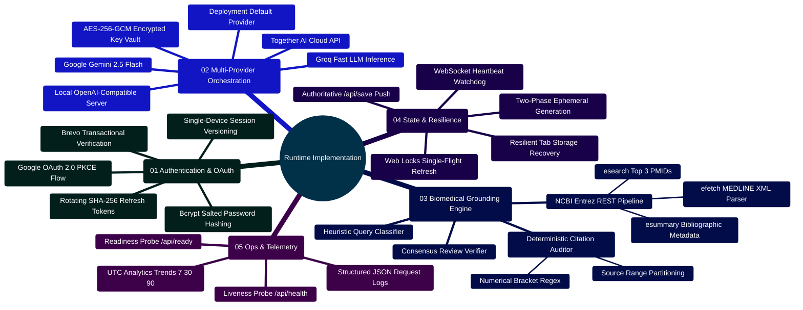

# MedAssist AI — Current Implementation & Runtime Architecture Specification

Developed by **J Ganesh kumar reddy**  
*Full-Stack Educational Health Assistance, Biomedical Evidence Grounding, & Machine Learning Research Platform*

---

## 1. Runtime Overview & Engineering Invariants

MedAssist AI runs as a web application with a **React 19 Single Page Application (SPA)**, an **Express / Node.js 24** backend, an authenticated **MongoDB 7** database, a **WebSocket gateway (`/ws`)**, and optional external integrations. The local verification environment uses synthetic AI, PubMed, and email responses; production hardening and clinical validation remain open.

```
====================================================================================================
                        MEDASSIST AI — CURRENT RUNTIME SPECIFICATION
====================================================================================================

      +-------------------------------------------------------------------------+
      |                           CLIENT APPLICATION                            |
      | - React 19 + Vite 6 + Tailwind CSS 4                                    |
      | - Single Page Routing via React Router 7                                |
      | - Web Locks API Single-Flight Token Refresh (lib/api.js)                |
      | - Resilient Draft & Pending Answer Recovery (lib/tabStorage.js)         |
      | - Safe Markdown Renderer (Inert Links, Omitted Remote Images)           |
      | - IME Composition Safety Guard for East Asian Language Typing           |
      +-------------------------------------------------------------------------+
                                           │
                         Same-Origin /api  │  Realtime /ws (WebSocket)
                         SameSite=Strict   │  Max 5 Conns/User
                                           ▼
      +-------------------------------------------------------------------------+
      |                       BACKEND APPLICATION PIPELINE                      |
      | - Reverse Proxy Ingress & Static File Delivery (Nginx :8080)            |
      | - Express Request Tracing (UUIDv4 x-request-id)                         |
      | - Origin Whitelist & Cross-Site Fetch Metadata Screening                |
      | - Strict Body Size Bounds (32KB JSON Ceiling)                           |
      | - Cookie-Based JWT Auth with Monotonic sessionVersion Invalidation      |
      | - AES-256-GCM Authenticated Personal API Key Vault                      |
      | - Google OAuth 2.0 with PKCE S256 Verification                          |
      | - Multi-Provider Engine (Gemini 2.5, Groq, Together AI, Local vLLM)    |
      | - Real-time NCBI Entrez PubMed Grounding (esearch, esummary, efetch)    |
      | - Deterministic Numerical Citation Verification ([N] Set Partitioning) |
      | - Optional Secondary Consensus Model Review (GEMINI_VERIFY_ANSWERS)     |
      | - Authoritative Two-Phase Generation Handshake (24h Ephemeral Buffer)   |
      +-------------------------------------------------------------------------+
                                           │
                                           ▼
      +-------------------------------------------------------------------------+
      |                       PERSISTENCE LAYER (MongoDB 7)                     |
      | - Users: Credentials, Bcrypt Hashes, sessionVersion, Provider Choice    |
      | - ProviderCredentials: AES-256-GCM Encrypted User Keys (IV, Tag, Data)  |
      | - Chats: Authoritative Message Threads, PubMed PMIDs, Citation Audits   |
      | - Generations: Ephemeral In-Flight Buffers with 24-Hour TTL Expiration  |
      +-------------------------------------------------------------------------+
```

---

## 2. Runtime Capability Mindmap



---

## 3. Database Models & Schema Specifications

The database layer runs on MongoDB 7 via Mongoose. All models enforce strict schema boundaries, validation rules, and indexing.

### 3.1 User Model (`backend/models/userModel.js`)

Manages user authentication, single-device session versioning, and provider preferences:

```javascript
// backend/models/userModel.js
const mongoose = require("mongoose");
const bcrypt = require("bcryptjs");

const userSchema = new mongoose.Schema({
  email: {
    type: String,
    required: true,
    unique: true,
    lowercase: true,
    trim: true,
    maxlength: 254,
  },
  password: {
    type: String,
    required: true,
    minlength: 8,
  },
  isVerified: {
    type: Boolean,
    default: false,
  },
  verificationToken: String,
  verificationTokenExpiry: Date,
  resetPasswordToken: String,
  resetPasswordExpiry: Date,
  googleSubject: {
    type: String,
    sparse: true,
    unique: true,
  },
  sessionVersion: {
    type: Number,
    default: 1,
  },
  refreshTokenHash: {
    type: String,
    default: null,
  },
  refreshTokenExpiry: {
    type: Date,
    default: null,
  },
  providerChoice: {
    type: String,
    default: "deployment",
  },
  answerStyle: {
    type: String,
    enum: ["balanced", "brief", "detailed"],
    default: "balanced",
  },
  audienceProfile: {
    type: String,
    enum: ["general", "student", "clinician"],
    default: "general",
  },
  usePastChats: {
    type: Boolean,
    default: false,
  },
}, { timestamps: true });

userSchema.pre("save", async function (next) {
  if (!this.isModified("password")) return next();
  this.password = await bcrypt.hash(this.password, 10);
  next();
});

module.exports = mongoose.model("User", userSchema);
```

### 3.2 Provider Credential Model (`backend/models/providerCredentialModel.js`)

Stores user-provided API keys encrypted via **AES-256-GCM**. Raw keys are never stored in plaintext:

```javascript
// backend/models/providerCredentialModel.js
const mongoose = require("mongoose");

const providerCredentialSchema = new mongoose.Schema({
  userId: {
    type: mongoose.Schema.Types.ObjectId,
    ref: "User",
    required: true,
    index: true,
  },
  provider: {
    type: String,
    required: true,
    enum: ["gemini", "groq", "together"],
  },
  iv: { type: String, required: true, select: false },        // Base64 12-byte initialization vector
  tag: { type: String, required: true, select: false },       // Base64 16-byte authentication tag
  ciphertext: { type: String, required: true, select: false },// Base64 ciphertext
  lastFour: { type: String, required: true },                 // Safe display suffix
  updatedAt: { type: Date, default: Date.now },
});

providerCredentialSchema.index({ userId: 1, provider: 1 }, { unique: true });
module.exports = mongoose.model("ProviderCredential", providerCredentialSchema);
```

### 3.3 Ephemeral Generation Model (`backend/models/generationModel.js`)

Buffers in-flight and completed generation payloads. Enforces a **24-hour Time-to-Live (TTL)** expiration:

```javascript
// backend/models/generationModel.js
const mongoose = require("mongoose");

const generationSchema = new mongoose.Schema({
  userId: { type: String, required: true, index: true },
  exchangeId: { type: String, required: true },
  sessionId: { type: String, required: true },
  newConversation: { type: Boolean, default: false },
  inputHash: { type: String, required: true },
  state: {
    type: String,
    enum: ["pending", "ready", "failed"],
    default: "pending",
  },
  prompt: { type: String, required: true },
  result: { type: mongoose.Schema.Types.Mixed },
  expiresAt: {
    type: Date,
    default: () => new Date(Date.now() + 24 * 60 * 60 * 1000),
    index: { expires: "24h" }, // MongoDB TTL auto-cleanup
  },
}, { timestamps: true });

generationSchema.index({ userId: 1, exchangeId: 1 }, { unique: true });
module.exports = mongoose.model("Generation", generationSchema);
```

### 3.4 Chat & Message Model (`backend/models/chatModel.js`)

Stores permanently committed conversation history, PubMed bibliographic citations, and verification outcomes:

```javascript
// backend/models/chatModel.js
const mongoose = require("mongoose");

const referenceSchema = new mongoose.Schema({
  title: String,
  authors: [String],
  journal: String,
  pubdate: String,
  pmid: String,
  url: String,
  evidenceType: String,
}, { _id: false });

const verificationSchema = new mongoose.Schema({
  status: String,
  provider: String,
  model: String,
  modelReview: String,
  verifierModel: String,
  sourceCount: Number,
  grounded: Boolean,
  citationNumbersValid: Boolean,
  validCitationCount: Number,
  invalidCitationCount: Number,
  citationCoverage: Number,
  historyMessagesUsed: Number,
  safetyCategory: String,
  evidenceLevel: String,
  fallbackReason: String,
}, { _id: false });

const messageSchema = new mongoose.Schema({
  exchangeId: String,
  prompt: { type: String, required: true },
  response: { type: String, required: true },
  isMedical: { type: Boolean, default: false },
  references: [referenceSchema],
  verification: verificationSchema,
  timestamp: { type: Date, default: Date.now },
}, { _id: false });

const chatSchema = new mongoose.Schema({
  sessionId: { type: String, required: true, unique: true, index: true },
  messages: [messageSchema],
  userId: { type: mongoose.Schema.Types.ObjectId, ref: "User", required: true, index: true },
  title: { type: String, default: "New Chat" },
  isMedical: { type: Boolean, default: false, index: true },
  createdAt: { type: Date, default: Date.now, index: true },
  updatedAt: { type: Date, default: Date.now, index: true },
});

chatSchema.index({ userId: 1, updatedAt: -1, sessionId: -1 });
chatSchema.pre("save", function (next) {
  this.updatedAt = Date.now();
  if (this.isModified("messages")) {
    this.isMedical = this.messages.some((msg) => msg.isMedical);
  }
  next();
});

module.exports = mongoose.model("Chat", chatSchema);
```

---

## 4. Multi-Provider AI Architecture & Personal Key Vault

MedAssist AI supports multi-provider generation with operator-defined fallbacks or authenticated user-supplied personal keys:

```
[User Generation Request]
           │
           ▼
[resolveProviderSelection(userId)]
           │
           ├── User Selected: "deployment" (Default)
           │     └── Reads process.env.AI_PROVIDER (gemini, groq, together, local)
           │
           ├── User Selected: "deployment-<provider>"
           │     └── Uses operator deployment environment keys
           │
           └── User Selected: "personal-<provider>"
                 ├── Load ProviderCredential record from MongoDB
                 └── Decrypt via open() using AES-256-GCM + USER_API_KEY_ENCRYPTION_KEY
```

### 4.1 Cryptographic Key Vault Implementation (`backend/services/providerCredentials.js`)

```javascript
const { randomBytes, createCipheriv, createDecipheriv } = require("crypto");
const { fail } = require("./validation");

const encryptionKey = () => {
  const raw = process.env.USER_API_KEY_ENCRYPTION_KEY;
  if (!raw || !/^[0-9a-f]{64}$/i.test(raw)) {
    throw fail("Personal API key storage is misconfigured.", 503, "KEY_STORAGE_UNAVAILABLE");
  }
  return Buffer.from(raw, "hex");
};

// Encrypt user key with AES-256-GCM
const seal = (apiKey) => {
  if (typeof apiKey !== "string" || apiKey.length < 12 || apiKey.length > 512 || /\s/.test(apiKey)) {
    throw fail("Enter a valid API key without spaces (12 to 512 characters).");
  }
  const iv = randomBytes(12);
  const cipher = createCipheriv("aes-256-gcm", encryptionKey(), iv);
  const ciphertext = Buffer.concat([cipher.update(apiKey, "utf8"), cipher.final()]);
  return {
    iv: iv.toString("base64"),
    tag: cipher.getAuthTag().toString("base64"),
    ciphertext: ciphertext.toString("base64"),
    lastFour: apiKey.slice(-4),
    updatedAt: new Date(),
  };
};

// Decrypt user key with AES-256-GCM
const open = (record) => {
  try {
    const decipher = createDecipheriv("aes-256-gcm", encryptionKey(), Buffer.from(record.iv, "base64"));
    decipher.setAuthTag(Buffer.from(record.tag, "base64"));
    return Buffer.concat([decipher.update(Buffer.from(record.ciphertext, "base64")), decipher.final()]).toString("utf8");
  } catch {
    throw fail("The saved API key could not be read. Remove it and add a new key.", 503, "KEY_UNAVAILABLE");
  }
};
```

---

## 5. Google OAuth 2.0 with PKCE Flow (`backend/controllers/oauthController.js`)

MedAssist AI implements standard OpenID Connect with **Proof Key for Code Exchange (PKCE)** using SHA-256 code challenges (`S256`):

```
Client Browser                         oauthController                  Google Identity Service
      │                                       │                                   │
  [1] │─── GET /api/auth/google ─────────────>│                                   │
      │                                       ├─ Generate state (32B random)      │
      │                                       ├─ Generate verifier (32B random)   │
      │                                       ├─ Compute challenge = SHA256(ver)  │
      │                                       ├─ Sign JWT oauthTransaction cookie │
      │<── 302 Redirect to Google Auth URL ───┤                                   │
      │                                       │                                   │
  [2] │───────────────────────────────────────┴──────────────────────────────────>│
      │                                  (User signs in & consents)               │
  [3] │<──────────────────────────────────────────────────────────────────────────┤
      │                                       │                                   │
  [4] │─── GET /api/auth/google/callback ────>│                                   │
      │    ?code=...&state=...                ├─ Verify JWT oauthTransaction      │
      │                                       ├─ timingSafeEqual(state, expected) │
      │                                       ├─ Exchange code + verifier ───────>│
      │                                       │<─ Return ID Token & Tokens ───────┤
      │                                       ├─ Verify ID token with Google      │
      │                                       ├─ Find/Create User (isVerified)    │
      │                                       ├─ Increment sessionVersion++       │
      │                                       ├─ Set HttpOnly Auth Cookies        │
      │<── 302 Redirect to /chat ─────────────┤                                   │
```

```javascript
// Excerpt from backend/controllers/oauthController.js
exports.callback = async (req, res) => {
  const { maxAge, ...clearOptions } = cookieSettings();
  res.clearCookie("oauthTransaction", clearOptions);
  const fail = () => res.redirect(frontend() + "/login?oauth=failed");

  try {
    if (!configured() || typeof req.query.code !== "string" || typeof req.query.state !== "string") return fail();
    const transaction = jwt.verify(req.cookies.oauthTransaction || "", process.env.JWT_VERIFICATION_TOKEN, { audience: "google-oauth" });
    const expected = Buffer.from(transaction.state);
    const received = Buffer.from(req.query.state);
    if (expected.length !== received.length || !timingSafeEqual(expected, received)) return fail();

    const identity = await (req.app.locals.services.googleExchange || exchange)({
      code: req.query.code,
      verifier: transaction.verifier,
    });
    if (!identity?.sub || !identity.email_verified || typeof identity.email !== "string") return fail();

    const email = identity.email.trim().toLowerCase();
    let user = await User.findOne({ googleSubject: identity.sub });
    if (!user) {
      if (await User.exists({ email })) return fail();
      user = await User.create({ email, googleSubject: identity.sub, password: randomBytes(32).toString("hex"), isVerified: true });
    }

    user = await User.findByIdAndUpdate(user._id, { $inc: { sessionVersion: 1 } }, { new: true });
    const tokens = makeTokens(user);
    await User.updateOne({ _id: user._id, sessionVersion: user.sessionVersion }, {
      $set: { refreshTokenHash: hashToken(tokens.refreshToken), refreshTokenExpiry: Date.now() + 7 * 86400000 },
    });

    req.app.locals.closeUserSockets?.(String(user._id));
    setCookies(res, tokens);
    return res.redirect(frontend() + "/chat");
  } catch {
    return fail();
  }
};
```

---

## 6. Comprehensive REST API Specifications with JSON Payloads

### 6.1 Authentication Routes (`/api/auth/*`)

#### `POST /api/auth/register`
- **Request Body**:
  ```json
  {
    "email": "student@example.com",
    "password": "SecurePassword123!"
  }
  ```
- **Response `201 Created`**:
  ```json
  {
    "success": true,
    "message": "Account registered. Please check your email to verify your account."
  }
  ```

#### `POST /api/auth/login`
- **Request Body**:
  ```json
  {
    "email": "student@example.com",
    "password": "SecurePassword123!"
  }
  ```
- **Response `200 OK`** (Sets `accessToken` and `refreshToken` HttpOnly cookies):
  ```json
  {
    "user": {
      "id": "67215f9b4c68832a8b9f1234",
      "email": "student@example.com",
      "isVerified": true
    }
  }
  ```

#### `GET /api/auth/check`
- **Response `200 OK`**:
  ```json
  {
    "user": {
      "id": "67215f9b4c68832a8b9f1234",
      "email": "student@example.com"
    }
  }
  ```

#### `POST /api/auth/refresh-token`
- **Request**: Cookie `refreshToken`
- **Response `200 OK`**:
  ```json
  {
    "status": "refreshed"
  }
  ```

---

### 6.2 User Settings & Personal Key Vault (`/api/settings/*`)

#### `GET /api/settings`
- **Response `200 OK`**:
  ```json
  {
    "providerChoice": "deployment",
    "answerStyle": "balanced",
    "audienceProfile": "general",
    "usePastChats": false,
    "keyStorageAvailable": true,
    "personalKeys": [
      {
        "provider": "gemini",
        "lastFour": "1234",
        "updatedAt": "2026-10-29T10:15:30.000Z"
      }
    ],
    "providerChoices": [
      { "id": "deployment", "provider": "gemini", "source": "deployment", "available": true },
      { "id": "deployment-groq", "provider": "groq", "source": "deployment", "available": true },
      { "id": "personal-gemini", "provider": "gemini", "source": "personal", "available": true },
      { "id": "personal-groq", "provider": "groq", "source": "personal", "available": false }
    ]
  }
  ```

#### `PUT /api/settings/keys/:provider`
- **Request Body**:
  ```json
  {
    "apiKey": "AIzaSyD-PersonalSecretKey1234"
  }
  ```
- **Response `200 OK`**: Updated settings payload matching `GET /api/settings`.

#### `PATCH /api/settings`
- Accepts any subset of `providerChoice`, `answerStyle`, `audienceProfile`, and `usePastChats`. A newly selected provider must have an available deployment credential or a saved personal key. Cross-chat context is off by default and uses bounded word-overlap retrieval from the signed-in user's nonmedical chats.

#### `DELETE /api/settings/keys/:provider`
- Removes the signed-in user's key. If that key was selected, the provider choice returns to the deployment default. Active database deletion does not purge older operator backups.

---

### 6.3 Chat & Two-Phase Generation Routes (`/api/*`)

#### `POST /api/ai/chat` (Phase 1 Generation)
- **Request Body**:
  ```json
  {
    "prompt": "What are common symptoms and triggers of asthma?",
    "sessionId": "4a18c7e9-6019-4dc8-a892-d39281bf094a",
    "exchangeId": "b1820468-b715-46fa-bb1e-53c448bb9214"
  }
  ```
- **Response `200 OK`**:
  ```json
  {
    "text": "Common symptoms of asthma include shortness of breath, wheezing, and coughing [1]. Typical triggers include airborne allergens, cold air, and respiratory infections [2].\n\nReview the linked records with a qualified clinician. This is educational information.",
    "isMedical": true,
    "references": [
      {
        "title": "Asthma Epidemiology and Clinical Presentation",
        "authors": ["Smith JA", "Doe RK"],
        "journal": "Lancet Respir Med",
        "pubdate": "2024",
        "pmid": "38491024",
        "url": "https://pubmed.ncbi.nlm.nih.gov/38491024/",
        "evidenceType": "abstract"
      },
      {
        "title": "Environmental Triggers in Severe Asthma",
        "authors": ["Lee H", "Patel M"],
        "journal": "Am J Respir Crit Care Med",
        "pubdate": "2025",
        "pmid": "39102845",
        "url": "https://pubmed.ncbi.nlm.nih.gov/39102845/",
        "evidenceType": "abstract"
      }
    ],
    "verification": {
      "status": "citation_checked",
      "provider": "Gemini",
      "model": "gemini-2.5-flash",
      "grounded": false,
      "sourceCount": 2,
      "validCitationCount": 2,
      "invalidCitationCount": 0,
      "citationCoverage": 100,
      "evidenceLevel": "abstracts_supplied",
      "modelReview": "supported",
      "verifierModel": "gemini-2.5-flash"
    },
    "generationId": "b1820468-b715-46fa-bb1e-53c448bb9214",
    "sessionId": "4a18c7e9-6019-4dc8-a892-d39281bf094a"
  }
  ```

#### `POST /api/save` (Phase 2 Authoritative Commitment)
- **Request Body**:
  ```json
  {
    "generationId": "b1820468-b715-46fa-bb1e-53c448bb9214"
  }
  ```
- **Response `201 Created`**:
  ```json
  {
    "sessionId": "4a18c7e9-6019-4dc8-a892-d39281bf094a",
    "isNew": false,
    "chat": {
      "id": "4a18c7e9-6019-4dc8-a892-d39281bf094a",
      "title": "Asthma Symptoms & Triggers",
      "isMedical": true,
      "timestamp": "2026-10-29T10:16:00.000Z",
      "messages": [
        {
          "id": "b1820468-b715-46fa-bb1e-53c448bb9214-user",
          "text": "What are common symptoms and triggers of asthma?",
          "isUser": true,
          "timestamp": "2026-10-29T10:15:30.000Z",
          "isMedical": true
        },
        {
          "id": "b1820468-b715-46fa-bb1e-53c448bb9214-assistant",
          "text": "Common symptoms of asthma include shortness of breath, wheezing, and coughing [1]...",
          "isUser": false,
          "timestamp": "2026-10-29T10:15:32.000Z",
          "isMedical": true,
          "references": [...],
          "verification": {...}
        }
      ]
    }
  }
  ```

#### `GET /api/history?limit=30`
- **Response `200 OK`**:
  ```json
  {
    "items": [
      {
        "id": "4a18c7e9-6019-4dc8-a892-d39281bf094a",
        "sessionId": "4a18c7e9-6019-4dc8-a892-d39281bf094a",
        "title": "Asthma Symptoms & Triggers",
        "isMedical": true,
        "timestamp": "2026-10-29T10:16:00.000Z",
        "createdAt": "2026-10-29T10:15:30.000Z"
      }
    ],
    "nextCursor": null
  }
  ```

---

### 6.4 Operations & Telemetry Routes (`/api/*`)

#### `GET /api/health`
- **Response `200 OK`**:
  ```json
  {
    "status": "ok",
    "version": "1.0.0"
  }
  ```

#### `GET /api/ready`
- **Response `200 OK`**:
  ```json
  {
    "status": "ready",
    "database": "connected",
    "aiConfigured": true,
    "emailConfigured": true,
    "requestId": "e93f821a-4c28-40b9-91a3-a7c89104db21"
  }
  ```

#### `GET /api/analytics/overview?days=7`
- **Response `200 OK`**:
  ```json
  {
    "generatedAt": "2026-10-29T12:00:00.000Z",
    "rangeDays": 7,
    "summaryScope": "lifetime",
    "timezone": "UTC",
    "summary": {
      "totalSessions": 42,
      "totalMessages": 118,
      "medicalSessions": 35,
      "medicalResponses": 98,
      "citedResponses": 95,
      "citations": 285,
      "averageMessagesPerSession": 2.8,
      "sourceAttachmentRate": 96.9
    },
    "breakdown": [
      { "label": "Medical", "value": 35 },
      { "label": "General", "value": 7 }
    ],
    "trend": [
      { "date": "2026-10-23", "sessions": 5, "exchanges": 14 },
      { "date": "2026-10-24", "sessions": 8, "exchanges": 22 },
      { "date": "2026-10-25", "sessions": 6, "exchanges": 18 },
      { "date": "2026-10-26", "sessions": 7, "exchanges": 20 },
      { "date": "2026-10-27", "sessions": 4, "exchanges": 11 },
      { "date": "2026-10-28", "sessions": 6, "exchanges": 17 },
      { "date": "2026-10-29", "sessions": 6, "exchanges": 16 }
    ],
    "verification": {
      "statuses": {
        "citation_checked": 95,
        "references_only": 3
      },
      "providers": {
        "Gemini": 98
      }
    },
    "dataset": {
      "rows": { "total": 16412, "valid": 16407, "excluded": 5 },
      "qualityFlags": { "repeatedNormalizedQuestions": 2062 }
    }
  }
  ```

---

## 7. Biomedical Grounding, Citation Auditing & Drug Interaction Service

### 7.1 Three-Stage NCBI Entrez PubMed Harvester (`backend/services/pubmedService.js`)

MedAssist AI interfaces directly with the National Center for Biotechnology Information (NCBI) Entrez E-Utilities via an orchestrated three-stage HTTP pipeline with rate limiting (110ms with NCBI key, 350ms without key):

```
========================================================================================================================
                                     NCBI ENTREZ E-UTILITIES THREE-STAGE HARVESTER
========================================================================================================================

    [ User Question Prompt ]
                 │
                 ▼
    ┌──────────────────────────────────────────────────────────────────────────────────────────────────┐
    │ Stage 1: esearch.fcgi (Query Normalization & Relevance Search)                                   │
    │ - Strips common stop-words, extracts alphanumeric clinical tokens                                │
    │ - Queries https://eutils.ncbi.nlm.nih.gov/entrez/eutils/esearch.fcgi?retmode=json&retmax=3       │
    │ - Fallback: If 0 hits returned, re-executes search using top 3 high-significance tokens          │
    │ - Extracts matching PubMed Unique Identifiers: [PMID1, PMID2, PMID3]                             │
    └──────────────────────────────────────────────────────────────────────────────────────────────────┘
                 │
                 ▼
    ┌──────────────────────────────────────────────────────────────────────────────────────────────────┐
    │ Stage 2: esummary.fcgi (Bibliographic Metadata Extraction)                                       │
    │ - Queries https://eutils.ncbi.nlm.nih.gov/entrez/eutils/esummary.fcgi?id=PMID1,PMID2,PMID3        │
    │ - Extracts canonical article title, author lists, journal source, publication date, and URLs     │
    └──────────────────────────────────────────────────────────────────────────────────────────────────┘
                 │
                 ▼
    ┌──────────────────────────────────────────────────────────────────────────────────────────────────┐
    │ Stage 3: efetch.fcgi (MEDLINE XML Abstract Retrieval & fast-xml-parser Extraction)                │
    │ - Queries https://eutils.ncbi.nlm.nih.gov/entrez/eutils/efetch.fcgi?retmode=xml&rettype=abstract │
    │ - Parses XML DOM tree via fast-xml-parser without entity expansion                               │
    │ - Flattens structured AbstractText nodes (Background, Methods, Results, Conclusions)             │
    │ - Maps abstracts directly to PMIDs with 10,000 character defensive caps                          │
    └──────────────────────────────────────────────────────────────────────────────────────────────────┘
========================================================================================================================
```

### 7.2 Deterministic Citation Auditor (`backend/services/citationService.js`)

The citation auditor deterministically extracts bracketed numbers `[N]` from generated model output and mathematically verifies them against the count of supplied literature records:

```javascript
// Implementation snippet from backend/services/citationService.js:
const CITATION_PATTERN = /\[(\d+)\]/g;

const assessCitationGrounding = (text, sourceCount = 0) => {
  const matches = [...String(text || "").matchAll(CITATION_PATTERN)];
  const citedNumbers = [...new Set(matches.map((m) => Number(m[1])))].sort((a, b) => a - b);

  const validCitations = citedNumbers.filter((n) => n >= 1 && n <= sourceCount);
  const invalidCitations = citedNumbers.filter((n) => n < 1 || n > sourceCount);

  let status = "ungrounded";
  if (invalidCitations.length > 0) status = "invalid_citations";
  else if (validCitations.length > 0) status = "citation_checked";
  else if (sourceCount > 0) status = "sources_supplied";

  const coverage = sourceCount > 0 ? (validCitations.length / sourceCount) * 100 : 0;

  return {
    status,
    sourceCount,
    validCitationCount: validCitations.length,
    invalidCitationCount: invalidCitations.length,
    citationCoverage: Math.round(coverage * 10) / 10,
    citedSourceNumbers: citedNumbers,
    validSourceNumbers: validCitations,
    invalidSourceNumbers: invalidCitations,
    grounded: status === "citation_checked" && invalidCitations.length === 0,
  };
};
```

### 7.3 High-Risk Medication Contraindication Scanner (`backend/services/interactionService.js`)

Performs deterministic regular-expression scanning across user queries for 12 major FDA black-box warning drug interaction pairs. Warnings are preserved across emergency redirects:

| Interacting Pair | Severity | Drug A Class & Examples | Drug B Class & Examples | Clinical Risk Description |
| :--- | :---: | :--- | :--- | :--- |
| **Anticoagulants + NSAIDs** | **CRITICAL** | Warfarin, Eliquis, Xarelto, Plavix | Aspirin, Ibuprofen, Naproxen, Celebrex | Synergistic GI ulceration and systemic/intracranial bleeding |
| **PDE5 Inhibitors + Nitrates** | **CRITICAL** | Sildenafil, Tadalafil, Vardenafil | Nitroglycerin, Isosorbide, Poppers | Cyclic GMP accumulation causing refractory, fatal hypotension |
| **Serotonergic Opioids + SSRIs** | **HIGH** | Tramadol, Meperidine, Methadone | Fluoxetine, Sertraline, Venlafaxine | Severe Serotonin Syndrome and lowered seizure threshold |
| **ACEI/ARBs + K-Sparing Diuretics**| **HIGH** | Lisinopril, Losartan, Enalapril | Spironolactone, Triamterene, K-Dur | Synergistic potassium retention causing fatal cardiac arrhythmias |
| **Methotrexate + Bactrim** | **HIGH** | Methotrexate, Trexall | Trimethoprim-Sulfamethoxazole | Synergistic anti-folate bone marrow suppression & pancytopenia |
| **Fluoroquinolones + Steroids** | **HIGH** | Ciprofloxacin, Levofloxacin | Prednisone, Dexamethasone | Synergistic tendon collagen degradation & Achilles rupture |
| **Benzodiazepines + Opioids** | **CRITICAL** | Alprazolam, Diazepam, Clonazepam | Morphine, Oxycodone, Fentanyl | Synergistic GABA/mu-opioid respiratory depression and death |
| **Lithium + NSAIDs/ACEI** | **HIGH** | Lithium carbonate, Lithobid | Ibuprofen, Naproxen, Lisinopril | Impaired renal clearance causing acute lithium neurotoxicity |
| **Statins + CYP3A4 Inhibitors** | **HIGH** | Simvastatin, Atorvastatin, Lovastatin | Clarithromycin, Itraconazole, Gemfibrozil | Impaired hepatic CYP3A4 clearance causing rhabdomyolysis |
| **Warfarin + Azoles** | **CRITICAL** | Warfarin, Coumadin | Fluconazole, Ketoconazole, Metronidazole| CYP2C9 inhibition causing supratherapeutic INR and hemorrhage |
| **Digoxin + Amiodarone/Verapamil**| **HIGH** | Digoxin, Lanoxin | Amiodarone, Verapamil, Diltiazem | P-glycoprotein inhibition causing digoxin toxicity and heart block |
| **MAOIs + Serotonergic Agents** | **CRITICAL** | Phenelzine, Selegiline, Tranylcypromine| Fluoxetine, Escitalopram, Duloxetine | Fatal Serotonin Syndrome and acute hypertensive crisis |

---

## 8. Clinical Educational Calculators Specification

The `frontend/src/components/tools/ClinicalCalculatorsModal.jsx` module implements 11 evidence-based medical calculators with WAI-ARIA tabpanel semantics and arrow-key cycling:

```
========================================================================================================================
                                     CLINICAL CALCULATOR SUITE & MATHEMATICAL FORMULATIONS
========================================================================================================================

    [ TOOL ]                   [ SCIENTIFIC FORMULATION / ALGORITHM ]                    [ BOUNDS / CONSTRAINTS ]
    ─────────────────────────────────────────────────────────────────────────────────────────────────────────────────
    Body Mass Index (BMI)      BMI = weight_kg / (height_m)^2                            Weight: 20-300 kg
                               Imperial: (weight_lbs * 703) / (height_in)^2              Height: 50-250 cm

    eGFR (CKD-EPI 2021)        eGFR = 142 * min(Scr/κ, 1)^α * max(Scr/κ, 1)^-1.200       Age: 18-120 years
    (Race-Free Standard)              * 0.9938^Age * (1.012 if female)                   Scr: 0.2-15.0 mg/dL
                               (κ = 0.7 F / 0.9 M; α = -0.241 F / -0.302 M)

    CHA2DS2-VASc               Points: CHF (+1), HTN (+1), Age >=75 (+2), Diabetes (+1), Age: 18-120 years
    (Stroke Risk in AFib)      Stroke/TIA (+2), Vascular Disease (+1), Age 65-74 (+1),   Binary clinical flags
                               Female Sex (+1). Range: 0 to 9 points.

    Mean Arterial Pressure     MAP = DBP + 1/3 * (SBP - DBP)                             SBP: 50-260 mmHg
    (MAP Hemodynamics)                                                                   DBP: 30-160 mmHg

    Cockcroft-Gault CrCl       CrCl = [(140 - Age) * Weight_kg] / (72 * Scr)            Age: 18-120 years
    (Renal Drug Dosing)        * (0.85 if female)                                        Weight: 20-250 kg, Scr: 0.2-15

    Payne Corrected Calcium    Corrected Ca = Measured Ca + 0.8 * (4.0 - Albumin_g_dL)   Total Ca: 4.0-18.0 mg/dL
                                                                                         Albumin: 1.0-6.0 g/dL

    Serum Anion Gap            Anion Gap = Na - (Cl + HCO3)                              Na: 100-180 mEq/L
                               Normal Range: 4 to 12 mEq/L                               Cl: 50-140, HCO3: 5-50

    FeNa (Fractional Sodium)   FeNa = (UNa * SCr) / (SNa * UCr) * 100%                   UNa, SNa, SCr, UCr
                               < 1% Prerenal azotemia; > 2% Acute tubular necrosis       All positive values

    FeUrea (Fractional Urea)   FeUrea = (UUrea * SCr) / (BUN * UCr) * 100%               UUrea, BUN, SCr, UCr
                               < 35% Prerenal (valid during diuretic therapy)            All positive values

    Parkland Burn Fluids       Total 24h = 4 mL * Weight_kg * %TBSA                      Weight: 20-200 kg
                               First 8h: 50% of total; Remaining 16h: 50% of total        TBSA: 1-100%

    Wells Criteria for PE      Clinical DVT (+3), PE #1 diagnosis (+3), HR >100 (+1.5),  Binary clinical flags
                               Immobilization/Surgery (+1.5), Prior DVT/PE (+1.5),       PE unlikely <= 4
                               Hemoptysis (+1), Malignancy (+1). Range: 0 to 12.5.       PE likely > 4
========================================================================================================================
```

---

## 9. Client Concurrency Control & State Resilience

### 9.1 Single-Flight Token Refresh via Web Locks API (`frontend/src/lib/api.js`)

Coordinates concurrent HTTP requests across browser tabs when encountering expired access tokens, using `navigator.locks.request("medassist-session-refresh")` to execute exactly one refresh call.

### 9.2 Resilient Client Storage (`frontend/src/lib/tabStorage.js`)

Protects against storage access exceptions in restricted browser environments (incognito/private mode, blocked third-party storage cookies), maintaining in-memory fallbacks while persisting drafts per keystroke.

### 9.3 IME Composition Safety in Composer (`frontend/src/components/chat/ChatWorkspace.jsx`)

Prevents accidental premature message submission during multi-byte Input Method Editor (IME) compositions (Japanese, Chinese, Korean, Indic transliterations) by evaluating `event.nativeEvent.isComposing`.

