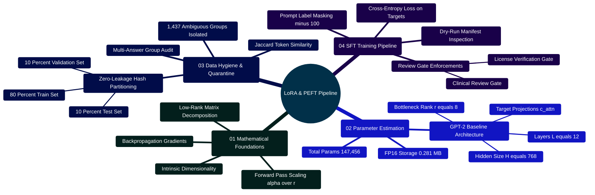

# MedAssist AI — Mathematical & Engineering Guide to LoRA & Model Fine-Tuning

Developed by **J Ganesh kumar reddy**  
*Full-Stack Educational Health Assistance, Biomedical Evidence Grounding, & Machine Learning Research Platform*

---

## 1. Theoretical Foundations: Pre-Training vs. Supervised Fine-Tuning (SFT)

The development lifecycle of specialized health and biomedical language models comprises two mathematically distinct training regimes:

### 1.1 Unsupervised Autoregressive Causal Pre-Training
A transformer foundation model with parameters $\theta$ is optimized over an unlabelled token corpus $\mathcal{U} = (u_1, u_2, \dots, u_N)$ by minimizing the negative log-likelihood:
$$\mathcal{L}_{\text{pre}}(\theta) = - \sum_{i=1}^{N} \log P_\theta(u_i \mid u_{1}, u_{2}, \dots, u_{i-1})$$

While this imparts broad linguistic representations and associative world knowledge, the base model functions strictly as a probabilistic continuation engine. When queried with clinical inquiries (*"What are the diagnostic signs of pulmonary embolism?"*), a raw base model may output further questions, transcribe textbook indices, or hallucinate answers.

### 1.2 Supervised Instruction Fine-Tuning (SFT)
Supervised Fine-Tuning conditions the model to behave as an instruction-following assistant. Given a curated dataset of prompt-target pairs $\mathcal{D} = \{(x^{(j)}, y^{(j)})\}_{j=1}^{|\mathcal{D}|}$, SFT maximizes the conditional log-likelihood of response tokens $y = (y_1, y_2, \dots, y_m)$ conditioned on instruction tokens $x = (x_1, x_2, \dots, x_n)$:
$$\mathcal{L}_{\text{SFT}}(\theta) = - \sum_{j=1}^{|\mathcal{D}|} \sum_{t=1}^{m_j} \log P_\theta(y_t^{(j)} \mid x^{(j)}, y_{<t}^{(j)})$$

---

## 2. Computational Bottlenecks of Full Fine-Tuning (FFT)

In Full Fine-Tuning, every parameter in $\theta \in \mathbb{R}^d$ is updated during backpropagation using optimizers like AdamW.

### 2.1 AdamW State-Space Memory Footprint
For a model with $|\theta|$ parameters:
1. **Model Weights (FP16/BF16)**: $2 \times |\theta|$ bytes.
2. **Backpropagated Gradients (FP16/BF16)**: $2 \times |\theta|$ bytes.
3. **First Moment Vector $m_t$ (FP32)**: $4 \times |\theta|$ bytes.
4. **Second Moment Vector $v_t$ (FP32)**: $4 \times |\theta|$ bytes.
5. **Master Weights Copy (FP32)**: $4 \times |\theta|$ bytes.

$$\text{Memory}_{\text{optimizer}}(\theta) = (2 + 2 + 4 + 4 + 4) \times |\theta| = 16 \times |\theta| \text{ bytes}$$

For a 7-billion parameter clinical model ($|\theta| = 7 \times 10^9$):
$$\text{Memory}_{\text{optimizer}} = 16 \times 7 \times 10^9 = 112 \text{ Gigabytes}$$
When adding KV-cache and forward activation buffers, total VRAM exceeds $140\text{ GB}$, necessitating multi-GPU enterprise infrastructure (e.g., $2 \times \text{NVIDIA A100 } 80\text{GB}$).

```
====================================================================================================
               FULL FINE-TUNING (FFT) vs LOW-RANK ADAPTATION (LoRA) COMPARISON
====================================================================================================

  FULL FINE-TUNING (All Weights Updated):
  Input Vector x ──► [ W_0 + Delta W ] (d x k parameters) ──► Output Vector h
                     All weights updated; requires 16x bytes optimizer overhead.

  LOW-RANK ADAPTATION (LoRA Bottleneck Decomposition):
                     ┌───────────────────┐
                     │   Frozen Base     │
  Input Vector x ─┬─►│     Weight W_0    │──────────────────────(+)──► Output Vector h
                  │  │     (d x k)       │                       ▲
                  │  └───────────────────┘                       │
                  │                                              │
                  │  ┌───────────────────┐      ┌─────────────┐  │
                  │  │ Down-Projection A │      │ Up-Proj B   │  │
                  └─►│ (r x k)           │─────►│ (d x r)     │──┘
                     │ Gaussian N(0, 1/r)│      │ Zero Init 0 │  Scaled by (alpha / r)
                     └───────────────────┘      └─────────────┘
```

---

## 3. Mathematical Formulation of Low-Rank Adaptation (LoRA)

Low-Rank Adaptation (Hu et al., 2021) leverages the **Intrinsic Dimensionality Hypothesis** (Aghajanyan et al., 2020): parameter updates $\Delta W$ for downstream tasks occupy a subspace of dramatically lower intrinsic dimension.

### 3.1 Matrix Decomposition
For a frozen pre-trained projection matrix $W_0 \in \mathbb{R}^{d \times k}$, the adapted weight is $W = W_0 + \Delta W$. LoRA decomposes $\Delta W$ into the product of two low-rank matrices:
$$\Delta W = \frac{\alpha}{r} (B \cdot A)$$

Where:
- $r \ll \min(d, k)$ is the low-rank bottleneck dimension (e.g., $r = 8$).
- $A \in \mathbb{R}^{r \times k}$ is initialized with Gaussian noise $\mathcal{N}(0, \sigma^2)$ where $\sigma = 1/r$.
- $B \in \mathbb{R}^{d \times r}$ is initialized to zero ($B = 0$), ensuring $\Delta W = 0$ at step $0$.
- $\alpha$ is a constant scaling hyperparameter; $\frac{\alpha}{r}$ stabilizes training across different rank choices.

### 3.2 Forward Pass Computation
Given input activation vector $x \in \mathbb{R}^{k}$:
$$h = W_0 x + \Delta W x = W_0 x + \frac{\alpha}{r} B (A x)$$

### 3.3 Gradient Backpropagation Through Bottlenecks
During training, base weights $W_0$ remain frozen ($\nabla_{W_0} \mathcal{L} = 0$). Gradients propagate exclusively through $B$ and $A$:
$$\frac{\partial \mathcal{L}}{\partial B} = \frac{\alpha}{r} \left( \frac{\partial \mathcal{L}}{\partial h} \right) (A x)^T \in \mathbb{R}^{d \times r}$$
$$\frac{\partial \mathcal{L}}{\partial A} = \frac{\alpha}{r} B^T \left( \frac{\partial \mathcal{L}}{\partial h} \right) x^T \in \mathbb{R}^{r \times k}$$

---

## 4. Parameter & Memory Derivations for GPT-2 Baseline

In MedAssist AI's offline validation suite ([`Model and Dataset/lora/validate_lora_setup.py`](file:///c:/Users/RAVIPRAKASH/React-App-LLM/Model%20and%20Dataset/lora/validate_lora_setup.py)), trainable adapter parameters are derived via closed-form analytical equations:

$$P_{\text{adapter}} = L \times P \times 2 \times d_{\text{model}} \times r$$

Where:
- Transformer Layers $L = 12$
- Target Projection Heads $P = 1$ (targeting fused `c_attn` projections)
- Hidden Dimension $d_{\text{model}} = 768$
- Adapter Rank $r = 8$

$$P_{\text{adapter}} = 12 \times 1 \times 2 \times 768 \times 8 = \mathbf{147,456 \text{ Trainable Parameters}}$$

### Memory Footprint:
$$\text{Memory}_{\text{FP16}} = \frac{147,456 \times 2 \text{ bytes}}{1,048,576 \text{ bytes/MB}} = \mathbf{0.28125 \text{ MB}} \approx 288 \text{ KB}$$

This yields a **99.88% reduction in trainable parameters** relative to the 124M parameter base model.

---

## 5. LoRA Engineering Mindmap



---

## 6. SFT Label Masking & Loss Formulation

When fine-tuning on question-answer records, standard causal language modeling trains the network to predict prompt tokens and answer tokens indiscriminately. In [`train_lora.py`](file:///c:/Users/RAVIPRAKASH/React-App-LLM/Model%20and%20Dataset/lora/train_lora.py), **Label Masking** is enforced:

$$\tilde{t}_i = \begin{cases} -100 & \text{if token } i \text{ belongs to prompt prefix ("Question: ...\\nAnswer: ")} \\ t_i & \text{if token } i \text{ belongs to target answer} \end{cases}$$

PyTorch cross-entropy loss ignores tokens with value `-100`, ensuring gradients optimize adapter weights strictly for clinical answer generation:

```
[Token Sequence Input]
Token:  [ Question: | What | is | asthma? | \n | Answer: | Asthma | is | a | chronic | disease. ]
Labels: [   -100    | -100 | -100|  -100  | -100|  -100  | Asthma | is | a | chronic | disease. ]
Loss:   [ ◄──────────────── IGNORED (0 Loss) ──────────► | ◄───── OPTIMIZED (Cross-Entropy) ──► ]
```

---

## 7. Dataset Quarantine & Partitioning Implementation

The offline preparation script ([`Model and Dataset/lora/build_lora_package.py`](file:///c:/Users/RAVIPRAKASH/React-App-LLM/Model%20and%20Dataset/lora/build_lora_package.py)) identifies and isolates ambiguous multi-answer questions into `quarantine.jsonl`:

```python
# Model and Dataset/lora/build_lora_package.py
from __future__ import annotations
import argparse
import csv
import hashlib
import json
import sys
from collections import defaultdict
from pathlib import Path

sys.path.insert(0, str(Path(__file__).resolve().parents[1]))
from prepare_dataset import DEFAULT_DATASET, file_sha256, leakage_key, load_and_clean, stable_split, write_split
from verify_splits import validate_splits
from prepare_sft_records import convert_csv

def build(source: Path, output: Path) -> dict:
    source = source.resolve()
    output = output.resolve()
    if output == source.parent or source == output:
        raise ValueError("Choose a separate output directory.")

    variants = defaultdict(set)
    with source.open(encoding="utf-8-sig", newline="") as handle:
        for row in csv.DictReader(handle):
            question = " ".join((row.get("question") or "").split())
            answer = " ".join((row.get("answer") or "").split())
            if question and answer:
                variants[leakage_key(question)].add(answer.casefold())

    # Quarantine any question associated with divergent answers
    ambiguous = {key for key, values in variants.items() if len(values) > 1}
    records, cleaning = load_and_clean(source, 5)
    accepted = [row for row in records if leakage_key(row["question"]) not in ambiguous]

    output.mkdir(parents=True, exist_ok=True)
    splits = {name: [row for row in accepted if stable_split(row["question"]) == name]
              for name in ("train", "validation", "test")}

    for name, rows in splits.items():
        write_split(output / (name + ".csv"), rows)
        convert_csv(output / (name + ".csv"), output / (name + ".jsonl"))

    source_hash = file_sha256(source)
    manifest = {
        "schema_version": 1,
        "source_file": source.name,
        "source_sha256": source_hash,
        "method": "Canonical question SHA-256 groups, approximate 80/10/10",
        "cleaning": cleaning,
        "quarantined_question_groups": len(ambiguous),
        "splits": {name: len(rows) for name, rows in splits.items()},
        "split_sha256": {name: file_sha256(output / (name + ".csv")) for name in splits},
        "jsonl_sha256": {name: file_sha256(output / (name + ".jsonl")) for name in splits},
        "clinical_review_approved": False,
        "license_review_approved": False,
        "reviewer": None,
        "training_performed": False,
    }

    (output / "manifest.json").write_text(json.dumps(manifest, indent=2) + "\n", encoding="utf-8")

    with (output / "provenance.jsonl").open("w", encoding="utf-8") as handle:
        for row in accepted:
            handle.write(json.dumps({
                "record_id": hashlib.sha256(leakage_key(row["question"]).encode()).hexdigest(),
                "source_sha256": source_hash,
                "source_url": None,
                "license": "unverified",
                "review_status": "pending",
                "split": stable_split(row["question"]),
            }) + "\n")

    with (output / "quarantine.jsonl").open("w", encoding="utf-8") as handle:
        for key in sorted(ambiguous):
            handle.write(json.dumps({
                "question_key": key,
                "reason": "multiple distinct answers; human review required",
                "variant_count": len(variants[key]),
            }) + "\n")

    validation = validate_splits(output)
    (output / "validation_report.json").write_text(json.dumps(validation, indent=2) + "\n", encoding="utf-8")
    if not validation["passed"]:
        raise ValueError("Prepared data failed split validation.")

    return manifest
```

---

## 8. Closed-Form Parameter Validation Script (`Model and Dataset/lora/validate_lora_setup.py`)

```python
# Model and Dataset/lora/validate_lora_setup.py
from __future__ import annotations
import argparse
import json
from pathlib import Path
from lora_config import load_lora_config

def estimate_adapter_parameters(hidden_size: int, layers: int, projections_per_layer: int, rank: int) -> int:
    """Calculate exact number of trainable parameters in LoRA matrices."""
    # Each projection decomposes into: Down-proj (H * R) + Up-proj (R * H) = 2 * H * R
    return layers * projections_per_layer * 2 * hidden_size * rank

def calculate_memory_footprint_mb(parameter_count: int, bytes_per_param: int = 2) -> float:
    """Compute FP16 storage footprint in megabytes."""
    return (parameter_count * bytes_per_param) / (1024 * 1024)

def validate_setup(config_path: Path | None = None) -> dict:
    config = load_lora_config(config_path)
    params = estimate_adapter_parameters(
        hidden_size=config.hidden_size,
        layers=config.layers,
        projections_per_layer=len(config.target_modules),
        rank=config.r,
    )
    fp16_mb = calculate_memory_footprint_mb(params, bytes_per_param=2)

    return {
        "model_name_or_path": config.model_name_or_path,
        "rank": config.r,
        "alpha": config.lora_alpha,
        "dropout": config.lora_dropout,
        "target_modules": config.target_modules,
        "adapter_trainable_parameters": params,
        "fp16_adapter_footprint_mb": round(fp16_mb, 5),
    }

if __name__ == "__main__":
    result = validate_setup()
    print(json.dumps(result, indent=2))
```
