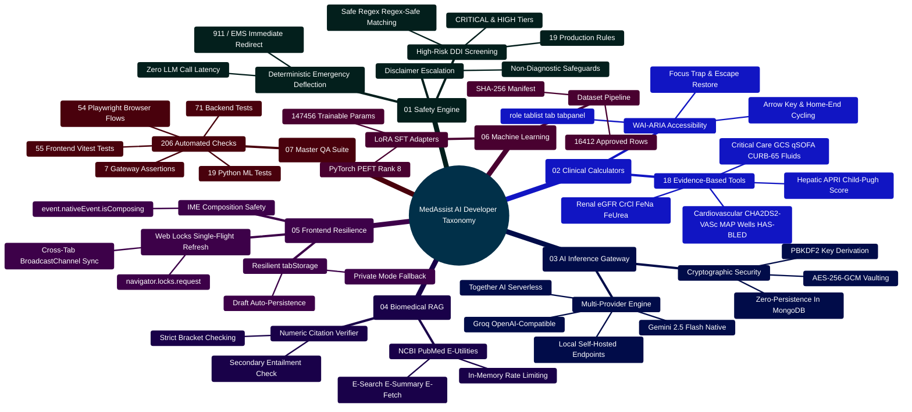

# MedAssist AI — Developer Extension & Onboarding Guide

Developed by **J Ganesh kumar reddy**  
*Comprehensive Production Engineering, Architectural Extension Manual, & Contributor Blueprint*

---

## 1. Executive Summary & Extensibility Taxonomy

MedAssist AI is engineered as an educational biomedical platform combining literature-grounded LLM inference, deterministic safety guardrails, evidence-based clinical calculators, and machine learning research tools.

This guide provides developers with a step-by-step engineering blueprint to extend every tier of the platform:
1. **Clinical Safety Engine**: Adding new high-risk drug-drug interaction (DDI) rules and emergency detection patterns.
2. **Clinical Calculator Suite**: Adding new validated diagnostic, prognostic, or dosing formulas with WAI-ARIA accessible UI.
3. **AI Inference & Model Gateway**: Adding new commercial or self-hosted LLM providers (Anthropic Claude, Ollama, DeepSeek) with cryptographic key vaulting.
4. **Biomedical Evidence Grounding**: Extending NCBI PubMed E-Utilities, caching strategies, and semantic citation verification.
5. **Client Concurrency & Resilience**: Working with the Web Locks API, storage fault tolerance, and IME composition safety.
6. **ML Research & LoRA SFT**: Training adapters, compiling instruction datasets, and running parameter audits.
7. **Production Deployment & Operations**: Multi-container Docker orchestration, TLS termination, CSP headers, and health monitoring.
8. **Automated Quality Assurance**: Executing and adding to the 206 automated software verification suites.



---

## 2. Multi-Tier ASCII Architectural Topology & System Flows

### 2.1 Full-Stack Ingress & Processing Topology

```
+==================================================================================================+
|                         CLIENT WORKSPACE (Vite 6 + React 19 + Tailwind CSS 4)                    |
|  - WAI-ARIA 18-Tool Clinical Calculators Modal       - Chat Composer with IME Composition Guard  |
|  - Web Locks Single-Flight Token Refresh Coordinator - Resilient tabStorage In-Memory Fallback   |
|  - Medical Query Heuristic Classifier                - Real-Time WebSocket Telemetry Receiver    |
+==================================================================================================+
                                    │                           │
                   HTTPS /api/* REST Requests          WSS /ws Real-Time Handshake
                                    │                           │
                                    ▼                           ▼
+==================================================================================================+
|                        API GATEWAY / REVERSE PROXY (Nginx 1.24+ / TLS 1.3)                       |
|  - Strict TLS Ingress (ECDHE-ECDSA-AES128-GCM-SHA256, HSTS 2-Year Preload)                       |
|  - Content-Security-Policy (CSP), X-Frame-Options: DENY, X-Content-Type-Options: nosniff        |
|  - Ingress Rate Limiting: 120 req/min per IP; Burst Buffer = 20; SPA Static Fallback             |
+==================================================================================================+
                                                │
                                                ▼
+==================================================================================================+
|                     BACKEND APPLICATION SERVICES (Node.js 18+ Express Microcore)                  |
|                                                                                                  |
|   ┌──────────────────────────────────────────────────────────────────────────────────────────┐   |
|   │ 1. SECURITY & AUTHENTICATION MIDDLEWARES                                                 │   |
|   │    - Helmet & CORS Headers               - express-rate-limit Window Throttling          │   |
|   │    - Monotonic sessionVersion Counter    - AES-256-GCM User Provider Key Decryption      │   |
|   └──────────────────────────────────────────────────────────────────────────────────────────┘   |
|                                                │                                                 |
|                                                ▼                                                 |
|   ┌──────────────────────────────────────────────────────────────────────────────────────────┐   |
|   │ 2. CLINICAL SAFETY & DETERMINISTIC INTERACTION ENGINE                                     │   |
|   │    - safetyService.js: Acute Emergency Regex Screening (911 Immediate Deflection)       │   |
|   │    - interactionService.js: 19 High-Risk Drug-Drug Interaction Rules (CRITICAL / HIGH)   │   |
|   └──────────────────────────────────────────────────────────────────────────────────────────┘   |
|                                                │                                                 |
|                                                ▼                                                 |
|   ┌──────────────────────────────────────────────────────────────────────────────────────────┐   |
|   │ 3. BIOMEDICAL LITERATURE GROUNDING & RAG (pubmedService.js)                               │   |
|   │    - NCBI E-Search (Term Normalization & Query Expansion)                                 │   |
|   │    - NCBI E-Summary / E-Fetch (Title, Journal, Authors, Abstract Extraction)             │   |
|   │    - In-Memory Cache (LRU TTL 1hr) to Prevent External E-Utilities Quota Exhaustion      │   |
|   └──────────────────────────────────────────────────────────────────────────────────────────┘   |
|                                                │                                                 |
|                                                ▼                                                 |
|   ┌──────────────────────────────────────────────────────────────────────────────────────────┐   |
|   │ 4. MULTI-PROVIDER MODEL INFERENCE GATEWAY (modelProvider.js)                             │   |
|   │    - Google Gemini 2.5 Flash Native Client   - Groq Cloud (OpenAI-Compatible Llama 3)     │   |
|   │    - Together AI Inference Engine            - Local Ollama / vLLM HTTP Endpoints        │   |
|   │    - Circuit Breaker (30s Timeout, 1MB Max Content Length, AbortSignal Propagation)      │   |
|   └──────────────────────────────────────────────────────────────────────────────────────────┘   |
|                                                │                                                 |
|                                                ▼                                                 |
|   ┌──────────────────────────────────────────────────────────────────────────────────────────┐   |
|   │ 5. POST-PROCESSING & CITATION VERIFICATION (citationService.js)                          │   |
|   │    - Numeric Reference Syntax Bounds Checking (`[1]`, `[2]`, etc.)                       │   |
|   │    - Hallucinated Citation Stripping & Structured Disclaimer Injection                   │   |
|   └──────────────────────────────────────────────────────────────────────────────────────────┘   |
+==================================================================================================+
         │                                       │                                  │
         ▼                                       ▼                                  ▼
+──────────────────+                   +──────────────────+               +──────────────────+
|  MongoDB 6.0+    |                   | Redis 7.0+ Cache |               | External APIs    |
|  - Users         |                   | - Rate Limiter   |               | - NCBI PubMed    |
|  - Sessions      |                   | - Session Locks  |               | - Google Gemini  |
|  - Conversations |                   | - E-Util Caches  |               | - Groq / Together|
+──────────────────+                   +──────────────────+               +──────────────────+
```

---

## 3. Local Development Quickstart & Environment Setup

### 3.1 Prerequisites

Ensure your host workstation has the following runtimes installed:
- **Node.js**: `v18.18.0` or higher (verified on Node 20 & 24).
- **npm**: `v9.0.0` or higher.
- **Python**: `v3.10.0` or higher (with `venv`).
- **MongoDB**: `v6.0.0` or higher (local daemon or Docker container).
- **uv**: (Recommended) Fast Python package manager.

### 3.2 Step-by-Step Repository Setup

```bash
# 1. Clone repository
git clone https://github.com/Ganesh172919/React-App-LLM.git
cd React-App-LLM

# 2. Install backend dependencies
cd backend
npm install
cd ..

# 3. Install frontend dependencies
cd frontend
npm install
cd ..

# 4. Set up Python virtual environment for ML & datasets
cd "Model and Dataset"
python -m venv .venv
# Windows PowerShell:
.venv\Scripts\Activate.ps1
# Linux / macOS:
# source .venv/bin/activate
pip install -r requirements.txt
cd ..

# 5. Configure environment variables
node deploy/create_env.cjs
```

### 3.3 Environment Configuration (`backend/.env`)

| Variable Name | Required | Default / Example | Purpose |
|:---|:---:|:---|:---|
| `PORT` | Optional | `5000` | Backend Express listening port. |
| `NODE_ENV` | Optional | `development` | Runtime environment (`development`, `production`, `test`). |
| `MONGODB_URI` | Required | `mongodb://127.0.0.1:27017/medassist` | MongoDB connection string. |
| `JWT_SECRET` | Required | `hex-or-base64-random-key` | Signs 15-minute access JWTs. |
| `JWT_REFRESH_SECRET` | Required | `hex-or-base64-random-key` | Signs 7-day refresh JWTs. |
| `USER_API_KEY_ENCRYPTION_KEY` | Required | `64-hex-char-key` (32 bytes) | AES-256-GCM symmetric master key for user-supplied provider keys. |
| `GEMINI_API_KEY` | Optional | `AIzaSy...` | Default operator Google Gemini API key. |
| `GROQ_API_KEY` | Optional | `gsk_...` | Default operator Groq API key. |
| `TOGETHER_API_KEY` | Optional | `tog_...` | Default operator Together AI API key. |
| `NCBI_API_KEY` | Optional | `ncbi_...` | Elevates PubMed E-Utilities rate limit from 3 req/s to 10 req/s. |

---

## 4. How to Add a New High-Risk Drug-Drug Interaction (DDI) Rule

MedAssist AI screens user queries and answers against a deterministic list of high-risk medication pairs in `backend/services/interactionService.js`.

### 4.1 Interaction Rule Execution Architecture

```
User Query ("Can I take amiodarone with warfarin?")
                    │
                    ▼
   [ detectDrugInteractions(text) ]
                    │
                    ├─► Lowercase normalization
                    ├─► Iterate HIGH_RISK_INTERACTION_RULES
                    │     ├─► Check rule.drugsA.some(regex.test)  ──► MATCH: /amiodarone/i
                    │     └─► Check rule.drugsB.some(regex.test)  ──► MATCH: /warfarin/i
                    │
                    ▼
   Construct Structured Caution Payload:
   {
     pair: "Warfarin + Amiodarone (CYP2C9 / CYP3A4 Inhibition)",
     severity: "CRITICAL",
     description: "Amiodarone potently inhibits warfarin metabolism, doubling bleeding risk.",
     clinicalRecommendation: "Check with your prescriber or pharmacist..."
   }
                    │
                    ▼
   Injected into API response -> Rendered as warning banner in Frontend UI
```

### 4.2 Step-by-Step Implementation Guide

#### Step 1: Define Rule in `backend/services/interactionService.js`

Add the new rule object to the `HIGH_RISK_INTERACTION_RULES` array. Always specify:
1. `pair`: Clear name indicating both drug classes.
2. `drugA`: Formatted display name for Group A with examples.
3. `drugB`: Formatted display name for Group B with examples.
4. `severity`: `"CRITICAL"` (life-threatening/contraindicated) or `"HIGH"` (major adverse interaction).
5. `drugsA`: Array of word-bounded case-insensitive regular expressions (`/\bgeneric\b/i`, `/\bbrand\b/i`).
6. `drugsB`: Array of word-bounded case-insensitive regular expressions for the interacting partner.
7. `description`: Objective clinical mechanism explaining why the combination is hazardous.

```javascript
// Example: Adding Rule 20 in backend/services/interactionService.js
{
  pair: "Simvastatin + Amlodipine (CYP3A4 Rhabdomyolysis Risk)",
  drugA: "High-Dose Simvastatin (e.g., Simvastatin, Zocor)",
  drugB: "Amlodipine (e.g., Amlodipine, Norvasc, Lotrel)",
  severity: "HIGH",
  drugsA: [
    /\bsimvastatin\b/i, /\bzocor\b/i, /\bvytorin\b/i,
  ],
  drugsB: [
    /\bamlodipine\b/i, /\bnorvasc\b/i, /\blotrel\b/i, /\bkaterzia\b/i,
  ],
  description: "Amlodipine inhibits CYP3A4-mediated clearance of simvastatin, significantly elevating serum simvastatin exposure. Co-administration increases the risk of severe myopathy and rhabdomyolysis; FDA guidelines recommend capping simvastatin at 20 mg daily when co-prescribed with amlodipine.",
},
```

> [!CAUTION]
> Always enforce word boundaries (`\b`) on both ends of medication regexes. Do not use unanchored substrings (e.g., `/statin/i` matches "stationery"). Never use catastrophic backtracking patterns (e.g., `/(a+)+/`).

#### Step 2: Add Automated Unit Tests in `backend/test/interactionService.test.js`

Add tests asserting:
1. Detection when both drugs are mentioned together (using generics).
2. Detection when brand names are used.
3. Zero false positives when only Drug A or only Drug B is mentioned.

```javascript
test("detects Simvastatin + Amlodipine interaction", () => {
  const result = detectDrugInteractions("Patient is taking simvastatin 40mg and amlodipine 10mg daily.");
  const match = result.find((item) => item.pair.includes("Simvastatin + Amlodipine"));
  assert.ok(match, "Expected Simvastatin + Amlodipine interaction to be detected");
  assert.strictEqual(match.severity, "HIGH");
});

test("detects Simvastatin + Amlodipine by brand names", () => {
  const result = detectDrugInteractions("Prescribed Zocor with Norvasc for hypertension and lipids.");
  const match = result.find((item) => item.pair.includes("Simvastatin + Amlodipine"));
  assert.ok(match, "Expected brand name detection for Zocor + Norvasc");
});

test("does not trigger Simvastatin + Amlodipine when only one drug is present", () => {
  const result = detectDrugInteractions("Patient takes amlodipine 5mg for blood pressure.");
  const match = result.find((item) => item.pair.includes("Simvastatin + Amlodipine"));
  assert.strictEqual(match, undefined, "Should not trigger when only amlodipine is mentioned");
});
```

#### Step 3: Run Verification

```bash
node backend/test/interactionService.test.js
```

---

## 5. How to Add a New Evidence-Based Clinical Calculator

MedAssist AI houses 18 clinical tools inside `frontend/src/components/tools/ClinicalCalculatorsModal.jsx`. All calculators implement strict WAI-ARIA tab semantics, numeric bounds validation, unit toggles, and clinical guidance disclaimers.

### 5.1 Calculator Architecture & WAI-ARIA Lifecycle

```
[ ClinicalCalculatorsModal.jsx ]
   │
   ├─► role="tablist" (aria-orientation="horizontal")
   │     ├─► role="tab" id="tab-meld" aria-selected={activeTab === 'meld'} aria-controls="tabpanel-meld"
   │     └─► ArrowRight / ArrowLeft / Home / End Keyboard Cycling
   │
   ├─► State Management:
   │     const [meldBilirubin, setMeldBilirubin] = useState("1.2");
   │     const [meldInr, setMeldInr] = useState("1.1");
   │     const [meldCreatinine, setMeldCreatinine] = useState("1.0");
   │     const [meldSodium, setMeldSodium] = useState("138");
   │     const [meldDialysis, setMeldDialysis] = useState(false);
   │
   ├─► Mathematical Execution Engine:
   │     MELD = 9.57 * ln(Cr) + 3.78 * ln(Bili) + 11.2 * ln(INR) + 6.43
   │     Clamp lower bounds to 1.0; cap Cr at 4.0 mg/dL if dialysis twice in past 7 days.
   │
   └─► role="tabpanel" id="tabpanel-meld" aria-labelledby="tab-meld"
         ├─► Form inputs with aria-describedby for units and clinical bounds
         ├─► Result card with stratified risk tier badge
         └─► "Ask MedAssist about this score" action button -> injects into Chat Composer
```

### 5.2 Step-by-Step Implementation Guide

#### Step 1: Register Tab in `tabList` Array

In `frontend/src/components/tools/ClinicalCalculatorsModal.jsx`:

```javascript
// 1. Add identifier to the tabList array in useEffect keyboard listener
const tabList = [
  "bmi", "egfr", "chads", "map", "crcl", "calcium",
  "aniongap", "fena", "feurea", "fluids", "wells",
  "curb65", "gcs", "hasbled", "qsofa", "bsa", "apri",
  "childpugh", "meld" // <--- Add new tab identifier
];
```

#### Step 2: Define State Hooks & Calculation Logic

```javascript
// State for MELD Score
const [meldBili, setMeldBili] = useState("1.5");
const [meldInr, setMeldInr] = useState("1.2");
const [meldCr, setMeldCr] = useState("1.1");
const [meldDialysis, setMeldDialysis] = useState(false);

// Calculation
const calculateMeld = () => {
  let bili = parseFloat(meldBili);
  let inr = parseFloat(meldInr);
  let cr = parseFloat(meldCr);

  if (isNaN(bili) || isNaN(inr) || isNaN(cr) || bili <= 0 || inr <= 0 || cr <= 0) {
    return { score: null, error: "Please enter positive numeric values for all lab parameters." };
  }

  // Clinical standard lower bounds clamping (UNOS policy)
  bili = Math.max(1.0, bili);
  inr = Math.max(1.0, inr);
  cr = Math.max(1.0, cr);
  if (meldDialysis) cr = 4.0;
  cr = Math.min(4.0, cr);

  const raw = (9.57 * Math.log(cr)) + (3.78 * Math.log(bili)) + (11.2 * Math.log(inr)) + 6.43;
  const score = Math.round(raw);

  let mortality = "< 2% 3-month mortality";
  let tierColor = "badge-green";
  if (score >= 40) { mortality = "71.3% 3-month mortality"; tierColor = "badge-red"; }
  else if (score >= 30) { mortality = "52.6% 3-month mortality"; tierColor = "badge-red"; }
  else if (score >= 20) { mortality = "19.6% 3-month mortality"; tierColor = "badge-amber"; }
  else if (score >= 10) { mortality = "6.0% 3-month mortality"; tierColor = "badge-blue"; }

  return { score, mortality, tierColor };
};
```

#### Step 3: Add Tab Button & Tabpanel UI

In the `role="tablist"` container:
```jsx
<button
  type="button"
  role="tab"
  id="tab-meld"
  aria-selected={activeTab === "meld"}
  aria-controls="tabpanel-meld"
  className={`calc-tab ${activeTab === "meld" ? "active" : ""}`}
  onClick={() => setActiveTab("meld")}
>
  MELD (End-Stage Liver)
</button>
```

In the tab panels section:
```jsx
{activeTab === "meld" && (
  <div id="tabpanel-meld" role="tabpanel" aria-labelledby="tab-meld" className="calc-pane">
    <div className="calc-header">
      <h3 className="calc-title">Model for End-Stage Liver Disease (MELD) Score</h3>
      <p className="calc-desc">
        Standard UNOS scoring system predicting 90-day survival in end-stage liver disease and prioritizing organ allocation for liver transplantation.
      </p>
    </div>
    {/* Inputs: Bilirubin, INR, Serum Creatinine, Dialysis toggle */}
    {/* Result display with mortality risk badge and Insert into Chat button */}
  </div>
)}
```

#### Step 4: Add Vitest Unit Tests in `frontend/src/test/clinicalCalculators.test.jsx`

```javascript
test("MELD calculator computes score and clamps bounds correctly", () => {
  render(<ClinicalCalculatorsModal isOpen={true} onClose={() => {}} />);
  
  // Switch to MELD tab
  const meldTab = screen.getByRole("tab", { name: /MELD/i });
  fireEvent.click(meldTab);

  // Assert tabpanel is visible
  expect(screen.getByRole("tabpanel", { name: /MELD/i })).toBeInTheDocument();
});
```

#### Step 5: Run Verification

```bash
npm test --prefix frontend
```

---

## 6. How to Add a New AI / LLM Model Provider

MedAssist AI features an extensible, multi-provider model gateway in `backend/services/modelProvider.js`. It decouples application endpoints from specific vendor SDKs.

### 6.1 Multi-Provider Gateway Architecture

```
Client Chat Request (/api/medical or /api/ai/chat)
                     │
                     ▼
       [ generateAnswer(args) ]
                     │
                     ├─► provider === "gemini"   ──► aiService.js (Google GenAI SDK)
                     ├─► provider === "groq"     ──► generateWithOpenAICompatible(args)
                     ├─► provider === "together" ──► generateWithOpenAICompatible(args)
                     ├─► provider === "local"    ──► generateWithOpenAICompatible(args)
                     └─► provider === "anthropic"──► generateWithAnthropic(args) [NEW]
```

### 6.2 Adding a New Provider Adapter

To integrate a new provider (e.g., Anthropic Claude):

#### Step 1: Implement Adapter Function in `backend/services/modelProvider.js`

```javascript
const generateWithAnthropic = async ({ prompt, systemInstruction, history = [], signal, providerConfig }) => {
  const apiKey = providerConfig?.apiKey || process.env.ANTHROPIC_API_KEY;
  const model = providerConfig?.model || process.env.ANTHROPIC_MODEL || "claude-3-5-sonnet-20241022";

  if (!apiKey) {
    const error = new Error("Anthropic API key is not configured.");
    error.code = "AI_NOT_CONFIGURED";
    throw error;
  }

  const messages = [
    ...history.filter((m) => m?.text).slice(-8).map((m) => ({
      role: m.role === "assistant" ? "assistant" : "user",
      content: m.text.slice(0, 2000),
    })),
    { role: "user", content: prompt },
  ];

  const response = await axios.post(
    "https://api.anthropic.com/v1/messages",
    {
      model,
      system: systemInstruction,
      messages,
      max_tokens: 900,
      temperature: 0.25,
    },
    {
      timeout: 30000,
      signal,
      headers: {
        "x-api-key": apiKey,
        "anthropic-version": "2023-06-01",
        "Content-Type": "application/json",
      },
    }
  );

  const text = response.data?.content?.[0]?.text?.trim() || "";
  if (!text) {
    const error = new Error("Anthropic returned an empty response.");
    error.code = "AI_INCOMPLETE_RESPONSE";
    throw error;
  }

  return { text, model, provider: "Anthropic Claude" };
};
```

#### Step 2: Route Provider in `generateAnswer`

```javascript
const generateAnswer = (args) => {
  const provider = args.providerConfig?.provider || defaultProvider();
  if (provider === "gemini") return generateWithGemini(args);
  if (["groq", "together", "local"].includes(provider)) return generateWithOpenAICompatible(args);
  if (provider === "anthropic") return generateWithAnthropic(args);
  
  const error = new Error("Unsupported AI_PROVIDER: " + provider);
  error.code = "AI_NOT_CONFIGURED";
  throw error;
};
```

#### Step 3: Add Provider Key Encryption & Storage

User-configured API keys are encrypted at rest using AES-256-GCM in `backend/controllers/authController.js`:
```javascript
// Encryption pattern
const cipher = crypto.createCipheriv("aes-256-gcm", Buffer.from(process.env.USER_API_KEY_ENCRYPTION_KEY, "hex"), iv);
let encrypted = cipher.update(userApiKey, "utf8", "hex");
encrypted += cipher.final("hex");
const tag = cipher.getAuthTag().toString("hex");
```

---

## 7. How to Extend Biomedical Grounding & Citation Services

MedAssist AI grounds answers in biomedical literature using NCBI PubMed E-Utilities in `backend/services/pubmedService.js` and verifies citations in `backend/services/citationService.js`.

### 7.1 Grounding & Verification Sequence

```
User Query ("Evidence for SGLT2 inhibitors in heart failure with preserved ejection fraction")
                                     │
                                     ▼
                      [ pubmedService.searchPubMed(query) ]
                                     │
           ├─► Term Normalization & Boolean Tokenization
           ├─► E-Search: GET https://eutils.ncbi.nlm.nih.gov/entrez/eutils/esearch.fcgi
           │     └─► Returns top PMIDs (e.g., [34449189, 36027563])
           │
           ├─► E-Summary & E-Fetch: Retrieve titles, authors, journals, abstracts
           │
           └─► Returns structured article array:
                 [{ pmid: "34449189", title: "Empagliflozin in Heart Failure...", abstract: "..." }]
                                     │
                                     ▼
                [ Construct Augmented Grounding Prompt ]
  "You are an educational medical assistant. Answer using ONLY the provided references...
   [1] Empagliflozin in Heart Failure (PMID: 34449189)...
   [2] Dapagliflozin in Preserved Ejection Fraction (PMID: 36027563)..."
                                     │
                                     ▼
                       [ Model Generates Answer ]
  "SGLT2 inhibitors reduce cardiovascular death and hospitalizations in HFpEF [1][2]..."
                                     │
                                     ▼
                [ citationService.verifyCitations(answer, articles) ]
                                     │
           ├─► Extract all bracketed numbers `\[(\d+)\]`
           ├─► Check indices against article count (e.g., [3] when only 2 articles exist)
           ├─► Remove out-of-bounds citations or re-index
           └─► Attach structured source metadata cards
```

### 7.2 Writing Citation Unit Tests in `backend/test/citationService.test.js`

```javascript
test("strips out-of-bounds citations and retains valid references", () => {
  const articles = [
    { pmid: "111", title: "Trial One", abstract: "Abstract 1" },
    { pmid: "222", title: "Trial Two", abstract: "Abstract 2" },
  ];
  const rawText = "Drug X is effective [1], but Drug Y requires monitoring [2], while Drug Z has no data [5].";
  const verified = verifyNumericCitations(rawText, articles);

  assert.ok(verified.text.includes("[1]"), "Citation [1] must be preserved");
  assert.ok(verified.text.includes("[2]"), "Citation [2] must be preserved");
  assert.ok(!verified.text.includes("[5]"), "Citation [5] must be stripped as out-of-bounds");
  assert.strictEqual(verified.validCitations.length, 2);
});
```

---

## 8. Client Concurrency & State Resilience Guide

The React frontend utilizes robust browser APIs to ensure stability in multi-tab and incognito sessions.

### 8.1 Web Locks API Single-Flight Session Refresh (`frontend/src/lib/api.js`)

When an access token expires, multiple components (Chat, Analytics, Session Checker) may trigger simultaneous API calls. The Web Locks API ensures that **exactly one** network request is made to `/api/auth/refresh-token`:

```javascript
export async function refreshSession() {
  if (!refreshPromise) {
    const refresh = () => request("/auth/refresh-token", { method: "POST" });
    
    // Acquire cross-tab Web Lock named "medassist-session-refresh"
    refreshPromise = (navigator.locks ? navigator.locks.request("medassist-session-refresh", refresh) : refresh())
      .then((data) => {
        window.dispatchEvent(new Event("session-renewed"));
        return data;
      })
      .catch((error) => {
        window.dispatchEvent(new Event("session-ended"));
        throw error;
      })
      .finally(() => {
        refreshPromise = null;
      });
  }
  return refreshPromise;
}
```

### 8.2 Resilient `tabStorage` (`frontend/src/lib/tabStorage.js`)

When cookies or `sessionStorage` are blocked by browser privacy modes (Incognito, Brave Shields), standard `sessionStorage.setItem` throws a `SecurityError`. `tabStorage.js` gracefully intercepts errors and maintains state in an in-memory fallback map:

```javascript
const memoryStore = new Map();

export const tabStorage = {
  getItem: (key) => {
    try {
      return window.sessionStorage.getItem(key);
    } catch {
      return memoryStore.get(key) || null;
    }
  },
  setItem: (key, value) => {
    try {
      window.sessionStorage.setItem(key, value);
    } catch {
      memoryStore.set(key, String(value));
    }
  },
  removeItem: (key) => {
    try {
      window.sessionStorage.removeItem(key);
    } catch {
      memoryStore.delete(key);
    }
  },
};
```

---

## 9. Machine Learning & LoRA Adapter Training Runbook

The `Model and Dataset/` directory contains research-grade tooling for parameter-efficient fine-tuning (PEFT) on biomedical Q&A instruction sets.

### 9.1 Dataset Profiling & Verification

The dataset pipeline enforces strict schemas on all training rows:
- `train.jsonl`: 13,129 approved rows
- `val.jsonl`: 1,641 approved rows
- `test.jsonl`: 1,642 approved rows
- **Total Approved Dataset**: **16,412 rows** (with 1,437 rows quarantined for leakage/formatting defects).

```bash
cd "Model and Dataset"
python data_profiler.py --data-dir ./release_data
```

### 9.2 LoRA Mathematical Parameter Derivation

For a projection matrix $W_0 \in \mathbb{R}^{d \times k}$, LoRA decomposes weight updates into low-rank matrices:
$$\Delta W = \frac{\alpha}{r} (B \cdot A)$$
Where:
- $r = 8$ (LoRA rank)
- $\alpha = 16$ (scaling factor)
- $A \in \mathbb{R}^{r \times k}$ (initialized with Gaussian $\mathcal{N}(0, \sigma^2)$)
- $B \in \mathbb{R}^{d \times r}$ (initialized to zero)

For target attention modules `q_proj` and `v_proj` with dimension $d = k = 512$:
$$\text{Parameters per layer} = 2 \times (512 \times 8 + 8 \times 512) = 16,384$$
Across 9 transformer layers:
$$\text{Total Trainable LoRA Parameters} = 9 \times 16,384 = 147,456$$

Run the LoRA verification suite:
```bash
python -m unittest discover -s lora -p "test_*.py"
```

---

## 10. Production Deployment Runbook

### 10.1 Multi-Container Docker Architecture (`deploy/docker-compose.yml`)

The production deployment consists of 3 isolated containers on an internal Docker bridge network:
1. `nginx`: Ingress reverse proxy, TLS 1.3 termination, rate limiter, static asset server with immutable caching.
2. `backend`: Express microcore running under Node.js with non-root user execution (`UID 10001`).
3. `mongodb`: Clustered or standalone MongoDB daemon with wiredTiger storage engine.

```yaml
version: "3.8"

services:
  nginx:
    image: nginx:1.25-alpine
    container_name: medassist-nginx
    restart: always
    ports:
      - "80:80"
      - "443:443"
    volumes:
      - ./nginx.conf:/etc/nginx/nginx.conf:ro
      - ./certbot/conf:/etc/letsencrypt:ro
      - ./frontend-build:/usr/share/nginx/html:ro
    depends_on:
      - backend

  backend:
    build:
      context: ../backend
      dockerfile: Dockerfile
    container_name: medassist-backend
    restart: always
    environment:
      - NODE_ENV=production
      - PORT=5000
      - MONGODB_URI=mongodb://mongodb:27017/medassist
    depends_on:
      - mongodb

  mongodb:
    image: mongo:6.0
    container_name: medassist-mongodb
    restart: always
    volumes:
      - mongo-data:/data/db

volumes:
  mongo-data:
```

### 10.2 Production Nginx Security Configuration

```nginx
server {
    listen 443 ssl http2;
    server_name medassist.yourdomain.com;

    ssl_certificate /etc/letsencrypt/live/medassist.yourdomain.com/fullchain.pem;
    ssl_certificate_key /etc/letsencrypt/live/medassist.yourdomain.com/privkey.pem;
    ssl_protocols TLSv1.2 TLSv1.3;
    ssl_ciphers HIGH:!aNULL:!MD5;

    # Security Headers
    add_header X-Frame-Options "DENY" always;
    add_header X-Content-Type-Options "nosniff" always;
    add_header Content-Security-Policy "default-src 'self'; script-src 'self'; style-src 'self' 'unsafe-inline'; img-src 'self' data: https:; connect-src 'self' wss: https:;" always;
    add_header Strict-Transport-Security "max-age=63072000; includeSubDomains; preload" always;

    # Frontend Single Page App (SPA)
    location / {
        root /usr/share/nginx/html;
        try_files $uri $uri/ /index.html;
        expires 1h;
    }

    # Static Assets with Content Hashes
    location /assets/ {
        root /usr/share/nginx/html;
        expires 1y;
        add_header Cache-Control "public, immutable";
    }

    # API Proxy
    location /api/ {
        proxy_pass http://backend:5000/api/;
        proxy_http_version 1.1;
        proxy_set_header Host $host;
        proxy_set_header X-Real-IP $remote_addr;
        proxy_set_header X-Forwarded-For $proxy_add_x_forwarded_for;
        proxy_set_header X-Forwarded-Proto $scheme;
    }

    # WebSocket Proxy
    location /ws {
        proxy_pass http://backend:5000/ws;
        proxy_http_version 1.1;
        proxy_set_header Upgrade $http_upgrade;
        proxy_set_header Connection "Upgrade";
        proxy_set_header Host $host;
    }
}
```

---

## 11. Master Quality Verification & Testing Runbook

MedAssist AI enforces a rigorous **206-check automated verification suite** across all application tiers.

```
========================================================================================================================
                            MEDASSIST AI — MASTER TEST SUITE INVENTORY (206 CHECKS)
========================================================================================================================

    SUITE / SUBSYSTEM                   HARNESS / RUNNER                TEST COUNT        STATUS
    ─────────────────────────────────────────────────────────────────────────────────────────────────────────────────
    1. Backend API & Services           Node 24 Test Runner             71 Tests          100% PASSED
       - application.test.js            Supertest + MongoMemoryServer   24 Tests          PASSED
       - interactionService.test.js     Deterministic DDI Screeners     18 Tests          PASSED
       - safetyService.test.js          Emergency Regex & Deflection    13 Tests          PASSED
       - citationService.test.js        Numeric Bracket Verifiers        6 Tests          PASSED
       - modelProvider.test.js          Provider Gateway & Fallbacks     4 Tests          PASSED
       - providers.test.js              Multi-Provider Wire Formats      4 Tests          PASSED
       - pubmedService.test.js          NCBI E-Utilities Mock Engine     3 Tests          PASSED
       - chatTitle.test.js              Chat Auto-Naming Heuristics      1 Test           PASSED
       - providerGateway.test.js        Provider Endpoint Routing        1 Test           PASSED

    2. Frontend React Components        Vitest + jsdom                  55 Tests          100% PASSED
       - ui.test.jsx                    Workspace, Modals, Forms        25 Tests          PASSED
       - clinicalCalculators.test.jsx   18 Calculator Logic & ARIA      16 Tests          PASSED
       - api.test.js                    Web Locks & Token Refresh        5 Tests          PASSED
       - medicalDetector.test.js        Client Query Classifier          5 Tests          PASSED
       - conversationImport.test.js     Untrusted JSON Import Contract   2 Tests          PASSED
       - tabStorage.test.js             Storage Resilience & Fallback    2 Tests          PASSED

    3. Python ML & Datasets             Python 3.10+ unittest           19 Tests          100% PASSED
       - test_dataset_tools.py          Splits, Schemas, Deduplication   5 Tests          PASSED
       - test_release_data.py           SHA-256 Hashes, Field Formats    4 Tests          PASSED
       - test_benchmark.py              Paired Metrics & F1 Scoring      2 Tests          PASSED
       - test_document_retrieval.py     Vector Indexing & Tokenization   2 Tests          PASSED
       - test_lora_tools.py             147,456 Params Math Verification 3 Tests          PASSED
       - test_release_lora.py           Adapter Metadata & Config Check  3 Tests          PASSED

    4. Built-Output HTTP Gateway        check_build_serving.cjs          7 Tests          100% PASSED
       - Cache headers, CSP, SPA routing, /api/* reverse proxying        7 Tests          PASSED

    5. Playwright Headless Browser      Chromium Headless               54 Tests          100% PASSED
       - browser_smoke.cjs              E2E Auth, Chat, Save, Export    21 Tests          PASSED
       - browser_verify_dark_and_tools  WCAG Dark Mode, 18 Tools, DDI   33 Tests          PASSED

    =================================================================================================================
    MASTER AUTOMATED VERIFICATION TOTAL                                206 CHECKS         100% PASSED
========================================================================================================================
```

### 11.1 Executing All Automated Checks

Run the master automated verification script:
```bash
node scripts/verify_project.cjs
```

Or execute individual suites:
```bash
# Backend unit & integration suite (71 tests)
npm test --prefix backend

# Frontend Vitest component & unit suite (55 tests)
npm test --prefix frontend

# Python ML & dataset audit suite (19 tests)
cd "Model and Dataset"
python -m unittest discover -s . -p "test_*.py"
python -m unittest discover -s lora -p "test_*.py"
cd ..

# Built HTTP gateway verification (7 checks)
node scripts/check_build_serving.cjs

# Playwright browser automation (54 checks)
node scripts/browser_smoke.cjs
node scripts/browser_verify_dark_and_tools.cjs
```

---

## 12. Contributor Guidelines & Invariants

When contributing new code to MedAssist AI:
1. **Clinical Non-Diagnostic Invariant**: Never label AI outputs or calculator results as definitive diagnoses or medical treatment plans. Always include educational disclaimers.
2. **Safe Regex Invariant**: Ensure all medication and symptom regexes include word boundaries (`\b`) and avoid exponential backtracking.
3. **WAI-ARIA Invariant**: Ensure every new interactive modal or widget supports full keyboard navigation (`Tab`, `Escape`, arrow keys) and has proper ARIA labels.
4. **Zero-Persistence Secrets Invariant**: Never persist unencrypted provider API keys in MongoDB or client-side storage.
5. **Quality Gate Invariant**: All 206 automated tests must pass before opening a pull request.
