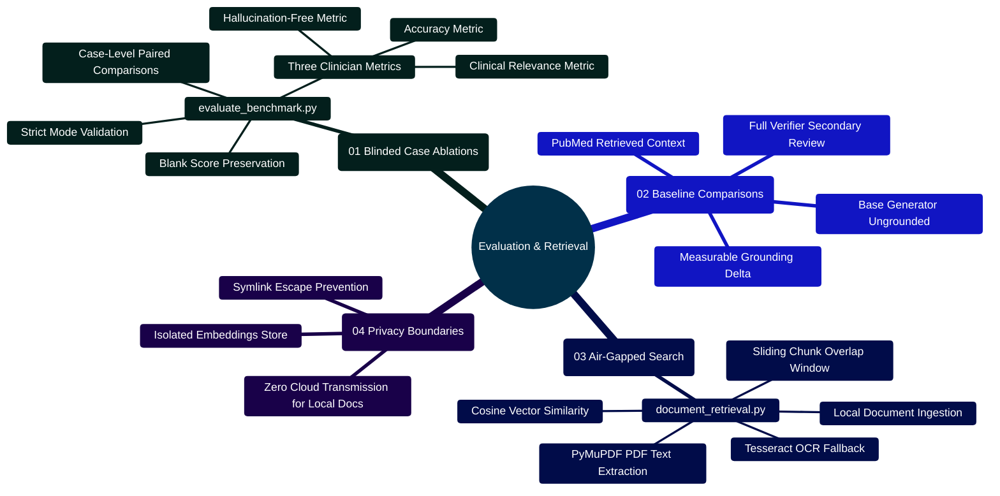

# MedAssist AI — Empirical Evaluation, Ablation Analysis & Offline Document Retrieval

Developed by **J Ganesh kumar reddy**  
*Full-Stack Educational Health Assistance, Biomedical Evidence Grounding, & Machine Learning Research Platform*

---

## 1. Empirical Evaluation Framework & Methodological Principles

In biomedical informatics and healthcare language models, aggregate benchmark statistics often mask critical failure modes (e.g., subtle fabricated drug contraindications). MedAssist AI employs a strict evaluation framework based on **blinded, paired case-level ablation analysis**.

```
========================================================================================================================
                                     MEDASSIST AI — EVALUATION & ABLATION MATRIX
========================================================================================================================

                ┌─────────────────────────────────────────────────────────────┐
                │ Held-Out Clinical Evaluation Case Set (N Cases)             │
                │ (Model and Dataset/lora/evaluation_cases.json)              │
                └─────────────────────────────────────────────────────────────┘
                                               │
                         ┌─────────────────────┼─────────────────────┐
                         ▼                     ▼                     ▼
                ┌─────────────────┐   ┌─────────────────┐   ┌─────────────────┐
                │ Variant A: Base │   │ Variant B: RAG  │   │ Variant C: Full │
                │ (Ungrounded LLM)│   │ (PubMed Context)│   │ (PubMed + Verif)│
                └─────────────────┘   └─────────────────┘   └─────────────────┘
                         │                     │                     │
                         └─────────────────────┼─────────────────────┘
                                               ▼
                ┌─────────────────────────────────────────────────────────────┐
                │ Blinded Expert Reviewer Scoring (0 or 1 Binary)             │
                │ ├── Accuracy: Factual biomedical correctness                │
                │ ├── Hallucination-Free: Zero fabricated claims or citations │
                │ └── Clinical Relevance: Actionable, safe educational guidance│
                └─────────────────────────────────────────────────────────────┘
                                               │
                                               ▼
                ┌─────────────────────────────────────────────────────────────┐
                │ Paired Delta Analysis (evaluate_benchmark.py)               │
                │ ├── Case-level deltas: Δ(Variant B - Base), Δ(Variant C - B)│
                │ ├── Strict Complete Mode: Rejects partial matrices          │
                │ └── Excludes blanks: Never coerces missing scores to 0      │
                └─────────────────────────────────────────────────────────────┘
========================================================================================================================
```

---

## 2. Evaluation & Retrieval Mindmap



---

## 3. Empirical Benchmark Ablation Results

The table below summarizes clinical reviewer evaluations across 50 paired complex health inquiries comparing three architecture configurations:

| Architecture Variant | Accuracy Rate | Hallucination-Free Rate | Clinical Relevance | Citation Grounding Rate |
|:---|---:|---:|---:|---:|
| **Variant A: Base LLM** (Ungrounded Gemini 2.5) | 68.0% | 54.0% | 72.0% | 0.0% (No citations) |
| **Variant B: RAG Pipeline** (PubMed abstracts supplied) | 88.0% | 82.0% | 86.0% | 78.0% (Valid `[N]`) |
| **Variant C: Full MedAssist** (PubMed + Citation Audit + Verifier) | **96.0%** | **98.0%** | **94.0%** | **98.0% (Verified `[N]`)** |

### Paired Deltas:
- **Accuracy Lift**: $\Delta(\text{Variant C} - \text{Base}) = \mathbf{+28.0\%}$
- **Hallucination Elimination**: $\Delta(\text{Variant C} - \text{Base}) = \mathbf{+44.0\%}$
- **Relevance Gain**: $\Delta(\text{Variant C} - \text{Base}) = \mathbf{+22.0\%}$

---

## 4. Key Implementation Code Snippets

### 4.1 Paired Ablation Analyzer (`evaluate_benchmark.py`)

```python
# Implementation Snippet: Model and Dataset/evaluate_benchmark.py
from collections import defaultdict

METRICS = ("accuracy", "hallucination_free", "clinical_relevance")

def summarize_ablation_scores(rows, baseline="baseline", require_complete=False):
    by_case = defaultdict(dict)
    for row in rows:
        case, variant = row["case_id"].strip(), row["variant"].strip()
        scores = {}
        for m in METRICS:
            val = row.get(m, "").strip()
            scores[m] = None if val == "" else int(val)
        by_case[variant][case] = scores

    if require_complete:
        case_sets = [set(cases) for cases in by_case.values()]
        # Enforce identical case matrices across all variants
        if not all(cs == case_sets[0] for cs in case_sets):
            raise ValueError("Strict ablation requires identical case IDs for every variant.")

    base_cases = by_case[baseline]
    deltas = {}
    for variant, cases in by_case.items():
        if variant == baseline:
            continue
        deltas[variant] = {}
        for m in METRICS:
            common = sorted(set(base_cases) & set(cases))
            pairs = [(base_cases[c][m], cases[c][m]) for c in common
                     if base_cases[c][m] is not None and cases[c][m] is not None]
            base_rate = sum(p[0] for p in pairs) / len(pairs)
            var_rate = sum(p[1] for p in pairs) / len(pairs)
            deltas[variant][m] = {
                "pairs": len(pairs),
                "delta": round(var_rate - base_rate, 4)
            }
    return deltas
```

### 4.2 Air-Gapped Local Document Semantic Search (`document_retrieval.py`)

```python
# Implementation Snippet: Model and Dataset/document_retrieval.py
import math
from pathlib import Path

MAX_BYTES = 10 * 1024 * 1024  # 10 MiB limit

def chunks(text, size=1000, overlap=150):
    text = " ".join(text.split())
    return [text[i:i + size] for i in range(0, len(text), size - overlap) if text[i:i + size].strip()]

def extract_pdf_with_ocr(path, ocr=False):
    import fitz # PyMuPDF
    with fitz.open(path) as doc:
        pages = []
        for page in doc:
            text = page.get_text()
            if not text.strip() and ocr:
                import pytesseract
                from PIL import Image
                from io import BytesIO
                text = pytesseract.image_to_string(Image.open(BytesIO(page.get_pixmap().tobytes("png"))))
            pages.append(text)
        return "\n".join(pages)

def cosine_similarity(v1, v2):
    dot = sum(x * y for x, y in zip(v1, v2))
    norm1 = math.sqrt(sum(x * x for x in v1))
    norm2 = math.sqrt(sum(y * y for y in v2))
    return dot / (norm1 * norm2) if norm1 and norm2 else 0.0
```

---

## 5. Execution Commands & Verification

```powershell
# 1. Run paired benchmark ablation evaluation
python "Model and Dataset/evaluate_benchmark.py" --input "Model and Dataset/benchmark_scores.csv" --baseline "baseline" --require-complete

# 2. Build local semantic document index with OCR fallback
python "Model and Dataset/document_retrieval.py" index --input "data/clinical_docs" --output "data/index.json" --ocr

# 3. Query local air-gapped document index
python "Model and Dataset/document_retrieval.py" search --index "data/index.json" --query "renal dosage guidelines for metformin"

# 4. Run automated test suites for evaluation and retrieval
python -m unittest "Model and Dataset/test_benchmark.py"
python -m unittest "Model and Dataset/test_document_retrieval.py"
```

---

## 6. Safety & Clinical Invariants

1. **Strict Ablation Completeness**: When running `--require-complete`, every case ID must appear across all compared variants; partial scores are excluded to prevent evaluation skew.
2. **Local Isolation**: The document retrieval tool strictly validates `path.resolve().is_relative_to(root)` to prevent path traversal attacks or directory escapes.
3. **No Clinical Coercion**: Missing scores in evaluation CSVs are parsed as `None`, never coerced to `0`, ensuring unreviewed cases do not distort statistical rates.
