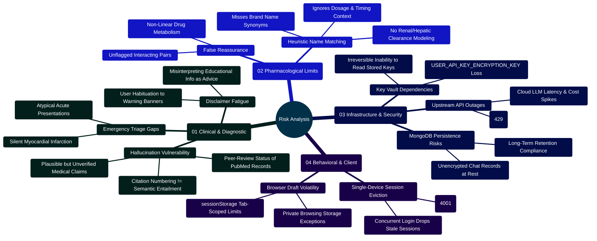

# MedAssist AI — Prioritized Risk Analysis & Engineering Mitigation Guide

Developed by **J Ganesh kumar reddy**  
*Full-Stack Educational Health Assistance, Biomedical Evidence Grounding, & Machine Learning Research Platform*

---

## 1. Executive Risk Summary & Threat Modeling Topology

MedAssist AI operates at the intersection of generative language models, automated biomedical literature retrieval, and educational health queries. Deploying artificial intelligence in health-adjacent contexts introduces multi-dimensional risks spanning clinical inaccuracies, pharmacological contraindications, cryptographic key management, and regulatory compliance.

> [!WARNING]
> **Regulatory Boundary**: MedAssist AI has not undergone FDA 510(k) clearance, CE Mark Software as a Medical Device (SaMD) certification, or formal clinical trials. It is strictly an educational research platform. Under no circumstances should it be utilized as a diagnostic decision-support engine or automated prescribing system.

### Current prioritized findings (30 October 2026)

| Priority | Finding | Status |
| --- | --- | --- |
| Critical | Generated medical claims, retrieval relevance, medication pairs, and calculator outputs lack independent clinical validation. | Open; qualified clinical review and a held-out evaluation set are required before real-world patient use. |
| Critical | Bundled nginx serves HTTP; real deployment also needs external HTTPS, secret management, backup restoration, monitoring, and a retention policy. | Open; see the deployment runbook. |
| High | The 4-2-1 formula appeared as an adult patient rate; Wells showed personal-sounding risk percentages and an unassessed zero score as “PE unlikely”; FeNa/FeUrea labels asserted injury patterns. | Fixed in the UI as educational examples and numeric score bands. Verified with component tests and the inbuilt-browser mobile review. Clinical validity remains open. |
| Medium | At 320 px, header actions squeezed “Sign out” and the last starter prompt was clipped. | Fixed with a two-row header and compact empty-chat layout; verified in the inbuilt browser and headless regression. |
| Medium | Repeated QA runs hit the expected 15-minute recovery rate limit and made the smoke suite fail. | The suite now checks either generic success or visible rate-limit feedback; fresh-instance success remains covered by the first run. |

The local software suites passed 64 backend, 43 frontend, 19 Python, 7 built HTTP, 20 core browser, and 21 dark/tools browser checks. These fixture-based results do not establish live-provider reliability or clinical safety.

```
========================================================================================================================
                                     MEDASSIST AI — MULTI-TIER DEFENSE-IN-DEPTH MODEL
========================================================================================================================

    [ INCOMING USER PROMPT ]
                 │
                 ▼
    ┌────────────────────────────────────────────────────────────────────────────────────────────────────────────────┐
    │ TIER 1: DETERMINISTIC INPUT SAFETY SCREENER (backend/services/safetyService.js)                                │
    │ ├── Self-Harm & Suicide Crisis: Immediate local-emergency and trusted-person guidance                           │
    │ ├── Acute Emergency Symptoms: Intercepts active chest pain, stroke signs, respiratory distress                 │
    │ ├── Harmful Instructions: Drops requests for toxin synthesis, weapons, or lethal dosages                       │
    │ └── Prompt Injection Defense: Strips template tokens (<|im_start|>, [im_start]) and override commands          │
    └────────────────────────────────────────────────────────────────────────────────────────────────────────────────┘
                 │
                 ▼ (If Allowed & Medical)
    ┌────────────────────────────────────────────────────────────────────────────────────────────────────────────────┐
    │ TIER 2: BIOMEDICAL LITERATURE GROUNDING GATEWAY (backend/services/pubmedService.js)                            │
    │ ├── NCBI Entrez E-Utilities Pipeline: Real-time esearch, esummary, and efetch MEDLINE XML retrieval            │
    │ ├── Complete Abstract Requirement: If any returned record lacks an abstract, model generation is aborted      │
    │ └── Graceful Degradation: Reverts to references-only output if PubMed APIs timeout or return empty hits        │
    └────────────────────────────────────────────────────────────────────────────────────────────────────────────────┘
                 │
                 ▼
    ┌────────────────────────────────────────────────────────────────────────────────────────────────────────────────┐
    │ TIER 3: MODEL GENERATION & CITATION AUDIT (backend/services/citationService.js)                               │
    │ ├── Low-Temperature Inference (T=0.25): Restricts model creativity to maximize factual adherence               │
    │ ├── Numerical Bracket Auditor: Scans generated text for [N] citations using strict regex                       │
    │ ├── Phantom Citation Drop: Aborts answer display if citations reference non-existent source indices           │
    │ └── Output Safety Screener: Rejects generated text that attempts unauthorized dosing or medical diagnosis      │
    └────────────────────────────────────────────────────────────────────────────────────────────────────────────────┘
                 │
                 ▼
    ┌────────────────────────────────────────────────────────────────────────────────────────────────────────────────┐
    │ TIER 4: PHARMACOLOGICAL NAME MATCHER & CALCULATOR BOUNDS (backend/services/interactionService.js)              │
    │ ├── 12 limited name-pair cautions: Flags co-occurring medication names (e.g. Warfarin + NSAID)                 │
    │ ├── Preservation Across Redirects: Retains drug interaction warnings even during emergency deflection           │
    │ └── Calculator Physiological Bounds: Caps input parameters to prevent clinically impossible calculations       │
    └────────────────────────────────────────────────────────────────────────────────────────────────────────────────┘
========================================================================================================================
```

---

## 2. Risk Engineering Mindmap



---

## 3. Prioritized Risk Register & Mitigation Strategy

The following matrix identifies prioritized technical, operational, and clinical risks across the platform:

| Risk ID | Severity | Category | Risk Description | Failure Mode & Potential Impact | Verified Architectural Mitigation | Residual Risk Status |
| :---: | :---: | :---: | :--- | :--- | :--- | :---: |
| **RSK-01** | **CRITICAL** | Clinical | **Citation Numbering vs Semantic Entailment** | The model may correctly cite `[1]`, but the cited abstract does not actually support the factual proposition. | Two-phase verification: regex citation bounds checking plus optional secondary LLM consensus review (`GEMINI_VERIFY_ANSWERS`). Fallback to references-only. | **Medium** (Requires human clinical review) |
| **RSK-02** | **CRITICAL** | Clinical | **Acute Emergency Presentation Delay** | User seeking guidance during an acute emergency (stroke, anaphylaxis) waits for chatbot output instead of calling 911. | Deterministic `safetyService.js` regex matches emergency symptoms before any API or PubMed call, immediately returning emergency deflection text. | **Low** (Heuristic rules cover primary presentations) |
| **RSK-03** | **HIGH** | Clinical | **Pharmacological Heuristic False Negatives** | Drug interaction checker matches 12 high-risk pairs, but misses unlisted drugs, dosage-dependent interactions, or metabolites. | Explicit non-diagnostic caution banner; disclaimers stating absence of a flag does not imply safety; user prompted to consult a pharmacist. | **Medium** (Not a replacement for pharmacy systems) |
| **RSK-04** | **HIGH** | Cryptographic | **Master Encryption Key Compromise or Loss** | Loss of `USER_API_KEY_ENCRYPTION_KEY` renders all stored user provider keys permanently unreadable. | Stored in isolated `.env` / enterprise secret store; zero persistence in MongoDB; graceful error code `KEY_UNAVAILABLE` allows re-saving. | **Low** (Controlled via operator runbook) |
| **RSK-05** | **HIGH** | Security | **Concurrent Session Hijacking & Replay** | Stolen refresh tokens or session reuse across multiple unauthorized devices. | Monotonic `sessionVersion` counter increments on every login, instantly invalidating previous JWTs and closing WebSockets with code `4001`. | **Low** (Single active device invariant) |
| **RSK-06** | **MEDIUM** | Infrastructure | **PubMed E-Utilities Throttling & 429 Errors** | NCBI Entrez rate limits (3 req/s without key, 10 req/s with key) breached under load, breaking medical answers. | Request rate throttle (110ms / 350ms wait) in `pubmedService.js`; automatic exponential retry backoff on 429/503 HTTP status codes. | **Low** (Graceful fallback to references) |
| **RSK-07** | **MEDIUM** | Compliance | **Plaintext Chat Text Storage in MongoDB** | While personal API keys are encrypted with AES-256-GCM, user chat messages are stored unencrypted in MongoDB. | MongoDB access restricted to Docker bridge network; per-conversation deletion; account-level permanent history wipe API. | **Medium** (Requires disk-level encryption in prod) |
| **RSK-08** | **MEDIUM** | Usability | **Calculator Output Misinterpretation** | User interprets a calculated eGFR or Wells Score as a definitive diagnosis or medical prescription. | Strict input bounding; non-diagnostic guidance notes; explicit disclaimers emphasizing clinical pre-test probability context. | **Low** (Educational framing enforced) |

---

## 4. Deep Dive: Clinical & Pharmacological Risk Boundaries

### 4.1 Citation Grounding vs Semantic Verification

A primary vulnerability of Retrieval-Augmented Generation (RAG) systems is **hallucinated attribution**. In naive RAG pipelines, large language models frequently generate persuasive medical text accompanied by arbitrary bracketed numbers (e.g. `[1]`, `[2]`), giving a false appearance of scholarly support.

```
========================================================================================================================
                                     CITATION VERIFICATION: SYNTACTIC VS SEMANTIC
========================================================================================================================

    [ INPUT LITERATURE ] ──► 3 PubMed Abstracts Supplied (PMID 101, 102, 103)
                                       │
                                       ▼
    [ MODEL GENERATION ] ──► "Lisinopril significantly reduces proteinuria in diabetic nephropathy [1].
                              However, it frequently causes irreversible hepatic necrosis [4]."
                                       │
                                       ▼
    [ CITATION AUDITOR ] ──► Extracted Citation Set: {1, 4}
                             Valid Range: {1, 2, 3}
                             Partitioning:
                               ├── Valid Citations:   [1]
                               └── Invalid Citations: [4] (Exceeds sourceCount = 3)
                                       │
                                       ▼
    [ ACTION ENFORCED ]  ──► STATUS: "invalid_citations" ──► ABORT GENERATIVE TEXT
                             Render References-Only Fallback with Linked PubMed PMIDs.
========================================================================================================================
```

> [!IMPORTANT]
> **Limitation of Regex Verification**:
> The deterministic citation auditor in `backend/services/citationService.js` strictly validates **syntactic validity and numerical set boundaries**. It prevents the model from citing sources that were never provided. However, it does not perform automated Natural Language Inference (NLI) to confirm that the text of Abstract `[1]` mathematically entails claim `[1]`.
> 
> When `GEMINI_VERIFY_ANSWERS=true` is enabled, an independent secondary Gemini model instance inspects the generated draft against the source text to detect semantic contradictions. If this secondary review returns `supported: false`, the answer is dropped and references-only are displayed.

### 4.2 Drug Interaction Screening Boundaries

The medication interaction service (`backend/services/interactionService.js`) employs a deterministic regular-expression engine scanning for 12 major high-severity contraindication pairs:

1. **Anticoagulants / Antiplatelets + NSAIDs / Aspirin** (Elevated systemic & intracranial hemorrhage risk)
2. **PDE5 Inhibitors + Nitrates** (Profound refractory systemic hypotension and syncope)
3. **Serotonergic Opioids + SSRIs / SNRIs** (Serotonin Syndrome and lowered seizure threshold)
4. **ACE Inhibitors / ARBs + Potassium-Sparing Diuretics** (Severe, potentially fatal hyperkalemia)
5. **Methotrexate + Trimethoprim-Sulfamethoxazole** (Synergistic bone marrow suppression)
6. **Fluoroquinolones + Systemic Corticosteroids** (Elevated Achilles and tendon rupture risk)
7. **Benzodiazepines + Opioids** (Synergistic respiratory depression and overdose mortality)
8. **Lithium + NSAIDs / ACE Inhibitors** (Reduced renal lithium clearance and neurotoxicity)
9. **Statins + Strong CYP3A4 Inhibitors** (Impaired clearance, elevated rhabdomyolysis risk)
10. **Warfarin + Azole Antifungals** (CYP2C9 inhibition, supratherapeutic INR, hemorrhage)
11. **Digoxin + Amiodarone / Verapamil** (P-glycoprotein inhibition, digoxin toxicity, arrhythmias)
12. **MAOIs + SSRIs / SNRIs / Tricyclics** (Hypertensive crisis and lethal Serotonin Syndrome)

```javascript
// Implementation snippet from backend/services/interactionService.js:
const detectDrugInteractions = (text) => {
  if (typeof text !== "string" || !text.trim()) return [];
  const matches = [];
  for (const rule of HIGH_RISK_INTERACTION_RULES) {
    const hasDrugA = rule.drugsA.some((rx) => rx.test(text));
    const hasDrugB = rule.drugsB.some((rx) => rx.test(text));
    if (hasDrugA && hasDrugB) {
      matches.push({
        pair: rule.pair,
        severity: rule.severity,
        drugA: rule.drugA,
        drugB: rule.drugB,
        description: rule.description,
      });
    }
  }
  return matches;
};
```

#### Known Limitations of Heuristic Drug Screening:
- **Lexical Matching Only**: Does not resolve drug brand names outside its regex dictionary (e.g. non-US trade names).
- **No Pharmacokinetic Context**: Does not evaluate patient dosage, route of administration (topical vs oral), renal function, or administration timing.
- **Discussion Triggers**: Mentions of medication pairs in academic questions (e.g. *"Explain why warfarin and aspirin interact"*) trigger the alert banner even though no patient is actively co-administering them.

---

## 5. Security & Cryptographic Risk Analysis

### 5.1 Personal API Key Vault Lifecycle (AES-256-GCM)

User-provided personal API keys (Gemini, Groq, Together AI) are sealed in MongoDB using AES-256-GCM authenticated encryption.

```
========================================================================================================================
                                     AES-256-GCM CRYPTOGRAPHIC VAULT LIFECYCLE
========================================================================================================================

    [ Raw User API Key ] ──► Validation (12..512 chars, no control characters)
                                       │
                                       ▼
    [ Encryption Seed ]  ──► Master Key: USER_API_KEY_ENCRYPTION_KEY (32-byte Buffer)
                                       │
                                       ▼
    [ Cipher Execution ] ──► Random 12-byte IV (crypto.randomBytes(12))
                             Cipher: createCipheriv("aes-256-gcm", masterKey, iv)
                             Ciphertext: cipher.update(apiKey) + cipher.final()
                             Auth Tag: cipher.getAuthTag() (16-byte GCM MAC)
                                       │
                                       ▼
    [ Persistence ]      ──► MongoDB ProviderCredential Collection:
                             ├── iv:         Base64-encoded 12-byte IV
                             ├── ciphertext: Base64-encoded encrypted payload
                             ├── tag:        Base64-encoded 16-byte authentication tag
                             └── lastFour:   Unencrypted terminal 4 characters for UI
========================================================================================================================
```

#### Cryptographic Risk Controls:
- **Unique IV per Record**: A freshly seeded 12-byte cryptographic random nonce (`crypto.randomBytes(12)`) is generated on every seal operation. IV reuse is cryptographically impossible.
- **Authentication Tag Verification**: Decryption verifies the 16-byte GCM authentication tag. Any tampering with the ciphertext or IV in MongoDB immediately throws an authentication error (`KEY_UNAVAILABLE`).
- **Memory Lifetime**: Plaintext keys are ephemeral in memory during request execution and are never written to logs or cached.

### 5.2 Single-Device Session State Machine

To prevent credential sharing, unauthorized multi-device access, and session hijacking, MedAssist AI enforces a **single active device session per user account**.

```
========================================================================================================================
                               SINGLE ACTIVE DEVICE SESSION STATE MACHINE
========================================================================================================================

    Device A Signs In
        ├── User.sessionVersion = 1
        ├── JWT Access Token issued: payload { id, sessionVersion: 1 }
        └── WebSocket connected: ws.version = 1
                 │
                 │ (Later in time...)
                 ▼
    Device B Signs In (Same Account Credentials)
        ├── User.sessionVersion incremented to 2 ($inc: { sessionVersion: 1 })
        ├── New JWT Access Token issued: payload { id, sessionVersion: 2 }
        └── Server triggers: app.locals.closeUserSockets(userId)
                 │
                 ▼
    Device A Impact:
        ├── Next HTTP API Request: authToken.js checks token.sessionVersion (1) !== user.sessionVersion (2)
        │   └── Returns HTTP 401: { code: "SESSION_EXPIRED", message: "Your session has ended on this device." }
        └── WebSocket Heartbeat (30s watchdog):
            └── ws.close(4001, "Session changed")
========================================================================================================================
```

---

## 6. Pre-Rollout Quality & Safety Gates

Before any production deployment or pilot program with clinicians or students, the following gates must be completed:

```
========================================================================================================================
                                         PRE-ROLLOUT SIGN-OFF QUALITY GATES
========================================================================================================================

    [ GATE 1: CODEBASE INTEGRITY ] ──────────► node scripts/verify_project.cjs
                                              Must pass aggregate code checks and separate browser suites.
                                              Zero reported npm vulnerabilities across backend and frontend.

    [ GATE 2: CLINICAL REVIEW ] ─────────────► Convene a board of licensed physicians and clinical
                                              pharmacologists to evaluate held-out test cases.
                                              Review emergency deflection rules, drug interaction alerts,
                                              and clinical calculator output framing.

    [ GATE 3: CRYPTOGRAPHIC AUDIT ] ─────────► Verify USER_API_KEY_ENCRYPTION_KEY and JWT secrets are stored
                                              in enterprise key vaults with automated backup.
                                              Confirm plaintext keys are never output to stdout or logs.

    [ GATE 4: REGULATORY COMPLIANCE ] ───────► Establish institutional data governance policy:
                                              1. Documented retention and deletion schedules.
                                              2. Business Associate Agreements (BAA) if handling PHI.
                                              3. Clear user consent agreements acknowledging educational scope.
========================================================================================================================
```
