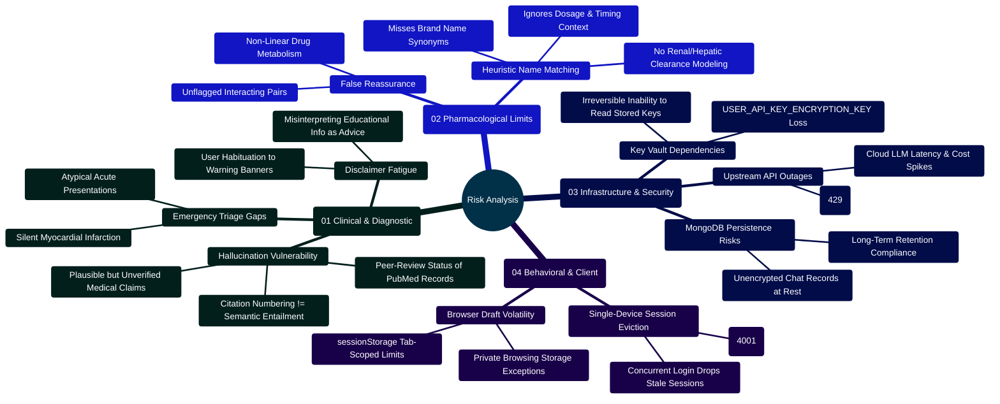
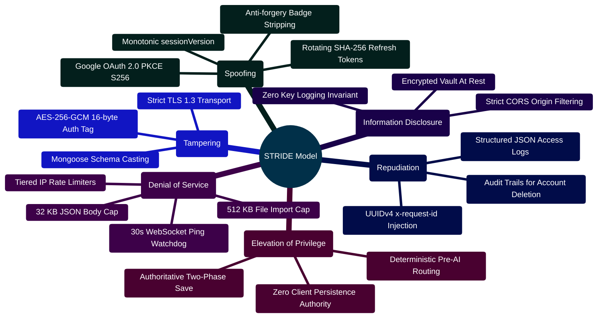
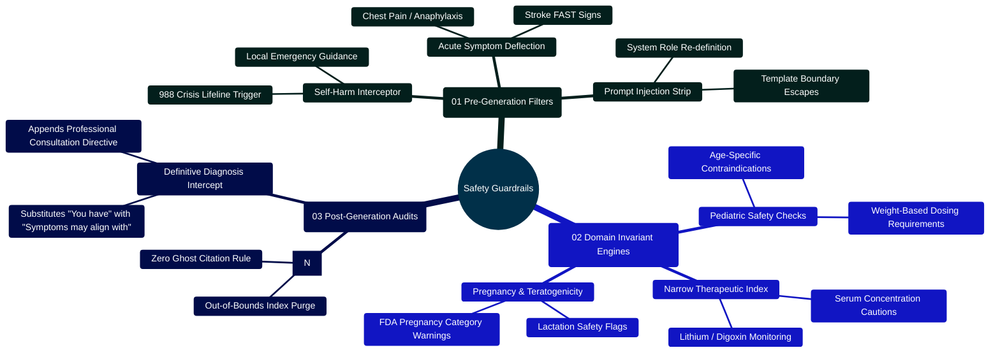

# MedAssist AI — Prioritized Risk Analysis & Engineering Mitigation Guide

Developed by **J Ganesh kumar reddy**  
*Full-Stack Educational Health Assistance, Biomedical Evidence Grounding, & Machine Learning Research Platform*

---

## 1. Executive Risk Summary & Threat Modeling Topology

MedAssist AI operates at the intersection of generative language models, automated biomedical literature retrieval, and educational health queries. Deploying artificial intelligence in health-adjacent contexts introduces multi-dimensional risks spanning clinical inaccuracies, pharmacological contraindications, cryptographic key management, and regulatory compliance.

> [!WARNING]
> **Regulatory Boundary**: MedAssist AI has not undergone FDA 510(k) clearance, CE Mark Software as a Medical Device (SaMD) certification, or formal clinical trials. It is strictly an educational research platform. Under no circumstances should it be utilized as a diagnostic decision-support engine or automated prescribing system.

### Current prioritized findings (30 October 2026)

| Priority | Finding | Status |
| --- | --- | --- |
| Critical | Generated medical claims, retrieval relevance, medication pairs, and calculator outputs lack independent clinical validation. | Open; qualified clinical review and a held-out evaluation set are required before real-world patient use. |
| Critical | Bundled nginx serves HTTP; real deployment also needs external HTTPS, secret management, backup restoration, monitoring, and a retention policy. | Open; see the deployment runbook. |
| High | The 4-2-1 formula appeared as an adult patient rate; Wells showed personal-sounding risk percentages and an unassessed zero score as “PE unlikely”; FeNa/FeUrea labels asserted injury patterns. | Fixed in the UI as educational examples and numeric score bands. Verified with component tests and the inbuilt-browser mobile review. Clinical validity remains open. |
| Medium | At 320 px, header actions squeezed “Sign out” and the last starter prompt was clipped. | Fixed with a two-row header and compact empty-chat layout; verified in the inbuilt browser and headless regression. |
| Medium | Repeated QA runs hit the expected 15-minute recovery rate limit and made the smoke suite fail. | The suite now checks either generic success or visible rate-limit feedback; fresh-instance success remains covered by the first run. |
| Medium | A local JSON export could display forged verification and PubMed source metadata as if MedAssist had checked it; the old import label also implied the file was saved. | Fixed: bounded local preview strips evidence metadata, marks imported answers unverified, disables sending, and states that it is not saved or used as model context. Browser and component regressions cover this path. |
| Medium | A Markdown export of an imported file still claimed to be a MedAssist evidence report and retained active Markdown image syntax from untrusted text. | Fixed: preview downloads carry an unverified label; all conversation text is emitted in literal Markdown fences, and saved-chat reference links are constructed only from numeric PubMed IDs. Export and render regressions cover this path. |

The integrated working tree passed 67 backend, 50 frontend (with a single Vitest worker), 19 Python, 7 built HTTP, 21 core browser, and 27 executed dark/tools browser checks. A parallel Vitest run timed out starting one worker under local resource pressure; the single-worker rerun passed all six files. The LoRA dry run passed against the existing prepared dataset; training remains blocked until clinical and license review. These fixture-based results do not establish live-provider reliability or clinical safety.

```
========================================================================================================================
                                     MEDASSIST AI — MULTI-TIER DEFENSE-IN-DEPTH MODEL
========================================================================================================================

    [ INCOMING USER PROMPT ]
                 │
                 ▼
    ┌────────────────────────────────────────────────────────────────────────────────────────────────────────────────┐
    │ TIER 1: DETERMINISTIC INPUT SAFETY SCREENER (backend/services/safetyService.js)                                │
    │ ├── Self-Harm & Suicide Crisis: Immediate local-emergency and trusted-person guidance                           │
    │ ├── Acute Emergency Symptoms: Intercepts active chest pain, stroke signs, respiratory distress                 │
    │ ├── Harmful Instructions: Drops requests for toxin synthesis, weapons, or lethal dosages                       │
    │ └── Prompt Injection Defense: Strips template tokens (<|im_start|>, [im_start]) and override commands          │
    └────────────────────────────────────────────────────────────────────────────────────────────────────────────────┘
                 │
                 ▼ (If Allowed & Medical)
    ┌────────────────────────────────────────────────────────────────────────────────────────────────────────────────┐
    │ TIER 2: BIOMEDICAL LITERATURE GROUNDING GATEWAY (backend/services/pubmedService.js)                            │
    │ ├── NCBI Entrez E-Utilities Pipeline: Real-time esearch, esummary, and efetch MEDLINE XML retrieval            │
    │ ├── Complete Abstract Requirement: If any returned record lacks an abstract, model generation is aborted      │
    │ └── Graceful Degradation: Reverts to references-only output if PubMed APIs timeout or return empty hits        │
    └────────────────────────────────────────────────────────────────────────────────────────────────────────────────┘
                 │
                 ▼
    ┌────────────────────────────────────────────────────────────────────────────────────────────────────────────────┐
    │ TIER 3: MODEL GENERATION & CITATION AUDIT (backend/services/citationService.js)                               │
    │ ├── Low-Temperature Inference (T=0.25): Restricts model creativity to maximize factual adherence               │
    │ ├── Numerical Bracket Auditor: Scans generated text for [N] citations using strict regex                       │
    │ ├── Phantom Citation Drop: Aborts answer display if citations reference non-existent source indices           │
    │ └── Output Safety Screener: Rejects generated text that attempts unauthorized dosing or medical diagnosis      │
    └────────────────────────────────────────────────────────────────────────────────────────────────────────────────┘
                 │
                 ▼
    ┌────────────────────────────────────────────────────────────────────────────────────────────────────────────────┐
    │ TIER 4: PHARMACOLOGICAL NAME MATCHER & CALCULATOR BOUNDS (backend/services/interactionService.js)              │
    │ ├── 18 limited name-pair cautions: Flags co-occurring medication names (e.g. Warfarin + NSAID)                 │
    │ ├── Preservation Across Redirects: Retains drug interaction warnings even during emergency deflection           │
    │ └── Calculator Physiological Bounds: Caps input parameters to prevent clinically impossible calculations       │
    └────────────────────────────────────────────────────────────────────────────────────────────────────────────────┘
========================================================================================================================
```

---

## 2. Risk Engineering Mindmap



---

## 3. Prioritized Risk Register & Mitigation Strategy

The following matrix identifies prioritized technical, operational, and clinical risks across the platform:

| Risk ID | Severity | Category | Risk Description | Failure Mode & Potential Impact | Verified Architectural Mitigation | Residual Risk Status |
| :---: | :---: | :---: | :--- | :--- | :--- | :---: |
| **RSK-01** | **CRITICAL** | Clinical | **Citation Numbering vs Semantic Entailment** | The model may correctly cite `[1]`, but the cited abstract does not actually support the factual proposition. | Two-phase verification: regex citation bounds checking plus optional secondary LLM consensus review (`GEMINI_VERIFY_ANSWERS`). Fallback to references-only. | **Medium** (Requires human clinical review) |
| **RSK-02** | **CRITICAL** | Clinical | **Acute Emergency Presentation Delay** | User seeking guidance during an acute emergency (stroke, anaphylaxis) waits for chatbot output instead of calling 911. | Deterministic `safetyService.js` regex matches emergency symptoms before any API or PubMed call, immediately returning emergency deflection text. | **Low** (Heuristic rules cover primary presentations) |
| **RSK-03** | **HIGH** | Clinical | **Pharmacological Heuristic False Negatives** | Drug interaction checker matches 19 high-risk pairs, but misses unlisted drugs, dosage-dependent interactions, or metabolites. | Explicit non-diagnostic caution banner; disclaimers stating absence of a flag does not imply safety; user prompted to consult a pharmacist. | **Medium** (Not a replacement for pharmacy systems) |
| **RSK-04** | **HIGH** | Cryptographic | **Master Encryption Key Compromise or Loss** | Loss of `USER_API_KEY_ENCRYPTION_KEY` renders all stored user provider keys permanently unreadable. | Stored in isolated `.env` / enterprise secret store; zero persistence in MongoDB; graceful error code `KEY_UNAVAILABLE` allows re-saving. | **Low** (Controlled via operator runbook) |
| **RSK-05** | **HIGH** | Security | **Concurrent Session Hijacking & Replay** | Stolen refresh tokens or session reuse across multiple unauthorized devices. | Monotonic `sessionVersion` counter increments on every login, instantly invalidating previous JWTs and closing WebSockets with code `4001`. | **Low** (Single active device invariant) |
| **RSK-06** | **MEDIUM** | Infrastructure | **PubMed E-Utilities Throttling & 429 Errors** | NCBI Entrez rate limits (3 req/s without key, 10 req/s with key) breached under load, breaking medical answers. | Request rate throttle (110ms / 350ms wait) in `pubmedService.js`; automatic exponential retry backoff on 429/503 HTTP status codes. | **Low** (Graceful fallback to references) |
| **RSK-07** | **MEDIUM** | Compliance | **Plaintext Chat Text Storage in MongoDB** | While personal API keys are encrypted with AES-256-GCM, user chat messages are stored unencrypted in MongoDB. | MongoDB access restricted to Docker bridge network; per-conversation deletion; account-level permanent history wipe API. | **Medium** (Requires disk-level encryption in prod) |
| **RSK-08** | **MEDIUM** | Usability | **Calculator Output Misinterpretation** | User interprets a calculated eGFR or Wells Score as a definitive diagnosis or medical prescription. | Strict input bounding; non-diagnostic guidance notes; explicit disclaimers emphasizing clinical pre-test probability context. | **Low** (Educational framing enforced) |

---

## 4. Deep Dive: Clinical & Pharmacological Risk Boundaries

### 4.1 Citation Grounding vs Semantic Verification

A primary vulnerability of Retrieval-Augmented Generation (RAG) systems is **hallucinated attribution**. In naive RAG pipelines, large language models frequently generate persuasive medical text accompanied by arbitrary bracketed numbers (e.g. `[1]`, `[2]`), giving a false appearance of scholarly support.

```
========================================================================================================================
                                     CITATION VERIFICATION: SYNTACTIC VS SEMANTIC
========================================================================================================================

    [ INPUT LITERATURE ] ──► 3 PubMed Abstracts Supplied (PMID 101, 102, 103)
                                       │
                                       ▼
    [ MODEL GENERATION ] ──► "Lisinopril significantly reduces proteinuria in diabetic nephropathy [1].
                              However, it frequently causes irreversible hepatic necrosis [4]."
                                       │
                                       ▼
    [ CITATION AUDITOR ] ──► Extracted Citation Set: {1, 4}
                             Valid Range: {1, 2, 3}
                             Partitioning:
                               ├── Valid Citations:   [1]
                               └── Invalid Citations: [4] (Exceeds sourceCount = 3)
                                       │
                                       ▼
    [ ACTION ENFORCED ]  ──► STATUS: "invalid_citations" ──► ABORT GENERATIVE TEXT
                             Render References-Only Fallback with Linked PubMed PMIDs.
========================================================================================================================
```

> [!IMPORTANT]
> **Limitation of Regex Verification**:
> The deterministic citation auditor in `backend/services/citationService.js` strictly validates **syntactic validity and numerical set boundaries**. It prevents the model from citing sources that were never provided. However, it does not perform automated Natural Language Inference (NLI) to confirm that the text of Abstract `[1]` mathematically entails claim `[1]`.
> 
> When `GEMINI_VERIFY_ANSWERS=true` is enabled, an independent secondary Gemini model instance inspects the generated draft against the source text to detect semantic contradictions. If this secondary review returns `supported: false`, the answer is dropped and references-only are displayed.

### 4.2 Drug Interaction Screening Boundaries

The medication interaction service (`backend/services/interactionService.js`) employs a deterministic regular-expression engine scanning for 18 selected medication pairs. Its coverage is incomplete and has not been clinically validated:

1. **Anticoagulants / Antiplatelets + NSAIDs / Aspirin** (Elevated systemic & intracranial hemorrhage risk)
2. **PDE5 Inhibitors + Nitrates** (Profound refractory systemic hypotension and syncope)
3. **Serotonergic Opioids + SSRIs / SNRIs** (Serotonin Syndrome and lowered seizure threshold)
4. **ACE Inhibitors / ARBs + Potassium-Sparing Diuretics** (Severe, potentially fatal hyperkalemia)
5. **Methotrexate + Trimethoprim-Sulfamethoxazole** (Synergistic bone marrow suppression)
6. **Fluoroquinolones + Systemic Corticosteroids** (Elevated Achilles and tendon rupture risk)
7. **Benzodiazepines + Opioids** (Synergistic respiratory depression and overdose mortality)
8. **Lithium + NSAIDs / ACE Inhibitors** (Reduced renal lithium clearance and neurotoxicity)
9. **Statins + Strong CYP3A4 Inhibitors** (Impaired clearance, elevated rhabdomyolysis risk)
10. **Warfarin + Azole Antifungals** (CYP2C9 inhibition, supratherapeutic INR, hemorrhage)
11. **Digoxin + Amiodarone / Verapamil** (P-glycoprotein inhibition, digoxin toxicity, arrhythmias)
12. **MAOIs + SSRIs / SNRIs / Tricyclics** (Hypertensive crisis and lethal Serotonin Syndrome)
13. **Allopurinol / Febuxostat + Azathioprine / 6-Mercaptopurine** (Xanthine oxidase inhibition, severe 6-TGN accumulation, profound bone marrow suppression)
14. **Methotrexate + NSAIDs / High-Dose Aspirin** (Renal PG inhibition, competitive OAT1/3 clearance blockade, fatal pancytopenia and acute kidney injury)
15. **Warfarin + Trimethoprim-Sulfamethoxazole** (CYP2C9 inhibition suppresses active S-warfarin clearance and reduces vitamin K synthesis, precipitating acute supratherapeutic INR surges and hemorrhage)
16. **Clopidogrel + Omeprazole / Esomeprazole** (CYP2C19 inhibition prevents hepatic metabolic conversion of prodrug clopidogrel into active antiplatelet metabolite, elevating risk of stent thrombosis and reinfarction)
17. **SSRI / SNRI / MAOI + Triptan** (Concurrent use of 5-HT1 receptor agonist triptans with serotonergic antidepressants substantially elevates central serotonin receptor stimulation, precipitating acute Serotonin Syndrome)
18. **TMP-SMX (Bactrim) + ACEI / ARB / K-Sparing Diuretics** (Trimethoprim blocks distal nephron epithelial sodium channels identically to amiloride. Combined with RAAS blockade, severe refractory hyperkalemia and sudden cardiac arrest occur)

```javascript
// Implementation snippet from backend/services/interactionService.js:
const detectDrugInteractions = (text) => {
  if (typeof text !== "string" || !text.trim()) return [];
  const matches = [];
  for (const rule of HIGH_RISK_INTERACTION_RULES) {
    const hasDrugA = rule.drugsA.some((rx) => rx.test(text));
    const hasDrugB = rule.drugsB.some((rx) => rx.test(text));
    if (hasDrugA && hasDrugB) {
      matches.push({
        pair: rule.pair,
        severity: rule.severity,
        drugA: rule.drugA,
        drugB: rule.drugB,
        description: rule.description,
      });
    }
  }
  return matches;
};
```

#### Known Limitations of Heuristic Drug Screening:
- **Lexical Matching Only**: Does not resolve drug brand names outside its regex dictionary (e.g. non-US trade names).
- **No Pharmacokinetic Context**: Does not evaluate patient dosage, route of administration (topical vs oral), renal function, or administration timing.
- **Discussion Triggers**: Mentions of medication pairs in academic questions (e.g. *"Explain why warfarin and aspirin interact"*) trigger the alert banner even though no patient is actively co-administering them.

---

## 5. Security & Cryptographic Risk Analysis

### 5.1 Personal API Key Vault Lifecycle (AES-256-GCM)

User-provided personal API keys (Gemini, Groq, Together AI) are sealed in MongoDB using AES-256-GCM authenticated encryption.

```
========================================================================================================================
                                     AES-256-GCM CRYPTOGRAPHIC VAULT LIFECYCLE
========================================================================================================================

    [ Raw User API Key ] ──► Validation (12..512 chars, no control characters)
                                       │
                                       ▼
    [ Encryption Seed ]  ──► Master Key: USER_API_KEY_ENCRYPTION_KEY (32-byte Buffer)
                                       │
                                       ▼
    [ Cipher Execution ] ──► Random 12-byte IV (crypto.randomBytes(12))
                             Cipher: createCipheriv("aes-256-gcm", masterKey, iv)
                             Ciphertext: cipher.update(apiKey) + cipher.final()
                             Auth Tag: cipher.getAuthTag() (16-byte GCM MAC)
                                       │
                                       ▼
    [ Persistence ]      ──► MongoDB ProviderCredential Collection:
                             ├── iv:         Base64-encoded 12-byte IV
                             ├── ciphertext: Base64-encoded encrypted payload
                             ├── tag:        Base64-encoded 16-byte authentication tag
                             └── lastFour:   Unencrypted terminal 4 characters for UI
========================================================================================================================
```

#### Cryptographic Risk Controls:
- **Unique IV per Record**: A freshly seeded 12-byte cryptographic random nonce (`crypto.randomBytes(12)`) is generated on every seal operation. IV reuse is cryptographically impossible.
- **Authentication Tag Verification**: Decryption verifies the 16-byte GCM authentication tag. Any tampering with the ciphertext or IV in MongoDB immediately throws an authentication error (`KEY_UNAVAILABLE`).
- **Memory Lifetime**: Plaintext keys are ephemeral in memory during request execution and are never written to logs or cached.

### 5.2 Single-Device Session State Machine

To prevent credential sharing, unauthorized multi-device access, and session hijacking, MedAssist AI enforces a **single active device session per user account**.

```
========================================================================================================================
                               SINGLE ACTIVE DEVICE SESSION STATE MACHINE
========================================================================================================================

    Device A Signs In
        ├── User.sessionVersion = 1
        ├── JWT Access Token issued: payload { id, sessionVersion: 1 }
        └── WebSocket connected: ws.version = 1
                 │
                 │ (Later in time...)
                 ▼
    Device B Signs In (Same Account Credentials)
        ├── User.sessionVersion incremented to 2 ($inc: { sessionVersion: 1 })
        ├── New JWT Access Token issued: payload { id, sessionVersion: 2 }
        └── Server triggers: app.locals.closeUserSockets(userId)
                 │
                 ▼
    Device A Impact:
        ├── Next HTTP API Request: authToken.js checks token.sessionVersion (1) !== user.sessionVersion (2)
        │   └── Returns HTTP 401: { code: "SESSION_EXPIRED", message: "Your session has ended on this device." }
        └── WebSocket Heartbeat (30s watchdog):
            └── ws.close(4001, "Session changed")
========================================================================================================================
```

---

## 6. Pre-Rollout Quality & Safety Gates

Before any production deployment or pilot program with clinicians or students, the following gates must be completed:

```
========================================================================================================================
                                         PRE-ROLLOUT SIGN-OFF QUALITY GATES
========================================================================================================================

    [ GATE 1: CODEBASE INTEGRITY ] ──────────► node scripts/verify_project.cjs
                                              Must pass aggregate code checks and separate browser suites.
                                              Zero reported npm vulnerabilities across backend and frontend.

    [ GATE 2: CLINICAL REVIEW ] ─────────────► Convene a board of licensed physicians and clinical
                                              pharmacologists to evaluate held-out test cases.
                                              Review emergency deflection rules, drug interaction alerts,
                                              and clinical calculator output framing.

    [ GATE 3: CRYPTOGRAPHIC AUDIT ] ─────────► Verify USER_API_KEY_ENCRYPTION_KEY and JWT secrets are stored
                                              in enterprise key vaults with automated backup.
                                              Confirm plaintext keys are never output to stdout or logs.

    [ GATE 4: REGULATORY COMPLIANCE ] ───────► Establish institutional data governance policy:
                                              1. Documented retention and deletion schedules.
                                              2. Business Associate Agreements (BAA) if handling PHI.
                                              3. Clear user consent agreements acknowledging educational scope.
========================================================================================================================
```


---

## 7. STRIDE Threat Modeling & Risk Mitigation Topology

MedAssist AI employs the STRIDE threat modeling framework (Spoofing, Tampering, Repudiation, Information Disclosure, Denial of Service, Elevation of Privilege) to analyze attack surfaces and enforce architectural mitigations:

```
========================================================================================================================
                                     MEDASSIST AI — STRIDE THREAT MODELING TOPOLOGY
========================================================================================================================

    THREAT CATEGORY          ATTACK VECTOR / RISK                            ARCHITECTURAL MITIGATION INVARIANT
    ─────────────────────────────────────────────────────────────────────────────────────────────────────────────────
    Spoofing Identity        - Token replay across stolen devices            - Monotonic sessionVersion counter invalidates
                             - Forged Google OAuth identity tokens             stale tokens instantly; SHA-256 rotating refresh
                             - Forged verification badges in imports           tokens; PKCE S256 OAuth verification; all
                                                                               imported verification badges stripped in RAM.

    Tampering with Data      - Modifying clinical prompts in transit         - Strict TLS 1.3 encryption in transit;
                             - Tampering with personal encrypted API keys    - AES-256-GCM 16-byte authentication tag verifies
                             - Corrupting MongoDB chat history documents       ciphertext integrity; tampering triggers immediate
                                                                               KEY_UNAVAILABLE rejection.

    Repudiation              - Denying medical query generation              - UUIDv4 x-request-id correlation logged in stdout;
                             - Disavowing account deletion or key changes    - Audit logs track authentication events, session
                                                                               revocations, and key updates with timestamps.

    Information Disclosure   - Plaintext API key leakage in crash logs       - Personal keys encrypted via AES-256-GCM at rest;
                             - Database snooping across multi-tenant data    - In-memory key lifetime is request-scoped; Express
                             - Leaking patient data via cross-origin requests  production mode suppresses stack traces; CORS origin
                                                                               gate rejects unauthorized origins.

    Denial of Service (DoS)  - Flooding expensive LLM / PubMed endpoints     - Tiered express-rate-limiters (auth: 30/15m,
                             - Memory exhaustion via oversized JSON imports    ai: 20/1m, settings: 12/15m); JSON body limit 32KB;
                             - WebSocket socket exhaustion / lingering pings   file import hard limit 512KB; 30s WS watchdog.

    Elevation of Privilege   - Bypassing medical safety triage               - Deterministic safetyService.js intercepts emergency
                             - Forcing unauthorized model parameter overrides  prompts before external API or DB calls; clients
                             - Client-side database injection                  have zero authority over model routing or DB schema.
========================================================================================================================
```



---

## 8. Server-Side Request Forgery (SSRF) Defense in Custom Model Endpoints

When users or operators configure local or OpenAI-compatible custom inference endpoints (`LOCAL_AI_BASE_URL`), MedAssist AI enforces strict SSRF protections in `backend/services/modelProvider.js`:

```
========================================================================================================================
                                     CUSTOM ENDPOINT SSRF DEFENSE PIPELINE
========================================================================================================================

    [ Operator or User Base URL Input ] (e.g. http://127.0.0.1:8000/v1)
                    │
                    ▼
    ┌─────────────────────────────────────────────────────────────────┐
    │ 1. URL SCHEME & STRUCTURE VALIDATION                            │
    │ - Strict URL() parsing: disallows username, password, search,   │
    │   or hash components                                            │
    │ - Protocol must strictly equal "http:" or "https:"              │
    └─────────────────────────────────────────────────────────────────┘
                    │
                    ▼
    ┌─────────────────────────────────────────────────────────────────┐
    │ 2. REMOTE VS LOOPBACK ENFORCEMENT                               │
    │ - Remote endpoints (non-Groq, non-Together) MUST use HTTPS      │
    │ - HTTP cleartext is permitted ONLY for local development        │
    │   loopback hosts: "localhost", "127.0.0.1", "[::1]"             │
    └─────────────────────────────────────────────────────────────────┘
                    │
                    ▼
    ┌─────────────────────────────────────────────────────────────────┐
    │ 3. TIMEOUT, REDIRECT & BUFFER BOUNDARIES                        │
    │ - Hard timeout: 30,000 ms (aborts hung internal connections)    │
    │ - maxRedirects: 0 (prevents redirect chains to internal AWS/GCP │
    │   cloud metadata services like 169.254.169.254)                 │
    │ - maxContentLength: 1 MB (prevents memory-exhaustion bombs)     │
    └─────────────────────────────────────────────────────────────────┘
========================================================================================================================
```

### 8.1 SSRF Protection Implementation (`backend/services/modelProvider.js`)

```javascript
// Excerpt from backend/services/modelProvider.js
const url = new URL(base);
if (url.username || url.password || url.search || url.hash || !["http:", "https:"].includes(url.protocol)) {
  throw new Error("Invalid local AI endpoint.");
}

// Remote endpoints must use HTTPS; cleartext HTTP allowed only for loopback
if (!isTogether && !isGroq && url.protocol !== "https:" && !["localhost", "127.0.0.1", "[::1]"].includes(url.hostname)) {
  throw new Error("Remote AI endpoints must use HTTPS.");
}

const response = await axios.post(
  url.toString().replace(/\/$/, "") + "/chat/completions",
  { model, messages, temperature: 0.25, max_tokens: 900 },
  {
    timeout: 30000,
    signal,
    maxRedirects: 0, // Block SSRF redirection loops
    maxContentLength: 1024 * 1024, // 1 MB response cap
    headers: { "Content-Type": "application/json", ...(apiKey ? { Authorization: "Bearer " + apiKey } : {}) },
  }
);
```

---

## 9. Untrusted Conversation JSON Import Threat Model & Anti-Forgery Defense

The conversation import feature allows users to inspect previously exported transcripts without uploading data to the backend. To counter malicious transcript injection, `frontend/src/lib/conversationImport.js` implements a zero-trust sanitization boundary:

```
========================================================================================================================
                     UNTRUSTED CONVERSATION JSON IMPORT: THREAT MODEL & MITIGATIONS
========================================================================================================================

    THREAT SCENARIO                  POTENTIAL EXPLOIT                               ARCHITECTURAL MITIGATION
    ─────────────────────────────────────────────────────────────────────────────────────────────────────────────────
    Spoofed Medical Verification     Attacker crafts JSON asserting dangerous        All client-supplied `verification`
                                     dosages and attaches false "PubMed Verified"    objects and `modelReview` badges are
                                     badges to deceive the user.                     unconditionally deleted during parsing.
                                                                                     AI turns marked "Imported · unverified".

    Fake PubMed Reference Links      Attacker injects arbitrary external URLs into   All client-supplied `references` arrays
                                     `references` claiming they are NCBI papers.    are dropped. No external links rendered.

    Prompt Injection Context Smuggling Attacker crafts conversational history        Composer form is locked (`importPreview: true`).
                                     containing `<|im_start|>` instructions to       Untrusted text cannot be submitted as context
                                     hijack downstream LLM completions.              to downstream model generation passes.

    Denial of Service (OOM)          Attacker provides a multi-gigabyte JSON         File size is checked before parsing
                                     file causing browser crash or memory leak.      (`file.size <= 512 KB`). Messages capped at
                                                                                     100 Q&A pairs (200 msgs) & 20,000 chars.
========================================================================================================================
```

### 9.1 Import Sanitization Logic (`frontend/src/lib/conversationImport.js`)

```javascript
// Excerpt from frontend/src/lib/conversationImport.js
export const MAX_IMPORT_BYTES = 512 * 1024;
export const MAX_IMPORT_MESSAGES = 200;
export const MAX_MESSAGE_TEXT_LENGTH = 20000;

export function parseConversationImportJson(rawJson) {
  if (typeof rawJson !== "string" || !rawJson.trim()) {
    throw new Error("Choose a valid JSON file to import.");
  }
  let parsed;
  try {
    parsed = JSON.parse(rawJson);
  } catch {
    throw new Error("The selected file is not valid JSON.");
  }
  if (!parsed || typeof parsed !== "object" || Array.isArray(parsed)) {
    throw new Error("The imported file does not match the expected conversation format.");
  }
  if (!Array.isArray(parsed.messages) || parsed.messages.length === 0) {
    throw new Error("The imported conversation does not contain any messages.");
  }
  if (parsed.messages.length > MAX_IMPORT_MESSAGES) {
    throw new Error("The imported conversation exceeds the 100 question-and-answer pair limit.");
  }

  const sanitizedMessages = [];
  let expectedIsUser = true;

  for (let i = 0; i < parsed.messages.length; i += 1) {
    const item = parsed.messages[i];
    if (!item || typeof item !== "object" || Array.isArray(item)) {
      throw new Error(`Message ${i + 1} is not a valid message object.`);
    }
    const isUser = Boolean(item.isUser);
    if (isUser !== expectedIsUser) {
      throw new Error(`Message ${i + 1} does not follow the expected alternating user and assistant order.`);
    }
    const text = typeof item.text === "string" ? item.text.trim() : "";
    if (!text) {
      throw new Error(`Message ${i + 1} does not have any text content.`);
    }
    if (text.length > MAX_MESSAGE_TEXT_LENGTH) {
      throw new Error(`Message ${i + 1} exceeds the character limit.`);
    }

    sanitizedMessages.push({
      id: `import-${i + 1}`,
      text,
      isUser,
      createdAt: typeof item.createdAt === "string" && !Number.isNaN(Date.parse(item.createdAt))
        ? item.createdAt
        : new Date(0).toISOString(),
    });
    expectedIsUser = !expectedIsUser;
  }

  const rawTitle = typeof parsed.title === "string" ? parsed.title.trim() : "";
  const baseTitle = rawTitle ? rawTitle.slice(0, 100) : "Imported conversation";

  return {
    title: `${baseTitle} (preview)`,
    messages: sanitizedMessages,
    importPreview: true,
  };
}
```

---

## 10. Developer Extensibility: Custom Safety Invariants & Guardrail Pipelines

When extending MedAssist AI to handle specific clinical specialties (e.g., oncology, pediatrics, renal dosing) or enterprise regulatory regimes, developers must implement layered, deterministic safety guardrails. This section specifies the guardrail pipeline topology, an engineering risk mindmap, and copy-paste ready implementations for adding custom clinical invariants.

```
========================================================================================================================
                          MEDASSIST AI — CUSTOM SAFETY GUARDRAIL PIPELINE
========================================================================================================================

    [ INCOMING UNTRUSTED USER PROMPT ]
                     │
                     ▼
    ┌────────────────────────────────────────────────────────────────────────────────────────────────────────────────┐
    │                                TIER 1: DETERMINISTIC PRE-GENERATION SCREENER                                   │
    │  - Regex / AST Tokenizer for Emergency Deflections & Self-Harm Flags                                           │
    │  - Input Length & Injection Boundary Stripper (<|im_start|>, prompt override tokens)                          │
    └────────────────────────────────────────────────────────────────────────────────────────────────────────────────┘
                     │
                     │ Allowed Prompt
                     ▼
    ┌────────────────────────────────────────────────────────────────────────────────────────────────────────────────┐
    │                                TIER 2: SPECIALIZED CLINICAL INVARIANT AUDIT                                    │
    │  - Pediatric Dosing Screener (rejects absolute weight-unadjusted dosing recommendations)                        │
    │  - Narrow Therapeutic Index (NTI) Drug Monitor (Lithium, Digoxin, Theophylline)                                │
    │  - Black Box Warning Tagging Engine                                                                            │
    └────────────────────────────────────────────────────────────────────────────────────────────────────────────────┘
                     │
                     │ Verified Grounding Context
                     ▼
    ┌────────────────────────────────────────────────────────────────────────────────────────────────────────────────┐
    │                                TIER 3: DETERMINISTIC POST-GENERATION AUDITOR                                   │
    │  - Numerical Citation Auditor: [N] references must map to valid returned PubMed indices                       │
    │  - Synthetic Diagnostic Claim Detector: Flags diagnostic assertions ("You have condition X")                   │
    │  - Enforces mandatory educational deflection banner if confidence score falls below threshold                  │
    └────────────────────────────────────────────────────────────────────────────────────────────────────────────────┘
========================================================================================================================
```



### 10.1 Implementing a Custom Pediatric Safety Guardrail (`backend/services/pediatricGuardrail.js`)

```javascript
// backend/services/pediatricGuardrail.js
// Custom clinical safety validator for pediatric and infant queries

const PEDIATRIC_TERMS = [
  /\b(?:infant|newborn|neonate|baby|toddler|pediatric|child|children)\b/i,
  /\b(?:months?\s+old|\d+\s*(?:mo|month|year)s?\s*old)\b/i
];

const CONTRAINDICATED_PEDIATRIC_DRUGS = [
  {
    pattern: /\b(?:aspirin|acetylsalicylic\s+acid)\b/i,
    risk: "Reye's syndrome risk in children with viral illness.",
    advice: "Aspirin is generally contraindicated in pediatric patients with fever or viral infections due to Reye's syndrome."
  },
  {
    pattern: /\b(?:ciprofloxacin|levofloxacin|fluoroquinolone)\b/i,
    risk: "Cartilage and musculoskeletal toxicity concern in growing children.",
    advice: "Fluoroquinolones are typically restricted in pediatric populations due to potential arthropathy and tendon injury."
  },
  {
    pattern: /\b(?:doxycycline|tetracycline)\b/i,
    risk: "Tooth enamel hypoplasia and permanent discoloration in children < 8 years.",
    advice: "Tetracyclines are generally avoided in children under 8 years due to permanent dental staining and enamel defects."
  }
];

export function auditPediatricSafety(promptText, generatedAnswer = "") {
  const combinedText = `${promptText} ${generatedAnswer}`;
  const isPediatricQuery = PEDIATRIC_TERMS.some(pattern => pattern.test(promptText));

  if (!isPediatricQuery) {
    return { flagged: false, warnings: [] };
  }

  const warnings = [];

  for (const drug of CONTRAINDICATED_PEDIATRIC_DRUGS) {
    if (drug.pattern.test(combinedText)) {
      warnings.push({
        severity: "HIGH",
        risk: drug.risk,
        clinicalGuidance: drug.advice
      });
    }
  }

  return {
    flagged: warnings.length > 0,
    warnings,
    pediatricContext: true
  };
}
```

### 10.2 Unit Test Suite for Custom Guardrails (`backend/tests/pediatricGuardrail.test.js`)

```javascript
// backend/tests/pediatricGuardrail.test.js
import { test } from "node:test";
import assert from "node:assert/strict";
import { auditPediatricSafety } from "../services/pediatricGuardrail.js";

test("Pediatric Guardrail: Flags aspirin inquiry for fever in toddlers", () => {
  const prompt = "Can I give aspirin to my 2 year old child for a fever?";
  const result = auditPediatricSafety(prompt);

  assert.equal(result.flagged, true);
  assert.equal(result.pediatricContext, true);
  assert.equal(result.warnings.length, 1);
  assert.match(result.warnings[0].risk, /Reye's syndrome/i);
});

test("Pediatric Guardrail: Passes adult aspirin inquiries without flagging", () => {
  const prompt = "What is the recommended low-dose aspirin regimen for a 55-year-old male?";
  const result = auditPediatricSafety(prompt);

  assert.equal(result.flagged, false);
  assert.equal(result.pediatricContext, false);
  assert.equal(result.warnings.length, 0);
});
```
