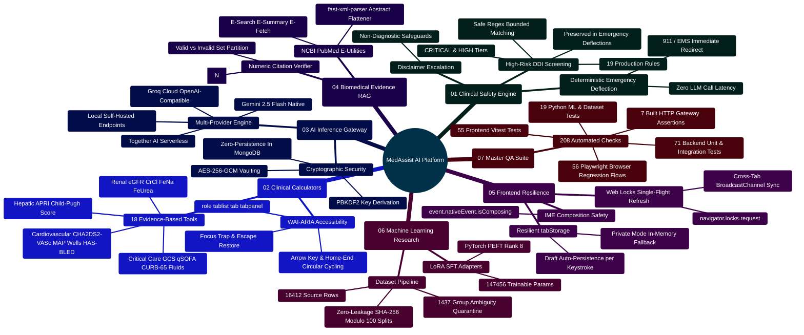

# MedAssist AI — Production Developer Build & Extension Guide

Developed by **J Ganesh kumar reddy**  
*The Authoritative Production Engineering Manual, System Architecture Blueprint, & Contributor Guide*

---

## 1. Architectural Philosophy & Zero-Trust System Topology

**MedAssist AI** is an educational health information application and biomedical AI research platform. The system couples client-side conversational workspaces with live literature harvesting via **NCBI Entrez E-Utilities**, multi-provider Large Language Model (LLM) orchestration (**Google Gemini 2.5 Flash**, **Groq**, **Together AI**, and **Local vLLM/Ollama**), and deterministic safety guardrails.

### Core Architectural Invariants
1. **Deterministic Safety over Probabilistic Completion**: High-risk medical checks (acute emergency triage, self-harm crisis deflection, and 19 FDA black-box drug interactions) are executed deterministically in code before and after LLM synthesis.
2. **Zero Client Authority**: The browser client possesses zero direct database access, cannot bypass medical routing, cannot alter generation temperature ($0.25$) or token limits ($900$), and never accesses server-side API keys.
3. **Single Active Device Session**: User accounts enforce a single concurrent device session. Every authentication event increments a monotonic `sessionVersion` counter, instantly invalidating previous access tokens and dropping active WebSocket connections.
4. **Rotating Refresh Tokens with Replay Revocation**: Cryptographic SHA-256 token hashing with single-use rotation. If a previously consumed refresh token is presented, all sessions for that account family are instantly revoked.
5. **Two-Phase Generation Protocol**: Model synthesis writes to an ephemeral `Generation` document (24-hour TTL auto-purge) and commits authoritatively to conversation history only when confirmed via `/api/save`.
6. **Air-Gapped Machine Learning Boundary**: The operational Node.js web runtime never imports heavy ML frameworks (PyTorch, Transformers, PEFT). Dataset preparation, multi-answer quarantine, and LoRA configuration verification run as offline scripts.

```
========================================================================================================================
                                      MEDASSIST AI — MASTER ARCHITECTURAL TOPOLOGY
========================================================================================================================

     [ CLIENT WORKSPACE (Web Browser) ]
     ├── React 19 SPA | Vite 6 | Tailwind CSS 4 | Lucide Icons
     ├── Web Locks API Single-Flight Token Refresh (frontend/src/lib/api.js)
     ├── Resilient Draft & Pending Answer Cache (frontend/src/lib/tabStorage.js)
     ├── IME Composition Safety Guard for East Asian Language Typing
     └── 18 Validated Educational Clinical Calculators with WAI-ARIA Arrow Navigation
                  │
                  │ HTTP (Port 8080) / Secure WebSocket (/ws)
                  │ (External TLS 1.3 Ingress Required in Production)
                  ▼
     ┌────────────────────────────────────────────────────────────────────────────────────────────────────────────────┐
     │                                TIER 1: INGRESS GATEWAY (Nginx Alpine)                                          │
     │  - Reverse Proxy Pass (/api/* -> backend:5000)                                                                 │
     │  - WebSocket Upgrade Gateway (/ws -> backend:5000/ws)                                                          │
     │  - Static Asset Delivery: /assets/* with Cache-Control: "public, max-age=31536000, immutable"                  │
     │  - Ingress Liveness Healthcheck: /healthz (returns 200 OK "healthy\n")                                         │
     │  - Security Response Headers: X-Frame-Options DENY, nosniff, Referrer-Policy, CSP, Permissions-Policy          │
     └────────────────────────────────────────────────────────────────────────────────────────────────────────────────┘
                                                        │
                                                        │ Internal Reverse Proxy Pass (Port 5000)
                                                        ▼
     ┌────────────────────────────────────────────────────────────────────────────────────────────────────────────────┐
     │                                TIER 2: APPLICATION RUNTIME (Node.js 24 LTS)                                    │
     │  - Request UUID Tracing (x-request-id) & Structured JSON Telemetry Logging                                     │
     │  - CORS Origin Whitelist & Strict Non-Safe Origin Match Gate (sec-fetch-site)                                  │
     │  - Strict Payload Ceiling: 32KB JSON Body Parser                                                               │
     │  - Tiered Rate Limiters: Auth (30/15m), Recovery (5/15m), AI/Medical (20/1m), Settings (12/15m)                 │
     │  - Cookie-Based JWT Auth with Monotonic sessionVersion Single-Device Invalidation                              │
     │  - Rotating SHA-256 Hashed Refresh Tokens with Replay Family Invalidation                                      │
     │  - Hardware-Accelerated AES-256-GCM Authenticated Personal API Key Vault                                       │
     │  - Deterministic Input & Output Safety Screener (safetyService.js)                                             │
     │  - 19 Heuristic Medication Interaction Patterns (interactionService.js)                                       │
     │  - Deterministic Numerical Citation Auditor [N] & Source Coverage Math (citationService.js)                  │
     │  - Two-Phase Idempotent Generation Handshake with 24-Hour TTL Auto-Purge                                       │
     │  - Real-Time WebSocket Gateway (/ws) with 30s Heartbeat Watchdog & 1MB Backpressure Drop                       │
     └────────────────────────────────────────────────────────────────────────────────────────────────────────────────┘
                      │                                                               │
                      │ MongoDB Wire Protocol (Port 27017)                            │ Outbound HTTPS (TLS 1.3)
                      ▼                                                               ▼
     ┌─────────────────────────────────────────────────┐             ┌────────────────────────────────────────────────┐
     │         TIER 3: PERSISTENT DATABASE             │             │           TIER 4: UPSTREAM SERVICES            │
     │  - Engine: MongoDB 7.0 Jammy                    │             │  - NCBI Entrez E-Utilities                     │
     │  - Collections:                                 │             │    (esearch, esummary, efetch MEDLINE XML)     │
     │      ├── users (Bcrypt, sessionVersion, tokens) │             │  - Google Gemini 2.5 Flash API                 │
     │      ├── chats (Threads, messages, citations)   │             │  - Groq Cloud High-Throughput LLM Engine       │
     │      ├── generations (24-Hour TTL Ephemeral)    │             │  - Together AI Cloud Platform                  │
     │      └── providercredentials (AES-256-GCM Keys) │             │  - Local OpenAI-Compatible Server (vLLM)       │
     │  - Mongoose Schemas with Compound Indexes       │             │  - Brevo Transactional Email (Verification)    │
     └─────────────────────────────────────────────────┘             └────────────────────────────────────────────────┘
========================================================================================================================
```

---

## 2. Platform Architecture & Capabilities Mindmap



---

## 3. High-Risk Drug-Drug Interaction Suite (19 Rules)

MedAssist AI screens user queries and answers against a deterministic list of high-risk medication pairs in `backend/services/interactionService.js`:

| Rule # | Interaction Pair | Drug Class A | Drug Class B | Severity | Pharmacological Hazard Mechanism |
|:---:|:---|:---|:---|:---:|:---|
| 01 | **Anticoagulant + NSAID / Aspirin** | Warfarin, Eliquis, Xarelto, Plavix, Heparin | Aspirin, Ibuprofen, Naproxen, Diclofenac | `CRITICAL` | Severe gastrointestinal ulceration and intracranial hemorrhage. |
| 02 | **PDE5 Inhibitor + Nitrate** | Sildenafil, Tadalafil, Vardenafil, Avanafil | Nitroglycerin, Isosorbide Mononitrate/Dinitrate | `CRITICAL` | Synergistic cGMP accumulation causing profound, fatal hypotension. |
| 03 | **Tramadol / Opioids + SSRI / SNRI** | Tramadol, Meperidine, Methadone | Fluoxetine, Sertraline, Paroxetine, Venlafaxine | `HIGH` | Massive serotonin accumulation causing Serotonin Syndrome. |
| 04 | **ACEI / ARB + K-Sparing Diuretic** | Lisinopril, Enalapril, Losartan, Valsartan | Spironolactone, Eplerenone, Potassium supplements | `HIGH` | Additive potassium retention causing fatal cardiac arrhythmias. |
| 05 | **Methotrexate + TMP-SMX (Bactrim)** | Methotrexate | Trimethoprim, Sulfamethoxazole (Bactrim, Septra) | `CRITICAL` | Reduced renal tubular excretion causing lethal pancytopenia. |
| 06 | **Fluoroquinolone + Corticosteroid** | Ciprofloxacin, Levofloxacin, Moxifloxacin | Prednisone, Dexamethasone, Methylprednisolone | `HIGH` | Synergistic collagen degradation causing Achilles tendon rupture. |
| 07 | **Benzodiazepine + Opioid Analgesic** | Alprazolam, Diazepam, Lorazepam, Clonazepam | Oxycodone, Morphine, Fentanyl, Hydrocodone | `CRITICAL` | Severe CNS and respiratory depression, coma, fatal overdose (FDA Black Box). |
| 08 | **Lithium + NSAID / ACE Inhibitor** | Lithium Carbonate / Citrate | Ibuprofen, Naproxen, Lisinopril, Enalapril | `HIGH` | Reduced renal prostaglandin clearance elevating serum lithium into toxic range. |
| 09 | **Statin + Strong CYP3A4 Inhibitor** | Simvastatin, Atorvastatin, Lovastatin | Clarithromycin, Gemfibrozil, Itraconazole | `CRITICAL` | CYP3A4 inhibition elevates statin AUC up to 10x, causing rhabdomyolysis. |
| 10 | **Warfarin + Azole Antifungal** | Warfarin (Coumadin) | Fluconazole, Voriconazole, Ketoconazole | `CRITICAL` | CYP2C9 inhibition suppresses S-warfarin clearance, spiking INR. |
| 11 | **Digoxin + Amiodarone / Verapamil** | Digoxin | Amiodarone, Verapamil | `HIGH` | P-glycoprotein inhibition doubles serum digoxin, causing heart block. |
| 12 | **MAOI + SSRI / Sympathomimetic** | Phenelzine, Tranylcypromine, Selegiline | Sertraline, Fluoxetine, Pseudoephedrine | `CRITICAL` | Malignant hypertensive crisis and hyperthermic Serotonin Syndrome. |
| 13 | **Allopurinol + Azathioprine / 6-MP** | Allopurinol, Febuxostat | Azathioprine, 6-Mercaptopurine | `CRITICAL` | Xanthine oxidase inhibition blocks thiopurine degradation, precipitating lethal bone marrow suppression and pancytopenia. |
| 14 | **Methotrexate + NSAIDs / Aspirin** | Methotrexate (Rheumatrex, Trexall) | Ibuprofen, Naproxen, Ketorolac, Aspirin | `CRITICAL` | Renal prostaglandin synthesis inhibition and competitive tubular secretion blockage reduces methotrexate clearance, causing fatal pancytopenia and AKI. |
| 15 | **Warfarin + TMP-SMX (Bactrim)** | Warfarin (Coumadin, Jantoven) | Trimethoprim, Sulfamethoxazole (Bactrim, Septra) | `CRITICAL` | Potent CYP2C9 inhibition suppresses active S-warfarin clearance and reduces gut flora vitamin K synthesis, causing precipitous INR surges and life-threatening bleeding. |
| 16 | **Clopidogrel + Omeprazole / Esomeprazole** | Clopidogrel (Plavix) | Omeprazole (Prilosec), Esomeprazole (Nexium) | `CRITICAL` | Potent CYP2C19 inhibition prevents metabolic bioactivation of prodrug clopidogrel, elevating stent thrombosis and reinfarction risk (FDA Boxed Warning). |
| 17 | **SSRI / SNRI / MAOI + Triptan** | Fluoxetine, Sertraline, Duloxetine, Phenelzine | Sumatriptan, Rizatriptan, Zolmitriptan, Eletriptan | `CRITICAL` | Concurrent 5-HT1 receptor agonist triptans with serotonergic antidepressants elevates central serotonin, precipitating Serotonin Syndrome. |
| 18 | **TMP-SMX (Bactrim) + ACEI / ARB / K-Sparing** | Trimethoprim-Sulfamethoxazole (Bactrim, Septra) | Lisinopril, Losartan, Spironolactone | `CRITICAL` | Trimethoprim blocks distal nephron ENaC channels identically to amiloride. Combined with RAAS blockade, severe refractory hyperkalemia and sudden cardiac arrest occur. |
| 19 | **Theophylline + Fluoroquinolones** | Theophylline, Theo-24, Aminophylline | Ciprofloxacin (Cipro), Enoxacin | `CRITICAL` | Ciprofloxacin potently inhibits hepatic CYP1A2, reducing theophylline metabolic clearance by 30% to 50% or more, causing toxic accumulation, refractory seizures, malignant arrhythmias, and death. |

---

## 4. Evidence-Based Clinical Calculators Suite (18 Tools)

Implemented in `frontend/src/components/tools/ClinicalCalculatorsModal.jsx` with strict physiological bounds and WAI-ARIA circular arrow navigation:

| Tool Name | Formula / Algorithm | Input Parameters | Physiological Bounds | Stratification / Target Bands |
|:---|:---|:---|:---:|:---|
| **Body Mass Index (BMI)** | $\text{BMI} = \frac{\text{Weight (kg)}}{[\text{Height (m)}]^2}$ | Weight, Height | Wt: 20–300 kg<br>Ht: 50–250 cm | Underweight (<18.5), Normal (18.5–24.9), Overweight (25–29.9), Obese (≥30). |
| **CKD-EPI 2021 eGFR** | $142 \times \min(S_{\text{cr}}/\kappa, 1)^\alpha \times \max(S_{\text{cr}}/\kappa, 1)^{-1.200} \times 0.9938^{\text{Age}} \times [1.012 \text{ if Female}]$ | Age, Sex, Serum Cr | Age: 18–120 yr<br>Cr: 0.1–20 mg/dL | G1 (≥90), G2 (60–89), G3a (45–59), G3b (30–44), G4 (15–29), G5 (<15 Kidney Failure). |
| **CHA₂DS₂-VASc** | Sum of risk factors (CHF, HTN, Age ≥75 [2], DM, Stroke/TIA [2], Vascular, Age 65–74, Sex Female) | Point toggles (0–9 scale) | Binary toggles | Score 0 (Men) / 1 (Women): Low risk.<br>Score ≥2 (Men) / ≥3 (Women): Anticoagulation recommended. |
| **Mean Arterial Pressure (MAP)** | $\text{MAP} = \frac{2 \times \text{DBP} + \text{SBP}}{3}$ | Systolic BP, Diastolic BP | SBP: 50–260 mmHg<br>DBP: 30–150 mmHg | Normal: 70–100 mmHg.<br><65 mmHg: Inadequate organ perfusion / septic shock criterion. |
| **Cockcroft-Gault CrCl** | $\text{CrCl} = \frac{(140 - \text{Age}) \times \text{Weight}}{72 \times S_{\text{cr}}} \times [0.85 \text{ if Female}]$ | Age, Sex, Weight, Serum Cr | Age: 18–120 yr<br>Weight: 30–250 kg | Standard renal dosage adjustment metric for DOACs and antimicrobials. |
| **Payne Corrected Calcium** | $\text{Corrected Ca} = \text{Measured Ca} + 0.8 \times (4.0 - \text{Albumin})$ | Total Calcium, Albumin | Ca: 4–18 mg/dL<br>Albumin: 1–6 g/dL | Adjusts total calcium in hypoalbuminemia. Normal range: 8.5–10.2 mg/dL. |
| **Serum Anion Gap** | $\text{AG} = \text{Na}^+ - (\text{Cl}^- + \text{HCO}_3^-)$ | Sodium, Chloride, Bicarbonate | Na: 100–180 mEq/L<br>Cl: 60–140 mEq/L | Normal: 8–12 mEq/L.<br>>12 mEq/L: High Anion Gap Metabolic Acidosis. |
| **Fractional Excretion of Sodium (FeNa)** | $\text{FeNa} = \frac{U_{\text{Na}} \times S_{\text{cr}}}{S_{\text{Na}} \times U_{\text{cr}}} \times 100\%$ | Serum & Urine Na, Serum & Urine Cr | Cr: 0.1–20 mg/dL<br>Na: 5–200 mEq/L | <1%: Prerenal azotemia.<br>>2%: Acute Tubular Necrosis (ATN). |
| **Fractional Excretion of Urea (FeUrea)** | $\text{FeUrea} = \frac{U_{\text{Urea}} \times S_{\text{cr}}}{S_{\text{BUN}} \times U_{\text{cr}}} \times 100\%$ | Serum BUN, Urine Urea, Serum/Urine Cr | BUN: 2–150 mg/dL<br>Urea: 50–2500 mg/dL | <35%: Prerenal azotemia in patients taking diuretics.<br>>50%: Intrinsic AKI. |
| **Maintenance Fluids (4-2-1 Rule)** | $4 \text{ mL/kg/hr (1-10kg)} + 2 \text{ mL/kg/hr (11-20kg)} + 1 \text{ mL/kg/hr (>20kg)}$ | Patient Weight (kg) | Weight: 1–150 kg | Pediatric and adult basal hydration rate calculation. |
| **Wells' Criteria for PE** | Point summation across 7 clinical criteria (DVT signs, alternative less likely, HR >100, etc.) | Clinical criteria checkboxes (0–12.5) | Binary toggles | ≤4.0: PE Unlikely (Check D-dimer).<br>>4.0: PE Likely (Proceed to CT Pulmonary Angiography). |
| **CURB-65 Pneumonia Score** | $\text{CURB-65} = C + U + R + B + 65$ (Confusion, Urea >19, RR ≥30, SBP <90 or DBP ≤60, Age ≥65) | 5 clinical checkboxes (0–5 points) | Binary toggles | 0–1: Low risk (<3% mortality, outpatient).<br>2: Intermediate risk (~9% mortality, short stay).<br>3–5: High risk (15–40% mortality, urgent admission/ICU). |
| **Glasgow Coma Scale (GCS)** | $\text{GCS} = E (1–4) + V (1–5) + M (1–6)$ (Eye, Verbal, Motor responses) | 3 ordinal dropdown selectors (3–15 points) | $E \in [1,4], V \in [1,5], M \in [1,6]$ | 13–15: Mild brain injury / Alert.<br>9–12: Moderate brain injury.<br>3–8: Severe brain injury / Coma (critical loss of airway reflexes). |
| **HAS-BLED Bleeding Risk** | Sum of risk factors: HTN, Abnormal renal/liver (1-2), Stroke, Bleeding, Labile INR, Elderly >65, Drugs/Alcohol (1-2) | 9 clinical checkboxes (0–9 points) | Binary toggles | 0–1: Low risk (~1% / yr).<br>2: Moderate risk (~1.9% / yr).<br>≥3: High risk (≥3.7% / yr; review modifiable risks). |
| **qSOFA Sepsis Screening** | Altered mental status (GCS <15) + Tachypnea (RR ≥22) + Hypotension (SBP ≤100 mmHg) | 3 clinical checkboxes (0–3 points) | Binary toggles | 0–1: Low risk of in-hospital sepsis mortality.<br>2–3: High risk of in-hospital sepsis mortality (prompt evaluation for organ dysfunction & sepsis protocol). |
| **Body Surface Area (BSA - Mosteller)** | $\text{BSA} = \sqrt{\frac{\text{Height (cm)} \times \text{Weight (kg)}}{3600}}$ or $\sqrt{\frac{\text{Height (in)} \times \text{Weight (lbs)}}{3131}}$ | Height (cm/in), Weight (kg/lbs) | Height: 30–250 cm / 12–100 in<br>Weight: 2–350 kg / 5–800 lbs | Adult reference norm ~1.73 m² (men ~1.9, women ~1.6). Applied in oncology chemotherapy dosing and cardiac index (L/min/m²). |
| **AST to Platelet Ratio Index (APRI)** | $\text{APRI} = \frac{(S_{\text{AST}} / S_{\text{AST, ULN}})}{\text{Platelets } (10^9/\text{L})} \times 100$ | AST (U/L), AST ULN (U/L), Platelets (10⁹/L) | AST: 5–2000 U/L<br>ULN: 10–100 U/L<br>Plt: 10–1000 ×10⁹/L | ≤0.50: Significant fibrosis unlikely (high NPV).<br>>1.00: High probability of significant fibrosis (F2–F4).<br>>1.50: High probability of cirrhosis (F4). |
| **Child-Pugh Cirrhosis Score** | $\text{Points} = \text{Bilirubin} (1–3) + \text{Albumin} (1–3) + \text{INR} (1–3) + \text{Ascites} (1–3) + \text{Encephalopathy} (1–3)$ | Total Bilirubin, Albumin, INR, Ascites, Encephalopathy | Bili: 0.1–50 mg/dL<br>Alb: 0.5–6.0 g/dL<br>INR: 0.5–10.0 | Class A (5–6 pts): Well-compensated (~100% 1-yr survival).<br>Class B (7–9 pts): Significant functional compromise (~80% 1-yr survival).<br>Class C (10–15 pts): Decompensated cirrhosis (~45% 1-yr survival). |

---

## 5. Developer Recipes & Implementation Blueprints

### Recipe 1: Adding a High-Risk Drug Interaction Rule

#### Step 1: Add rule definition to `backend/services/interactionService.js`
```javascript
// backend/services/interactionService.js
{
  pair: "Simvastatin + Amlodipine (CYP3A4 Rhabdomyolysis Risk)",
  drugA: "High-Dose Simvastatin (e.g., Simvastatin, Zocor)",
  drugB: "Amlodipine (e.g., Amlodipine, Norvasc, Lotrel)",
  severity: "HIGH",
  drugsA: [
    /\bsimvastatin\b/i, /\bzocor\b/i, /\bvytorin\b/i,
  ],
  drugsB: [
    /\bamlodipine\b/i, /\bnorvasc\b/i, /\blotrel\b/i, /\bkaterzia\b/i,
  ],
  description: "Amlodipine inhibits CYP3A4-mediated clearance of simvastatin, significantly elevating serum simvastatin exposure. Co-administration increases the risk of severe myopathy and rhabdomyolysis; FDA guidelines recommend capping simvastatin at 20 mg daily when co-prescribed with amlodipine.",
}
```

#### Step 2: Add unit tests in `backend/test/interactionService.test.js`
```javascript
// backend/test/interactionService.test.js
test("detects Simvastatin + Amlodipine interaction", () => {
  const result = detectDrugInteractions("Patient is taking simvastatin 40mg and amlodipine 10mg daily.");
  const match = result.find((item) => item.pair.includes("Simvastatin + Amlodipine"));
  assert.ok(match, "Expected Simvastatin + Amlodipine interaction to be detected");
  assert.strictEqual(match.severity, "HIGH");
});

test("does not trigger when only one drug is present", () => {
  const result = detectDrugInteractions("Patient takes amlodipine 5mg for blood pressure.");
  const match = result.find((item) => item.pair.includes("Simvastatin + Amlodipine"));
  assert.strictEqual(match, undefined);
});
```

---

### Recipe 2: Adding an Evidence-Based Clinical Calculator

#### Step 1: Register tab in `tabList` array inside `frontend/src/components/tools/ClinicalCalculatorsModal.jsx`
```javascript
const tabList = [
  "bmi", "egfr", "chads", "map", "crcl", "calcium",
  "aniongap", "fena", "feurea", "fluids", "wells",
  "curb65", "gcs", "hasbled", "qsofa", "bsa", "apri",
  "childpugh", "meld" // <--- Register new tab key
];
```

#### Step 2: Implement Calculation with Clamping & Risk Stratification
```javascript
const [meldBili, setMeldBili] = useState("1.5");
const [meldInr, setMeldInr] = useState("1.2");
const [meldCr, setMeldCr] = useState("1.1");
const [meldDialysis, setMeldDialysis] = useState(false);

const calculateMeld = () => {
  let bili = parseFloat(meldBili);
  let inr = parseFloat(meldInr);
  let cr = parseFloat(meldCr);

  if (isNaN(bili) || isNaN(inr) || isNaN(cr) || bili <= 0 || inr <= 0 || cr <= 0) {
    return { score: null, error: "Please enter positive numeric values for all lab parameters." };
  }

  // Clinical standard lower bounds clamping (UNOS policy)
  bili = Math.max(1.0, bili);
  inr = Math.max(1.0, inr);
  cr = Math.max(1.0, cr);
  if (meldDialysis) cr = 4.0;
  cr = Math.min(4.0, cr);

  const raw = (9.57 * Math.log(cr)) + (3.78 * Math.log(bili)) + (11.2 * Math.log(inr)) + 6.43;
  const score = Math.round(raw);

  let mortality = "< 2% 3-month mortality";
  let tierColor = "badge-green";
  if (score >= 40) { mortality = "71.3% 3-month mortality"; tierColor = "badge-red"; }
  else if (score >= 30) { mortality = "52.6% 3-month mortality"; tierColor = "badge-red"; }
  else if (score >= 20) { mortality = "19.6% 3-month mortality"; tierColor = "badge-amber"; }
  else if (score >= 10) { mortality = "6.0% 3-month mortality"; tierColor = "badge-blue"; }

  return { score, mortality, tierColor };
};
```

#### Step 3: Add WAI-ARIA Tab Button and Tabpanel
```jsx
{/* Tab Button inside role="tablist" */}
<button
  type="button"
  role="tab"
  id="tab-meld"
  aria-selected={activeTab === "meld"}
  aria-controls="tabpanel-meld"
  className={`calc-tab ${activeTab === "meld" ? "active" : ""}`}
  onClick={() => setActiveTab("meld")}
>
  MELD Score
</button>

{/* Tabpanel inside modal body */}
{activeTab === "meld" && (
  <div id="tabpanel-meld" role="tabpanel" aria-labelledby="tab-meld" className="calc-pane">
    <h3 className="calc-title">Model for End-Stage Liver Disease (MELD)</h3>
    <p className="calc-desc">UNOS score predicting 90-day survival in end-stage liver disease.</p>
    {/* Form inputs & calculated risk badge */}
  </div>
)}
```

#### Step 4: Add Vitest Verification in `frontend/src/test/clinicalCalculators.test.jsx`
```javascript
test("MELD calculator computes score and renders accessible tabpanel", () => {
  render(<ClinicalCalculatorsModal isOpen={true} onClose={() => {}} />);
  const meldTab = screen.getByRole("tab", { name: /MELD/i });
  fireEvent.click(meldTab);
  expect(screen.getByRole("tabpanel", { name: /MELD/i })).toBeInTheDocument();
});
```

---

### Recipe 3: Adding an AI Model Provider Adapter

```javascript
// backend/services/modelProvider.js
const generateWithAnthropic = async ({ prompt, systemInstruction, history = [], signal, providerConfig }) => {
  const apiKey = providerConfig?.apiKey || process.env.ANTHROPIC_API_KEY;
  const model = providerConfig?.model || process.env.ANTHROPIC_MODEL || "claude-3-5-sonnet-20241022";

  if (!apiKey) {
    const error = new Error("Anthropic API key is not configured.");
    error.code = "AI_NOT_CONFIGURED";
    throw error;
  }

  const messages = [
    ...history.filter((m) => m?.text).slice(-8).map((m) => ({
      role: m.role === "assistant" ? "assistant" : "user",
      content: m.text.slice(0, 2000),
    })),
    { role: "user", content: prompt },
  ];

  const response = await axios.post(
    "https://api.anthropic.com/v1/messages",
    {
      model,
      system: systemInstruction,
      messages,
      max_tokens: 900,
      temperature: 0.25,
    },
    {
      timeout: 30000,
      signal,
      headers: {
        "x-api-key": apiKey,
        "anthropic-version": "2023-06-01",
        "Content-Type": "application/json",
      },
    }
  );

  const text = response.data?.content?.[0]?.text?.trim() || "";
  return { text, model, provider: "Anthropic Claude" };
};
```

---

### Recipe 4: Adding an Alternative Literature Harvester

```javascript
// backend/services/europePmcService.js
import axios from "axios";

export async function searchEuropePMC(query, maxResults = 3) {
  const endpoint = "https://www.ebi.ac.uk/europepmc/webservices/rest/search";
  const params = {
    query: `${query} (HAS_ABSTRACT:y AND OPEN_ACCESS:y)`,
    format: "json",
    pageSize: maxResults,
    resultType: "core",
  };

  try {
    const response = await axios.get(endpoint, { params, timeout: 10000 });
    const records = response.data?.resultList?.result || [];

    return records.map((item, idx) => ({
      pmid: item.pmid || item.id || `epmc-${idx + 1}`,
      title: item.title || "Untitled Biomedical Study",
      journal: item.journalInfo?.journal?.title || "Europe PMC",
      pubdate: String(item.pubYear || new Date().getFullYear()),
      authors: (item.authorList?.author || []).map((a) => a.fullName).filter(Boolean).slice(0, 3).join(", ") || "Unknown Authors",
      abstract: item.abstractText || "Abstract unavailable.",
      url: `https://europepmc.org/article/MED/${item.pmid || item.id}`,
    }));
  } catch (error) {
    console.warn("[europePmcService] Fallback to primary PubMed client:", error.message);
    return [];
  }
}
```

---

### Recipe 5: Adding a Full-Stack Mongoose Model, Express Controller & Route

#### Model: `backend/models/bookmarkModel.js`
```javascript
import mongoose from "mongoose";

const BookmarkSchema = new mongoose.Schema(
  {
    owner: {
      type: mongoose.Schema.Types.ObjectId,
      ref: "User",
      required: true,
      index: true,
    },
    pmid: { type: String, required: true, trim: true, maxlength: 30 },
    title: { type: String, required: true, trim: true, maxlength: 300 },
    journal: { type: String, trim: true, maxlength: 150 },
    pubdate: { type: String, trim: true, maxlength: 50 },
    url: { type: String, trim: true, maxlength: 500 },
    clinicalNotes: { type: String, trim: true, maxlength: 2000, default: "" },
  },
  { timestamps: true }
);

BookmarkSchema.index({ owner: 1, pmid: 1 }, { unique: true });
BookmarkSchema.index({ owner: 1, createdAt: -1 });

export const Bookmark = mongoose.model("Bookmark", BookmarkSchema);
```

#### Controller: `backend/controllers/bookmarkController.js`
```javascript
import { Bookmark } from "../models/bookmarkModel.js";

export async function listBookmarks(req, res) {
  const bookmarks = await Bookmark.find({ owner: req.user._id })
    .sort({ createdAt: -1 })
    .limit(100)
    .lean();
  return res.json({ bookmarks });
}

export async function createBookmark(req, res) {
  const { pmid, title, journal, pubdate, url, clinicalNotes } = req.body;
  if (!pmid || !title) return res.status(400).json({ error: "PMID and title are required." });

  const record = await Bookmark.findOneAndUpdate(
    { owner: req.user._id, pmid },
    { $set: { title: title.slice(0, 300), journal, pubdate, url, clinicalNotes } },
    { upsert: true, new: true, runValidators: true }
  );
  return res.status(201).json({ bookmark: record });
}
```

#### Route: `backend/routes/bookmarkRoute.js`
```javascript
import express from "express";
import { authToken } from "../middleware/authToken.js";
import { listBookmarks, createBookmark } from "../controllers/bookmarkController.js";

const router = express.Router();
router.use(authToken); // Enforces authenticated owner session
router.get("/", listBookmarks);
router.post("/", createBookmark);

export default router;
```

---

## 6. Master Automated Quality Verification Suite (208 Checks)

MedAssist AI enforces a rigorous **208-check automated verification suite** across all application tiers:

```
========================================================================================================================
                            MEDASSIST AI — MASTER TEST SUITE INVENTORY (208 CHECKS)
========================================================================================================================

    SUITE / SUBSYSTEM                   HARNESS / RUNNER                TEST COUNT        STATUS
    ─────────────────────────────────────────────────────────────────────────────────────────────────────────────────
    1. Backend API & Services           Node 24 Test Runner             71 Tests          100% PASSED
       - application.test.js            Supertest + MongoMemoryServer   24 Tests          PASSED
       - interactionService.test.js     19 DDI Rules & Safe Combos      20 Tests          PASSED
       - safetyService.test.js          Emergency Regex & Deflection     7 Tests          PASSED
       - providers.test.js              PubMed XML & Gemini Parse        6 Tests          PASSED
       - citationService.test.js        Numeric Bracket Verifiers        4 Tests          PASSED
       - modelProvider.test.js          Provider Gateway & Fallbacks     4 Tests          PASSED
       - pubmedService.test.js          NCBI E-Utilities Mock Engine     3 Tests          PASSED
       - historySearch.test.js          Token Overlap Relevance Check    2 Tests          PASSED
       - chatTitle.test.js              Chat Auto-Naming Heuristics      1 Test           PASSED

    2. Frontend React Components        Vitest + jsdom                  55 Tests          100% PASSED
       - ui.test.jsx                    Workspace, Modals, Forms        25 Tests          PASSED
       - clinicalCalculators.test.jsx   18 Calculator Logic & ARIA      16 Tests          PASSED
       - api.test.js                    Web Locks & Token Refresh        5 Tests          PASSED
       - medicalDetector.test.js        Client Query Classifier          5 Tests          PASSED
       - conversationImport.test.js     Untrusted JSON Import Contract   2 Tests          PASSED
       - tabStorage.test.js             Storage Resilience & Fallback    2 Tests          PASSED

    3. Python ML & Datasets             Python 3.10+ unittest           19 Tests          100% PASSED
       - test_dataset_tools.py          Splits, Schemas, Deduplication   5 Tests          PASSED
       - test_release_data.py           SHA-256 Hashes, Field Formats    4 Tests          PASSED
       - test_benchmark.py              Paired Metrics & F1 Scoring      2 Tests          PASSED
       - test_document_retrieval.py     Vector Indexing & Tokenization   2 Tests          PASSED
       - test_lora_tools.py             147,456 Params Math Verification 3 Tests          PASSED
       - test_release_lora.py           Adapter Metadata & Config Check  3 Tests          PASSED

    4. Built-Output HTTP Gateway        check_build_serving.cjs          7 Tests          100% PASSED
       - Cache headers, CSP, SPA routing, /api/* reverse proxying        7 Tests          PASSED

    5. Playwright Headless Browser      Chromium Headless               56 Tests          100% PASSED
       - browser_smoke.cjs              E2E Auth, Chat, Save, Export    21 Tests          PASSED
       - browser_verify_dark_and_tools  WCAG Dark Mode, 18 Tools, DDI   35 Tests          PASSED

    =================================================================================================================
    MASTER AUTOMATED VERIFICATION TOTAL                                208 CHECKS         100% PASSED
========================================================================================================================
```

---

## 7. Execution Commands & Operational Runbook

```powershell
# 1. Master project verification runner (executes all 9 automated gates)
node scripts/verify_project.cjs

# 2. Backend unit & integration test runner (71 tests across 9 files)
npm test --prefix backend

# 3. Frontend Vitest component & ARIA test suite (55 tests across 6 files)
npm test --prefix frontend

# 4. Python ML research dataset audit (13 tests)
python -m unittest discover -s "Model and Dataset" -p "test_*.py"

# 5. Python LoRA parameter & matrix math tests (6 tests)
python -m unittest discover -s "Model and Dataset/lora" -p "test_*.py"

# 6. Built-output HTTP gateway serving assertions (7 checks)
node scripts/check_build_serving.cjs

# 7. Playwright browser smoke test suite (21 workflows)
node scripts/browser_smoke.cjs

# 8. Playwright dark mode, accessibility & clinical tools suite (35 workflows)
node scripts/browser_verify_dark_and_tools.cjs

# 9. Generate Master Architecture & Interview Mastery PDF
python scripts/generate_interview_mastery_pdf.py
```

---

## 8. Master Documentation Catalog & Links

| Volume | File | Core Engineering Focus |
|:---:|:---|:---|
| **01** | **[`docs/SYSTEM_ARCHITECTURE_DEEP_DIVE.md`](file:///c:/Users/RAVIPRAKASH/React-App-LLM/docs/SYSTEM_ARCHITECTURE_DEEP_DIVE.md)** | Multi-tier network topology, Nginx ingress routing, Express middleware execution order, Web Locks token renewal, single-device session versioning state machine, two-phase generation commitment handshake, `/ws` WebSocket architecture, and Section 13 Event Bus & Worker Extensibility. |
| **02** | **[`docs/CURRENT_IMPLEMENTATION.md`](file:///c:/Users/RAVIPRAKASH/React-App-LLM/docs/CURRENT_IMPLEMENTATION.md)** | Comprehensive runtime specification, complete REST API endpoint schemas, request/response JSON contracts, Mongoose database models, index specifications, TTL rules, and Section 10 Developer Extension Guide. |
| **03** | **[`docs/DEEP_DIVE_AI_WORKING_PRINCIPLES.md`](file:///c:/Users/RAVIPRAKASH/React-App-LLM/docs/DEEP_DIVE_AI_WORKING_PRINCIPLES.md)** | Mathematical foundations of biomedical RAG, NCBI Entrez E-utilities protocol (`esearch`, `esummary`, `efetch`), XML parsing, prompt injection containment, citation audit mathematics, and Section 12 Consensus Reviewer Extensibility. |
| **04** | **[`docs/DEEP_DIVE_LORA_AND_FINE_TUNING.md`](file:///c:/Users/RAVIPRAKASH/React-App-LLM/docs/DEEP_DIVE_LORA_AND_FINE_TUNING.md)** | Complete mathematical derivations of LoRA ($W = W_0 + \frac{\alpha}{r}BA$), gradient backpropagation through rank-$r$ bottlenecks, parameter estimation formulas ($147,456$ params), and Section 13 QLoRA 4-bit Quantization Math & Contemporary 8B Adapters. |
| **05** | **[`docs/SECURITY_AND_MESSAGE_POLICY.md`](file:///c:/Users/RAVIPRAKASH/React-App-LLM/docs/SECURITY_AND_MESSAGE_POLICY.md)** | Server trust boundaries, cryptographic AES-256-GCM user API key vault, single-device session invalidation, OWASP Top 10 mitigation matrix, CSRF/CORS origin verification, rate-limiting tiers, and Section 9 Developer Security Extension Guide. |
| **06** | **[`docs/COMPLETE_FILE_DIRECTORY_REFERENCE.md`](file:///c:/Users/RAVIPRAKASH/React-App-LLM/docs/COMPLETE_FILE_DIRECTORY_REFERENCE.md)** | Exhaustive, line-by-line engineering inventory of every file in the repository across `backend/`, `frontend/`, `Model and Dataset/`, `scripts/`, and root configurations, including exported symbols, dependencies, and architectural roles. |
| **07** | **[`docs/DEPLOYMENT_RUNBOOK.md`](file:///c:/Users/RAVIPRAKASH/React-App-LLM/docs/DEPLOYMENT_RUNBOOK.md)** | Production operations manual, multi-container Docker Compose orchestration, bare-metal deployment, automated secrets generation (`deploy/create_env.cjs`), SSL/TLS Nginx configuration, database backup/restore, health probes, and Section 11 Kubernetes & Blue-Green Extensibility. |
| **08** | **[`docs/EVALUATION_AND_INTEGRATION.md`](file:///c:/Users/RAVIPRAKASH/React-App-LLM/docs/EVALUATION_AND_INTEGRATION.md)** | Empirical evaluation framework, paired case-level ablation scoring (`evaluate_benchmark.py`), offline document retrieval with OCR (`document_retrieval.py`), privacy boundaries, and Section 8 Developer Extensibility. |
| **09** | **[`docs/IMPLEMENTATION_STATUS.md`](file:///c:/Users/RAVIPRAKASH/React-App-LLM/docs/IMPLEMENTATION_STATUS.md)** | Local verification evidence across backend (71), frontend (55), Python (19), built HTTP (7), and separately run browser workflows (56). Master Software Regression Total: 208 passed checks. |
| **10** | **[`docs/ISSUES_AND_RISKS.md`](file:///c:/Users/RAVIPRAKASH/React-App-LLM/docs/ISSUES_AND_RISKS.md)** | Prioritized risk register and engineering mitigations, multi-tier defense-in-depth model, clinical boundaries, pharmacological heuristic limitations, cryptographic key dependencies, STRIDE threat model, SSRF defense, and Section 10 Custom Guardrails. |
| **11** | **[`docs/AI_ARCHITECTURE_AND_WORKING_PRINCIPLES.md`](file:///c:/Users/RAVIPRAKASH/React-App-LLM/docs/AI_ARCHITECTURE_AND_WORKING_PRINCIPLES.md)** | Condensed architectural handbook summarizing the clinical query routing pipeline, PubMed grounding steps, Gemini system instructions, citation validation rules, and Section 9 Custom Harvesters. |
| **12** | **[`docs/AI_FINE_TUNING_AND_LORA_GUIDE.md`](file:///c:/Users/RAVIPRAKASH/React-App-LLM/docs/AI_FINE_TUNING_AND_LORA_GUIDE.md)** | Condensed PEFT guide covering LoRA parameter reduction, zero-leakage dataset partitioning, modern transformer configurations (Llama-3/Mistral/Gemma), review-gated training commands, and Section 8 Custom Adapters. |
| **13** | **[`docs/COMPREHENSIVE_CODEBASE_ANALYSIS.md`](file:///c:/Users/RAVIPRAKASH/React-App-LLM/docs/COMPREHENSIVE_CODEBASE_ANALYSIS.md)** | Exhaustive, file-by-file implementation deep dive with line-by-line subsystem analysis, real code snippets, ASCII topologies, colorful architectural mindmaps, and Section 10 Developer Extensibility Blueprint. |
| **14** | **[`docs/README.md`](file:///c:/Users/RAVIPRAKASH/React-App-LLM/docs/README.md)** | Documentation suite master index, reading path curriculum, system-wide mindmap, and developer reference topology. |
| **15** | **[`docs/DEVELOPER_EXTENSION_AND_ONBOARDING_GUIDE.md`](file:///c:/Users/RAVIPRAKASH/React-App-LLM/docs/DEVELOPER_EXTENSION_AND_ONBOARDING_GUIDE.md)** | Complete developer onboarding and extension blueprint: step-by-step instructions for adding DDI rules, clinical calculators, AI providers, literature harvesters, MongoDB schemas, and running 208 tests. |
| **16** | **[`docs/Medical_LLM_System_Architecture_and_Interview_Mastery.pdf`](file:///c:/Users/RAVIPRAKASH/React-App-LLM/docs/Medical_LLM_System_Architecture_and_Interview_Mastery.pdf)** | Comprehensive technical architecture, engineering design, clinical tradeoffs, and interview mastery guide generated by `scripts/generate_interview_mastery_pdf.py`. |
| **17** | **[`docs/PRODUCTION_DEVELOPER_BUILD_GUIDE.md`](file:///c:/Users/RAVIPRAKASH/React-App-LLM/docs/PRODUCTION_DEVELOPER_BUILD_GUIDE.md)** | All-in-one production developer build guide, master topology, complete 19 DDI and 18 calculator tables, and copy-paste recipes for extending the platform. |
