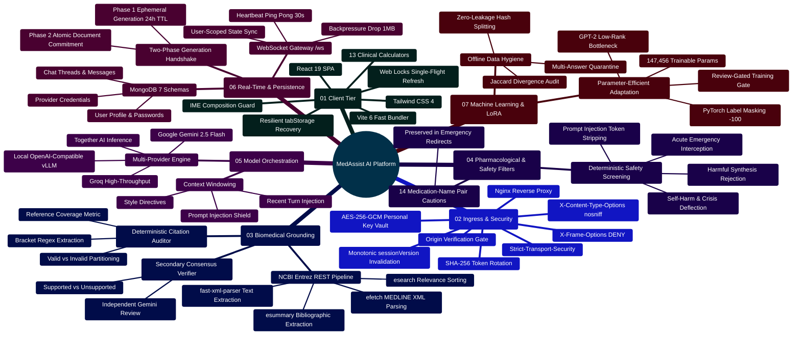
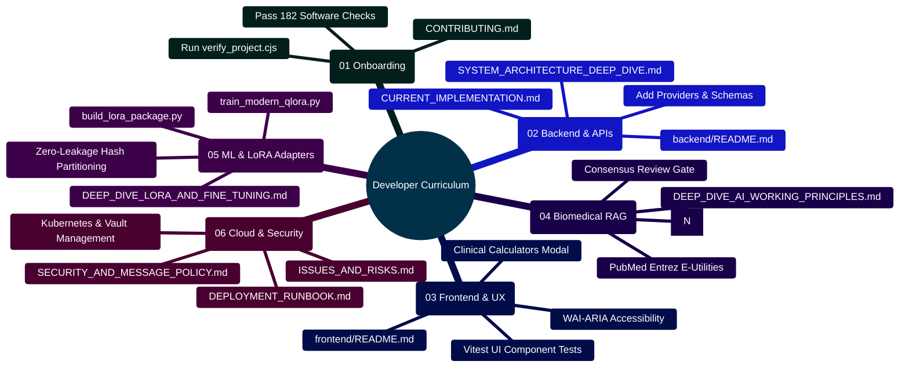

# MedAssist AI — Technical Documentation Suite

Developed by **J Ganesh kumar reddy**  
*Full-Stack Educational Health Assistance, Biomedical Evidence Grounding, & Machine Learning Research Platform*

---

## 1. Executive Summary & Documentation Index

MedAssist AI is an educational health information application and biomedical AI research project. It combines PubMed retrieval with configurable Gemini, Groq, Together AI, or local model serving. The app has session controls, numeric citation checks, a limited medication-name caution list, educational calculators, and AES-256-GCM encryption for stored personal provider keys. None of these features establishes clinical accuracy or production readiness.

This comprehensive technical documentation suite provides deep engineering specifications, mathematical formulations, architectural diagrams, security invariants, and operational runbooks.

```
========================================================================================================================
                                     MEDASSIST AI — PRODUCTION DOCUMENTATION SUITE
========================================================================================================================
  [01] SYSTEM_ARCHITECTURE_DEEP_DIVE.md       ──► Multi-Tier Infrastructure, Ingress, & Network Flow
  [02] CURRENT_IMPLEMENTATION.md              ──► Complete Runtime State, API Specs, & Developer Extension Guide
  [03] DEEP_DIVE_AI_WORKING_PRINCIPLES.md     ──► Biomedical RAG Math, PubMed E-Utilities, & Verifiers
  [04] DEEP_DIVE_LORA_AND_FINE_TUNING.md      ──► Parameter-Efficient LoRA Math & SFT Backprop Derivation
  [05] SECURITY_AND_MESSAGE_POLICY.md         ──► AES-256-GCM Vault, OWASP Defenses, & Safety Policies
  [06] COMPLETE_FILE_DIRECTORY_REFERENCE.md   ──► Comprehensive File-by-File Technical Code Catalog
  [07] DEPLOYMENT_RUNBOOK.md                  ──► Docker Compose, external TLS, & Ops Playbooks
  [08] EVALUATION_AND_INTEGRATION.md          ──► Paired Ablation Scoring & Local Document Retrieval
  [09] IMPLEMENTATION_STATUS.md               ──► Engineering Verification Matrix & Local Test Evidence
  [10] ISSUES_AND_RISKS.md                    ──► Prioritized Risk Register, STRIDE Model, & SSRF Defense
  [11] AI_ARCHITECTURE_AND_WORKING_PRINCIPLES.md ─► Concise Grounding Summary & Algorithmic Rules
  [12] AI_FINE_TUNING_AND_LORA_GUIDE.md       ──► Concise LoRA Setup Guide, Parameter Benchmarks & Custom Datasets
  [13] COMPREHENSIVE_CODEBASE_ANALYSIS.md     ──► Codebase Analysis, Line-by-Line Breakdown & Developer Blueprint
  [14] README.md                              ──► Master Documentation Suite Guide, Reading Paths & Mindmap
========================================================================================================================
```

---

## 2. High-Level ASCII System Architecture

```
+==================================================================================================+
|                                    CLIENT TIER (Web Browser)                                     |
|  React 19 SPA | Vite 6 | Tailwind CSS 4 | Web Locks API | tabStorage (Resilient Session Recovery) |
|  13 Validated Clinical Calculators (BMI, eGFR, CHA2DS2-VASc, MAP, CrCl, Wells PE, Payne, etc.)    |
+==================================================================================================+
                                           │              ▲
               HTTP (Port 8080; external HTTPS required) │   WebSocket (/ws)
                       Strict SameSite     ▼              │   Owner-Scoped Realtime Sync
+==================================================================================================+
|                                  NETWORK & INGRESS TIER (Nginx)                                  |
|  - Static Asset Delivery (Cache-Control: immutable)  - Security Headers (CSP, HSTS, X-Frame)     |
|  - Reverse Proxy (/api/* -> backend:5000)            - WebSocket Upgrade Gateway (/ws)           |
|  - Ingress Healthcheck (/healthz -> 200 OK)                                                      |
+==================================================================================================+
                                           │              ▲
                               HTTP / WS   │              │   JSON Stream
                                           ▼              │
+==================================================================================================+
|                                APPLICATION SERVER TIER (Node.js 24)                              |
|  [Express Pipeline]                                                                              |
|    ├── Request Tracing (UUIDv4 x-request-id)   ├── CORS Whitelist & Origin Match Gate            |
|    ├── Body Parser (Strict 32KB Limit)        ├── Rate Limiters (Auth: 30/15m, AI: 20/m, Set: 12)|
|    └── Auth Middleware (JWT Cookie Validation & Monotonic sessionVersion Enforcement)             |
|                                                                                                  |
|  [Core Controllers & Services]                                                                   |
|    ├── authController.js     <--> sessionService.js (Rotating SHA-256 Refresh Tokens)            |
|    ├── oauthController.js    <--> PKCE S256 Flow & Google OpenID Connect Verification            |
|    ├── settingsController.js <--> providerCredentials.js (AES-256-GCM User API Key Vault)       |
|    ├── aiController.js       <--> answerService.js (Two-Phase Idempotent Generation)             |
|    ├── medicalController.js  <--> pubmedService.js (NCBI E-Utilities: esearch, esummary, efetch)  |
|    ├── citationService.js    <--> Deterministic Numerical Set Partitioning [N] Audit             |
|    ├── interactionService.js <--> Limited 14-pair medication-name caution checker              |
|    ├── answerVerifier.js     <--> Secondary LLM Draft Consensus Review                          |
|    └── websocketService.js   <--> 30s Heartbeat Watchdog & 1MB Backpressure Protection           |
+==================================================================================================+
         │                                 │                                │
         ▼                                 ▼                                ▼
+==================+             +===================+            +===================+
+ PERSISTENCE TIER |             | UPSTREAM MEDICAL  |            | UPSTREAM AI TIERS |
| MongoDB 7        |             | NCBI Entrez APIs  |            | Google Gemini API |
| - Users & Vault  |             | - esearch.fcgi    |            | Groq Cloud API    |
| - Chats & History|             | - esummary.fcgi   |            | Together AI API   |
| - Generations    |             | - efetch.fcgi     |            | Local OpenAI Host |
|   (24h TTL)      |             | (fast-xml-parser) |            | (vLLM / Ollama)   |
+==================+             +===================+            +===================+
```

---

## 3. Platform Capabilities Mindmap

The mindmap below outlines the full architectural hierarchy of the MedAssist AI platform:



---

## 4. Master Documentation Catalog & Links

The comprehensive system documentation is organized into focused architectural volumes:

| Volume | File | Core Engineering Focus |
| :--- | :--- | :--- |
| **01** | **[`SYSTEM_ARCHITECTURE_DEEP_DIVE.md`](SYSTEM_ARCHITECTURE_DEEP_DIVE.md)** | Multi-tier network topology, Nginx ingress routing, Express middleware execution order, Web Locks token renewal, single-device session versioning state machine, two-phase generation commitment handshake, `/ws` WebSocket architecture, and Section 13 Event Bus & Worker Extensibility. |
| **02** | **[`CURRENT_IMPLEMENTATION.md`](CURRENT_IMPLEMENTATION.md)** | Comprehensive runtime specification, complete REST API endpoint schemas, request/response JSON contracts, Mongoose database models, index specifications, TTL rules, and Section 10 Developer Extension Guide. |
| **03** | **[`DEEP_DIVE_AI_WORKING_PRINCIPLES.md`](DEEP_DIVE_AI_WORKING_PRINCIPLES.md)** | Mathematical foundations of biomedical RAG, NCBI Entrez E-utilities protocol (`esearch`, `esummary`, `efetch`), XML parsing, prompt injection containment, citation audit mathematics, and Section 12 Consensus Reviewer Extensibility. |
| **04** | **[`DEEP_DIVE_LORA_AND_FINE_TUNING.md`](DEEP_DIVE_LORA_AND_FINE_TUNING.md)** | Complete mathematical derivations of LoRA ($W = W_0 + \frac{\alpha}{r}BA$), gradient backpropagation through rank-$r$ bottlenecks, parameter estimation formulas ($147,456$ params), and Section 13 QLoRA 4-bit Quantization Math & Contemporary 8B Adapters. |
| **05** | **[`SECURITY_AND_MESSAGE_POLICY.md`](SECURITY_AND_MESSAGE_POLICY.md)** | Server trust boundaries, cryptographic AES-256-GCM user API key vault, single-device session invalidation, OWASP Top 10 mitigation matrix, CSRF/CORS origin verification, rate-limiting tiers, and Section 9 Developer Security Extension Guide. |
| **06** | **[`COMPLETE_FILE_DIRECTORY_REFERENCE.md`](COMPLETE_FILE_DIRECTORY_REFERENCE.md)** | Exhaustive, line-by-line engineering inventory of every file in the repository across `backend/`, `frontend/`, `Model and Dataset/`, `scripts/`, and root configurations, including exported symbols, dependencies, and architectural roles. |
| **07** | **[`DEPLOYMENT_RUNBOOK.md`](DEPLOYMENT_RUNBOOK.md)** | Production operations manual, multi-container Docker Compose orchestration, bare-metal deployment, automated secrets generation (`deploy/create_env.cjs`), SSL/TLS Nginx configuration, database backup/restore, health probes, and Section 11 Kubernetes & Blue-Green Extensibility. |
| **08** | **[`EVALUATION_AND_INTEGRATION.md`](EVALUATION_AND_INTEGRATION.md)** | Empirical evaluation framework, paired case-level ablation scoring (`evaluate_benchmark.py`), offline document retrieval with OCR (`document_retrieval.py`), privacy boundaries, and Section 8 Developer Extensibility. |
| **09** | **[`IMPLEMENTATION_STATUS.md`](IMPLEMENTATION_STATUS.md)** | Local verification evidence across backend (66), frontend (49), Python (19), built HTTP (7), and separately run browser workflows (41). Master Software Regression Total: 182 passed checks. |
| **10** | **[`ISSUES_AND_RISKS.md`](ISSUES_AND_RISKS.md)** | Prioritized risk register and engineering mitigations, multi-tier defense-in-depth model, clinical boundaries, pharmacological heuristic limitations, cryptographic key dependencies, STRIDE threat model, SSRF defense, and Section 10 Custom Guardrails. |
| **11** | **[`AI_ARCHITECTURE_AND_WORKING_PRINCIPLES.md`](AI_ARCHITECTURE_AND_WORKING_PRINCIPLES.md)** | Condensed architectural handbook summarizing the clinical query routing pipeline, PubMed grounding steps, Gemini system instructions, citation validation rules, and Section 9 Custom Harvesters. |
| **12** | **[`AI_FINE_TUNING_AND_LORA_GUIDE.md`](AI_FINE_TUNING_AND_LORA_GUIDE.md)** | Condensed PEFT guide covering LoRA parameter reduction, zero-leakage dataset partitioning, modern transformer configurations (Llama-3/Mistral/Gemma), review-gated training commands, and Section 8 Custom Adapters. |
| **13** | **[`COMPREHENSIVE_CODEBASE_ANALYSIS.md`](COMPREHENSIVE_CODEBASE_ANALYSIS.md)** | Exhaustive, file-by-file implementation deep dive with line-by-line subsystem analysis, real code snippets, ASCII topologies, colorful architectural mindmaps, and Section 10 Developer Extensibility Blueprint. |
| **14** | **[`README.md`](README.md)** | Documentation suite master index, reading path curriculum, system-wide mindmap, and developer reference topology. |

---

## 5. Subsystem Documentation Cross-References

Detailed subsystem-specific README files are located directly in their respective component directories:

- **Root Quickstart & Master Overview**: [`../README.md`](../README.md)
- **Developer Contributing Guide**: [`../CONTRIBUTING.md`](../CONTRIBUTING.md)
- **Deployment & Production Manual**: [`../deploy/README.md`](../deploy/README.md)
- **Scripts & Automation Harness**: [`../scripts/README.md`](../scripts/README.md)
- **Backend Architecture & API Specifications**: [`../backend/README.md`](../backend/README.md)
- **Backend Services Architecture**: [`../backend/services/README.md`](../backend/services/README.md)
- **Database Architecture & Models**: [`../backend/models/README.md`](../backend/models/README.md)
- **Frontend Architecture & Client State**: [`../frontend/README.md`](../frontend/README.md)
- **Frontend Components & Modals Guide**: [`../frontend/src/components/README.md`](../frontend/src/components/README.md)
- **Dataset Analysis, Auditing & Splits**: [`../Model and Dataset/README.md`](../Model%20and%20Dataset/README.md)
- **Offline LoRA Package & Parameter Estimation**: [`../Model and Dataset/lora/README.md`](../Model%20and%20Dataset/lora/README.md)
- **LoRA Production Training Runbook**: [`../Model and Dataset/lora/TRAINING_RUNBOOK.md`](../Model%20and%20Dataset/lora/TRAINING_RUNBOOK.md)
- **Engineering Improvement Plan & Milestones**: [`../IMPROVEMENT_PLAN.md`](../IMPROVEMENT_PLAN.md)

---

## 6. Developer Extensibility Master Curriculum

For new contributors and developers building on MedAssist AI, follow this structured curriculum based on your focus area:

```
========================================================================================================================
                          MEDASSIST AI — DEVELOPER LEARNING CURRICULUM
========================================================================================================================

    [ CORE ORIENTATION ]
    └── Step 1: Read `CONTRIBUTING.md` & `README.md`
    └── Step 2: Run verification runner: `node scripts/verify_project.cjs` (Verifies all 182 software checks)

    [ PATH A: FULL-STACK WEB & API EXTENSION ]
    ├── Volume 01: `SYSTEM_ARCHITECTURE_DEEP_DIVE.md` (Ingress, Web Locks, Two-Phase Persistence)
    ├── Volume 02: `CURRENT_IMPLEMENTATION.md` (REST APIs, Mongoose Schemas, Extensibility Guides A-E)
    ├── Frontend: `frontend/README.md` (Accessible components, responsive layout, Vitest tests)
    └── Backend: `backend/README.md` (66 unit tests, middleware pipeline, service blueprints)

    [ PATH B: AI, BIOMEDICAL RAG & CITATIONS ]
    ├── Volume 03: `DEEP_DIVE_AI_WORKING_PRINCIPLES.md` (Entrez protocol, XML flattening, [N] math)
    ├── Volume 11: `AI_ARCHITECTURE_AND_WORKING_PRINCIPLES.md` (Grounding summaries, custom harvesters)
    └── Volume 08: `EVALUATION_AND_INTEGRATION.md` (Paired ablation benchmarking, document retrieval)

    [ PATH C: MACHINE LEARNING & PARAMETER-EFFICIENT FINE-TUNING ]
    ├── Volume 04: `DEEP_DIVE_LORA_AND_FINE_TUNING.md` (LoRA backprop math, parameter formulas, QLoRA)
    ├── Volume 12: `AI_FINE_TUNING_AND_LORA_GUIDE.md` (Adapter configurations, training commands)
    ├── Dataset Audit: `Model and Dataset/reports/dataset_audit.md` (Jaccard divergence, quarantine)
    └── Dataset Analysis: `Model and Dataset/reports/dataset_analysis.md` (Corpus profiling, intents)

    [ PATH D: DEVOPS, SECURITY & INFRASTRUCTURE ]
    ├── Volume 07: `DEPLOYMENT_RUNBOOK.md` (Docker Compose, Kubernetes, blue-green cutover)
    ├── Volume 05: `SECURITY_AND_MESSAGE_POLICY.md` (AES-256-GCM vault, OWASP defenses)
    ├── Volume 10: `ISSUES_AND_RISKS.md` (STRIDE threat modeling, SSRF defenses, guardrails)
    └── Deploy Manual: `deploy/README.md` (Multi-container orchestration, mongo-init, create_env)
========================================================================================================================
```


