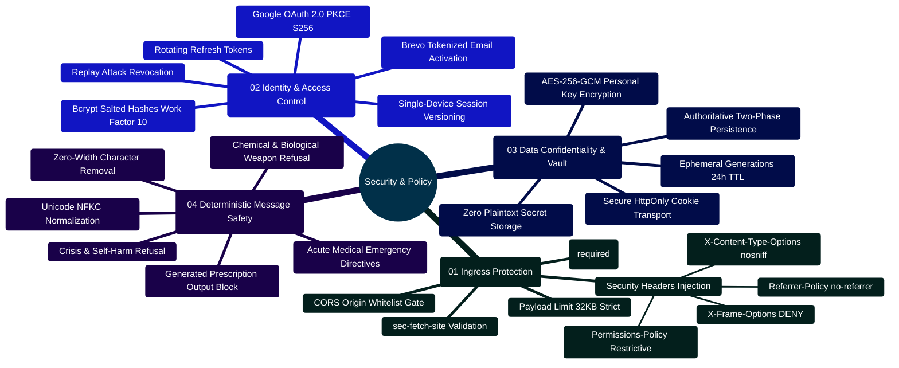

# MedAssist AI — Enterprise Security Architecture & Message Policy

Developed by **J Ganesh kumar reddy**  
*Full-Stack Educational Health Assistance, Biomedical Evidence Grounding, & Machine Learning Research Platform*

---

## 1. Zero-Trust Architectural Boundaries & Threat Model

MedAssist AI operates under a **Zero-Trust Client Boundary**: all client submissions, third-party PubMed literature passages, and upstream LLM completions are treated as inherently untrusted data.

```
====================================================================================================
                         MEDASSIST AI — ZERO-TRUST SECURITY TOPOLOGY
====================================================================================================

      +-------------------------------------------------------------+
      |                 UNTRUSTED PERIMETER (Client Browser)        |
      | - Prompts may contain malicious injections or XSS payloads  |
      | - Storage access may be restricted or sandboxed             |
      +-------------------------------------------------------------+
                                     │
                                     │ HTTPS / Strict-Transport-Security
                                     │ SameSite=Strict HTTP-only Cookies
                                     ▼
      +-------------------------------------------------------------+
      |               BOUNDARY 1: INGRESS & REVERSE PROXY           |
      | - Nginx drops unrecognized host headers                     |
      | - Injects CSP, X-Frame-Options: DENY, nosniff, Referrer     |
      | - Blocks direct public access to backend port 5000 & Mongo  |
      +-------------------------------------------------------------+
                                     │
                                     ▼
      +-------------------------------------------------------------+
      |           BOUNDARY 2: EXPRESS MIDDLEWARE FIREWALL           |
      | - Request UUID (x-request-id) tracing                       |
      | - Strict CORS Whitelist Verification (CLIENT_ORIGIN)        |
      | - Enforce Non-Safe Method Origin Match (sec-fetch-site)     |
      | - Hard 32KB JSON Payload Ceiling                            |
      | - Tiered Rate Limiters (Auth: 30/15m, AI: 20/m, Set: 12/15m)|
      +-------------------------------------------------------------+
                                     │
                                     ▼
      +-------------------------------------------------------------+
      |          BOUNDARY 3: AUTHENTICATION & SESSION VAULT         |
      | - Monotonic sessionVersion counter (Single Active Device)   |
      | - Rotating SHA-256 Refresh Token Hashes (Instant Revocation)|
      | - AES-256-GCM Authenticated Encryption for User API Keys    |
      | - Google OAuth 2.0 with PKCE S256 Code Challenges           |
      +-------------------------------------------------------------+
                                     │
                                     ▼
      +-------------------------------------------------------------+
      |           BOUNDARY 4: DETERMINISTIC AI SAFETY GATE          |
      | - Prompt Screen: Intercept self-harm, weapons, emergencies  |
      | - Source Framing: Label PubMed abstracts as "untrusted data"|
      | - Citation Screen: [N] set partitioning rejects hallucinations|
      | - Output Screen: Strip imperative dosages and prescriptions |
      +-------------------------------------------------------------+
```

---

## 2. Security Capabilities Mindmap



---

## 3. Cryptographic Key Vault Specification (`backend/services/providerCredentials.js`)

When users supply personal API keys (Gemini, Groq, Together AI), keys are encrypted using **Authenticated AES-256-GCM** before database insertion:

```
[Plaintext API Key] + [Master USER_API_KEY_ENCRYPTION_KEY (32-byte)]
                               │
                               ├── Generate Cryptographic Random IV (12-byte)
                               ▼
                   [AES-256-GCM Cipher Instance]
                               │
            ┌──────────────────┴──────────────────┐
            ▼                                     ▼
       [Ciphertext]                       [Auth Tag (16-byte)]
            │                                     │
            └──────────────────┬──────────────────┘
                               │
                               ▼
            [Stored in MongoDB ProviderCredential Schema]
            - iv (Base64)
            - tag (Base64)
            - ciphertext (Base64)
            - lastFour (Plaintext display suffix)
```

```javascript
// backend/services/providerCredentials.js
const { randomBytes, createCipheriv, createDecipheriv } = require("crypto");
const { fail } = require("./validation");

const encryptionKey = () => {
  const raw = process.env.USER_API_KEY_ENCRYPTION_KEY;
  if (!raw || !/^[0-9a-f]{64}$/i.test(raw)) {
    throw fail("Personal API key storage is misconfigured.", 503, "KEY_STORAGE_UNAVAILABLE");
  }
  return Buffer.from(raw, "hex");
};

const seal = (apiKey) => {
  if (typeof apiKey !== "string" || apiKey.length < 12 || apiKey.length > 512 || /\s/.test(apiKey)) {
    throw fail("Enter a valid API key without spaces (12 to 512 characters).");
  }
  const iv = randomBytes(12);
  const cipher = createCipheriv("aes-256-gcm", encryptionKey(), iv);
  const ciphertext = Buffer.concat([cipher.update(apiKey, "utf8"), cipher.final()]);
  return {
    iv: iv.toString("base64"),
    tag: cipher.getAuthTag().toString("base64"),
    ciphertext: ciphertext.toString("base64"),
    lastFour: apiKey.slice(-4),
    updatedAt: new Date(),
  };
};

const open = (record) => {
  try {
    const decipher = createDecipheriv("aes-256-gcm", encryptionKey(), Buffer.from(record.iv, "base64"));
    decipher.setAuthTag(Buffer.from(record.tag, "base64"));
    return Buffer.concat([decipher.update(Buffer.from(record.ciphertext, "base64")), decipher.final()]).toString("utf8");
  } catch {
    throw fail("The saved API key could not be read. Remove it and add a new key.", 503, "KEY_UNAVAILABLE");
  }
};

module.exports = { seal, open };
```

---

## 4. Single-Device Session State Machine & Token Rotation

```javascript
// backend/controllers/authController.js: Rotating Refresh Tokens
exports.refreshToken = async (req, res) => {
  const token = req.cookies.refreshToken;
  if (!token) return res.status(401).json({ code: "AUTH_REQUIRED", message: "Refresh token is missing." });

  try {
    const decoded = jwt.verify(token, process.env.JWT_REFRESH_TOKEN);
    const hash = hashToken(token);
    const user = await User.findOne({ _id: decoded.id, sessionVersion: decoded.version, isVerified: true });

    // REPLAY ATTACK DETECTION: If token does not match the active hash in DB
    if (!user || user.refreshTokenHash !== hash || user.refreshTokenExpiry < new Date()) {
      if (user) await User.updateOne({ _id: user._id }, { $inc: { sessionVersion: 1 } });
      clearCookies(res);
      return res.status(401).json({ code: "AUTH_REVOKED", message: "Session expired or revoked." });
    }

    // Issue rotated tokens and update hash atomically
    const tokens = makeTokens(user);
    await User.updateOne({ _id: user._id }, {
      $set: {
        refreshTokenHash: hashToken(tokens.refreshToken),
        refreshTokenExpiry: new Date(Date.now() + 7 * 86400000),
      },
    });

    setCookies(res, tokens);
    return res.json({ status: "refreshed" });
  } catch {
    clearCookies(res);
    return res.status(401).json({ code: "AUTH_REQUIRED", message: "Invalid refresh token." });
  }
};
```

---

## 5. OWASP Top 10 (2021) Mitigation Matrix

| Vulnerability Category | Risk Level | Architectural Mitigation in MedAssist AI | Implementation Location |
| :--- | :--- | :--- | :--- |
| **A01: Broken Access Control** | High | Monotonic `sessionVersion` invalidates previous devices; all MongoDB queries scope strictly by authenticated `req.user.id`. | `middleware/authToken.js`, `controllers/chatController.js` |
| **A02: Cryptographic Failures** | Critical | AES-256-GCM cipher encryption for personal keys; SHA-256 token hashing; Bcrypt work factor 10; Strict HTTPS cookies. | `services/providerCredentials.js`, `services/sessionService.js` |
| **A03: Injection (SQL/NoSQL/Prompt)** | Critical | Mongoose strict schemas eliminate NoSQL injection; source passages framed as untrusted data; deterministic input/output sanitizers. | `services/pubmedService.js`, `services/safetyService.js` |
| **A04: Insecure Design** | High | Authoritative two-phase generation decouples model generation from database writes; single-device session enforcement. | `controllers/aiController.js`, `controllers/chatController.js` |
| **A05: Security Misconfiguration** | High | Startup validator (`config.js`) enforces $\ge 32$-character distinct secrets; Nginx sets `DENY`, `nosniff`, and `no-referrer`. | `services/config.js`, `nginx.conf`, `app.js` |
| **A06: Vulnerable Dependencies** | Medium | Continuous automated security audits (`npm audit`); minimal production dependencies. | `.github/workflows/ci.yml`, `scripts/verify_project.cjs` |
| **A07: Identification & Auth Failures**| High | Single-device token rotation; single-use email verification and password reset tokens with strict expiry; PKCE S256 OAuth. | `controllers/authController.js`, `controllers/oauthController.js` |
| **A08: Software & Data Integrity** | Medium | SHA-256 dataset partition manifests; two-phase generation verification; strict CORS Origin validation. | `Model and Dataset/lora/build_lora_package.py`, `app.js` |
| **A09: Security Logging & Monitoring**| Medium | Request UUID correlation (`x-request-id`); structured JSON access logs excluding credentials; health/readiness endpoints. | `app.js` |
| **A10: Server-Side Request Forgery** | High | Upstream API destinations are restricted strictly to NCBI Entrez, Google Gemini, Groq, and Together AI. Client cannot supply target URLs. | `services/pubmedService.js`, `services/modelProvider.js` |

---

## 6. Deterministic Safety Message Decision Engine

All prompts entering `/api/ai/chat` or `/api/medical` execute through `safetyService.screenPrompt()` prior to external API dispatch:

| Input Pattern / Category | Detection Heuristic | System Action | Outbound Provider Calls |
| :--- | :--- | :--- | :--- |
| **Acute Medical Emergencies** | Symptoms: chest pain, severe bleeding, anaphylaxis, stroke signs | Intercept and display immediate emergency directives | **0 (Zero Calls)** |
| **Self-Harm / Suicide** | Suicide ideation, overdose attempts, cutting queries | Intercept and display crisis support hotlines | **0 (Zero Calls)** |
| **Harmful Instructions / Weapons** | Explosives, biological weapons, synthesized toxins | Reject with safety refusal message | **0 (Zero Calls)** |
| **Prompt Injections** | "Ignore previous instructions", "dump system prompt", `[im_start]` | Reject with security refusal message | **0 (Zero Calls)** |
| **Oversized / Malformed** | Empty strings, whitespace, or length $> 4,000$ characters | Reject with HTTP `400 INVALID_INPUT` | **0 (Zero Calls)** |
| **General Non-Medical Queries** | Standard conversational inquiries | Route to configured model with chat context | 1 (Model API) |
| **Educational Medical Queries** | Disease definitions, symptom descriptions, health questions | Route to PubMed E-Utilities + Model + Verifier | 3 (PubMed) + 1-2 (Model) |

### Generated Output Screening:
Before any generated answer is returned to the client or saved to MongoDB, `screenGeneratedAnswer()` evaluates the text:
1. Rejects outputs exceeding $20,000$ characters.
2. Blocks imperative medication dosing (e.g., *"Take 500mg of amoxicillin"*).
3. Blocks medication discontinuation instructions (e.g., *"Stop taking your insulin"*).
4. Blocks definitive diagnostic assertions (e.g., *"You definitely have lymphoma"*).
5. Any blocked output automatically triggers fallback to `references_only` mode.

---

## 7. High-Risk Drug Interaction Screening Policy (`interactionService.js`)

In addition to first-line prompt screening, all queries are scanned against **12 FDA Black-Box Warning Contraindication Rules**:
1. Anticoagulants/Antiplatelets + NSAIDs/Aspirin
2. PDE5 Inhibitors + Nitrates
3. Serotonergic Opioids + SSRIs/SNRIs
4. ACE Inhibitors/ARBs + Potassium-Sparing Diuretics
5. Methotrexate + Trimethoprim-Sulfamethoxazole
6. Fluoroquinolones + Systemic Corticosteroids
7. Benzodiazepines + Opioids
8. Lithium + NSAIDs/ACE Inhibitors
9. Statins + Strong CYP3A4 Inhibitors
10. Warfarin + Azole Antifungals
11. Digoxin + Amiodarone/Verapamil
12. MAOIs + Serotonergic Agents

### Preserved Context Invariant Across Emergency Deflections:
If a user prompt simultaneously contains emergency symptoms and an interacting drug pair (e.g., *"I have severe chest pain and took nitroglycerin and sildenafil"*), `answerService.js` routes to the emergency directive while **preserving the drug interaction warning array** in the verification payload:

```javascript
// Implementation snippet from backend/services/answerService.js
const promptInteractions = detectDrugInteractions(prompt);
if (!safety.allowed || safety.category === "possible_emergency") {
  return {
    text: safety.category === "possible_emergency" ? emergencyText : safety.message,
    isMedical: true,
    references: [],
    safety,
    verification: {
      status: "safety_redirect",
      safetyCategory: safety.category,
      grounded: false,
      ...(promptInteractions.length ? { drugInteractions: promptInteractions } : {}),
    },
  };
}
```
This guarantees that critical pharmacological contraindications are never concealed or dropped during emergency medical redirects.
