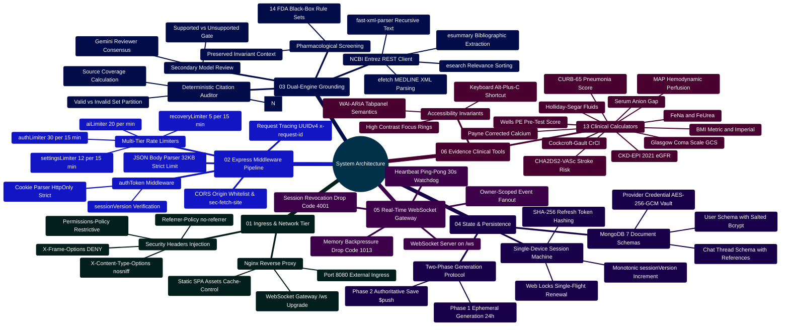
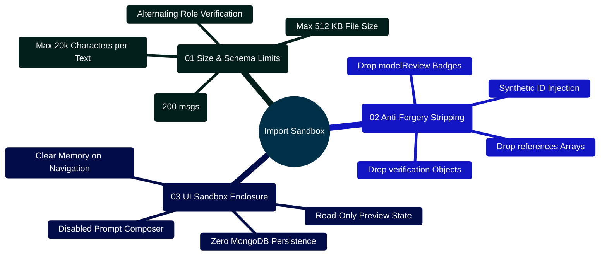

# MedAssist AI — Comprehensive System Architecture & Engineering Deep Dive

Developed by **J Ganesh kumar reddy**  
*Full-Stack Educational Health Assistance, Biomedical Evidence Grounding, & Machine Learning Research Platform*

---

## 1. Architectural Philosophy & Zero-Trust Invariants

MedAssist AI uses a layered web architecture with server-side checks around authentication, model calls, and database access. These controls reduce client authority over medical routing and stored state, but they have not undergone an independent production security review.

```
====================================================================================================
                        MEDASSIST AI — SYSTEM TRUST & BOUNDARY TOPOLOGY
====================================================================================================

      +-------------------------------------------------------------+
      |                 UNTRUSTED PERIMETER (Browser)               |
      | - React 19 Client UI                                        |
      | - In-Memory & sessionStorage State                          |
      | - User Text Input (Untrusted Prompts)                       |
      +-------------------------------------------------------------+
                                     │
                                     │ HTTP (Port 8080), behind external HTTPS ingress
                                     │ WebSocket upgrade (/ws)
                                     ▼
      +-------------------------------------------------------------+
      |                 NETWORK BOUNDARY (Nginx Ingress)            |
      | - TLS termination is outside this Compose deployment       |
      | - Host & Header Rewriting                                   |
      | - HTTP/1.1 WebSocket Upgrade Proxying                       |
      | - Immutable Static Asset Delivery                           |
      +-------------------------------------------------------------+
                                     │
                                     │ Reverse Proxy Pass (Port 5000)
                                     ▼
      +-------------------------------------------------------------+
      |            APPLICATION BOUNDARY (Node.js 24 Express)        |
      | - Request UUID Tracing (x-request-id)                       |
      | - CORS Origin Gate & Strict Non-Safe Method Checks          |
      | - Rate Limiting (Auth: 30/15m, AI: 20/m, Settings: 12/15m)  |
      | - JWT Cookie Verification & Monotonic sessionVersion Audit   |
      | - Deterministic Heuristic Safety Screener (safetyService.js)|
      | - Ephemeral Two-Phase Generation Coordinator                |
      +-------------------------------------------------------------+
                   │                                │
      Internal     │                                │ Outbound HTTPS (TLS 1.3)
      Mongoose     │                                │ Ephemeral REST E-Utilities / API
                   ▼                                ▼
      +-------------------------+      +----------------------------+
      |    PERSISTENCE LAYER    |      |    UPSTREAM INTEGRATIONS   |
      |  MongoDB 7 Jammy        |      | - NCBI Entrez E-Utilities  |
      |  (Authenticated User,   |      | - Google Gemini 2.5 Flash  |
      |   Chats, Generations,   |      | - Groq / Together AI Cloud |
      |   AES-256-GCM Vault)    |      | - Brevo Transactional Email|
      +-------------------------+      +----------------------------+
```

### Core Architectural Invariants:
1. **Zero Client Authority**: The client never dictates database persistence directly, cannot bypass medical routing, cannot alter generation parameters, and never accesses server API keys (`GEMINI_API_KEY`, `BREVO_API_KEY`, `NCBI_API_KEY`, `USER_API_KEY_ENCRYPTION_KEY`).
2. **Authoritative Two-Phase Persistence**: Generation is decoupled from database storage. Answers are generated into an ephemeral `Generation` document (24-hour TTL) and committed only when explicitly confirmed via `/api/save`.
3. **Single Active Device Session**: User accounts enforce a single concurrent device session. Every successful authentication increments a monotonic `sessionVersion` counter, instantly invalidating previous access tokens and terminating live WebSockets across earlier devices.
4. **Rotating Refresh Tokens with Replay Detection**: Cryptographic SHA-256 token hashing with single-use rotation. If a previously consumed refresh token is presented, all active sessions for that account are revoked immediately.
5. **Decoupled Machine Learning Boundary**: The operational web stack never imports heavy ML frameworks (PyTorch, Transformers, PEFT). Dataset preparation, multi-answer quarantine, and LoRA configuration verification run as isolated, review-gated offline scripts.

---

## 2. Colorful System Capabilities & Subsystem Mindmap



---

## 3. Network & Transport Layer Architecture

### 3.1 Reverse Proxy & Traffic Routing (`frontend/nginx.conf`)

In containerized production environments, Nginx acts as the single public gateway on port `8080`:

```
                                  Client HTTP/HTTPS Ingress
                                             │
                        ┌────────────────────┴────────────────────┐
                        ▼                                         ▼
            Static SPA Assets & Files                     API & WebSocket Traffic
             (/, /index.html, /assets/*)                       (/api/*, /ws)
                        │                                         │
                        ▼                                         ▼
                 nginx:alpine Root                      Reverse Proxy Pass
                 (/usr/share/nginx/html)             (http://backend:5000)
```

```nginx
# frontend/nginx.conf implementation
server {
    listen 8080;
    server_name localhost;
    root /usr/share/nginx/html;
    index index.html;

    # Static asset caching with immutable hash markers
    location /assets/ {
        expires 1y;
        add_header Cache-Control "public, max-age=31536000, immutable";
        try_files $uri =404;
    }

    # SPA Client-Side Routing Fallback
    location / {
        try_files $uri $uri/ /index.html;
        add_header Cache-Control "no-cache";
    }

    # REST API Gateway
    location /api/ {
        proxy_pass http://backend:5000/api/;
        proxy_http_version 1.1;
        proxy_set_header Host $host;
        proxy_set_header X-Real-IP $remote_addr;
        proxy_set_header X-Forwarded-For $proxy_add_x_forwarded_for;
        proxy_set_header X-Forwarded-Proto $scheme;
    }

    # WebSocket Gateway with Upgrade Protocol Handshake
    location /ws {
        proxy_pass http://backend:5000/ws;
        proxy_http_version 1.1;
        proxy_set_header Upgrade $http_upgrade;
        proxy_set_header Connection "Upgrade";
        proxy_set_header Host $host;
        proxy_read_timeout 3600s;
        proxy_send_timeout 3600s;
    }
}
```

---

## 4. Backend Runtime & Middleware Execution Lifecycle

Every incoming request into `backend/app.js` executes through an ordered, deterministic pipeline:

```
[Incoming HTTP Request]
         │
         ▼
[Step 1: Header Sanitization] ──► Strip x-powered-by
         │
         ▼
[Step 2: Request Tracing]     ──► Validate or generate UUIDv4 x-request-id
         │                        Inject nosniff, DENY, no-referrer, permissions-policy, no-store
         │
         ▼
[Step 3: CORS Origin Check]   ──► Validate Origin against CLIENT_ORIGIN whitelist
         │                        Reject unauthorized cross-origin requests with 403 ORIGIN_DENIED
         │
         ▼
[Step 4: Body & Cookies]      ──► Enforce 32KB JSON payload limit (express.json)
         │                        Parse HTTP-only cookies (cookieParser)
         │
         ▼
[Step 5: Origin Match Gate]   ──► Non-safe methods (POST, PATCH, DELETE) require exact Origin match
         │                        Block cross-site Fetch Metadata (sec-fetch-site === "cross-site")
         │
         ▼
[Step 6: Route Dispatch]
         ├── /api/health      ──► Return liveness status and version
         ├── /api/ready       ──► Return readiness probe (MongoDB readyState === 1)
         ├── /api/auth/*      ──► Apply authLimiter (30/15m) / recoveryLimiter (5/15m)
         ├── /api/settings/*  ──► Apply authToken + settingsLimiter (12/15m per user)
         ├── /api/ai/*        ──► Apply authToken + aiLimiter (20/min per user)
         ├── /api/medical/*   ──► Apply authToken + aiLimiter (20/min per user)
         └── /api/* (Chats)   ──► Apply chatController (/save, /history, /chats/:id)
         │
         ▼
[Step 7: Global Error Gate]   ──► Catch entity.too.large (413), syntax errors (400), internal (500)
```

### 4.1 Production Middleware Implementation (`backend/app.js`)

```javascript
// backend/app.js
const express = require("express");
const mongoose = require("mongoose");
const cors = require("cors");
const cookieParser = require("cookie-parser");
const rateLimit = require("express-rate-limit");
const { randomUUID } = require("crypto");
const authenticate = require("./middleware/authToken");
const { version } = require("./package.json");

function createApp({ services = {}, limits = true } = {}) {
  const app = express();
  app.disable("x-powered-by");

  if (process.env.TRUST_PROXY) {
    app.set("trust proxy", process.env.TRUST_PROXY.split(",").map((v) => v.trim()));
  }

  const allowedOrigins = (process.env.CLIENT_ORIGIN || "http://localhost:5173")
    .split(",")
    .map((o) => o.trim())
    .filter(Boolean);

  app.locals.allowedOrigins = allowedOrigins;
  app.locals.services = services;

  app.use((req, res, next) => {
    const supplied = req.get("x-request-id");
    req.requestId = supplied && /^[a-zA-Z0-9-]{8,80}$/.test(supplied) ? supplied : randomUUID();
    res.set({
      "x-request-id": req.requestId,
      "x-content-type-options": "nosniff",
      "x-frame-options": "DENY",
      "referrer-policy": "no-referrer",
      "permissions-policy": "camera=(), microphone=(), geolocation=()",
      "cache-control": "no-store",
    });

    if (process.env.STRUCTURED_LOGS === "true") {
      const start = Date.now();
      res.on("finish", () =>
        console.log(
          JSON.stringify({
            requestId: req.requestId,
            method: req.method,
            route: req.route?.path || req.baseUrl || "unmatched",
            status: res.statusCode,
            durationMs: Date.now() - start,
          })
        )
      );
    }
    next();
  });

  app.use(
    cors({
      origin(origin, callback) {
        callback(
          origin && !allowedOrigins.includes(origin)
            ? Object.assign(new Error("Origin is not allowed."), { status: 403, code: "ORIGIN_DENIED" })
            : null,
          true
        );
      },
      credentials: true,
      methods: ["GET", "POST", "PATCH", "DELETE", "OPTIONS"],
      allowedHeaders: ["Content-Type", "X-Request-Id"],
      exposedHeaders: ["x-request-id", "retry-after"],
    })
  );

  app.use(express.json({ limit: "32kb" }));
  app.use(cookieParser());

  app.use((req, res, next) => {
    if (!["GET", "HEAD", "OPTIONS"].includes(req.method)) {
      const origin = req.get("origin");
      const fetchSite = req.get("sec-fetch-site");
      if ((origin && !allowedOrigins.includes(origin)) || fetchSite === "cross-site") {
        return res.status(403).json({ code: "ORIGIN_DENIED", message: "Origin is not allowed.", requestId: req.requestId });
      }
      if (process.env.NODE_ENV === "production" && req.get("cookie") && !origin) {
        return res.status(403).json({ code: "ORIGIN_REQUIRED", message: "A same-origin request is required.", requestId: req.requestId });
      }
    }
    next();
  });

  // Health and Readiness Endpoints
  app.get("/api/health", (req, res) => res.json({ status: "ok", version }));
  app.get("/api/ready", (req, res) => {
    const ready = mongoose.connection.readyState === 1;
    res.status(ready ? 200 : 503).json({
      status: ready ? "ready" : "unavailable",
      database: ready ? "connected" : "disconnected",
      aiConfigured: require("./services/modelProvider").providerConfigured(),
      emailConfigured: Boolean(process.env.BREVO_API_KEY),
      requestId: req.requestId,
    });
  });

  const pass = (req, res, next) => next();
  const limiter = (limit, windowMs, keyGenerator) =>
    limits
      ? rateLimit({
          limit,
          windowMs,
          ...(keyGenerator ? { keyGenerator } : {}),
          standardHeaders: "draft-7",
          legacyHeaders: false,
          message: { code: "RATE_LIMIT", message: "Too many requests. Please wait and try again." },
        })
      : pass;

  app.locals.authLimiter = limiter(30, 15 * 60000);
  app.locals.recoveryLimiter = limiter(5, 15 * 60000);
  app.use("/api/auth", require("./routes/authRoute"));
  app.use("/api", require("./routes/chatRoute"));

  app.locals.settingsLimiter = limiter(12, 15 * 60000, (req) => req.user.id);
  app.use("/api/settings", authenticate, require("./routes/settingsRoute"));

  const aiLimiter = limiter(20, 60000, (req) => req.user.id);
  app.use("/api/ai", authenticate, aiLimiter, require("./routes/aiRoute"));
  app.use("/api/medical", authenticate, aiLimiter, require("./routes/medicalRoute"));
  app.use("/api/analytics", require("./routes/analyticsRoute"));

  app.use((req, res) => res.status(404).json({ code: "NOT_FOUND", message: "API route not found.", requestId: req.requestId }));
  app.use((error, req, res, next) => {
    if (res.headersSent) return next(error);
    const status = error.type === "entity.too.large" ? 413 : error instanceof SyntaxError && error.status === 400 ? 400 : error.status || 500;
    res.status(status).json({
      code: error.code || (status === 413 ? "BODY_TOO_LARGE" : status === 400 ? "INVALID_INPUT" : "INTERNAL"),
      message: status === 413 ? "Request body is too large." : status < 500 || error.code === "AI_UNAVAILABLE" ? error.message : "Service unavailable. Please try again.",
      requestId: req.requestId,
    });
  });

  return app;
}

module.exports = createApp();
module.exports.createApp = createApp;
```

---

## 5. Single-Device Authentication State Machine

```
+==================================================================================================+
|                        SINGLE-DEVICE SESSION VERSIONING STATE MACHINE                            |
+==================================================================================================+

   +-------------------+
   |  Unauthenticated  |
   +-------------------+
             │
             │ POST /api/auth/register { email, password }
             ▼
   +-------------------+
   |    Registered     |  ──► Email Dispatch via Brevo API (JWT verifyToken, 24h Expiry)
   +-------------------+
             │
             │ GET /api/auth/verify-email?token=...
             ▼
   +-------------------+
   |   EmailVerified   |  ──► User document updated with isVerified: true
   +-------------------+
             │
             │ POST /api/auth/login { email, password }
             ▼
   +-----------------------------------------------------------------------------------------------+
   |                                    ACTIVE DEVICE SESSION                                      |
   |  1. Atomically increment sessionVersion++ in MongoDB                                          |
   |  2. Issue accessToken (15 min, HttpOnly, SameSite=Strict) with { id, version }               |
   |  3. Issue refreshToken (7 days, HttpOnly, SameSite=Strict) with unique JTI                    |
   |  4. Store SHA-256 hash of refreshToken in User document                                       |
   |  5. Terminate all earlier WebSockets for this userId with Code 4001                           |
   +-----------------------------------------------------------------------------------------------+
             │                                               │
             │ 15 Minutes Elapsed                            │ Concurrent Sign-in on Other Device
             ▼                                               ▼
   +-------------------+                           +-----------------------------------------------+
   |   AccessExpired   |                           |                REVOKED SESSION                |
   +-------------------+                           |  - sessionVersion mismatch in authToken.js    |
             │                                     |  - WebSocket watchdog terminates with 4001    |
             │ POST /api/auth/refresh-token        |  - Instant rejection of all protected routes  |
             ▼                                     +-----------------------------------------------+
   +---------------------------------------+                         ▲
   |         TOKEN ROTATION GATE           |                         │
   |  Compare SHA-256(refreshToken) with DB|                         │
   +---------------------------------------+                         │
             │                                                       │
             ├── Valid Match ────────────────────────────────────────┤
             │   - Generate new 15m accessToken                      │
             │   - Generate new 7d refreshToken                      │
             │   - Atomically replace SHA-256 hash in DB             │
             │   - Return to ACTIVE DEVICE SESSION                   │
             │                                                       │
             └── Replay Detected (Old Token Re-presented) ───────────┘
                 - Detected possible token theft!
                 - Revoke sessionVersion++ immediately
                 - Invalidate all tokens for user
```

---

## 6. Two-Phase Idempotent Generation & Persistence Handshake

```

### 6.2 Conversational Relevance Retrieval & Safety Context Filtering (`backend/services/historySearch.js`)

When a user enables `usePastChats` in their settings, MedAssist AI does not dump entire raw conversation histories into LLM context windows. Instead, `backend/services/historySearch.js` performs localized, deterministic token-overlap relevance scoring.

```
====================================================================================================
               CONVERSATIONAL RELEVANCE RETRIEVAL & SAFETY FILTERING
====================================================================================================

   User General Prompt x (Tokenized into Set T(x), stop-words removed)
              │
              ├── 1. Recent Session Turns: Slice last 4 messages from active sessionId
              │      Filter with safeExchange(item): Excludes medical & emergency redirects
              │      Take last 3 valid exchanges
              │
              ├── 2. Past Cross-Session Search (if usePastChats === true):
              │      Fetch up to 24 most recent user chats (last 6 exchanges each)
              │      Filter with safeExchange(item)
              │      Compute Cosine Token Similarity:
              │
              │         Relevance(x, d) = |T(x) ∩ T(d)| / sqrt(|T(x)| * |T(d)|)
              │
              │      Filter score > 0, sort by score DESC, then timestamp DESC
              │      Select Top 2 exchanges, re-sort chronologically by timestamp
              │
              ▼
   [ Bound Context Window: Merged Array of Safe History Exchanges (Max 2000 chars per turn) ]
====================================================================================================
```

#### The `safeExchange` Safety Invariant
```javascript
// Critical Invariant: Medical and emergency redirects must never be reused as prompt context
const safeExchange = (item) =>
  item &&
  !item.isMedical &&
  item.verification?.status !== "safety_redirect" &&
  typeof item.prompt === "string" &&
  typeof item.response === "string";
```

#### Production Implementation Snippet (`backend/services/historySearch.js`)
```javascript
// backend/services/historySearch.js
const Chat = require("../models/chatModel");

const STOP_WORDS = new Set(
  "about after also and are but for from have how that the this what when where which with you your of".split(" ")
);

const tokenize = (value) =>
  new Set(
    (String(value || "").toLowerCase().match(/[a-z][a-z'-]+/g) || [])
      .filter((word) => word.length > 2 && !STOP_WORDS.has(word))
  );

const relevance = (queryTokens, value) => {
  const tokens = tokenize(value);
  if (!queryTokens.size || !tokens.size) return 0;
  return [...queryTokens].filter((word) => tokens.has(word)).length / Math.sqrt(queryTokens.size * tokens.size);
};

const safeExchange = (item) =>
  item &&
  !item.isMedical &&
  item.verification?.status !== "safety_redirect" &&
  typeof item.prompt === "string" &&
  typeof item.response === "string";

const findRelevantHistory = async ({ userId, prompt, sessionId, usePastChats = false }) => {
  const current = sessionId ? await Chat.findOne({ userId, sessionId }, { messages: { $slice: -4 } }).lean() : null;
  const recent = (current?.messages || []).filter(safeExchange).slice(-3);
  let related = [];

  if (usePastChats) {
    const queryTokens = tokenize(prompt);
    if (queryTokens.size) {
      const filter = { userId, ...(sessionId ? { sessionId: { $ne: sessionId } } : {}) };
      const chats = await Chat.find(filter, { messages: { $slice: -6 } }).sort({ updatedAt: -1 }).limit(24).lean();
      related = chats
        .flatMap((chat) =>
          (chat.messages || [])
            .filter(safeExchange)
            .map((item) => ({ item, score: relevance(queryTokens, item.prompt), time: new Date(item.timestamp || chat.updatedAt).getTime() }))
        )
        .filter(({ score }) => score > 0)
        .sort((a, b) => b.score - a.score || b.time - a.time)
        .slice(0, 2)
        .sort((a, b) => a.time - b.time)
        .map(({ item }) => item);
    }
  }

  return [...related, ...recent].flatMap((item) => [
    { role: "user", text: item.prompt.slice(0, 2000) },
    { role: "assistant", text: item.response.slice(0, 2000) },
  ]);
};

module.exports = { findRelevantHistory, relevance, tokenize };
```

---

## 7. Real-Time WebSocket Architecture (`/ws`)

### 7.1 WebSocket Gateway Topology & Backpressure Management

```
                             +-----------------------------------+
                             |       Node.js HTTP Server         |
                             +-----------------------------------+
                                               │
                                               │ HTTP Upgrade Request (GET /ws)
                                               ▼
                             +-----------------------------------+
                             |     WebSocket Upgrade Handler     |
                             |  - Check Origin against Whitelist |
                             |  - Upgrading Counter (<= 50)      |
                             |  - Cookie JWT Authentication      |
                             |  - Max 5 Sockets Per User Limit   |
                             +-----------------------------------+
                                               │
                                 ┌─────────────┴─────────────┐
                                 ▼                           ▼
                     [Active Client ws Socket]   [30s Watchdog Ping Timer]
                     - ws.userId = user._id      - For each socket:
                     - ws.version = version        - Check ws.isAlive
                     - ws.isAlive = true           - User.exists(version)
                                                   - Send ws.ping()
```

```javascript
// backend/services/websocketService.js
const WebSocket = require("ws");
const cookie = require("cookie");
const { authenticate } = require("./sessionService");
const User = require("../models/userModel");

function attachWebSockets(server, app) {
  const wss = new WebSocket.Server({ noServer: true, maxPayload: 1024, perMessageDeflate: false });
  let upgrading = 0;

  server.on("upgrade", async (req, socket, head) => {
    const reject = (status = 401) => {
      if (!socket.destroyed) {
        socket.write("HTTP/1.1 " + status + " Rejected\r\nConnection: close\r\n\r\n");
        socket.destroy();
      }
    };
    if (req.url !== "/ws" || !app.locals.allowedOrigins.includes(req.headers.origin) || upgrading >= 50) return reject(403);
    upgrading++;
    try {
      const { user, expiresAt } = await authenticate(cookie.parse(req.headers.cookie || "").accessToken);
      if ([...wss.clients].filter((client) => client.userId === String(user._id)).length >= 5) return reject(429);

      wss.handleUpgrade(req, socket, head, (ws) => {
        ws.userId = String(user._id);
        ws.version = user.sessionVersion;
        ws.isAlive = true;
        const expiry = setTimeout(() => ws.close(4001, "Session expired"), Math.max(0, expiresAt - Date.now()));
        ws.on("pong", () => { ws.isAlive = true; });
        ws.on("message", () => ws.close(1003, "Client messages are not supported"));
        ws.on("error", () => {});
        ws.on("close", () => clearTimeout(expiry));
        wss.emit("connection", ws, req);
      });
    } catch {
      reject();
    } finally {
      upgrading--;
    }
  });

  // 30-Second Heartbeat Watchdog
  const timer = setInterval(async () => {
    for (const ws of wss.clients) {
      if (!ws.isAlive) { ws.terminate(); continue; }
      try {
        if (!(await User.exists({ _id: ws.userId, sessionVersion: ws.version, isVerified: true }))) {
          ws.close(4001, "Session revoked");
          continue;
        }
        ws.isAlive = false;
        ws.ping();
      } catch {
        ws.close(1011, "Session check unavailable");
      }
    }
  }, 30000);

  // User-Scoped Event Broadcast with Backpressure Drop
  app.locals.broadcastUpdate = async (data, userId) => {
    for (const ws of wss.clients) {
      if (ws.userId !== String(userId) || ws.readyState !== WebSocket.OPEN) continue;
      try {
        if (!(await User.exists({ _id: ws.userId, sessionVersion: ws.version, isVerified: true }))) {
          ws.close(4001, "Session revoked");
          continue;
        }
        if (ws.bufferedAmount > 1024 * 1024) { // 1MB buffer ceiling
          ws.close(1013, "Slow connection");
          continue;
        }
        ws.send(JSON.stringify({ type: "CHAT_UPDATE", data, timestamp: new Date().toISOString() }));
      } catch {
        ws.close(1011, "Update unavailable");
      }
    }
  };

  wss.on("close", () => clearInterval(timer));
  return wss;
}

module.exports = { attachWebSockets };
```

---

## 8. Web Locks API Token Refresh Synchronization (`frontend/src/lib/api.js`)

```
Request A (Fails 401) ──┐
Request B (Fails 401) ──┼──► Acquire Web Lock ("medassist-session-refresh")
Request C (Fails 401) ──┘           │
                                    ├── First Acquirer executes POST /api/auth/refresh-token
                                    ├── Dispatches 'session-renewed' event
                                    └── Waiting Requests resolve lock and replay original requests
```

```javascript
// frontend/src/lib/api.js
export const API_BASE_URL = (import.meta.env.VITE_API_URL || "/api").replace(/\/$/, "");
let refreshPromise;

async function request(path, options) {
  const response = await fetch(API_BASE_URL + path, {
    credentials: "include",
    ...options,
    headers: { ...(options.body ? { "Content-Type": "application/json" } : {}), ...options.headers },
  });
  const data = response.headers.get("content-type")?.includes("application/json") ? await response.json() : null;
  if (!response.ok) {
    const error = new Error(data?.message || `Request failed (${response.status}).`);
    Object.assign(error, {
      status: response.status,
      code: data?.code,
      data,
      requestId: data?.requestId,
      retryAfter: Number(response.headers.get("retry-after")) || 0,
    });
    throw error;
  }
  return data;
}

export async function refreshSession() {
  if (!refreshPromise) {
    const refresh = () => request("/auth/refresh-token", { method: "POST" });
    refreshPromise = (
      navigator.locks ? navigator.locks.request("medassist-session-refresh", refresh) : refresh()
    )
      .then((data) => {
        window.dispatchEvent(new Event("session-renewed"));
        return data;
      })
      .catch((error) => {
        window.dispatchEvent(new Event("session-ended"));
        throw error;
      })
      .finally(() => {
        refreshPromise = null;
      });
  }
  return refreshPromise;
}

export async function apiRequest(path, options = {}) {
  try {
    return await request(path, options);
  } catch (error) {
    if (error.status === 401 && (!path.startsWith("/auth/") || path === "/auth/check")) {
      await refreshSession();
      return request(path, options);
    }
    throw error;
  }
}
```

---

## 9. Standardized Error Code Taxonomy

| Error Code | HTTP Status | Meaning & Cause | System Action | Client Response |
| :--- | :--- | :--- | :--- | :--- |
| `AUTH_REQUIRED` | 401 | Missing `accessToken` cookie on protected route. | Halts request pipeline. | Redirects to `/login`. |
| `ACCESS_EXPIRED` | 401 | 15-minute access token lifespan elapsed. | Triggers single-flight refresh lock. | Replays request post-refresh. |
| `AUTH_REVOKED` | 401 | `sessionVersion` mismatch (user logged in elsewhere). | Terminates session; clears cookies. | Clears cache, redirects to `/login`. |
| `INVALID_INPUT` | 400 | Malformed email, password $< 8$ chars, invalid JSON keys. | Rejects with descriptive validation error. | Displays inline form error notice. |
| `BODY_TOO_LARGE`| 413 | JSON request body exceeded strict 32KB ceiling. | Aborts stream before body parsing finishes. | Notifies user message is too long. |
| `ORIGIN_DENIED` | 403 | Origin header is absent or not in `CLIENT_ORIGIN`. | Rejects request; logs origin violation. | Network error displayed. |
| `RATE_LIMIT` | 429 | Exceeded IP rate limit or per-user operation limit. | Rejects with `retry-after` header. | Displays countdown retry timer. |
| `ID_CONFLICT` | 409 | Reused `exchangeId` with conflicting prompt text. | Prevents state corruption. | Auto-generates fresh exchange UUID. |
| `GENERATION_PENDING` | 409 | Duplicate concurrent submission in Phase 1. | Deduplicates concurrent generation calls. | Waits for existing generation promise. |
| `NOT_FOUND` | 404 | Conversation or ready generation record does not exist. | Returns 404 resource missing error. | Resets active conversation view. |
| `AI_NOT_CONFIGURED` | 503 | Requested AI provider has no API key configured. | Refuses generation; advises configuration. | Prompts user to select provider. |
| `AI_UNAVAILABLE`| 503 | Upstream provider timeout, quota exceeded, or network drop. | Falls back to PubMed `references_only`. | Renders literature source cards only. |
| `INTERNAL` | 500 | Unhandled database error or unexpected crash. | Logs structured JSON error with UUID trace. | Displays generic service unavailable. |

---

## 10. Pharmacological Drug Interaction Detection & Preservation (`interactionService.js`)

MedAssist AI implements deterministic regular expression screening for 14 major FDA black-box warning medication pairs. The critical architectural property of this subsystem is **preserved context invariant**: even if a prompt is flagged as an acute emergency and redirected to 911 guidance, detected drug interactions are attached to `verification.drugInteractions`, ensuring critical pharmacological risk context is never discarded during emergency deflection.

```
====================================================================================================
                        PHARMACOLOGICAL SCREENING & CONTEXT PRESERVATION
====================================================================================================

      Prompt Text x
            │
            ├──► detectDrugInteractions(x) ──► promptInteractions Array (0..N)
            │
            ▼
      screenPrompt(x)
            │
      ┌─────┴────────────────────────────────────────────────────────┐
      ▼                                                              ▼
   Allowed                                                    Emergency / Harm
      │                                                              │
   PubMed Grounding                                           Direct Deflection
   & Multi-Provider                                           (Zero External Calls)
      │                                                              │
      ├── References Fallback                                        ▼
      │   (interactions preserved)                       emergencyText Response
      ▼                                                              │
   Verified Output                                                   ▼
   (interactions preserved)                              verification.drugInteractions
                                                         (Critical Warning Preserved)
====================================================================================================
```

### 10.1 14 FDA Black-Box Interaction Pairs

| Interaction Rule | Drug Class A | Drug Class B | Severity | Primary Risk & Mechanism |
|:---|:---|:---|:---:|:---|
| **Anticoagulant + NSAID / Aspirin** | Warfarin, Eliquis, Xarelto, Plavix, Heparin | Aspirin, Ibuprofen, Naproxen, Diclofenac, Meloxicam | `CRITICAL` | Severe GI bleeding, platelet inhibition, intracranial hemorrhage. |
| **PDE5 Inhibitor + Nitrate** | Sildenafil, Tadalafil, Vardenafil, Avanafil | Nitroglycerin, Isosorbide Mononitrate/Dinitrate | `CRITICAL` | Massive cGMP accumulation causing refractory, fatal hypotension. |
| **Tramadol / Opioids + SSRI / SNRI** | Tramadol, Meperidine, Methadone | Fluoxetine, Sertraline, Paroxetine, Venlafaxine | `HIGH` | Excessive serotonin synaptic accumulation (Serotonin Syndrome). |
| **ACEI / ARB + K-Sparing Diuretic** | Lisinopril, Enalapril, Losartan, Valsartan | Spironolactone, Eplerenone, Potassium supplements | `HIGH` | Additive potassium retention causing fatal hyperkalemic arrhythmias. |
| **Methotrexate + TMP-SMX (Bactrim)** | Methotrexate | Trimethoprim-Sulfamethoxazole (Bactrim, Septra) | `CRITICAL` | Decreased renal tubular excretion causing lethal pancytopenia. |
| **Fluoroquinolone + Corticosteroid** | Ciprofloxacin, Levofloxacin, Moxifloxacin | Prednisone, Dexamethasone, Methylprednisolone | `HIGH` | Synergistic collagen degradation causing Achilles tendon rupture. |
| **Benzodiazepine + Opioid Analgesic** | Alprazolam, Diazepam, Lorazepam, Clonazepam | Oxycodone, Morphine, Fentanyl, Hydrocodone | `CRITICAL` | Profound respiratory depression, coma, fatal overdose (FDA Black Box). |
| **Lithium + NSAID / ACE Inhibitor** | Lithium Carbonate / Citrate | Ibuprofen, Naproxen, Lisinopril, Enalapril | `HIGH` | Decreased renal clearance elevating serum lithium into toxic range. |
| **Statin + Strong CYP3A4 Inhibitor** | Simvastatin, Atorvastatin, Lovastatin | Clarithromycin, Gemfibrozil, Itraconazole | `CRITICAL` | CYP3A4 inhibition elevates statin AUC up to 10x, causing rhabdomyolysis. |
| **Warfarin + Azole Antifungal** | Warfarin | Fluconazole, Voriconazole, Ketoconazole | `CRITICAL` | CYP2C9 inhibition suppresses S-warfarin clearance, spiking INR. |
| **Digoxin + Amiodarone / Verapamil** | Digoxin | Amiodarone, Verapamil | `HIGH` | P-glycoprotein inhibition doubles serum digoxin, causing fatal heart block. |
| **MAOI + SSRI / Sympathomimetic** | Phenelzine, Tranylcypromine, Selegiline | Sertraline, Fluoxetine, Pseudoephedrine | `CRITICAL` | Malignant hypertensive crisis and hyperthermic Serotonin Syndrome. |
| **Allopurinol / Febuxostat + Azathioprine / 6-MP** | Allopurinol, Febuxostat | Azathioprine, 6-Mercaptopurine | `CRITICAL` | Major contraindication: Xanthine oxidase inhibition blocks thiopurine degradation, precipitating severe active metabolite accumulation, life-threatening bone marrow suppression, and profound pancytopenia. |
| **Methotrexate + NSAIDs / High-Dose Aspirin** | Methotrexate (Rheumatrex, Trexall) | Ibuprofen, Naproxen, Ketorolac, Meloxicam, Aspirin | `CRITICAL` | Inhibition of renal prostaglandin synthesis and competitive tubular secretion blockage by NSAIDs markedly reduces renal methotrexate clearance, precipitating life-threatening bone marrow suppression, pancytopenia, and acute kidney injury (FDA Black Box Warning). |

---

## 11. Evidence-Based Clinical Calculators Subsystem (`ClinicalCalculatorsModal.jsx`)

MedAssist AI embeds an evidence-based clinical calculator suite accessible directly within the chat workspace or via the global keyboard shortcut (`Alt+C`).

```
====================================================================================================
                        CLINICAL CALCULATORS SUBSYSTEM ARCHITECTURE
====================================================================================================

   User / Global Shortcut (Alt+C)
                 │
                 ▼
   ┌─────────────────────────────────────────────────────────────────┐
   │ <ClinicalCalculatorsModal isOpen={true} onClose={...} />        │
   │ ├── Focus Lock & Trapping (Escape closes modal)                 │
   │ ├── WAI-ARIA Tab Navigation (ArrowRight / ArrowLeft / Home / End)│
   │ └── Strict Physiological Input Clamping & Unit Converters       │
   └─────────────────────────────────────────────────────────────────┘
                 │
                 ▼
   ┌─────────────────────────────────────────────────────────────────┐
   │ 13 Evidence-Based Clinical Scoring Tools:                       │
   │ ├── 01. Adult BMI (Metric: kg/m², Imperial: lbs/in² * 703)      │
   │ ├── 02. CKD-EPI 2021 Creatinine eGFR (Race-Free ASN-NKF Formula)│
   │ ├── 03. CHA₂DS₂-VASc Score for Atrial Fibrillation Stroke Risk  │
   │ ├── 04. Mean Arterial Pressure (MAP = (2*DBP + SBP) / 3)        │
   │ ├── 05. Cockcroft-Gault Creatinine Clearance (CrCl)             │
   │ ├── 06. Payne Corrected Calcium (Albuminemia Adjustment)        │
   │ ├── 07. Serum Anion Gap (Na - (Cl + HCO3))                      │
   │ ├── 08. Fractional Excretion of Sodium (FeNa Prerenal vs ATN)   │
   │ ├── 09. Fractional Excretion of Urea (FeUrea for Diuretic State)│
   │ ├── 10. Holliday-Segar 4-2-1 Maintenance Fluid Infusion         │
   │ ├── 11. Wells' Criteria for Pulmonary Embolism (Pre-Test Prob)  │
   │ ├── 12. CURB-65 Pneumonia Severity Score (30-Day Mortality)     │
   │ └── 13. Glasgow Coma Scale (GCS Consciousness Assessment)       │
   └─────────────────────────────────────────────────────────────────┘
                 │
                 ▼
   [ "Insert into Chat" Action: Populates Composer with Structured Input & Result ]
====================================================================================================
```

### 11.1 Calculator Specifications, Formulas & Clinical Boundaries

| Tool Name | Input Parameters | Formula / Scoring Logic | Physiological Bounds | Clinical Interpretation |
|:---|:---|:---|:---:|:---|
| **Body Mass Index (BMI)** | Weight (kg or lbs), Height (cm or in) | $\text{BMI} = \frac{\text{kg}}{\text{m}^2}$ or $\frac{\text{lbs}}{\text{in}^2} \times 703$ | Weight: 20–300 kg<br>Height: 50–250 cm | Underweight (<18.5), Normal (18.5–24.9), Overweight (25–29.9), Obese (≥30). |
| **CKD-EPI 2021 eGFR** | Age, Biological Sex, Serum Creatinine (mg/dL) | $142 \times \min(S_{\text{cr}}/\kappa, 1)^\alpha \times \max(S_{\text{cr}}/\kappa, 1)^{-1.200} \times 0.9938^{\text{Age}} \times [1.012 \text{ if Female}]$ | Age: 18–120 yr<br>Creatinine: 0.1–20 mg/dL | G1 (≥90), G2 (60–89), G3a (45–59), G3b (30–44), G4 (15–29), G5 (<15 Kidney Failure). |
| **CHA₂DS₂-VASc** | CHF (1), HTN (1), Age ≥75 (2), Diabetes (1), Stroke/TIA (2), Vascular (1), Age 65–74 (1), Sex Female (1) | Point summation (Range: 0–9) | Binary toggles (0 or 1) | Score 0 (Men) / 1 (Women): Low risk.<br>Score ≥2 (Men) / ≥3 (Women): Oral anticoagulation recommended. |
| **Mean Arterial Pressure (MAP)** | Systolic BP (mmHg), Diastolic BP (mmHg) | $\text{MAP} = \text{DBP} + \frac{1}{3}(\text{SBP} - \text{DBP}) = \frac{2 \times \text{DBP} + \text{SBP}}{3}$ | SBP: 50–260 mmHg<br>DBP: 30–150 mmHg | Normal: 70–100 mmHg.<br><65 mmHg: Inadequate organ perfusion / septic shock indicator. |
| **Cockcroft-Gault CrCl** | Age, Biological Sex, Weight (kg), Serum Creatinine (mg/dL) | $\text{CrCl} = \frac{(140 - \text{Age}) \times \text{Weight}}{72 \times S_{\text{cr}}} \times [0.85 \text{ if Female}]$ | Age: 18–120 yr<br>Weight: 30–250 kg<br>Cr: 0.2–15 mg/dL | Used for pharmacological renal dose adjustments (DOACs, antimicrobials). |
| **Payne Corrected Calcium** | Measured Total Calcium (mg/dL), Serum Albumin (g/dL) | $\text{Corrected Ca} = \text{Measured Ca} + 0.8 \times (4.0 - \text{Albumin})$ | Total Ca: 4–18 mg/dL<br>Albumin: 1–6 g/dL | Adjusts for hypoalbuminemia. Normal range: 8.5–10.2 mg/dL. |
| **Serum Anion Gap** | Sodium (mEq/L), Chloride (mEq/L), Bicarbonate (mEq/L) | $\text{AG} = \text{Na}^+ - (\text{Cl}^- + \text{HCO}_3^-)$ | Na: 100–180 mEq/L<br>Cl: 60–140 mEq/L<br>HCO3: 2–50 mEq/L | Normal: 8–12 mEq/L.<br>>12 mEq/L: High Anion Gap Metabolic Acidosis (MUDPILES / GOLDMARK). |
| **Fractional Excretion of Sodium (FeNa)** | Serum Na, Urine Na, Serum Cr, Urine Cr | $\text{FeNa} = \frac{U_{\text{Na}} \times S_{\text{cr}}}{S_{\text{Na}} \times U_{\text{cr}}} \times 100\%$ | Creatinine: 0.1–20 mg/dL<br>Sodium: 5–200 mEq/L | <1%: Prerenal azotemia.<br>>2%: Acute Tubular Necrosis (ATN). (Invalid if diuretics active). |
| **Fractional Excretion of Urea (FeUrea)** | Serum BUN, Urine Urea, Serum Cr, Urine Cr | $\text{FeUrea} = \frac{U_{\text{Urea}} \times S_{\text{cr}}}{S_{\text{BUN}} \times U_{\text{cr}}} \times 100\%$ | BUN: 2–150 mg/dL<br>Urea: 50–2500 mg/dL | <35%: Prerenal azotemia in patients taking loop or thiazide diuretics.<br>>50%: Intrinsic renal failure. |
| **Maintenance Fluids (4-2-1)** | Body Weight (kg) | $4 \text{ mL/kg/hr for first 10 kg} + 2 \text{ mL/kg/hr for 11–20 kg} + 1 \text{ mL/kg/hr for each kg > 20 kg}$ | Weight: 1–150 kg | Pediatric and adult basal hydration rate calculation. |
| **Wells' Criteria for PE** | DVT signs (3), Alternative less likely (3), HR >100 (1.5), Immobilization/Surgery (1.5), Prior DVT/PE (1.5), Hemoptysis (1), Malignancy (1) | Point summation (Range: 0–12.5) | Binary toggles | ≤4.0: PE Unlikely (Proceed to D-dimer).<br>>4.0: PE Likely (Proceed directly to CT Pulmonary Angiography). |
| **CURB-65 Pneumonia Score** | Confusion (+1), Urea >19 mg/dL (+1), RR ≥30 (+1), Low BP SBP <90 or DBP ≤60 (+1), Age ≥65 (+1) | Point summation (Range: 0–5) | Binary toggles | 0–1: Low risk (<3% mortality, outpatient management).<br>2: Intermediate risk (~9% mortality, short inpatient admission).<br>3–5: High / severe risk (15–40% mortality, urgent admission/ICU). |
| **Glasgow Coma Scale (GCS)** | Eye Opening $E$ (1–4), Verbal Response $V$ (1–5), Motor Response $M$ (1–6) | $\text{GCS} = E + V + M$ (Range: 3–15) | $E \in [1,4], V \in [1,5], M \in [1,6]$ | 13–15: Mild brain injury / Alert.<br>9–12: Moderate brain injury.<br>3–8: Severe brain injury / Coma (critical loss of airway protection reflexes). |

### 11.2 Production Implementation Snippet (`frontend/src/components/tools/ClinicalCalculatorsModal.jsx`)

```jsx
// frontend/src/components/tools/ClinicalCalculatorsModal.jsx
export function calculateCKDEPI({ age, sex, creatinine }) {
  const scr = parseFloat(creatinine);
  const a = parseInt(age, 10);
  if (!scr || !a || scr <= 0 || a <= 0) return null;

  const isFemale = sex === "female";
  const kappa = isFemale ? 0.7 : 0.9;
  const alpha = isFemale ? -0.241 : -0.302;
  const genderMultiplier = isFemale ? 1.012 : 1.0;

  const scrOverKappa = scr / kappa;
  const minTerm = Math.min(scrOverKappa, 1) ** alpha;
  const maxTerm = Math.max(scrOverKappa, 1) ** -1.200;
  const ageTerm = 0.9938 ** a;

  const egfr = Math.round(142 * minTerm * maxTerm * ageTerm * genderMultiplier);
  let stage = "";
  if (egfr >= 90) stage = "G1 (Normal or high kidney function)";
  else if (egfr >= 60) stage = "G2 (Mildly decreased)";
  else if (egfr >= 45) stage = "G3a (Mildly to moderately decreased)";
  else if (egfr >= 30) stage = "G3b (Moderately to severely decreased)";
  else if (egfr >= 15) stage = "G4 (Severely decreased)";
  else stage = "G5 (Kidney failure)";

  return { egfr, stage };
}
```

### 11.3 Glasgow Coma Scale (GCS) Implementation & ARIA Trapping

```jsx
// frontend/src/components/tools/ClinicalCalculatorsModal.jsx
// GCS Scoring Logic & Stratification
const gcsEyeScore = parseInt(gcsEye, 10) || 4;
const gcsVerbalScore = parseInt(gcsVerbal, 10) || 5;
const gcsMotorScore = parseInt(gcsMotor, 10) || 6;
const gcsScore = gcsEyeScore + gcsVerbalScore + gcsMotorScore;

let gcsStratification = "Mild brain injury / Alert (13–15)";
if (gcsScore <= 8) {
  gcsStratification = "Severe brain injury / Coma (3–8)";
} else if (gcsScore <= 12) {
  gcsStratification = "Moderate brain injury (9–12)";
}

// WAI-ARIA Focus Management & Keyboard Trap
useEffect(() => {
  if (!isOpen) return;
  const previousFocus = document.activeElement;
  closeButtonRef.current?.focus();
  const handleKeyDown = (e) => {
    if (e.key === "Escape") { e.preventDefault(); onCloseRef.current(); return; }
    const tabList = ["bmi", "egfr", "chads", "map", "crcl", "calcium", "aniongap", "fena", "feurea", "fluids", "wells", "curb65", "gcs"];
    const activeEl = document.activeElement;
    if (activeEl && activeEl.getAttribute("role") === "tab") {
      const curTabId = activeEl.id.replace(/^tab-/, "");
      const curIndex = tabList.indexOf(curTabId);
      if (curIndex !== -1) {
        let nextIndex = -1;
        if (e.key === "ArrowRight" || e.key === "ArrowDown") nextIndex = (curIndex + 1) % tabList.length;
        else if (e.key === "ArrowLeft" || e.key === "ArrowUp") nextIndex = (curIndex - 1 + tabList.length) % tabList.length;
        else if (e.key === "Home") nextIndex = 0;
        else if (e.key === "End") nextIndex = tabList.length - 1;
        if (nextIndex !== -1) {
          e.preventDefault();
          const nextTab = tabList[nextIndex];
          setActiveTab(nextTab);
          document.getElementById("tab-" + nextTab)?.focus();
        }
      }
    }
  };
  window.addEventListener("keydown", handleKeyDown);
  return () => { window.removeEventListener("keydown", handleKeyDown); previousFocus?.focus(); };
}, [isOpen]);
```


---

## 12. Client-Side Untrusted JSON Conversation Import Sandbox Architecture

MedAssist AI implements a client-side sandboxed conversation import preview workflow (`frontend/src/lib/conversationImport.js`) designed to protect users against anti-forgery attacks, spoofed verification badges, forged PubMed citations, and prompt injection into subsequent LLM conversational context windows.

```
========================================================================================================================
                          UNTRUSTED CONVERSATION JSON IMPORT: SECURITY & DATA FLOW
========================================================================================================================

    [ External Untrusted .json File ] (Drag & Drop or File Input Picker)
                   │
                   ▼
    ┌─────────────────────────────────────────────────────────────────┐
    │ 1. BOUNDARY VALIDATION (< 512 KB)                               │
    │ - File size checked in browser before JSON deserialization       │
    │ - file.size <= MAX_IMPORT_BYTES (512 * 1024 = 524,288 bytes)    │
    │ - Immediate rejection if file size exceeds threshold            │
    └─────────────────────────────────────────────────────────────────┘
                   │
                   ▼
    ┌─────────────────────────────────────────────────────────────────┐
    │ 2. SCHEMA & TURN INTEGRITY CHECKS                               │
    │ - JSON.parse() executed within sandboxed browser memory         │
    │ - Root object must contain a non-empty `messages` array         │
    │ - Max 100 complete Q&A pairs (200 messages total)               │
    │ - Max 20,000 characters per message text                        │
    │ - Alternating order: User (isUser: true) -> AI (isUser: false)  │
    └─────────────────────────────────────────────────────────────────┘
                   │
                   ▼
    ┌─────────────────────────────────────────────────────────────────┐
    │ 3. ANTI-FORGERY METADATA STRIPPING                              │
    │ - Strip all client-supplied `verification` badges               │
    │ - Strip all client-supplied `modelReview` badges                │
    │ - Strip all client-supplied `references` (PubMed citations)    │
    │ - Discard any remote `sessionId` or user-defined message IDs    │
    │ - Assign synthetic ephemeral client IDs: `import-${index}`      │
    └─────────────────────────────────────────────────────────────────┘
                   │
                   ▼
    ┌─────────────────────────────────────────────────────────────────┐
    │ 4. SANDBOXED READ-ONLY PREVIEW STATE                            │
    │ - Appends "(Imported conversation preview)" banner              │
    │ - Labels AI turns as "Imported answer · unverified"             │
    │ - Sets `importPreview = true` in active chat state              │
    │ - Disables composer submission (prevents context injection)     │
    │ - Zero persistence: No writes to backend or MongoDB database    │
    └─────────────────────────────────────────────────────────────────┘
========================================================================================================================
```



### 12.1 Security & Sanitization Implementation (`frontend/src/lib/conversationImport.js`)

```javascript
// Excerpt from frontend/src/lib/conversationImport.js
export const MAX_IMPORT_BYTES = 512 * 1024;
export const MAX_IMPORT_MESSAGES = 200;
export const MAX_MESSAGE_TEXT_LENGTH = 20000;

export function parseConversationImportJson(rawJson) {
  if (typeof rawJson !== "string" || !rawJson.trim()) {
    throw new Error("Choose a valid JSON file to import.");
  }
  let parsed;
  try {
    parsed = JSON.parse(rawJson);
  } catch {
    throw new Error("The selected file is not valid JSON.");
  }
  if (!parsed || typeof parsed !== "object" || Array.isArray(parsed)) {
    throw new Error("The imported file does not match the expected conversation format.");
  }
  if (!Array.isArray(parsed.messages) || parsed.messages.length === 0) {
    throw new Error("The imported conversation does not contain any messages.");
  }
  if (parsed.messages.length > MAX_IMPORT_MESSAGES) {
    throw new Error("The imported conversation exceeds the 100 question-and-answer pair limit.");
  }

  const sanitizedMessages = [];
  let expectedIsUser = true;

  for (let i = 0; i < parsed.messages.length; i += 1) {
    const item = parsed.messages[i];
    if (!item || typeof item !== "object" || Array.isArray(item)) {
      throw new Error(`Message ${i + 1} is not a valid message object.`);
    }
    const isUser = Boolean(item.isUser);
    if (isUser !== expectedIsUser) {
      throw new Error(`Message ${i + 1} does not follow the expected alternating user and assistant order.`);
    }
    const text = typeof item.text === "string" ? item.text.trim() : "";
    if (!text) {
      throw new Error(`Message ${i + 1} does not have any text content.`);
    }
    if (text.length > MAX_MESSAGE_TEXT_LENGTH) {
      throw new Error(`Message ${i + 1} exceeds the character limit.`);
    }

    sanitizedMessages.push({
      id: `import-${i + 1}`,
      text,
      isUser,
      createdAt: typeof item.createdAt === "string" && !Number.isNaN(Date.parse(item.createdAt))
        ? item.createdAt
        : new Date(0).toISOString(),
    });
    expectedIsUser = !expectedIsUser;
  }

  const rawTitle = typeof parsed.title === "string" ? parsed.title.trim() : "";
  const baseTitle = rawTitle ? rawTitle.slice(0, 100) : "Imported conversation";

  return {
    title: `${baseTitle} (preview)`,
    messages: sanitizedMessages,
    importPreview: true,
  };
}
```

### 12.2 Import Sandbox Security Invariants

1. **Client-Side RAM Isolation**: Imported conversations are never dispatched to `/api/chat`, `/api/generate`, or `/api/save`. Deserialized objects reside strictly within React component state and are wiped upon navigating to another conversation or reloading the browser.
2. **Anti-Spoofing Strip**: A malicious user or external agent cannot craft a JSON file containing fraudulent `verification` tags (e.g. claiming a dangerous assertion was verified by NCBI PubMed or secondary Gemini review). All evidence and verification metadata are unconditionally dropped during parsing.
3. **Prompt Injection Prevention**: Because `importPreview` locks the input composer, untrusted text inside an imported transcript can never be forwarded to downstream LLM generation passes as conversational history context.
