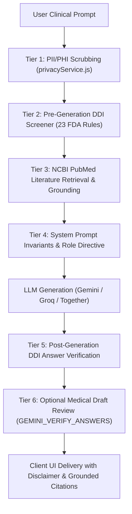

# Biomedical AI Safety Architecture and Guardrails

Generative AI in clinical education presents distinct safety hazards: hallucinations of nonexistent clinical trials, invented drug dosages, and failure to recognize contraindications. MedAssist AI implements a multi-tier defense-in-depth architecture combining deterministic rule engines, external literature retrieval, and strict boundary prompts.

---

## 1. Safety Defense-in-Depth Topology

---

## 2. Tier 1: Input Privacy & PHI Scrubbing

Before any clinical text is forwarded to external LLM providers (Google Gemini, Groq, Together AI), `backend/services/privacyService.js` scans and de-identifies sensitive identifiers:
- Social Security Numbers (`\b\d{3}-\d{2}-\d{4}\b`)
- Phone Numbers and Contact Digits
- Email Addresses
- National Medical Record Identifiers (MRNs)

Matched tokens are redacted to placeholder markers (`[REDACTED_SSN]`, `[REDACTED_EMAIL]`) to uphold HIPAA Safe Harbor de-identification principles.

---

## 3. Tier 2 & 5: Deterministic Drug-Drug Interaction Safety

Stochastic language models cannot guarantee detection of life-threatening drug contraindications. MedAssist AI separates pharmacological safety from language generation:
- **Pre-Generation Screening:** If the user mentions interacting drugs (e.g. Warfarin + Bactrim), the screener immediately emits a high-priority caution banner preceding the AI answer.
- **Post-Generation Screening:** If the generated text suggests an interacting co-prescription, the engine flags the response before rendering.
- **Word Boundary Regex:** All 23 rules utilize word boundaries (`\b...\b/i`) to ensure 0% false positive cross-talk.

---

## 4. Tier 3: NCBI PubMed Retrieval Grounding

Rather than relying purely on parametric memory, MedAssist AI connects directly to the National Center for Biotechnology Information (NCBI) E-Utilities API (`backend/services/citationService.js`):
1. **Literature Fetching:** Searches PubMed using MeSH-aligned keywords derived from the user query.
2. **Abstract Assembly:** Retrieves authoritative title, author, publication date, and abstract text.
3. **Citation Formatting:** Attaches valid PubMed Identifiers (PMIDs) and verified HTTPS URLs (`https://pubmed.ncbi.nlm.nih.gov/<PMID>/`).

---

## 5. Tier 4: System Prompt Directives & Emergency Intercepts

`backend/services/answerService.js` enforces rigid non-negotiable prompt boundaries:
- **Role:** Medical education and biomedical research assistant only.
- **No Direct Prescriptions:** Prohibited from writing specific individual medication dosing schedules or diagnosing named patients.
- **Emergency Intercept:** If a prompt suggests acute life-threatening symptoms (chest pain, stroke symptoms, suicidal ideation), the system immediately prioritizes an emergency action directive instructing the user to contact local emergency services (e.g., 911/112/999).

---

**Evidence:** `backend/services/answerService.js`, `backend/services/interactionService.js`, `backend/services/privacyService.js`, `backend/services/citationService.js`.
