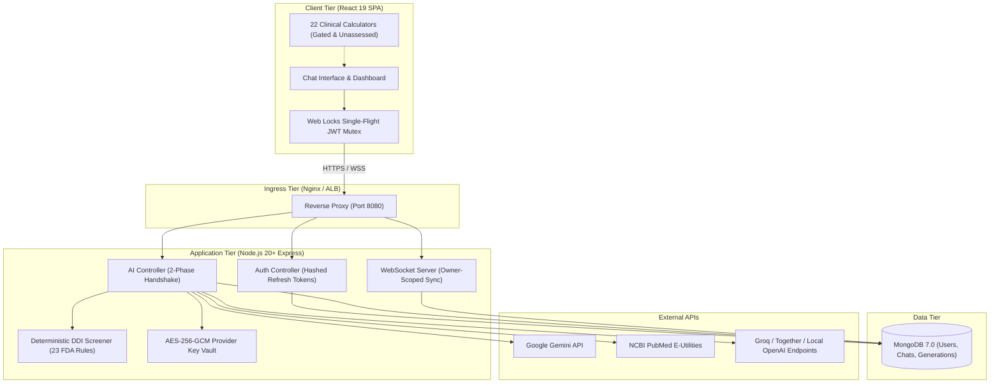

# MedAssist AI Technical Documentation

MedAssist AI is an educational clinical assistant and biomedical AI research platform. It integrates Google Gemini, Groq, Together AI, and local inference models with real-time NCBI PubMed literature grounding. The platform features 22 client-side clinical risk calculators, deterministic 23-rule FDA Black Box drug interaction screening, and AES-256-GCM encrypted provider credential vaults.

---

## 1. Quick Navigation by Persona

| Persona | "I want to..." | Recommended Starting Point |
|:---|:---|:---|
| **New Developer** | Set up the project locally and run my first query | [Getting Started & Local Setup](../README.md#getting-started) / [Production Build Guide](PRODUCTION_DEVELOPER_BUILD_GUIDE.md) |
| **Full-Stack Contributor** | Understand architecture, conventions, and add a feature | [Contributing Guide](../CONTRIBUTING.md) / [Developer Onboarding](DEVELOPER_EXTENSION_AND_ONBOARDING_GUIDE.md) |
| **AI Coding Agent** | Understand invariants, entry points, and test commands | [Agent Instructions](../AGENTS.md) / [Machine-Readable Index](../llms.txt) |
| **API Consumer** | Authenticate and interact with backend REST/WS APIs | [System Architecture Deep Dive](SYSTEM_ARCHITECTURE_DEEP_DIVE.md) / [Backend Routes](../backend/routes/README.md) |
| **On-Call Operator / SRE** | Triage an active alert, diagnose errors, or failover models | [Operational Runbooks Directory](runbooks/index.md) / [Deployment Runbook](DEPLOYMENT_RUNBOOK.md) |
| **Security Reviewer** | Inspect trust boundaries, STRIDE models, and OWASP defenses | [System STRIDE Model](records/threat-models/system.md) / [OWASP Top 10 for LLMs](records/threat-models/ai.md) |
| **AI Auditor / ML Eng** | Review model cards, datasets, and LoRA training pipeline | [Multi-Provider System Card](records/model-cards/system-card.md) / [LoRA Guide](AI_FINE_TUNING_AND_LORA_GUIDE.md) |
| **Clinical Reviewer** | Inspect calculator formulas and DDI screening rules | [Clinical Calculators](../frontend/src/components/tools/README.md) / [DDI Screener ADR](records/decisions/0002-implement-deterministic-regex-drug-interaction-screener.md) |

---

## 2. High-Level Architecture

---

## 3. How These Docs Are Organised

This repository organizes documentation following the **Diátaxis** framework:
- **Tutorials**: Action-oriented learning for newcomers to acquire basic proficiency.
- **How-To Guides**: Practical, goal-oriented recipes solving specific real-world tasks.
- **Reference**: Information-oriented, structured representations of reality (API contracts, config variables, calculation math).
- **Explanation**: Understanding-oriented discussions exploring concepts, architectural decisions, and trade-offs.
- **Records & Runbooks**: Living engineering artifacts (MADR decision records, threat models, system cards, and operational runbooks).

---

## 4. Documentation Directory & Quadrants

### Quadrant I: Tutorials & How-To Guides
- [Tutorial: Getting Started](tutorials/getting-started.md): Verified 15-minute developer onboarding guide with executable test commands.
- [DEVELOPER_EXTENSION_AND_ONBOARDING_GUIDE.md](DEVELOPER_EXTENSION_AND_ONBOARDING_GUIDE.md): Practical steps for adding clinical tools, DDI rules, and tests.
- [PRODUCTION_DEVELOPER_BUILD_GUIDE.md](PRODUCTION_DEVELOPER_BUILD_GUIDE.md): Step-by-step local build, Docker orchestration, and troubleshooting recipes.
- [AI_FINE_TUNING_AND_LORA_GUIDE.md](AI_FINE_TUNING_AND_LORA_GUIDE.md): Hands-on training recipes for fine-tuning MedQuAD/PubMedQA LoRA adapters.
- [../CONTRIBUTING.md](../CONTRIBUTING.md): Branching, PR guidelines, linting, and testing workflows.

### Quadrant II: Reference
- [Configuration Reference](reference/configuration.md): Exhaustive environment variable reference covering all 34 configuration keys.
- [Database Architecture & MongoDB Schemas](reference/database.md): Entity relationship model, collection schemas, indexes, and BSON size limits.
- [Biomedical RAG Pipeline Reference](reference/ai/rag-pipeline.md): End-to-end specification of PubMed literature retrieval, relevance ranking, and citation grounding.
- [Clinical Prompt Registry & Directives](reference/ai/prompts.md): System prompt directives, audience profile adaptations, and emergency intercepts.
- [Service Level Objectives (SLOs) & Error Budgets](reference/slo.md): Availability indicators, p95 latency targets, and budget depletion policies.
- [CURRENT_IMPLEMENTATION.md](CURRENT_IMPLEMENTATION.md): Detailed inventory of all components, state machines, and API endpoints.
- [COMPLETE_FILE_DIRECTORY_REFERENCE.md](COMPLETE_FILE_DIRECTORY_REFERENCE.md): File-by-file catalog of every module across the codebase.
- [SECURITY_AND_MESSAGE_POLICY.md](SECURITY_AND_MESSAGE_POLICY.md): Comprehensive security policies, token lifecycles, and cryptographic standards.
- [../frontend/src/components/tools/README.md](../frontend/src/components/tools/README.md): Reference equations and risk tiers for all 22 clinical tools.
- [../backend/services/README.md](../backend/services/README.md): Service layer contracts (DDI screener, citation parser, privacy scrubber).
- [_meta/coverage-matrix.md](_meta/coverage-matrix.md): Exhaustive coverage matrix of HTTP endpoints, env variables, calculators, and DDI rules.

### Quadrant III: Explanation & Architecture
- [Trust Boundaries & Network Isolation](explanation/security/trust-boundaries.md): Deep dive into the 4 security trust boundaries, CORS, cookie flags, and AES vaults.
- [SYSTEM_ARCHITECTURE_DEEP_DIVE.md](SYSTEM_ARCHITECTURE_DEEP_DIVE.md): Full-stack architectural breakdown, trust boundaries, and network flows.
- [DEEP_DIVE_AI_WORKING_PRINCIPLES.md](DEEP_DIVE_AI_WORKING_PRINCIPLES.md): Mathematical principles of biomedical RAG, literature weighting, and citation validation.
- [DEEP_DIVE_LORA_AND_FINE_TUNING.md](DEEP_DIVE_LORA_AND_FINE_TUNING.md): Mathematical foundations of Low-Rank Adaptation (LoRA) and PEFT backpropagation.
- [COMPREHENSIVE_CODEBASE_ANALYSIS.md](COMPREHENSIVE_CODEBASE_ANALYSIS.md): Staff engineer architectural critique and design evaluation.
- [ISSUES_AND_RISKS.md](ISSUES_AND_RISKS.md): Risk register, STRIDE analysis, and SSRF defensive boundaries.

### Quadrant IV: Living Engineering Records
- **Architectural Decision Records (ADRs)**:
  - [ADR 0000: Use Markdown ADRs](records/decisions/0000-use-markdown-architectural-decision-records.md)
  - [ADR 0001: In-Memory MongoDB for Isolated Testing](records/decisions/0001-use-in-memory-mongodb-for-isolated-backend-testing.md)
  - [ADR 0002: Deterministic Regex Drug Interaction Screener](records/decisions/0002-implement-deterministic-regex-drug-interaction-screener.md)
  - [ADR 0003: Web Locks Mutex for Single-Flight JWT Renewal](records/decisions/0003-use-web-locks-mutex-for-single-flight-jwt-renewal.md)
  - [ADR 0004: Two-Phase Chat Generation & Persistence Handshake](records/decisions/0004-two-phase-chat-generation-and-persistence-handshake.md)
  - [ADR 0005: Unassessed Defaults & Complete Record Gating](records/decisions/0005-unassessed-defaults-and-complete-record-gating-for-clinical-calculators.md)
- **Threat Models**:
  - [System STRIDE Threat Model](records/threat-models/system.md)
  - [OWASP Top 10 for LLM Applications (2025)](records/threat-models/ai.md)
- **Model Cards & Evaluation**:
  - [Multi-Provider System Card](records/model-cards/system-card.md)
  - [Dataset Card](../Model%20and%20Dataset/DATASET_CARD.md)
  - [Dataset Audit Report](../Model%20and%20Dataset/reports/dataset_audit.md)
  - [Master Verification Log](_meta/verification-log.md)
  - [Master Acceptance Report](_meta/acceptance-report.md)

### Quadrant V: Operational Incident Runbooks
- [Operational Runbooks Directory](runbooks/index.md): Incident severity triage matrix (SEV-1 to SEV-4).
- [High API Error Rate Runbook](runbooks/api-error-rate-high.md): Troubleshooting 5xx spikes on API routes.
- [Database Connection Saturation Runbook](runbooks/db-connection-saturation.md): Resolving MongoDB connection pool exhaustion or failovers.
- [LLM Provider Outage or Rate Limit Runbook](runbooks/llm-provider-outage-or-rate-limit.md): Handling HTTP 429/503 errors and multi-provider failover.
- [Drug Interaction Screener Alert Runbook](runbooks/drug-interaction-screener-alert.md): Handling false positive disputes and maintaining the 23 FDA rules.
- [DEPLOYMENT_RUNBOOK.md](DEPLOYMENT_RUNBOOK.md): Docker Compose orchestration and production infrastructure runbook.

---

**Evidence:** `docs/_meta/audit-report.md`, `docs/_meta/system-profile.md`, `docs/_meta/baseline-manifest.txt`, `scripts/docs/check-no-deletions.cjs`.
