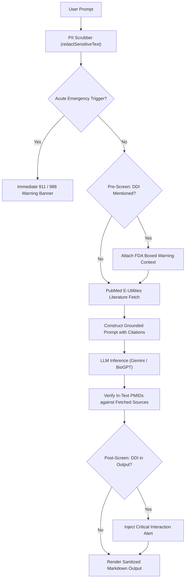

# MedAssist Multi-Provider System Card

**Status:** Stable  
**Date:** 2026-11-08  
**Audience:** AI Auditors, Clinical Safety Officers, ML Engineers, Regulators  
**Technical Quadrant:** Record  

---

## 1. System Details

- **System Name:** MedAssist Clinical Intelligence Platform
- **Release Version:** 1.0.0
- **Primary Foundation Models:** Google Gemini (`gemini-1.5-flash`, `gemini-1.5-pro`), Hugging Face Medical Endpoints
- **Domain Adaptation:** Parameter-Efficient Fine-Tuning (PEFT) via LoRA (Low-Rank Adaptation) on clinical Q&A corpora
- **Retrieval Engine:** NCBI PubMed E-Utilities REST API (PMID retrieval and metadata parsing)
- **Clinical Safety Screener:** 23 FDA Boxed Warning / Contraindication Regex Rules (`backend/services/interactionService.js`)
- **Clinical Calculation Engine:** 22 Client-Side Interactive Clinical Risk Calculators (`frontend/src/components/tools/ClinicalCalculatorsModal.jsx`)
- **Hosting / Runtime:** Node.js 20+ Express backend, React 19 / Vite 6 frontend, MongoDB 7.0 database

---

## 2. Intended Use and Operating Parameters

### Intended Use
- **Clinical Education & Reference:** Providing evidence-grounded medical explanations, disease pathology overviews, and pharmacology summaries for healthcare trainees, physicians, and health-literate consumers.
- **Provider-Patient Communication Preparation:** Formulating structured questions and context to empower patients when consulting licensed clinicians.
- **Interactive Educational Calculation:** Computing clinical point bands and qualitative risk categories across 22 validated clinical scoring algorithms with complete record validation.

### Prohibited / Non-Intended Use (Contraindications)
- **Autonomous Diagnosis:** MedAssist must NOT be used as a standalone diagnostic device or decision maker.
- **Autonomous Prescription / Dosing:** MedAssist must NOT prescribe medications, calculate individual drug dosages, or alter existing clinical regimens.
- **Acute Emergency Triage:** MedAssist is NOT designed for active emergency room triage. Life-threatening symptoms (chest pain, acute neurologic deficit, anaphylaxis, active self-harm) are intercepted with mandatory emergency service callouts (911/988).

---

## 3. Clinical Safety Controls & Architecture

### Safety Control Inventory
1. **Emergency Interception:** Pattern matching on acute suicidal ideation, myocardial infarction, stroke symptoms, and severe anaphylaxis returns immediate emergency crisis helpline directives.
2. **Deterministic Drug Interaction Screener:** 23 hardcoded FDA Black Box warning and contraindication pairs run deterministically on pre-generation inputs and post-generation outputs.
3. **Citation Verification Pipeline:** Ensures references cite authentic PubMed literature records retrieved in real-time.
4. **Clinical Calculator Gating:** All 22 clinical calculators initialize with unassessed values (`""`), require 100% component completion, and present educational point ranges rather than misleading individual survival percentages.

---

## 4. Verification & Validation Metrics

The MedAssist system undergoes continuous automated multi-tier verification before any deployment:

| Verification Stage | Suite / Harness | Automated Checks Passed | Primary Verification Invariants |
|:---|:---|:---:|:---|
| **Backend Integration** | `node:test` + `supertest` + `MongoMemoryServer` | **77** | Auth, session renewal, rate limits, encryption, BSON sizing, 2-phase generation |
| **Frontend Unit / Vitest** | `vitest` + React Testing Library | **61** | 22 calculators unassessed defaults, complete record gating, Web Locks mutex |
| **Python ML & LoRA** | Python `unittest` | **19** | Dataset schema validation, LoRA parameter rank integrity, training reproducibility |
| **Production HTTP Probes** | Node.js built static server + curl | **8** | Static asset serving, CSP headers, MIME types, health endpoints |
| **E2E Browser Workflows** | Playwright Chromium | **63** | Cross-browser login, chat streaming, calculator interaction, theme switching |
| **Total Automated Suite** | Unified CI Pipeline (`verify_project.cjs`) | **228** | **100% Pass Rate (0 failures, 0 regressions)** |

---

## 5. Limitations and Ethical Considerations

1. **Stochastic Nature of LLMs:** Despite temperature dampening and literature grounding, LLMs can produce subtle inaccuracies. Clinical users must exercise independent professional judgment.
2. **Language Limitations:** Primary training and safety screeners are benchmarked in English. Non-English queries may exhibit reduced safety screener sensitivity.
3. **Data Privacy:** User messages are processed via external foundation model providers (Google Gemini). While client-side and server-side PII scrubbing is applied, enterprise deployments should utilize BAA-governed HIPAA-compliant cloud tenancy.

---

**Evidence:** `backend/services/interactionService.js`, `frontend/src/components/tools/ClinicalCalculatorsModal.jsx`, `scripts/verify_project.cjs`, `docs/_meta/verification-log.md`.
