# OWASP Top 10 for LLM Applications 2025 Threat Model

**Status:** Stable  
**Date:** 2026-11-08  
**Audience:** AI Engineers, Security Reviewers, Clinical Safety Officers  
**Technical Quadrant:** Record  

---

## 1. Overview and Assessment Scope

MedAssist utilizes large language models (LLMs) including Google Gemini and open-source fine-tuned medical adapters to deliver educational clinical guidance. This document evaluates the MedAssist AI subsystem against the **OWASP Top 10 for LLM Applications (2025 Edition)**.

---

## 2. OWASP LLM 2025 Threat Assessment Matrix

| ID | OWASP Threat Name | MedAssist Risk Profile | Defensive Mitigations in Place | Verification Test / Evidence | Residual Risk |
|:---|:---|:---:|:---|:---|:---:|
| **LLM01** | **Prompt Injection** (Direct & Indirect) | High | Input length limited to 4,000 characters. Strict system prompt boundary separation. Dual screening: regex drug-interaction and safety guardrails run independently of LLM reasoning. Post-generation safety validation in `safetyService.js`. | `backend/test/safetyService.test.js`, `backend/test/application.test.js` | Medium. Multi-turn jailbreak techniques require ongoing adversarial red-teaming. |
| **LLM02** | **Sensitive Information Disclosure** | High | Client inputs pass through `redactSensitiveText()` before dispatch to external LLMs. Provider API keys are encrypted at rest with AES-256-GCM and never returned in API payloads or error logs. | `backend/services/privacyService.js`, `backend/test/providerCredentials.test.js` | Low. Regex-based PII redaction handles standard formats. |
| **LLM03** | **Supply Chain Vulnerabilities** | Medium | Foundation models accessed via official verified SDKs (`@google/genai`). Python fine-tuning dependencies pinned in requirements. Automated npm and pip dependency auditing. | `package.json`, `backend/package.json`, `frontend/package.json`, `scripts/verify_project.cjs` | Low. Regular Renovate/Dependabot scans keep transitive packages updated. |
| **LLM04** | **Data and Model Poisoning** | Low | Fine-tuning datasets (`Model and Dataset/data/`) are sourced from peer-reviewed medical question banks (MedQuAD, PubMedQA). Verified with cryptographic checksums and dataset audits. | `Model and Dataset/reports/dataset_audit.md`, `Model and Dataset/DATASET_CARD.md` | Very Low. Training pipeline is offline and gated by human review. |
| **LLM05** | **Improper Output Handling** | High | LLM outputs rendered in React using sanitized markdown parser with strict XSS protections (`DOMPurify` / safe markdown components). HTML tags stripped or escaped. | `frontend/src/components/chat/MessageBubble.jsx`, `frontend/src/test/` | Very Low. Script injection into DOM is blocked by React escaping. |
| **LLM06** | **Excessive Agency** | Low | The AI assistant possesses **read-only, zero-action agency**. The model cannot execute database writes, change patient records, place medication orders, or send external emails autonomously. | `backend/controllers/aiController.js`, `backend/services/answerService.js` | Zero. Architecture provides no tool-execution or write capabilities to LLM. |
| **LLM07** | **System Prompt Leakage** | Medium | System instructions explicitly prohibit printing initial directives. Sensitive credentials, internal IPs, and database schemas are completely omitted from system prompts. | `backend/services/systemPrompt.js`, `backend/services/answerService.js` | Low. Prompt leakage discloses only general educational tone guidance. |
| **LLM08** | **Vector and Embedding Weaknesses** | Low | MedAssist does not currently utilize an unrestricted vector database for user document injection. Literature retrieval uses NCBI PubMed E-Utilities with explicit PMID validation. | `backend/services/pubmedService.js`, `backend/test/pubmedService.test.js` | Low. Retrieval results are sanitized before prompt assembly. |
| **LLM09** | **Misinformation & Hallucination** | Critical | 1. Mandatory emergency banner for acute keywords (chest pain, suicide, stroke). 2. Deterministic regex drug-interaction screener with 23 FDA Black Box rules. 3. Literature citation validation: citations matched against real fetched PubMed PMIDs. 4. Persistent clinical disclaimers. | `backend/services/interactionService.js`, `backend/services/citationService.js`, `backend/test/citationService.test.js` | Medium. Inherent LLM hallucination risk mitigated by citations and disclaimers. |
| **LLM10** | **Unbounded Consumption** | High | 1. Maximum prompt length: 4,000 characters. 2. Rate limiting per IP/user (`express-rate-limit`). 3. AbortController hard timeout of 35 seconds. 4. Single-flight token renewal mutex (`navigator.locks`). 5. Idempotent exchange deduplication via `Generation` collection. | `backend/controllers/aiController.js`, `backend/services/validation.js`, `frontend/src/lib/api.js` | Low. DoS protection backed by rate limiters and timeout aborts. |

---

## 3. Defense-in-Depth Pipeline

```mermaid
flowchart LR
    A["User Input (Max 4k chars)"] --> B["PII Redaction (redactSensitiveText)"]
    B --> C["Emergency Keyword Check (911/988)"]
    C --> D["Pre-generation DDI Screener (23 Rules)"]
    D --> E["PubMed Literature Search (E-Utilities)"]
    E --> F["LLM Generation (Gemini / BioGPT)"]
    F --> G["Citation Grounding Verification"]
    G --> H["Post-generation Safety & DDI Screener"]
    H --> I["DOM-Sanitized Rendered Output"]
```

---

**Evidence:** `backend/services/answerService.js`, `backend/services/interactionService.js`, `backend/services/citationService.js`, `backend/services/safetyService.js`, `backend/services/privacyService.js`, `docs/SECURITY_AND_MESSAGE_POLICY.md`.
