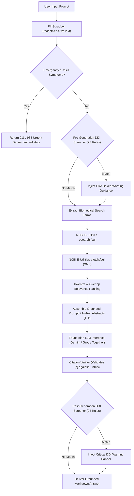

# Biomedical RAG Pipeline Reference

MedAssist AI implements a multi-stage, evidence-grounded Retrieval-Augmented Generation (RAG) architecture tailored specifically to biomedical inquiries and clinical safety constraints.

---

## 1. Pipeline Execution Flow

---

## 2. Pipeline Parameters & Configuration

| Pipeline Stage | Implementation File | Key Parameters & Default Values | Behavior & Safety Rules |
|:---|:---|:---|:---|
| **PII Scrubber** | `backend/services/privacyService.js` | Regex token replacement | Redacts emails, phone numbers, SSNs, and credit cards before external API egress. |
| **Emergency Gate** | `backend/services/safetyService.js` | Acute symptom keyword match | Bypasses all LLM providers for acute chest pain, stroke, or suicidal ideation; returns emergency callout. |
| **Pre-DDI Screener** | `backend/services/interactionService.js` | 23 FDA Boxed Warning rules | Word-bounded regex matching (`/\b...\b/i`). Emits educational cautionary disclaimer if interacting pairs mentioned. |
| **Search Reduction** | `backend/services/pubmedService.js` | Max 5 search tokens | Strips conversational filler ("can you tell me", "please explain") to optimize NCBI MeSH index queries. |
| **PubMed ESearch** | `backend/services/pubmedService.js` | `retmax: 4`, timeout: 8,000ms | Queries `https://eutils.ncbi.nlm.nih.gov/entrez/eutils/esearch.fcgi`. |
| **PubMed EFetch** | `backend/services/pubmedService.js` | XML stream parsing | Fetches structured abstracts by PMID, parsing `<AbstractText>` sections. |
| **Relevance Rank** | `backend/services/citationService.js` | Overlapping token density | Ranks candidate passages by Jaccard/overlap metric against user query terms. |
| **LLM Inference** | `backend/services/modelProvider.js` | `temperature: 0.25`, `max_tokens: 900` | Dampens sampling variance for clinical factuality; enforces strict 35s hard timeout. |
| **Citation Verify** | `backend/services/citationService.js` | Bracket matching (`/\[(\d+)\]/g`) | Asserts all cited indices `[n]` correspond to retrieved PMIDs. Flags hallucinated citation numbers. |
| **Post-DDI Screener**| `backend/services/interactionService.js` | 23 FDA Boxed Warning rules | Rescreens outgoing AI text to guarantee no dangerous drug combination is advised without warning. |

---

**Evidence:** `backend/services/answerService.js`, `backend/services/pubmedService.js`, `backend/services/citationService.js`, `backend/services/interactionService.js`.
