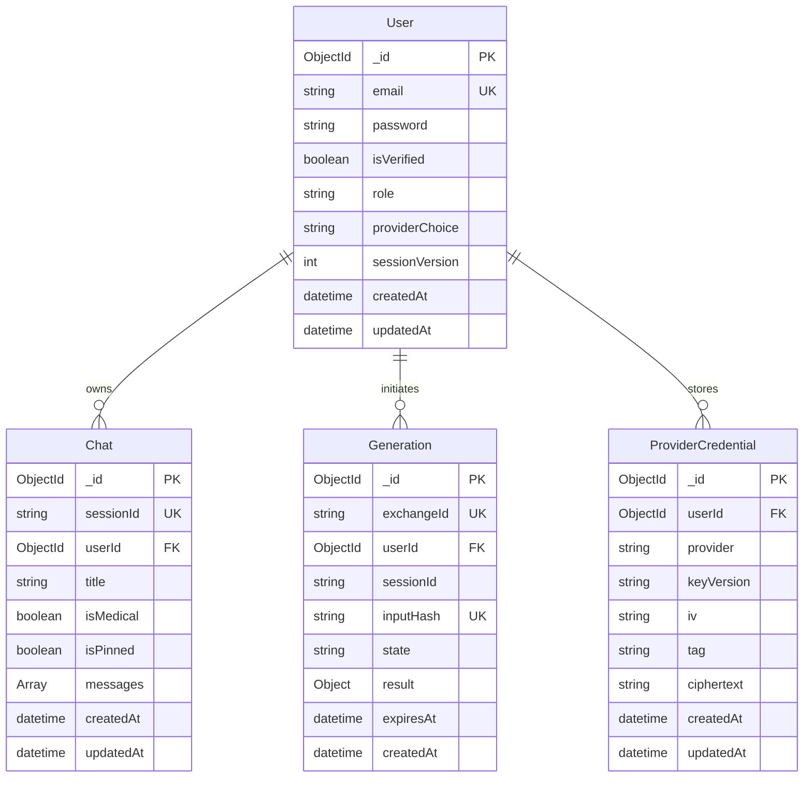

# Database Architecture & MongoDB Schemas

MedAssist AI uses MongoDB 7.0 via Mongoose as its persistence layer. The database maintains four primary collections: `users`, `chats`, `generations`, and `providercredentials`.

---

## 1. Entity-Relationship Model

---

## 2. Collection Schemas & Indexing Strategies

### 2.1 `users` Collection (`backend/models/userModel.js`)
Stores authenticated user identities, hashed passwords, verification state, and session invalidation counters.
- **Indexes:**
  - `{ email: 1 }` (Unique, sparse, case-insensitive collation).
- **Session Invalidation:**
  - `sessionVersion` increments on password reset or explicit multi-device revocation, invalidating outstanding JWT tokens immediately.

### 2.2 `chats` Collection (`backend/models/chatModel.js`)
Persists multi-turn conversations, message arrays, and citation references.
- **Indexes:**
  - `{ sessionId: 1, userId: 1 }` (Unique compound index).
  - `{ userId: 1, updatedAt: -1 }` (Compound index for chronological history pagination).
  - `{ userId: 1, isPinned: -1, updatedAt: -1 }` (Compound index for pinned conversations).
- **Safety Invariants (`chatController.js`):**
  - **Message Array Bound:** Enforces `$lt: [{ $size: "$messages" }, 1000]`.
  - **BSON Document Bound:** Enforces `$lt: [{ $add: [{ $bsonSize: "$$ROOT" }, bytes] }, 12582912]` (12MB, comfortably below the 16MB MongoDB hard limit).

### 2.3 `generations` Collection (`backend/models/generationModel.js`)
Implements the first phase of the two-phase generation handshake, caching intermediate inference results.
- **Indexes:**
  - `{ exchangeId: 1 }` (Unique UUIDv4 index).
  - `{ userId: 1, exchangeId: 1 }` (Compound index).
  - `{ inputHash: 1 }` (Unique SHA-256 hash deduplicating concurrent identical queries).
  - `{ expiresAt: 1 }` (TTL index: documents auto-expire after 10 minutes).
- **States:**
  - `"pending"`: AI inference in-flight.
  - `"ready"`: AI response received and verified, ready for persistence handshake.

### 2.4 `providercredentials` Collection (`backend/models/providerCredentialModel.js`)
Stores personal API keys encrypted with hardware-grade AES-256-GCM.
- **Indexes:**
  - `{ userId: 1, provider: 1 }` (Unique compound index: one personal key per provider per user).
- **Cryptographic Fields:**
  - `ciphertext`, `iv` (12-byte initialization vector), `tag` (16-byte authentication tag), `keyVersion`.
  - Secret fields are marked `select: false` in Mongoose to prevent accidental serialization in API responses or logs.

---

**Evidence:** `backend/models/userModel.js`, `backend/models/chatModel.js`, `backend/models/generationModel.js`, `backend/models/providerCredentialModel.js`, `backend/controllers/chatController.js`.
