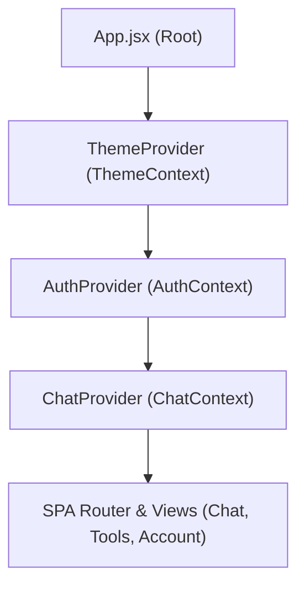

# Frontend Architecture and Component Reference

MedAssist AI's user interface is built as a single-page application (SPA) using React 19, Vite 6, Tailwind CSS, and Lucide React icons.

---

## 1. Directory Structure & Key Modules

```
frontend/src/
├── components/
│   ├── auth/              # AccountPage.jsx, AuthPage.jsx, ForgotPassword.jsx
│   ├── chat/              # ChatWorkspace.jsx, ChatComposer.jsx, MessageList.jsx
│   ├── dashboard/         # Dashboard.jsx, AnalyticsView.jsx, MetricCard.jsx
│   └── tools/             # ClinicalCalculatorsModal.jsx (22 clinical risk tools)
├── context/
│   ├── AuthContext.jsx    # Session state, user profile, login/logout actions
│   ├── ThemeContext.jsx   # Light/dark mode switching and persistence
│   └── ChatContext.jsx    # Active conversation thread, generation streams
├── lib/
│   ├── api.js             # Fetch wrapper with Web Locks session renewal mutex
│   └── utils.js           # Class name merger (clsx + tailwind-merge)
├── App.jsx                # Root router, context provider hierarchy
├── main.jsx               # React DOM entry point
└── index.css              # Tailwind base, components, and clinical theme tokens
```

---

## 2. Context Providers & State Hierarchy



### `ThemeContext`
- Manages `theme` state (`light` or `dark`).
- Synchronizes with system preference (`prefers-color-scheme`) and persists choice to `localStorage.getItem("medassist-theme")`.

### `AuthContext`
- Stores `user` (`id`, `email`, `name`, `role`), `accessToken`, and `isLoading`.
- Exposes `login()`, `register()`, `logout()`, `updateProfile()`, and `refreshSession()`.
- Automatically executes silent refresh on application mount.

### `ChatContext`
- Tracks `activeChatId`, `messages`, `isGenerating`, `abortController`, and `pendingExchangeId`.
- Manages the two-phase handshake: invokes `POST /api/ai/chat` (phase 1), streams or displays generation, and dispatches `POST /api/chat/save` (phase 2) upon completion.

---

## 3. Design System & Accessibility

- **Theme Palette:** Built with clinical accessibility in mind, utilizing high-contrast slate, blue, and emerald palettes for informational clarity, with dedicated amber/red callout tokens for DDI warnings.
- **Dark Mode Support:** Fully verified dark mode across all chat workspace panels, dropdowns, code blocks, and the 22 clinical calculators.
- **Focus Trapping & Keyboard Navigation:** `ClinicalCalculatorsModal` implements focus trapping, Escape key dismissal, and Arrow-key tab bar cycling.

---

## 4. Build Pipeline & Optimization

- **Bundler:** Vite 6 with `@vitejs/plugin-react`.
- **Chunk Splitting:** Manual chunks configured for vendor libraries (React, Lucide) to optimize caching.
- **Assets:** SVG icons inlined or imported as static module URLs.

```bash
# Build production bundle
npm run build --prefix frontend

# Preview production build locally
npm run preview --prefix frontend
```

---

**Evidence:** `frontend/package.json`, `frontend/vite.config.js`, `frontend/src/App.jsx`, `frontend/src/lib/api.js`.
