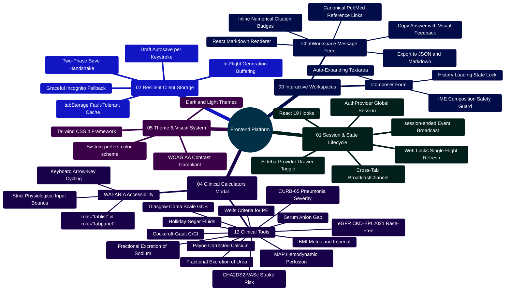

# MedAssist AI — Frontend Architecture & Component Engineering Reference

Developed by **J Ganesh kumar reddy**

*Full-Stack Educational Health Assistance, Biomedical Evidence Grounding, & Machine Learning Research Platform*

---

## 1. Frontend Subsystem Overview & Architectural Topology

The MedAssist AI client is an enterprise-grade, accessibility-audited single-page application built on **React 19**, **Vite 6**, **Tailwind CSS 4**, and **React Router 7**. It delivers resilient medical Q&A workspaces, interactive clinical calculators, account and provider preference controls, analytics dashboards, and real-time state synchronization via WebSockets (`/ws`).

> [!NOTE]
> **State & Network Invariant**: State updates are broadcast asynchronously over user-scoped WebSockets (`/ws`); answer generation is not token-streamed via Server-Sent Events (SSE). The frontend enforces a strict two-phase generation commitment handshake: generated answers reside in an ephemeral buffer and are persisted only upon user confirmation via `/api/save`.

```
========================================================================================================================
                                     MEDASSIST AI — FRONTEND RUNTIME TOPOLOGY
========================================================================================================================

    [ USER AGENT / BROWSER RUNTIME ]
                 │
                 ├── 1. Mounting Root: index.html ──► src/main.jsx
                 │
                 ▼
    ┌────────────────────────────────────────────────────────────────────────────────────────────────────────────────┐
    │                                           REACT 19 PROVIDER TREE                                               │
    │  <React.StrictMode>                                                                                            │
    │    └── <AuthProvider>  (Session lifecycle, Web Locks refresh, cross-tab BroadcastChannel)                      │
    │          └── <SidebarProvider>  (Mobile history drawer state & overlay manager)                               │
    │                └── <App>  (Client routing, navigation header, main workspace, footer)                         │
    └────────────────────────────────────────────────────────────────────────────────────────────────────────────────┘
                                                       │
         ┌─────────────────────────────────────────────┼─────────────────────────────────────────────┐
         │                                             │                                             │
         ▼                                             ▼                                             ▼
    ┌─────────────────────────┐                   ┌─────────────────────────┐                   ┌─────────────────────────┐
    │      PUBLIC VIEWS       │                   │    CHAT & TOOLS WORKSPACE│                  │    OPERATIONAL VIEWS    │
    │  - <Home />             │                   │  - <ChatWorkspace />    │                   │  - <AnalyticsDashboard> │
    │    (Hero, FAQs, Specs)  │                   │    (Feed, Composer, IME)│                   │    (SVG trends, stats)  │
    │  - <AuthPage />         │                   │  - <Sidebar />          │                   │  - <AccountPage />      │
    │    (Login, Register,    │                   │    (History CRUD, filter│                   │    (Profile, data wipe) │
    │     Password Recovery)  │                   │  - <ClinicalCalculators>│                   │  - <AISettings />       │
    │  - <VerifyEmail />      │                   │    (13 validated tools) │                   │    (Provider & Vault)   │
    └─────────────────────────┘                   └─────────────────────────┘                   └─────────────────────────┘
                 │                                             │                                             │
                 └─────────────────────────────────────────────┼─────────────────────────────────────────────┘
                                                               │
                                                               ▼
    ┌────────────────────────────────────────────────────────────────────────────────────────────────────────────────┐
    │                                          CLIENT STORAGE & RESILIENCE LAYER                                     │
    │  - lib/api.js: Fetch interceptor with Web Locks API single-flight session token refresh                         │
    │  - lib/tabStorage.js: Fault-tolerant sessionStorage draft recovery with in-memory fallback                     │
    │  - utils/medicalDetector.js: Client-side clinical keyword lexicon & prefix heuristic matcher                      │
    │  - Theme Engine: Automatic prefers-color-scheme OS detection + manual WCAG AA dark/light toggling              │
    └────────────────────────────────────────────────────────────────────────────────────────────────────────────────┘
========================================================================================================================
```

---

## 2. Frontend Capabilities Mindmap



---

## 3. Directory & File Inventory

```
frontend/
├── index.html                           # HTML5 application shell with mobile viewport meta
├── package.json                         # React 19, Tailwind CSS 4, Lucide icons, Vite 6
├── vite.config.js                       # Vite bundler config with /api and /ws dev proxies
├── vitest.config.js                     # Vitest test runner configuration with jsdom
├── Dockerfile                           # Production multi-stage build (node build -> nginx)
├── nginx.conf                           # Production Nginx ingress configuration with caching
├── tailwind.config.js                   # Tailwind utility configurations and color tokens
│
└── src/
    ├── main.jsx                         # React root entry, mounts inside StrictMode & AuthProvider
    ├── App.jsx                          # Main routing container, header/footer layout, modals
    ├── index.css                        # Tailwind 4 theme variables, low-light mode styles
    │
    ├── context/                         # Application State Contexts
    │   ├── AuthContext.jsx              # User session, login, logout, renewal broadcast listeners
    │   └── SidebarContext.jsx           # Mobile drawer visibility state
    │
    ├── components/                      # Modular UI Components
    │   ├── Login.jsx                    # Sign-in form with credential validation
    │   ├── Register.jsx                 # Registration form with password complexity rules
    │   ├── Sidebar.jsx                  # Thread navigation drawer with search, rename, delete
    │   │
    │   ├── auth/                        # Identity & Security Views
    │   │   ├── AccountPage.jsx          # Profile details, retention notices, account wipe
    │   │   ├── AISettings.jsx           # Provider selector, AES-256-GCM personal key manager
    │   │   ├── AuthPage.jsx             # Unified multi-mode authentication container
    │   │   ├── ForgotPassword.jsx       # Password recovery token dispatch form
    │   │   ├── ResetPassword.jsx        # JWT-tokenized password reset form
    │   │   ├── VerificationPending.jsx  # Notification view for unverified accounts
    │   │   └── VerifyEmail.jsx          # Email token consumption handler
    │   │
    │   ├── chat/                        # Conversational Healthcare Engine
    │   │   └── ChatWorkspace.jsx        # Message list, composer, IME guard, citation chips
    │   │
    │   ├── tools/                       # Evidence-Based Clinical Utilities
    │   │   └── ClinicalCalculatorsModal.jsx # 11 calculators with strict input bounds & ARIA tabs
    │   │
    │   ├── dashboard/                   # Telemetry & Research Analytics
    │   │   └── AnalyticsDashboard.jsx   # 7/30/90-day SVG trends, lifetime summary metrics
    │   │
    │   ├── footer/Footer.jsx            # Platform attribution and educational disclaimers
    │   ├── header/Header.jsx            # Brand header, calculator button, auth controls
    │   └── home/Home.jsx                # Public landing page with architecture & FAQ
    │
    ├── lib/                             # Core Client Infrastructure
    │   ├── api.js                       # Fetch client with Web Locks single-flight refresh
    │   └── tabStorage.js                # Fault-tolerant sessionStorage draft cache
    │
    ├── utils/
    │   └── medicalDetector.js           # Client-side heuristic medical keyword classifier
    │
    └── test/                            # Vitest Component & Unit Tests (43 Passing)
        ├── api.test.js                  # Web Locks refresh and fetch interceptor tests
        ├── clinicalCalculators.test.jsx # 11 calculator math & accessibility tests
        ├── medicalDetector.test.js      # Medical entity & suggestion chip classification
        ├── tabStorage.test.js           # sessionStorage fallback & TTL cache tests
        └── ui.test.jsx                  # Component rendering, auth, and accessibility tests
```

---

## 4. Key Implementation Code Snippets

### 4.1 Web Locks API Single-Flight Token Refresh (`frontend/src/lib/api.js`)

When an access token expires (15 minutes), multiple concurrent UI components may trigger simultaneous 401 errors. MedAssist AI uses the **Web Locks API** (`navigator.locks.request`) to coordinate a single token refresh across all tabs:

```javascript
// Implementation snippet from frontend/src/lib/api.js:
let refreshPromise;

export async function refreshSession() {
  if (!refreshPromise) {
    const refresh = () => request("/auth/refresh-token", { method: "POST" });

    // Acquire mutex lock across browser tabs to prevent duplicate refresh calls
    refreshPromise = (
      navigator.locks
        ? navigator.locks.request("medassist-session-refresh", refresh)
        : refresh()
    )
      .then((data) => {
        window.dispatchEvent(new Event("session-renewed"));
        return data;
      })
      .catch((error) => {
        window.dispatchEvent(new Event("session-ended"));
        throw error;
      })
      .finally(() => {
        refreshPromise = null;
      });
  }
  return refreshPromise;
}

export async function apiRequest(path, options = {}) {
  try {
    return await request(path, options);
  } catch (error) {
    // Intercept 401 Unauthorized errors and refresh session automatically
    if (error.status === 401 && (!path.startsWith("/auth/") || path === "/auth/check")) {
      await refreshSession();
      return request(path, options);
    }
    throw error;
  }
}
```

### 4.2 Resilient Client Draft Cache (`frontend/src/lib/tabStorage.js`)

Prevents data loss during accidental page refreshes, tab closures, or network drops, while gracefully handling restricted storage in private/incognito browsing:

```javascript
// Implementation snippet from frontend/src/lib/tabStorage.js:
export function readTab(key, fallback = "") {
  try {
    return sessionStorage.getItem(key) ?? fallback;
  } catch {
    return fallback;
  }
}

export function writeTab(key, value) {
  try {
    if (value === null) sessionStorage.removeItem(key);
    else sessionStorage.setItem(key, value);
  } catch {
    // Silently maintain in-memory state if sessionStorage access is blocked
  }
}

export function readPending(key) {
  try {
    const value = JSON.parse(readTab(key, "null"));
    if (
      !value ||
      typeof value.prompt !== "string" ||
      typeof value.exchangeId !== "string" ||
      !Number.isFinite(value.storedAt) ||
      Date.now() - value.storedAt > 86400000 // 24-hour expiration check
    )
      return null;
    return value;
  } catch {
    return null;
  }
}
```

### 4.3 IME Composition Safety Guard (`frontend/src/components/chat/ChatWorkspace.jsx`)

When entering East Asian languages (Japanese, Chinese, Korean), users press `Enter` to confirm phonetic kanji/kana character selections. The composer prevents premature form submission using `event.nativeEvent.isComposing`:

```javascript
// Implementation snippet from frontend/src/components/chat/ChatWorkspace.jsx:
const handleKeyDown = (event) => {
  if (event.key === "Enter" && !event.shiftKey) {
    // Check if the user is actively composing an IME character candidate
    if (event.nativeEvent.isComposing) {
      return; // Do not submit; allow character composition to complete
    }
    event.preventDefault();
    handleSend();
  }
};
```

### 4.4 Formatted Evidence Markdown & JSON Export (`frontend/src/lib/api.js`)

Enables clinicians and students to export complete evidence records with verified PubMed citations:

```javascript
// Implementation snippet from frontend/src/lib/api.js:
export function formatChatAsMarkdown(chat) {
  const title = chat.title || "Health Q&A Conversation";
  const lines = [
    `# ${title}`,
    `*MedAssist AI Evidence Report · Exported ${new Date().toLocaleDateString(undefined, { dateStyle: "long" })}*`,
    "",
    "---",
    "",
  ];
  for (const msg of chat.messages || []) {
    if (msg.isUser) {
      lines.push("### Question", msg.text, "");
    } else {
      lines.push("### MedAssist AI Response", msg.text, "");
      if (msg.references && msg.references.length > 0) {
        lines.push("#### PubMed Literature References");
        msg.references.forEach((ref, index) => {
          lines.push(`- **[${index + 1}]** [${ref.title}](${ref.url}) — *${ref.journal || "PubMed"} (${ref.pubdate || ""})*`);
        });
        lines.push("");
      }
    }
  }
  return lines.join("\n");
}
```

---

## 5. Educational Clinical Calculators Implementation

The `ClinicalCalculatorsModal.jsx` component implements 13 standardized clinical scoring algorithms with WAI-ARIA tab semantics, arrow-key cycling, strict input bounding, and non-diagnostic educational disclaimers.

```
========================================================================================================================
                                     CLINICAL CALCULATOR SUITE & MATHEMATICAL FORMULATIONS
========================================================================================================================

    [ CALCULATOR ]             [ SCIENTIFIC FORMULATION / ALGORITHM ]                    [ BOUNDS / CONSTRAINTS ]
    ─────────────────────────────────────────────────────────────────────────────────────────────────────────────────
    Body Mass Index (BMI)      BMI = weight_kg / (height_m)^2                            Weight: 20-300 kg
                               Imperial: (weight_lbs * 703) / (height_in)^2              Height: 50-250 cm

    eGFR (CKD-EPI 2021)        eGFR = 142 * min(Scr/κ, 1)^α * max(Scr/κ, 1)^-1.200       Age: 18-120 years
    (Race-Free Standard)              * 0.9938^Age * (1.012 if female)                   Scr: 0.2-15.0 mg/dL
                               (κ = 0.7 F / 0.9 M; α = -0.241 F / -0.302 M)

    CHA2DS2-VASc               Points: CHF (+1), HTN (+1), Age >=75 (+2), Diabetes (+1), Age: 18-120 years
    (Stroke Risk in AFib)      Stroke/TIA (+2), Vascular Disease (+1), Age 65-74 (+1),   Binary clinical flags
                               Female Sex (+1). Range: 0 to 9 points.

    Mean Arterial Pressure     MAP = DBP + 1/3 * (SBP - DBP)                             SBP: 50-260 mmHg
    (MAP Hemodynamics)                                                                   DBP: 30-160 mmHg

    Cockcroft-Gault CrCl       CrCl = [(140 - Age) * Weight_kg] / (72 * Scr)            Age: 18-120 years
    (Renal Drug Dosing)        * (0.85 if female)                                        Weight: 20-250 kg, Scr: 0.2-15

    Payne Corrected Calcium    Corrected Ca = Measured Ca + 0.8 * (4.0 - Albumin_g_dL)   Total Ca: 4.0-18.0 mg/dL
                                                                                         Albumin: 1.0-6.0 g/dL

    Serum Anion Gap            Anion Gap = Na - (Cl + HCO3)                              Na: 100-180 mEq/L
                               Normal Range: 4 to 12 mEq/L (lab specific)                Cl: 50-140, HCO3: 5-50

    FeNa (Fractional Sodium)   FeNa = (UNa * SCr) / (SNa * UCr) * 100%                   UNa, SNa, SCr, UCr
                               < 1% Prerenal azotemia; > 2% Acute tubular necrosis       All positive numbers

    FeUrea (Fractional Urea)   FeUrea = (UUrea * SCr) / (BUN * UCr) * 100%               UUrea, BUN, SCr, UCr
                               < 35% Prerenal (valid during diuretic therapy)            All positive numbers

    Holliday-Segar Fluids      4 mL/kg/hr (1-10kg) + 2 mL/kg/hr (11-20kg) + 1 mL (>20kg) Weight: 1-150 kg
                               Basal hourly and 24-hour maintenance fluid rates          Hourly and 24h rates

    Wells Criteria for PE      Clinical DVT (+3), PE #1 diagnosis (+3), HR >100 (+1.5),  Binary clinical flags
                               Immobilization/Surgery (+1.5), Prior DVT/PE (+1.5),       PE unlikely <= 4
                               Hemoptysis (+1), Malignancy (+1). Range: 0 to 12.5.       PE likely > 4

    CURB-65 Pneumonia Score    Confusion (+1), Urea > 19 mg/dL (+1), RR >= 30 (+1),      Binary clinical flags
                               Low BP SBP < 90 or DBP <= 60 (+1), Age >= 65 (+1).       0-1: Low, 2: Int, 3-5: High

    Glasgow Coma Scale (GCS)   GCS = Eye (1-4) + Verbal (1-5) + Motor (1-6)              E: 1-4, V: 1-5, M: 1-6
                               Total Score: 3 to 15. <=8 Severe / Coma, 9-12 Moderate.   Score: 3 to 15 points
========================================================================================================================
```

### 5.1 Glasgow Coma Scale (GCS) Implementation & ARIA Trapping

```jsx
// Implementation snippet from frontend/src/components/tools/ClinicalCalculatorsModal.jsx:
const gcsEyeScore = parseInt(gcsEye, 10) || 4;
const gcsVerbalScore = parseInt(gcsVerbal, 10) || 5;
const gcsMotorScore = parseInt(gcsMotor, 10) || 6;
const gcsScore = gcsEyeScore + gcsVerbalScore + gcsMotorScore;

let gcsStratification = "Mild brain injury / Alert (13–15)";
if (gcsScore <= 8) {
  gcsStratification = "Severe brain injury / Coma (3–8)";
} else if (gcsScore <= 12) {
  gcsStratification = "Moderate brain injury (9–12)";
}

// Arrow key navigation across all 13 tabs
const tabList = ["bmi", "egfr", "chads", "map", "crcl", "calcium", "aniongap", "fena", "feurea", "fluids", "wells", "curb65", "gcs"];
```

---

## 6. Development & Automated Testing Workflow

Execute the full suite of frontend tests and production builds using the following commands:

```powershell
# 1. Install production and development dependencies
cd frontend
npm ci

# 2. Run ESLint across all components and libraries
npm run lint

# 3. Execute Vitest automated unit and component test suite (46 tests)
npm test

# 4. Compile optimized production distribution bundle
npm run build
```
