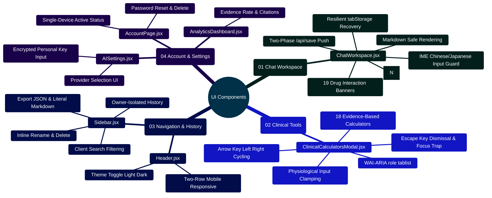

# MedAssist AI — Frontend Component Architecture & Accessibility Guide

Developed by **J Ganesh kumar reddy**  
*Full-Stack Educational Health Assistance, Biomedical Evidence Grounding, & Machine Learning Research Platform*

---

## 1. Executive UI Architecture & Component Hierarchy

The MedAssist AI client application (`frontend/src/components/`) is constructed as a React 19 Single-Page Application (SPA) utilizing Vite 6 and Tailwind CSS 4. The user interface enforces zero-trust client boundaries: components handle user interactions, responsive viewports, and accessible keyboard navigation while delegating all clinical routing, citations, and state persistence to backend services.

```
========================================================================================================================
                          MEDASSIST AI — COMPONENT HIERARCHY & DATA FLOW
========================================================================================================================

    [ App.jsx — Router Root & Global Providers (AuthProvider, SidebarProvider) ]
                           │
             ┌─────────────┴─────────────┐
             ▼                           ▼
    ┌──────────────────┐        ┌────────────────────────────────────────────────────────┐
    │   HEADER / NAV   │        │                   CHAT WORKSPACE VIEW                  │
    │  - Header.jsx    │        │  - ChatWorkspace.jsx (Primary Conversational Surface)  │
    │  - Theme Toggle  │        │  - Input Composer with IME Composition Protection      │
    │  - Mobile Drawer │        │  - Two-Phase Generation & Resilient Pending Handshake   │
    └──────────────────┘        │  - Markdown Renderer (react-markdown + Code Fences)   │
             │                  │  - Citation References List & Numeric Badges [N]       │
             │                  │  - Drug-Drug Interaction Warning Banners (19 Rules)    │
             │                  │  - Emergency Triage & Crisis Deflection Banners        │
             │                  └────────────────────────────────────────────────────────┘
             ▼                                           │
    ┌──────────────────┐                                 ├───────────────────────────────┐
    │   SIDEBAR DRAWER │                                 ▼                               ▼
    │  - Sidebar.jsx   │        ┌────────────────────────────────┐ ┌────────────────────────────────┐
    │  - History List  │        │   CLINICAL CALCULATORS MODAL   │ │     SETTINGS & ACCOUNT MODALS  │
    │  - Search Filter │        │  - ClinicalCalculatorsModal.jsx│ │  - AISettings.jsx (Vault)     │
    │  - Rename/Delete │        │  - 18 Evidence-Based Tools     │ │  - AccountPage.jsx (Sessions)  │
    │  - Export Engine │        │  - WAI-ARIA Tabpanel Cycling   │ │  - AnalyticsDashboard.jsx      │
    └──────────────────┘        └────────────────────────────────┘ └────────────────────────────────┘
========================================================================================================================
```

---

## 2. Component Capabilities Mindmap



---

## 3. Core Component Specifications & Contracts

### 3.1 `ChatWorkspace.jsx` — Conversational Interface
- **State Resilience**: Integrated with `tabStorage.js` (`sessionStorage` with memory fallback) to recover drafts and completed unsaved answers across page reloads.
- **Two-Phase Generation Flow**:
  1. Sends user prompt to `/api/chat` or `/api/generate` (writes ephemeral generation).
  2. Displays completed answer with references and verification badges.
  3. Dispatches `/api/save` to commit the exchange into persistent MongoDB history.
- **Accessibility**: Includes WAI-ARIA live regions (`aria-live="polite"`) for incoming streaming tokens.

### 3.2 `ClinicalCalculatorsModal.jsx` — Evidence-Based Clinical Tools
- **Calculators Implemented (18 Tools)**:
  1. **Body Mass Index (BMI)**: Metric ($kg/m^2$) and Imperial ($lbs \times 703 / in^2$).
  2. **eGFR (CKD-EPI 2021)**: Race-free glomerular filtration rate estimation.
  3. **CHA2DS2-VASc**: Stroke risk stratification in non-valvular atrial fibrillation (0-9).
  4. **Mean Arterial Pressure (MAP)**: $\text{MAP} = \frac{2 \times \text{DBP} + \text{SBP}}{3}$ and pulse pressure.
  5. **Creatinine Clearance (Cockcroft-Gault)**: Clamped weight and age bounds ($0.85$ female multiplier).
  6. **Corrected Calcium (Payne Formula)**: $\text{Corrected Ca} = \text{Total Ca} + 0.8 \times (4.0 - \text{Albumin})$.
  7. **Serum Anion Gap**: $\text{AG} = \text{Na} - (\text{Cl} + \text{HCO}_3)$.
  8. **Fractional Excretion of Sodium (FeNa)**: Acute kidney injury etiology ($<1\%$ vs $>2\%$).
  9. **Fractional Excretion of Urea (FeUrea)**: Diuretic-tolerant renal assessment ($<35\%$).
  10. **Maintenance Fluids (4-2-1 Rule)**: Pediatric and adult hourly and 24-hour rate estimation.
  11. **Wells' Criteria for Pulmonary Embolism**: Clinical probability scoring ($\le 4$ vs $> 4$).
  12. **CURB-65**: Community-acquired pneumonia 30-day mortality risk stratification (0-5).
  13. **Glasgow Coma Scale (GCS)**: Eye (1-4), verbal (1-5), and motor (1-6) neurological response (3-15).
  14. **HAS-BLED Bleeding Risk**: Risk factor scoring in atrial fibrillation (0-9).
  15. **qSOFA Sepsis Screening**: Bedside evaluation for sepsis mortality risk (0-3).
  16. **Mosteller Body Surface Area (BSA)**: $\text{BSA} = \sqrt{\frac{\text{Ht (cm)} \times \text{Wt (kg)}}{3600}}$ (or $\sqrt{\frac{\text{Ht (in)} \times \text{Wt (lbs)}}{3131}}$).
  17. **APRI Liver Fibrosis**: $\text{APRI} = \frac{(\text{AST} / \text{AST}_{\text{ULN}}) \times 100}{\text{Platelets } (10^9/\text{L})}$.
  18. **Child-Pugh Score for Cirrhosis Mortality**: Points sum ($5-15$) across Bilirubin, Albumin, INR, Ascites, and Encephalopathy; stratifies into Class A (5-6, well-compensated), Class B (7-9, moderate), and Class C (10-15, decompensated liver disease).
- **WAI-ARIA Accessibility**:
  - `role="tablist"` with `aria-orientation="horizontal"`.
  - Individual calculator tabs utilize `role="tab"`, `aria-selected`, and `aria-controls`.
  - Active calculator body renders in `role="tabpanel"` with matching `aria-labelledby`.
  - Full keyboard navigation: `ArrowRight` and `ArrowLeft` cycle tabs; `Home`/`End` navigate to boundaries; `Escape` closes modal and restores focus.

### 3.3 `Sidebar.jsx` — Conversation Drawer & Search
- **Export Sanitization**: Exports literal Markdown using code fences (` ``` `) to prevent untrusted message text from triggering Markdown image injections.
- **Owner Tenancy**: Conversation listings are keyed strictly to the authenticated user ID.

---

## 4. Developer Extensibility: Adding a New UI Modal or Tool

Follow this pattern to create a fully accessible, WCAG-compliant modal:

```jsx
// frontend/src/components/tools/CustomToolModal.jsx
import React, { useEffect, useRef } from "react";
import { X } from "lucide-react";

export function CustomToolModal({ isOpen, onClose, title, children }) {
  const modalRef = useRef(null);
  const previousFocusRef = useRef(null);

  useEffect(() => {
    if (isOpen) {
      previousFocusRef.current = document.activeElement;
      modalRef.current?.focus();

      const handleKeyDown = (e) => {
        if (e.key === "Escape") {
          e.preventDefault();
          onClose();
        }
      };

      window.addEventListener("keydown", handleKeyDown);
      return () => {
        window.removeEventListener("keydown", handleKeyDown);
        previousFocusRef.current?.focus();
      };
    }
  }, [isOpen, onClose]);

  if (!isOpen) return null;

  return (
    <div
      className="fixed inset-0 z-50 flex items-center justify-center bg-black/50 backdrop-blur-sm p-4"
      role="dialog"
      aria-modal="true"
      aria-labelledby="modal-title"
    >
      <div
        ref={modalRef}
        tabIndex={-1}
        className="w-full max-w-lg rounded-xl bg-white p-6 shadow-2xl dark:bg-slate-900 dark:text-white outline-none"
      >
        <div className="flex items-center justify-between pb-4 border-b border-slate-200 dark:border-slate-800">
          <h2 id="modal-title" className="text-xl font-bold">{title}</h2>
          <button
            onClick={onClose}
            aria-label="Close dialog"
            className="rounded-lg p-1 hover:bg-slate-100 dark:hover:bg-slate-800 transition"
          >
            <X className="h-5 w-5" />
          </button>
        </div>
        <div className="mt-4">{children}</div>
      </div>
    </div>
  );
}
```

---

## 5. Automated Frontend Component Verification

The frontend component suite contains 54 passing Vitest tests:

```powershell
# Run the complete frontend test suite
npm test --prefix frontend

# Run specific component tests
npm test --prefix frontend -- ui.test.jsx
npm test --prefix frontend -- clinicalCalculators.test.jsx
npm test --prefix frontend -- api.test.js
```
