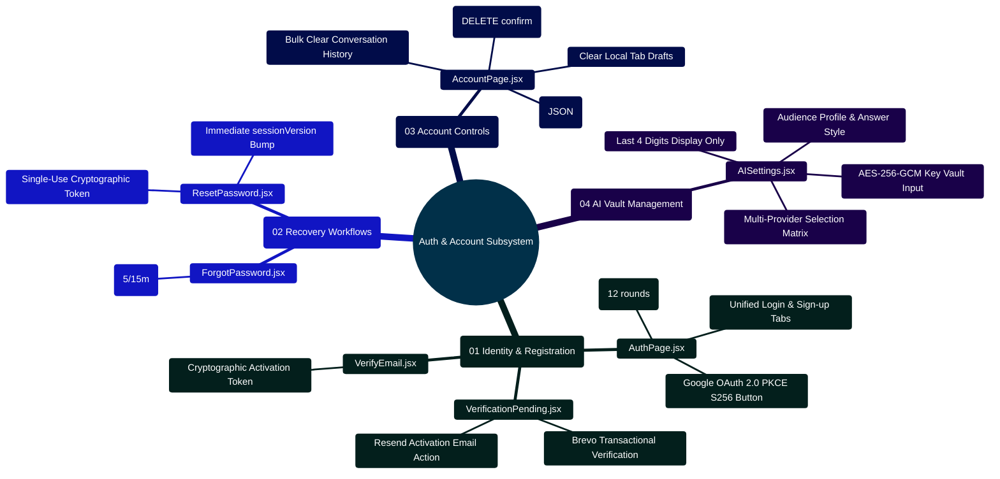

# MedAssist AI — Authentication & Account Architecture Manual

Developed by **J Ganesh kumar reddy**  
*Full-Stack Educational Health Assistance, Biomedical Evidence Grounding, & Machine Learning Research Platform*

---

## 1. Executive Overview & Authentication Lifecycle Topology

The MedAssist AI authentication and account component tier (`frontend/src/components/auth/`) encapsulates user identity lifecycle, Google OAuth 2.0 PKCE handshakes, multi-provider credential vault management, single-device session versioning, and GDPR/CCPA-compliant account data exports and deletion.

```
========================================================================================================================
                                  MEDASSIST AI — AUTHENTICATION & CREDENTIAL TOPOLOGY
========================================================================================================================

    [ CLIENT AUTHENTICATION FLOW ]
                 │
                 ├── 1. Email & Password Credentials (POST /api/auth/login or /api/auth/register)
                 │     ├── Bcrypt 12-round salted hash verification
                 │     ├── Monotonic sessionVersion increment (invalidates older active devices)
                 │     └── Brevo transactional email activation token (GET /api/auth/verify-email)
                 │
                 └── 2. Google OAuth 2.0 PKCE Flow (GET /api/auth/google/start)
                       ├── SHA-256 code challenge generation & state challenge validation
                       ├── OpenID Connect token exchange & automatic profile creation
                       └── HttpOnly SameSite=Strict secure cookie issuance (accessToken, refreshToken)
                                 │
                                 ▼
    ┌────────────────────────────────────────────────────────────────────────────────────────────────────────────────┐
    │                                             AUTHENTICATED APP STATE                                            │
    │  - AuthContext.jsx: Reactive global user profile state (`user.id`, `user.email`, `user.isVerified`)           │
    │  - Web Locks Mutex: Single-flight token refresh across browser tabs (`medassist-session-refresh`)              │
    └────────────────────────────────────────────────────────────────────────────────────────────────────────────────┘
                                 │
                 ┌───────────────┴───────────────┐
                 │                               │
                 ▼                               ▼
    ┌──────────────────────────┐   ┌────────────────────────────────────────────────────────┐
    │     ACCOUNT SETTINGS     │   │              PERSONAL API KEY VAULT (AISettings.jsx)   │
    │  (AccountPage.jsx)       │   │  - Supported: Gemini, Groq, Together AI, Local Models  │
    │  - Single active device  │   │  - Hardware-accelerated AES-256-GCM encryption on host │
    │  - Local tab draft wipe  │   │  - Client displays provider choice & last 4 key digits │
    │  - Full data export JSON │   │  - Zero cleartext key persistence in DB or browser DOM │
    │  - Permanent account wipe│   └────────────────────────────────────────────────────────┘
    └──────────────────────────┘
========================================================================================================================
```

---

## 2. Authentication Subsystem Mindmap



---

## 3. Component Inventory & Functional Contracts

### 3.1 `AuthPage.jsx` — Unified Authentication Modal
- **Role**: Coordinates user login and registration forms, email verification warnings, and Google OAuth entry points.
- **Security Invariant**: Password fields enforce minimum length bounds ($\ge 8$ chars) and disable form submission during active requests.

### 3.2 `AISettings.jsx` — Multi-Provider & Encrypted Vault Controls
- **Role**: Allows authenticated users to configure their inference provider preference (Gemini, Groq, Together AI, or Local vLLM), answer verbosity style (`balanced`, `brief`, `detailed`), audience profile (`general`, `student`, `clinician`), and personal API keys.
- **Key Vault Contract**:
  - Keys submitted via `PUT /api/settings/keys/:provider` are sealed with AES-256-GCM using unique 12-byte initialization vectors (IVs).
  - Cleartext keys are never returned to the client; the UI only receives `{ provider: "gemini", lastFour: "1a2b" }`.
  - Removing a key via `DELETE /api/settings/keys/:provider` automatically reverts the user's provider choice to the deployment default.

### 3.3 `AccountPage.jsx` — Privacy, Data Export & Account Deletion
- **Role**: Primary settings view allowing users to inspect stored data policies, clear in-memory drafts from `tabStorage`, export all saved conversations in structured JSON format, and permanently wipe their account.
- **Account Deletion Guard**: Requires typing `"DELETE"` into the confirmation input before activating the destructive `DELETE /api/auth/account` endpoint.

---

## 4. Key Implementation Code Snippets

### 4.1 Personal API Key Vault Submission (`AISettings.jsx`)

```jsx
// Encrypted personal key submission in AISettings.jsx
const handleSaveKey = async (event) => {
  event.preventDefault();
  if (!apiKey.trim()) return;

  setBusy(true);
  setError("");
  setStatus("");

  try {
    const updatedSettings = await apiRequest(`/settings/keys/${keyProvider}`, {
      method: "PUT",
      body: JSON.stringify({ apiKey: apiKey.trim() }),
    });

    setSettings(updatedSettings);
    setApiKey(""); // Clear sensitive plaintext from DOM immediately
    setStatus("API key saved.");
  } catch (err) {
    setError(err.message);
  } finally {
    setBusy(false);
  }
};
```

### 4.2 Account Data Archive Export (`AccountPage.jsx`)

```jsx
// Full account data JSON export in AccountPage.jsx
const handleExportAccountData = async () => {
  setExportBusy(true);
  setError("");
  try {
    const data = await apiRequest("/auth/export-data");
    const dateStamp = new Date().toISOString().slice(0, 10);
    downloadJson(`medassist-account-export-${dateStamp}.json`, data);
  } catch (err) {
    setError(err.message);
  } finally {
    setExportBusy(false);
  }
};
```

---

## 5. Developer Extensibility: Adding a New Authentication Provider

To add an alternative OAuth provider (e.g., GitHub or Institutional SAML/OIDC):
1. In `backend/controllers/oauthController.js`, add the initiation endpoint (`/auth/saml/start`) and callback handler (`/auth/saml/callback`).
2. Verify authorization code signatures with timing-safe comparisons.
3. In `frontend/src/components/auth/AuthPage.jsx`, add the provider button:

```jsx
<button
  type="button"
  className="button secondary social-auth"
  onClick={() => window.location.href = "/api/auth/saml/start"}
>
  <Hospital className="h-5 w-5" />
  <span>Sign in with Institutional Single Sign-On</span>
</button>
```

---

## 6. Automated Verification Commands

All authentication components, session versioning rules, and vault controllers are verified by the backend integration suite and Vitest frontend tests:

```powershell
# Run backend authentication and OAuth tests
node --test backend/test/application.test.js

# Run frontend authentication UI tests
npm test --prefix frontend -- ui.test.jsx
```
