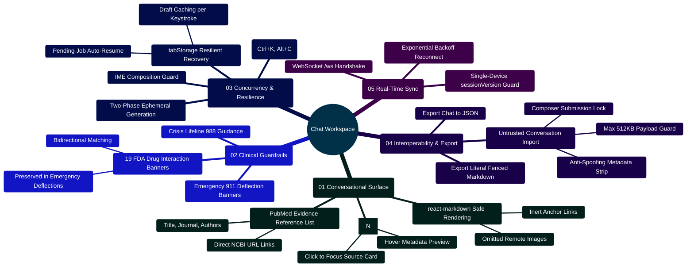

# MedAssist AI — Chat Workspace Architecture & Conversational Interface Manual

Developed by **J Ganesh kumar reddy**  
*Full-Stack Educational Health Assistance, Biomedical Evidence Grounding, & Machine Learning Research Platform*

---

## 1. Executive Overview & Conversational Dataflow Topology

The MedAssist AI Chat Workspace (`frontend/src/components/chat/ChatWorkspace.jsx`) provides the primary conversational interface for evidence-grounded health exploration. It coordinates multi-turn biomedical Q&A, two-phase generation persistence, resilient client-side draft caching, untrusted JSON import sandboxing, and real-time state synchronization via WebSockets (`/ws`).

```
========================================================================================================================
                                     MEDASSIST AI — CHAT WORKSPACE DATAFLOW & STATE LIFECYCLE
========================================================================================================================

    [ USER INPUT COMPOSER ] ──► (Text Input / Clinical Calculator Prompt Insertion)
                  │
                  ├── 1. IME Composition Check: event.nativeEvent.isComposing (Prevents premature dispatch)
                  ├── 2. Resilient Draft Sync: tabStorage.writeTab("medassist-draft-<userId>", prompt)
                  │
                  ▼
    [ PHASE 1: GENERATION REQUEST ]
                  │
                  ├── Action: POST /api/ai/chat { prompt, sessionId, exchangeId }
                  ├── In-Flight State: writeTab("...-pending", { exchangeId, prompt, sessionId, storedAt })
                  ├── AbortController: Binds controller.current.signal (Allows user cancellation)
                  │
                  ▼
    ┌────────────────────────────────────────────────────────────────────────────────────────────────────────────────┐
    │                                       BACKEND DUAL-ENGINE PROCESSING PIPELINE                                  │
    │  - safetyService.js: Deterministic Acute Emergency & Crisis Deflection                                         │
    │  - interactionService.js: 19 FDA Black-Box Drug Interaction Screening (Preserved Context Invariant)            │
    │  - pubmedService.js: NCBI Entrez Three-Stage Harvesting (esearch -> esummary -> efetch MEDLINE XML)             │
    │  - modelProvider.js: Multi-Engine Synthesis (Gemini 2.5 Flash, Groq, Together AI, Local vLLM)                 │
    │  - citationService.js: Deterministic Bracket Numerical Citation Audit ([N] Set Partitioning)                   │
    └────────────────────────────────────────────────────────────────────────────────────────────────────────────────┘
                  │
                  ▼
    [ INTERMEDIATE CLIENT RENDER: Ephemeral Answer Display ]
                  │
                  ├── Formats Answer with react-markdown (Inert Link & Omitted Remote Image Sanitization)
                  ├── Mounts Interactive Numerical Citation Badges ([1], [2]) with Focus Routing
                  ├── Renders Evidence Cards with PubMed PMIDs, Authors, Journals, and Links
                  └── Displays Drug-Drug Interaction Banners (Preserved even during Emergency Deflections)
                  │
                  ▼
    [ PHASE 2: AUTHORITATIVE PERSISTENCE COMMITMENT ]
                  │
                  ├── Action: POST /api/save { generationId: result.generationId }
                  ├── On Success:
                  │     ├── selectActive(saved.sessionId) & setActiveName(saved.chat.title)
                  │     ├── setPending(null) & purge pending draft from tabStorage
                  │     └── Refresh Conversation History drawer
                  └── On Failure (Network Drop / Server Timeout):
                        └── Retains pending draft in tabStorage with "Retry Save" button (Zero Data Loss)
========================================================================================================================
```

---

## 2. Chat Workspace Capabilities Mindmap



---

## 3. Core Component Contracts & State Model

### 3.1 Primary State Invariants

| State Property | Type | Default | Contract & Invariant |
|:---|:---:|:---:|:---|
| `messages` | `Array<Message>` | `[]` (or recovered) | Authoritative message turns for active conversation. Contains `{ id, text, isUser, references, verification, drugInteractions }`. |
| `pending` | `Object \| null` | `null` (or recovered) | Stores in-flight generation metadata (`{ prompt, sessionId, exchangeId, result }`). Prevents page navigation and reloads from dropping answers. |
| `active` | `string \| null` | `null` | MongoDB ObjectId of the current conversation thread. `null` indicates a fresh uncommitted exchange. |
| `importPreview` | `boolean` | `false` | When true, renders an untrusted client-side conversation preview. Composer input is locked to prevent sending messages into an imported preview. |
| `calcModalOpen` | `boolean` | `false` | Modal toggle for the 18 evidence-based clinical calculators (`ClinicalCalculatorsModal.jsx`), triggered via UI button or `Alt+C`. |
| `online` | `boolean` | `false` | Reflects live WebSocket connection status to `/ws`. Auto-reconnects with exponential backoff on drop. |

### 3.2 Security & Markdown Sanitization Contract

To prevent stored Cross-Site Scripting (XSS), phishing links, and remote tracking pixels from malicious prompts or unvetted external PubMed records, `ChatWorkspace.jsx` overrides `react-markdown` component renderers:

```jsx
// Inert links and omitted remote images in ChatWorkspace.jsx
const safeMessageComponents = {
  a: ({ children }) => <span className="inactive-link">{children}</span>,
  img: ({ alt }) => <span className="muted">{alt ? `[Image omitted: ${alt}]` : "[Image omitted]"}</span>,
};
```

Only verified, server-provided PubMed bibliographic records rendered in the separate references card are permitted to emit actionable external links.

---

## 4. Key Implementation Code Snippets

### 4.1 Two-Phase Generation & Resilient Save Handshake

```jsx
// Frontend two-phase generation implementation in ChatWorkspace.jsx
const send = async (event, retry = null) => {
  event?.preventDefault();
  if (importPreview || busyRef.current || (!retry && (!prompt.trim() || pendingRef.current))) return;

  const job = retry || {
    prompt: prompt.trim(),
    sessionId: activeRef.current,
    exchangeId: crypto.randomUUID(),
  };

  const generation = view.current;
  busyRef.current = true;
  setBusy(true);
  setError("");
  setPending(job);
  controller.current = new AbortController();

  if (!retry) {
    setMessages((old) => [
      ...old,
      { id: job.exchangeId + "-user", text: job.prompt, isUser: true, timestamp: new Date().toISOString() },
    ]);
    setPrompt("");
  }

  try {
    setStatus(job.result ? "Saving your answer..." : "Finding an answer...");
    
    // Phase 1: In-Flight Ephemeral Generation
    if (!job.result) {
      job.result = await apiRequest("/ai/chat", {
        method: "POST",
        body: JSON.stringify({ prompt: job.prompt, sessionId: job.sessionId, exchangeId: job.exchangeId }),
        signal: controller.current.signal,
      });
    }

    if (!mounted.current || generation !== view.current) return;
    setPending({ ...job });
    setMessages((old) => [
      ...old.filter((item) => item.id !== job.exchangeId + "-assistant"),
      { ...job.result, id: job.exchangeId + "-assistant", isUser: false },
    ]);

    // Phase 2: Authoritative Database Commit
    setStatus("Saving your answer...");
    const saved = await apiRequest("/save", {
      method: "POST",
      body: JSON.stringify({ generationId: job.result.generationId }),
      signal: controller.current.signal,
    });

    if (!mounted.current || generation !== view.current) return;
    selectActive(saved.sessionId);
    setActiveName(saved.chat.title);
    setMessages(saved.chat.messages);
    setPending(null);
    setStatus("Saved");
    loadHistory();
  } catch (err) {
    if (mounted.current && generation === view.current && err.name !== "AbortError") {
      setPending({ ...job });
      setError((job.result ? "Your answer is shown but has not been saved. " : "Your message could not be completed. ") + err.message);
      setStatus("");
    }
  } finally {
    busyRef.current = false;
    if (mounted.current && generation === view.current) setBusy(false);
  }
};
```

### 4.2 Keyboard Navigation & Shortcuts

```jsx
// Global keyboard listener in ChatWorkspace.jsx
useEffect(() => {
  const onKeyDown = (event) => {
    // Ctrl+K / Cmd+K: Focus History Search Drawer
    if ((event.ctrlKey || event.metaKey) && event.key.toLowerCase() === "k") {
      event.preventDefault();
      if (window.innerWidth <= 700) setSidebarOpen(true);
      drawer.current?.querySelector("input")?.focus();
    }
    // Alt+C: Toggle 18 Clinical Calculators Modal
    else if (event.altKey && event.key.toLowerCase() === "c") {
      event.preventDefault();
      setCalcModalOpen((prev) => !prev);
    }
  };

  window.addEventListener("keydown", onKeyDown);
  return () => window.removeEventListener("keydown", onKeyDown);
}, []);
```

---

## 5. Developer Extensibility: Adding Custom Message Card Badges

To add a new clinical badge or alert banner to assistant messages (e.g., Renal Dose Adjustment Warning):

```jsx
// Inside the assistant message rendering loop in ChatWorkspace.jsx:
{msg.verification?.renalAdjustmentNeeded && (
  <div className="rounded-lg border border-amber-300 bg-amber-50 p-3 text-sm text-amber-900 dark:border-amber-800 dark:bg-amber-950/40 dark:text-amber-200">
    <div className="flex items-center gap-2 font-semibold">
      <AlertTriangle className="h-4 w-4 text-amber-600 dark:text-amber-400" />
      <span>Renal Dosage Adjustment Recommended</span>
    </div>
    <p className="mt-1 text-xs">
      This medication requires renal dosage titration for patients with eGFR &lt; 60 mL/min/1.73m².
    </p>
  </div>
)}
```

---

## 6. Automated Verification Commands

The Chat Workspace is verified by the Vitest component test suite and Playwright end-to-end browser workflows:

```powershell
# Run component tests covering ChatWorkspace
npm test --prefix frontend -- ui.test.jsx

# Run Playwright browser smoke flows (21 workflows)
node scripts/browser_smoke.cjs

# Run dark mode and accessibility verification (33 workflows)
node scripts/browser_verify_dark_and_tools.cjs
```
