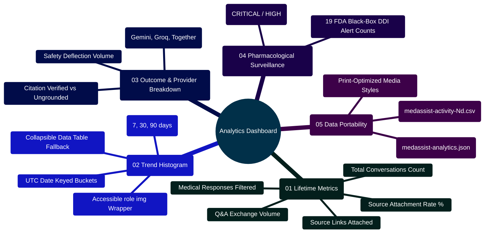

# MedAssist AI — Operational Analytics Dashboard Architecture Manual

Developed by **J Ganesh kumar reddy**  
*Full-Stack Educational Health Assistance, Biomedical Evidence Grounding, & Machine Learning Research Platform*

---

## 1. Executive Overview & Telemetry Dataflow Topology

The MedAssist AI Analytics Dashboard (`frontend/src/components/dashboard/AnalyticsDashboard.jsx`) delivers comprehensive, owner-isolated operational telemetry, evidence-grounding statistics, drug interaction monitoring metrics, and offline dataset quality metrics. It interfaces with `backend/controllers/analyticsController.js` to compute daily UTC activity trends over selectable 7, 30, and 90-day windows.

```
========================================================================================================================
                                MEDASSIST AI — ANALYTICS DASHBOARD TELEMETRY PIPELINE
========================================================================================================================

    [ USER VISITS: /dashboard ]
                 │
                 ├── Trigger: GET /api/analytics/overview?days=7 (or 30, 90)
                 │
                 ▼
    ┌────────────────────────────────────────────────────────────────────────────────────────────────────────────────┐
    │                                  BACKEND ANALYTICS ENGINE (analyticsController.js)                             │
    │  - MongoDB Aggregation Pipeline: Scoped strictly to authenticated `owner: req.user._id`                        │
    │  - Daily UTC Bucket Generation: Groups by `$dateToString: { format: "%Y-%m-%d", date: "$createdAt" }`         │
    │  - Grounding Rate Metric: (Medical Answers with Sources / Total Medical Answers) * 100%                         │
    │  - Interaction Aggregator: Counts occurrences of 19 FDA Black-Box Drug Interaction Pairs                        │
    │  - Dataset Audit Parser: Ingests offline JSON reports (`dataset_analysis.json`, `dataset_audit.json`)          │
    └────────────────────────────────────────────────────────────────────────────────────────────────────────────────┘
                 │
                 ▼
    ┌────────────────────────────────────────────────────────────────────────────────────────────────────────────────┐
    │                                          CLIENT RENDERING & ACCESSIBILITY                                      │
    │  - 5 Metric Cards: Conversations, Exchanges, Medical Responses, Source Links, Grounding Rate %                 │
    │  - Accessible SVG Activity Histogram: Scaled dynamically to max exchanges; includes fallback data table        │
    │  - Answer Outcome Breakdown: `citation_checked`, `references_only`, `sources_supplied`, `safety_redirect`       │
    │  - Provider Breakdown: Google Gemini, Groq, Together AI, Local vLLM count distribution                         │
    │  - Medication Warning Audit: Table of detected DDI pairs with severity badges (`CRITICAL`, `HIGH`)             │
    │  - Data Export Engine: Structured JSON, RFC 4180 CSV Export, and CSS Print Stylesheet                          │
    └────────────────────────────────────────────────────────────────────────────────────────────────────────────────┘
========================================================================================================================
```

---

## 2. Analytics Subsystem Mindmap



---

## 3. Telemetry Schema & Metric Contracts

### 3.1 Overview API Payload Contract (`GET /api/analytics/overview`)

```json
{
  "rangeDays": 7,
  "summary": {
    "totalSessions": 12,
    "totalMessages": 48,
    "medicalResponses": 36,
    "citations": 72,
    "sourceAttachmentRate": 94.4
  },
  "trend": [
    { "date": "2026-10-25", "sessions": 2, "exchanges": 6 },
    { "date": "2026-10-26", "sessions": 1, "exchanges": 4 },
    { "date": "2026-10-27", "sessions": 3, "exchanges": 12 }
  ],
  "verification": {
    "statuses": {
      "citation_checked": 30,
      "references_only": 4,
      "safety_redirect": 2
    },
    "providers": {
      "Google Gemini": 28,
      "Groq": 8
    },
    "interactions": [
      { "pair": "Anticoagulants + NSAIDs", "severity": "CRITICAL", "count": 2 }
    ]
  },
  "dataset": {
    "rows": { "total": 16412, "valid_question_answer_pairs": 16407 },
    "qualityFlags": { "missing_answer_rows": 5, "exact_duplicate_rows_after_whitespace_normalization": 0 },
    "generatedAt": "2026-10-30T12:00:00.000Z"
  }
}
```

---

## 4. Key Implementation Code Snippets

### 4.1 RFC 4180 Multi-Section CSV Export

```jsx
// CSV export implementation in AnalyticsDashboard.jsx
const exportCsv = () => {
  if (!data?.trend) return;
  const rows = [
    ["Date (UTC)", "New Conversations", "Q&A Exchanges"],
    ...data.trend.map((pt) => [pt.date, pt.sessions, pt.exchanges]),
  ];

  if (data.verification?.interactions?.length) {
    rows.push([]);
    rows.push(["Medication Interaction Pair", "Severity", "Alert Count"]);
    for (const item of data.verification.interactions) {
      rows.push([`"${item.pair}"`, item.severity, item.count]);
    }
  }

  const csvContent = rows.map((r) => r.join(",")).join("\n");
  downloadText(`medassist-activity-${data.rangeDays}d.csv`, csvContent, "text/csv;charset=utf-8");
};
```

### 4.2 Accessible Activity Histogram with Fallback Table

```jsx
<section className="card">
  <h2>Recent activity · {data.rangeDays} days</h2>
  <p className="muted small-text">Saved exchanges per day. Dates use UTC.</p>
  
  {/* Visual Histogram */}
  <div className="activity-chart" role="img" aria-label={`Saved exchanges in the last ${data.rangeDays} days`}>
    {data.trend.map((point) => (
      <div className="bar-column" key={point.date} title={`${point.date}: ${point.exchanges} exchanges`}>
        <span>{point.exchanges || ""}</span>
        <div className="bar-space">
          <div className="bar" style={{ height: `${Math.max(2, (point.exchanges / max) * 100)}%` }} />
        </div>
        <span>{point.date.slice(5)}</span>
      </div>
    ))}
  </div>

  {/* Accessible Table Fallback */}
  <details>
    <summary>View activity as a table</summary>
    <div className="table-scroll">
      <table>
        <thead>
          <tr><th>Date (UTC)</th><th>New conversations</th><th>Q&amp;A exchanges</th></tr>
        </thead>
        <tbody>
          {data.trend.map((point) => (
            <tr key={point.date}><td>{point.date}</td><td>{point.sessions}</td><td>{point.exchanges}</td></tr>
          ))}
        </tbody>
      </table>
    </div>
  </details>
</section>
```

---

## 5. Developer Extensibility: Adding a New Analytics Metric Card

To display a new telemetry parameter (e.g., Average Response Latency in seconds):
1. In `backend/controllers/analyticsController.js`, calculate the average latency from `generationModel.js` records.
2. In `AnalyticsDashboard.jsx`, append the new metric to the summary grid:

```jsx
<article className="card metric">
  <span>Avg. Synthesis Latency</span>
  <strong>{data.summary.avgLatencySec ? `${data.summary.avgLatencySec}s` : "—"}</strong>
</article>
```

---

## 6. Automated Verification Commands

The Analytics Dashboard is covered by Vitest component tests and Playwright headless browser workflows:

```powershell
# Run frontend dashboard component tests
npm test --prefix frontend -- ui.test.jsx

# Run Playwright browser verification including dashboard view
node scripts/browser_smoke.cjs
```
