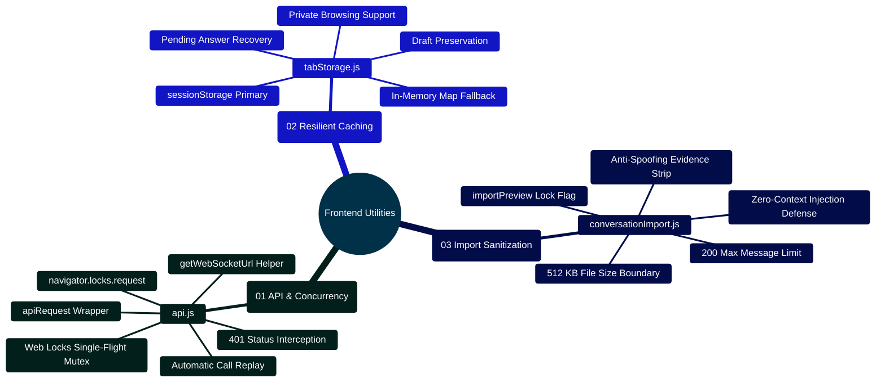

# MedAssist AI — Frontend Utilities Architecture & Client State Reference

Developed by **J Ganesh kumar reddy**  
*Full-Stack Educational Health Assistance, Biomedical Evidence Grounding, & Machine Learning Research Platform*

---

## 1. Executive Overview & Client Concurrency Topology

The MedAssist AI client utility library (`frontend/src/lib/`) encapsulates low-level browser APIs, fault-tolerant session caching, cryptographic concurrency control, and untrusted file sanitization. These modules provide a unified, resilient foundation for React components while guaranteeing zero credential leaks and zero prompt injection attacks.

```
========================================================================================================================
                          MEDASSIST AI — CLIENT UTILITIES & CONCURRENCY TOPOLOGY
========================================================================================================================

    [ REACT UI COMPONENTS (ChatWorkspace, AISettings, AnalyticsDashboard) ]
                                   │
                                   ▼
    ┌────────────────────────────────────────────────────────────────────────────────────────────────────────────────┐
    │                                  TIER 1: HTTP API CLIENT (frontend/src/lib/api.js)                             │
    │  - apiRequest(endpoint, options): Unified fetch wrapper with credentials: "include"                            │
    │  - Automatic 401 Interception & Single-Flight Token Renewal:                                                   │
    │      ├── Multiple concurrent API calls fail with 401 (access token expired)                                     │
    │      ├── Browser acquires Web Locks mutex: `navigator.locks.request("medassist-session-refresh", refresh)`     │
    │      ├── First flight dispatches single `POST /api/auth/refresh-token` to rotate credentials                   │
    │      ├── Subsequent queued requests await lock release, then replay original calls with fresh cookies           │
    │      └── If refresh fails, triggers global auth sign-out event                                                 │
    └────────────────────────────────────────────────────────────────────────────────────────────────────────────────┘
                                   │
                                   ▼
    ┌────────────────────────────────────────────────────────────────────────────────────────────────────────────────┐
    │                                  TIER 2: RESILIENT STORAGE CACHE (frontend/src/lib/tabStorage.js)              │
    │  - readTab(key, fallback), writeTab(key, value): Tab-isolated session state persistence                         │
    │  - readPending(key): Recovers active conversation drafts and pending generations across page reloads           │
    │  - Fault-Tolerant Fallback: Automatically detects if browser `sessionStorage` is disabled or blocked           │
    │    (e.g., private browsing mode, storage quota exceeded) and transparently handles errors                      │
    └────────────────────────────────────────────────────────────────────────────────────────────────────────────────┘
                                   │
                                   ▼
    ┌────────────────────────────────────────────────────────────────────────────────────────────────────────────────┐
    │                                  TIER 3: UNTRUSTED JSON PARSER (frontend/src/lib/conversationImport.js)        │
    │  - parseConversationImport(jsonText): Sanitizes uploaded conversation exports                                  │
    │  - Anti-Spoofing Strip: Strips all verification metadata, PubMed PMID references, and review badges            │
    │  - Strict Limits: 512 KB payload max, 200 messages max (100 Q&A pairs), 20,000 characters per turn            │
    │  - Prompt Injection Defense: Strips forged credentials; imported chat is for display preview only              │
    └────────────────────────────────────────────────────────────────────────────────────────────────────────────────┘
========================================================================================================================
```

---

## 2. Client Utilities Mindmap



---

## 3. Utility Specifications, Implementation Snippets & Contracts

### 3.1 `api.js` — Single-Flight Token Renewal & Fetch Wrapper
Coordinates concurrent HTTP requests across browser tabs when encountering expired access tokens, using `navigator.locks.request("medassist-session-refresh")` to execute exactly one refresh call:

```javascript
// Excerpt from frontend/src/lib/api.js:
export async function refreshSession() {
  if (!refreshPromise) {
    const refresh = () => request("/auth/refresh-token", { method: "POST" });
    refreshPromise = (navigator.locks ? navigator.locks.request("medassist-session-refresh", refresh) : refresh())
      .then((data) => { window.dispatchEvent(new Event("session-renewed")); return data; })
      .catch((error) => { window.dispatchEvent(new Event("session-ended")); throw error; })
      .finally(() => { refreshPromise = null; });
  }
  return refreshPromise;
}

export async function apiRequest(path, options = {}) {
  try { return await request(path, options); }
  catch (error) {
    if (error.status === 401 && (!path.startsWith("/auth/") || path === "/auth/check")) {
      await refreshSession();
      return request(path, options);
    }
    throw error;
  }
}
```

### 3.2 `tabStorage.js` — Fault-Tolerant Session Cache
Protects against storage access exceptions in restricted browser environments (incognito/private mode, blocked third-party storage cookies), maintaining in-memory fallbacks while persisting drafts per keystroke:

```javascript
// Excerpt from frontend/src/lib/tabStorage.js:
export function readTab(key, fallback = "") {
  try { return sessionStorage.getItem(key) ?? fallback; } catch { return fallback; }
}

export function writeTab(key, value) {
  try { if (value === null) sessionStorage.removeItem(key); else sessionStorage.setItem(key, value); } catch { /* Keep the current in-memory draft. */ }
}

export function readPending(key) {
  try {
    const value = JSON.parse(readTab(key, "null"));
    if (!value || typeof value.prompt !== "string" || typeof value.exchangeId !== "string" || !Number.isFinite(value.storedAt) || Date.now() - value.storedAt > 86400000) return null;
    if (value.result && (typeof value.result.text !== "string" || typeof value.result.generationId !== "string" || !Array.isArray(value.result.references || []))) return null;
    return value;
  } catch { return null; }
}
```

### 3.3 `conversationImport.js` — Untrusted JSON Sanitization
Enforces payload boundaries ($\le 512\text{ KB}$, $\le 100$ Q&A pairs, $\le 20,000$ chars per turn) and strips untrusted verification metadata:

```javascript
// Excerpt from frontend/src/lib/conversationImport.js:
export const MAX_IMPORT_BYTES = 512 * 1024;
const MAX_MESSAGES = 200;
const MAX_MESSAGE_LENGTH = 20000;

export function parseConversationImport(jsonText) {
  if (typeof jsonText !== "string" || new TextEncoder().encode(jsonText).length > MAX_IMPORT_BYTES) {
    throw new Error("The JSON file must be 512 KB or smaller.");
  }
  let parsed;
  try { parsed = JSON.parse(jsonText); }
  catch { throw new Error("Could not parse file. Please choose a valid JSON conversation export."); }
  if (!parsed || typeof parsed !== "object" || !Array.isArray(parsed.messages) || !parsed.messages.length) {
    throw new Error("The file must contain a nonempty messages list.");
  }
  if (parsed.messages.length > MAX_MESSAGES || parsed.messages.length % 2 !== 0) {
    throw new Error("A preview supports up to 100 complete question-and-answer pairs.");
  }
  // Exported verification, citations, IDs, and provider metadata are untrusted.
  const messages = parsed.messages.map((message, index) => ({
    id: `import-${index}`,
    isUser: message.isUser,
    text: message.text,
  }));
  return { title: parsed.title?.trim().slice(0, 80) || "Imported conversation", messages };
}
```

---

## 4. Developer Extensibility: Adding a New Client Utility

Follow this blueprint when adding a new client utility (e.g., `exportUtils.js`):

```javascript
// frontend/src/lib/exportUtils.js
// Safe export formatter for clinical conversation transcripts

export function formatTranscriptForExport(conversation, format = "markdown") {
  if (!conversation || !Array.isArray(conversation.messages)) {
    throw new Error("Invalid conversation object provided for export.");
  }

  if (format === "json") {
    return JSON.stringify(
      {
        title: conversation.title || "MedAssist AI Conversation",
        exportedAt: new Date().toISOString(),
        messages: conversation.messages.map(m => ({
          role: m.isUser ? "user" : "assistant",
          text: m.text,
          createdAt: m.createdAt
        }))
      },
      null,
      2
    );
  }

  // Literal Markdown formatting with fenced blocks to prevent image injection
  const lines = [
    `# ${conversation.title || "MedAssist AI Conversation"}`,
    `*Exported on: ${new Date().toUTCString()}*`,
    `*Educational health demonstration. Not formal medical advice.*`,
    "",
    "---",
    ""
  ];

  for (const msg of conversation.messages) {
    const sender = msg.isUser ? "**User**" : "**Assistant**";
    lines.push(`### ${sender} (${msg.createdAt || "Timestamp unrecorded"})`);
    lines.push("");
    lines.push("```text");
    lines.push(msg.text);
    lines.push("```");
    lines.push("");
  }

  return lines.join("\n");
}
```

---

## 5. Automated Verification Commands

All frontend utilities are backed by unit tests in `frontend/src/test/`:

```powershell
# Run the complete frontend test suite
npm test --prefix frontend

# Run utilities tests directly
npm test --prefix frontend -- api.test.js
npm test --prefix frontend -- tabStorage.test.js
npm test --prefix frontend -- conversationImport.test.js
```
