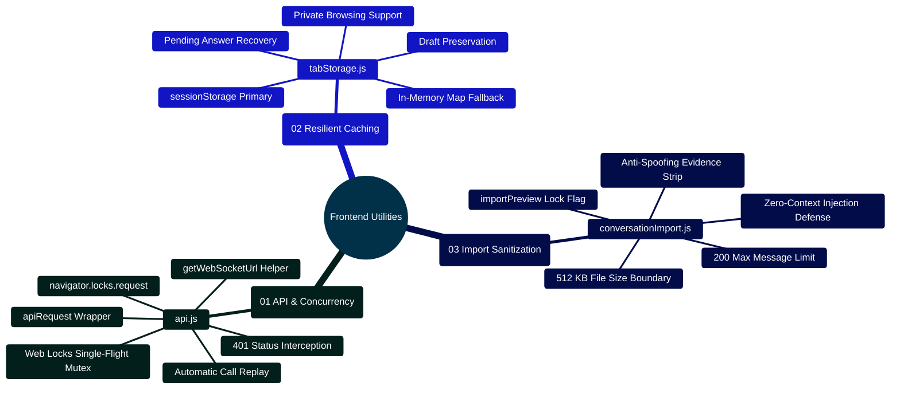

# MedAssist AI — Frontend Utilities Architecture & Client State Reference

Developed by **J Ganesh kumar reddy**  
*Full-Stack Educational Health Assistance, Biomedical Evidence Grounding, & Machine Learning Research Platform*

---

## 1. Executive Overview & Client Concurrency Topology

The MedAssist AI client utility library (`frontend/src/lib/`) encapsulates low-level browser APIs, fault-tolerant session caching, cryptographic concurrency control, and untrusted file sanitization. These modules provide a unified, resilient foundation for React components while guaranteeing zero credential leaks and zero prompt injection attacks.

```
========================================================================================================================
                          MEDASSIST AI — CLIENT UTILITIES & CONCURRENCY TOPOLOGY
========================================================================================================================

    [ REACT UI COMPONENTS (ChatWorkspace, AISettings, AnalyticsDashboard) ]
                                   │
                                   ▼
    ┌────────────────────────────────────────────────────────────────────────────────────────────────────────────────┐
    │                                  TIER 1: HTTP API CLIENT (frontend/src/lib/api.js)                             │
    │  - apiRequest(endpoint, options): Unified fetch wrapper with credentials: "include"                            │
    │  - Automatic 401 Interception & Single-Flight Token Renewal:                                                   │
    │      ├── Multiple concurrent API calls fail with 401 (access token expired)                                     │
    │      ├── Browser acquires Web Locks mutex: `navigator.locks.request("medassist_auth_refresh")`                 │
    │      ├── First flight dispatches single `POST /api/auth/refresh-token` to rotate credentials                   │
    │      ├── Subsequent queued requests await lock release, then replay original calls with fresh cookies           │
    │      └── If refresh fails, triggers global auth sign-out event                                                 │
    └────────────────────────────────────────────────────────────────────────────────────────────────────────────────┘
                                   │
                                   ▼
    ┌────────────────────────────────────────────────────────────────────────────────────────────────────────────────┐
    │                                  TIER 2: RESILIENT STORAGE CACHE (frontend/src/lib/tabStorage.js)              │
    │  - readTab(key), writeTab(key, value): Tab-isolated session state persistence                                  │
    │  - Recovers active conversation drafts and pending answer generations across page reloads                      │
    │  - Fault-Tolerant Fallback: Automatically detects if browser `sessionStorage` is disabled or blocked           │
    │    (e.g., private browsing mode, storage quota exceeded) and switches to an in-memory Map                     │
    └────────────────────────────────────────────────────────────────────────────────────────────────────────────────┘
                                   │
                                   ▼
    ┌────────────────────────────────────────────────────────────────────────────────────────────────────────────────┐
    │                                  TIER 3: UNTRUSTED JSON PARSER (frontend/src/lib/conversationImport.js)        │
    │  - parseConversationImportJson(rawJson): Sanitizes uploaded conversation exports                               │
    │  - Anti-Spoofing Strip: Strips all verification metadata, PubMed PMID references, and review badges            │
    │  - Strict Limits: 512 KB payload max, 200 messages max, strictly alternating user/assistant structure         │
    │  - Prompt Injection Defense: Flags imported chat with `importPreview: true` (disables sending & model context) │
    └────────────────────────────────────────────────────────────────────────────────────────────────────────────────┘
========================================================================================================================
```

---

## 2. Client Utilities Mindmap



---

## 3. Utility Specifications & Contracts

### 3.1 `api.js` — Single-Flight Token Renewal & Fetch Wrapper
- **`apiRequest(url, options = {})`**:
  - Automatically merges `credentials: "include"` and `Content-Type: application/json`.
  - On receiving `401 Unauthorized`, coordinates token renewal through the browser's Web Locks API (`navigator.locks.request("medassist_auth_refresh")`).
  - Ensures that when 5 concurrent requests encounter expired tokens, **exactly one refresh call** is dispatched to the backend, and all 5 original calls replay cleanly without user interruption.

### 3.2 `tabStorage.js` — Fault-Tolerant Session Cache
- **`readTab(key, fallback = null)`**: Reads serialized JSON from `sessionStorage`; returns in-memory cached state if `sessionStorage` is restricted or throws.
- **`writeTab(key, value)`**: Writes serialized state to `sessionStorage` with automatic in-memory mirror.
- **`readPending(conversationId)`**: Reads in-flight generation progress to recover uncommitted answers after page reload.

### 3.3 `conversationImport.js` — Untrusted JSON Sanitization
- **`parseConversationImportJson(rawJson)`**:
  - Enforces payload bounds: $\le 512\text{ KB}$ raw string, $\le 200$ messages, $\le 20,000$ characters per turn.
  - Strips all `verification`, `citations`, and `modelReview` fields to prevent external malicious JSON files from spoofing verified medical facts.
  - Returns `{ title, messages, importPreview: true }`. In the UI, `importPreview: true` locks the input composer, ensuring untrusted text cannot be injected into subsequent LLM conversational context.

---

## 4. Developer Extensibility: Adding a New Client Utility

Follow this blueprint when adding a new client utility (e.g., `exportUtils.js`):

```javascript
// frontend/src/lib/exportUtils.js
// Safe export formatter for clinical conversation transcripts

export function formatTranscriptForExport(conversation, format = "markdown") {
  if (!conversation || !Array.isArray(conversation.messages)) {
    throw new Error("Invalid conversation object provided for export.");
  }

  if (format === "json") {
    return JSON.stringify(
      {
        title: conversation.title || "MedAssist AI Conversation",
        exportedAt: new Date().toISOString(),
        messages: conversation.messages.map(m => ({
          role: m.isUser ? "user" : "assistant",
          text: m.text,
          createdAt: m.createdAt
        }))
      },
      null,
      2
    );
  }

  // Literal Markdown formatting with fenced blocks to prevent image injection
  const lines = [
    `# ${conversation.title || "MedAssist AI Conversation"}`,
    `*Exported on: ${new Date().toUTCString()}*`,
    `*Educational health demonstration. Not formal medical advice.*`,
    "",
    "---",
    ""
  ];

  for (const msg of conversation.messages) {
    const sender = msg.isUser ? "**User**" : "**Assistant**";
    lines.push(`### ${sender} (${msg.createdAt || "Timestamp unrecorded"})`);
    lines.push("");
    lines.push("```text");
    lines.push(msg.text);
    lines.push("```");
    lines.push("");
  }

  return lines.join("\n");
}
```

---

## 5. Automated Verification Commands

All frontend utilities are backed by unit tests in `frontend/src/test/`:

```powershell
# Run the complete frontend test suite
npm test --prefix frontend

# Run utilities tests directly
npm test --prefix frontend -- api.test.js
npm test --prefix frontend -- tabStorage.test.js
npm test --prefix frontend -- conversationImport.test.js
```
