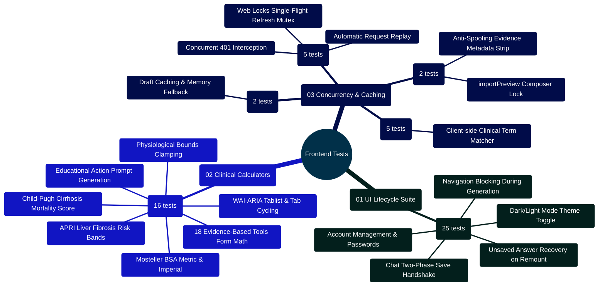

# MedAssist AI — Frontend Testing Architecture & Verification Manual

Developed by **J Ganesh kumar reddy**  
*Full-Stack Educational Health Assistance, Biomedical Evidence Grounding, & Machine Learning Research Platform*

---

## 1. Executive Testing Philosophy & Topology

The MedAssist AI frontend test harness (`frontend/src/test/`) verifies React 19 components, WAI-ARIA accessible clinical calculators, authentication context providers, Web Locks concurrency control, and resilient storage caching. Tests execute using Vitest with a simulated `jsdom` browser environment, ensuring sub-second execution speed, strict component isolation, and full DOM assertions without running a live browser daemon.

```
========================================================================================================================
                          MEDASSIST AI — FRONTEND VITEST TEST EXECUTION TOPOLOGY
========================================================================================================================

    [ TEST RUNNER: npm test --prefix frontend / vitest run ]
                             │
                             ▼
    ┌────────────────────────────────────────────────────────────────────────────────────────────────────────────────┐
    │                                TIER 1: JSDOM SIMULATED BROWSER ENVIRONMENT                                     │
    │  - Environment: jsdom with global `window`, `document`, and `sessionStorage` simulation                        │
    │  - Mock Adapters: Web Locks API (`navigator.locks.request`), Fetch API, and ResizeObserver                     │
    │  - Component Testing Harness: `@testing-library/react` + `@testing-library/user-event`                         │
    └────────────────────────────────────────────────────────────────────────────────────────────────────────────────┘
                             │
         ┌───────────────────┼───────────────────┬───────────────────┐
         │                   │                   │                   │
         ▼                   ▼                   ▼                   ▼
    ┌───────────────┐   ┌───────────────┐   ┌───────────────┐   ┌───────────────┐
    │ UI LIFECYCLE  │   │ CLINICAL TOOLS│   │ CLIENT APIS & │   │ HEURISTICS &  │
    │ SUITE (25)    │   │ SUITE (16)    │   │ CONCURRENCY(7)│   │ STORAGE (7)   │
    │ ui.test.jsx   │   │ clinical-     │   │ api.test.js   │   │ medical-      │
    │ (Auth & Chat) │   │ Calculators   │   │ conversation- │   │ Detector      │
    │               │   │               │   │ Import        │   │ tabStorage    │
    └───────────────┘   └───────────────┘   └───────────────┘   └───────────────┘
                             │                   │                   │
                             └───────────────────┼───────────────────┘
                                                 │
                                                 ▼
    ┌────────────────────────────────────────────────────────────────────────────────────────────────────────────────┐
    │                                55 TESTS PASSED ACROSS 6 TEST FILES (100% PASS RATE)                            │
    │  - Verified Invariants: 18 Calculator physiological bounds, Web Locks single-flight refresh, tab recovery      │
    │  - Accessibility Verification: WAI-ARIA tabpanel cycling, Escape key dismiss, and focus restoration           │
    └────────────────────────────────────────────────────────────────────────────────────────────────────────────────┘
========================================================================================================================
```

---

## 2. Frontend Testing Mindmap



---

## 3. Test Suite Inventory & Coverage Matrix

| Test Suite File | Test Framework | Test Count | Key Invariants Verified |
|:---|:---:|:---:|:---|
| `ui.test.jsx` | Vitest + RTL | **25** | Auth flow, pending feedback, chat lifecycle, two-phase save retry, navigation guard, draft recovery. |
| `clinicalCalculators.test.jsx` | Vitest + RTL | **16** | 18 calculators math, input clamping (age, creatinine), Mosteller BSA, APRI, Child-Pugh, WAI-ARIA tabpanel semantics. |
| `api.test.js` | Vitest | **5** | Single-flight token renewal via Web Locks mutex, concurrent 401 resolution, error payload extraction. |
| `medicalDetector.test.js` | Vitest | **5** | Clinical keyword detection, negation handling, non-medical inquiry passthrough. |
| `conversationImport.test.js` | Vitest | **2** | JSON export sanitization, anti-spoofing evidence strip, `importPreview: true` composer lock. |
| `tabStorage.test.js` | Vitest | **2** | Resilient `sessionStorage` wrapper, transparent in-memory Map fallback. |
| **TOTAL** | — | **55 Tests** | **100% Passing** |

---

## 4. Developer Extensibility: Writing a New Vitest Component Test

When contributing a new React component or modal, author a test suite using Vitest and React Testing Library:

```jsx
// frontend/src/test/customTool.test.jsx
import { describe, it, expect, vi } from "vitest";
import { render, screen, fireEvent } from "@testing-library/react";
import React from "react";
import { CustomToolModal } from "../components/tools/CustomToolModal.jsx";

describe("CustomToolModal Component", () => {
  it("renders modal when open and closes on Escape key", () => {
    const handleClose = vi.fn();
    const { rerender } = render(
      <CustomToolModal isOpen={true} onClose={handleClose} title="Custom Clinical Tool">
        <p>Tool Content</p>
      </CustomToolModal>
    );

    expect(screen.getByRole("dialog")).toBeInTheDocument();
    expect(screen.getByText("Custom Clinical Tool")).toBeInTheDocument();

    // Trigger Escape key
    fireEvent.keyDown(window, { key: "Escape" });
    expect(handleClose).toHaveBeenCalledTimes(1);
  });
});
```

---

## 5. Automated Execution Commands

```powershell
# Run the complete frontend Vitest suite
npm test --prefix frontend

# Run specific test suites
npm test --prefix frontend -- ui.test.jsx
npm test --prefix frontend -- clinicalCalculators.test.jsx
npm test --prefix frontend -- api.test.js
```
