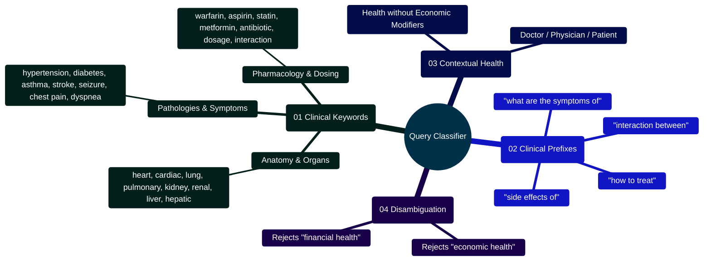

# MedAssist AI — Client Heuristic Query Classifier Reference

Developed by **J Ganesh kumar reddy**  
*Full-Stack Educational Health Assistance, Biomedical Evidence Grounding, & Machine Learning Research Platform*

---

## 1. Executive Overview & Routing Topology

The MedAssist AI client query classifier (`frontend/src/utils/medicalDetector.js`) performs instantaneous, deterministic classification of user inquiries before network dispatch. By analyzing linguistic cues, anatomical terms, pharmacological entities, and grammatical intent, the classifier routes health-related questions to the evidence-grounded PubMed endpoint (`/api/medical`) while directing general conversational prompts to the primary conversational endpoint (`/api/ai/chat`).

```
========================================================================================================================
                          MEDASSIST AI — CLIENT HEURISTIC ROUTING TOPOLOGY
========================================================================================================================

    [ USER INPUT PROMPT IN COMPOSER ]
                   │
                   ▼
    ┌────────────────────────────────────────────────────────────────────────────────────────────────────────────────┐
    │                                HEURISTIC CLASSIFIER: isMedicalQuery(text)                                      │
    │  - Normalization: Lowercases, removes punctuation, collapses excessive whitespace                             │
    │  - Stage 1: Explicit Clinical Lexicon Match (60+ terms: "migraine", "hypertension", "warfarin", "asthma")     │
    │  - Stage 2: Clinical Question Prefixes ("how to treat", "side effects of", "dosage for")                       │
    │  - Stage 3: Contextual Health Inquiries ("doctor", "nurse", "physician", "patient")                            │
    │  - False-Positive Guard: Excludes non-health contexts (e.g., "fiscal health", "financial health")             │
    └────────────────────────────────────────────────────────────────────────────────────────────────────────────────┘
                   │
         ┌─────────┴─────────┐
         │                   │
         ▼ True              ▼ False
    ┌─────────────────┐ ┌─────────────────┐
    │  /api/medical   │ │  /api/ai/chat   │
    │  Forced PubMed  │ │  Primary Chat   │
    │  Grounding RAG  │ │  Generation     │
    └─────────────────┘ └─────────────────┘
========================================================================================================================
```

---

## 2. Query Classification Mindmap



---

## 3. Classification Algorithm & Lexicon Architecture

### 3.1 Lexicon Structure
```javascript
// Excerpt from frontend/src/utils/medicalDetector.js
const MEDICAL_KEYWORDS = [
  "pubmed", "nih", "clinical", "diagnos\\w*", "prognosis", "therapy",
  "medication", "dosage", "side effect", "contraindication", "allergy",
  "hypertension", "heart", "cardiac", "pulmonary", "diabetes", "insulin",
  "migraine", "asthma", "warfarin", "aspirin", "ibuprofen", "metformin"
];

const MEDICAL_QUESTION_PREFIXES = [
  "how to treat", "what are the symptoms of", "how is diagnosed",
  "what are the treatments for", "side effects of", "interaction between"
];
```

### 3.2 Detection Logic & Implementation
The complete implementation of `isMedicalQuery(text)` handles normalization, direct keyword matching, and false-positive filtering:

```javascript
// Excerpt from frontend/src/utils/medicalDetector.js:
const CLINICAL_REGEX = new RegExp(
  `(?:^|\\b)(${MEDICAL_KEYWORDS.join("|")})\\b|` +
    `^(?:${MEDICAL_QUESTION_PREFIXES.join("|")})`,
  "i"
);

export const isMedicalQuery = (text) => {
  if (!text || typeof text !== "string") return false;

  const cleanText = text.toLowerCase().replace(/[^\w\s-]/g, " ").replace(/\s+/g, " ").trim();
  if (!cleanText || cleanText.length < 2) return false;

  // Direct match for explicit clinical keywords or specific medical prefixes
  if (CLINICAL_REGEX.test(cleanText)) return true;

  // Question syntax or multi-word structure with health context
  const isQuestion =
    text.trim().endsWith("?") ||
    /^(?:what|how|why|when|where|who|can|should|is|are|does)\b/i.test(cleanText);
  const isDetailedQuery = cleanText.split(/\s+/).length > 2;

  const hasMedicalContext =
    /\b(?:medical|doctor|nurse|physician|patient|prescriber)\b/i.test(cleanText) ||
    (/\bhealth\b/i.test(cleanText) && !/\b(?:financial|economic|fiscal|market)\b/i.test(cleanText));

  return Boolean(hasMedicalContext && (isQuestion || isDetailedQuery));
};
```

### 3.3 False-Positive Disambiguation
General terms such as "health" can appear in economic or corporate contexts (*"What is the financial health of Company X?"*). The classifier enforces contextual disambiguation:
```javascript
const hasMedicalContext =
  /\b(?:medical|doctor|nurse|physician|patient|prescriber)\b/i.test(cleanText) ||
  (/\bhealth\b/i.test(cleanText) && !/\b(?:financial|economic|fiscal|market)\b/i.test(cleanText));
```

---

## 4. Developer Extensibility: Expanding the Clinical Lexicon

Developers integrating MedAssist AI into sub-specialty clinics (e.g., dermatology, ophthalmology, oncology) can easily append domain-specific terms:

```javascript
// Example: Adding ophthalmic terms to MEDICAL_KEYWORDS in medicalDetector.js:
const OPHTHALMOLOGY_KEYWORDS = [
  "glaucoma", "cataract", "retinopathy", "macular degeneration",
  "intraocular pressure", "astigmatism", "myopia", "blepharitis"
];
```

---

## 5. Automated Verification Commands

The query detector is verified by 5 unit tests in `frontend/src/test/medicalDetector.test.js`:

```powershell
npm test --prefix frontend -- medicalDetector.test.js
```
