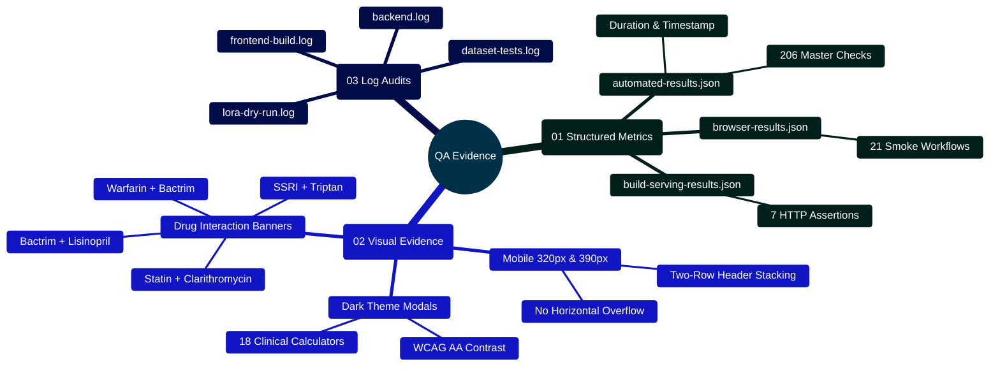

# MedAssist AI — Quality Assurance Evidence Catalog & Artifact Reference

Developed by **J Ganesh kumar reddy**  
*Full-Stack Educational Health Assistance, Biomedical Evidence Grounding, & Machine Learning Research Platform*

---

## 1. Executive QA Overview & Artifact Topology

The quality assurance output directory (`output/qa/`) stores automated verification logs, JSON metric reports, and high-resolution Playwright browser screenshots generated during CI runs and local pre-release testing. These artifacts provide auditability, visual evidence of accessibility across desktop and mobile viewports, and regression tracking across all 206 automated checks.

```
========================================================================================================================
                          MEDASSIST AI — QA ARTIFACT GENERATION PIPELINE
========================================================================================================================

    [ TEST HARNESS EXECUTION: node scripts/verify_project.cjs / node scripts/browser_smoke.cjs ]
                                                │
                                                ▼
    ┌────────────────────────────────────────────────────────────────────────────────────────────────────────────────┐
    │                                TIER 1: STRUCTURED JSON VERIFICATION LOGS                                       │
    │  - automated-results.json: Aggregate code-check metrics (backend, frontend, python, build)                     │
    │  - browser-results.json: Results of 21 core browser workflows and scenarios                                   │
    │  - build-serving-results.json: 7 HTTP ingress assertions (cache headers, SPA routing, proxying)               │
    │  - frontend-results.json: Vitest JSON output covering 55 component and unit tests                             │
    └────────────────────────────────────────────────────────────────────────────────────────────────────────────────┘
                                                │
                                                ▼
    ┌────────────────────────────────────────────────────────────────────────────────────────────────────────────────┐
    │                                TIER 2: CHROMIUM HEADLESS SCREENSHOT EVIDENCE                                   │
    │  - Mobile Viewports (320px, 390px): `chat-320.png`, `chat-mobile.png`, `register-mobile.png`                  │
    │  - Dark Theme Modals: `calculators-dark-modal.png`, `bsa-dark-modal.png`, `apri-dark-modal.png`, etc.         │
    │  - Clinical Caution Banners: `triptan-ssri-dark.png`, `bactrim-lisinopril-dark.png`, etc.                     │
    │  - Desktop Workspaces: `chat-desktop.png`, `dashboard-desktop.png`, `home-desktop.png`                        │
    └────────────────────────────────────────────────────────────────────────────────────────────────────────────────┘
========================================================================================================================
```

---

## 2. QA Artifacts Mindmap



---

## 3. Artifact Catalog & Description

| Artifact File | Category | Source Script | Description |
|:---|:---:|:---:|:---|
| `automated-results.json` | Report | `verify_project.cjs` | Master summary of 206 automated software checks across all suites. |
| `browser-results.json` | Report | `browser_smoke.cjs` | Verification logs for 21 browser end-to-end user workflows. |
| `build-serving-results.json` | Report | `check_build_serving.cjs` | HTTP response header assertions (immutable cache, CSP, SPA fallbacks). |
| `calculators-dark-modal.png` | Visual | `browser_verify_dark_and_tools.cjs` | Dark theme rendering of clinical calculators modal and tablist (18 tools). |
| `bsa-dark-modal.png` | Visual | `browser_verify_dark_and_tools.cjs` | Dark theme rendering of Mosteller BSA calculator. |
| `apri-dark-modal.png` | Visual | `browser_verify_dark_and_tools.cjs` | Dark theme rendering of APRI liver fibrosis calculator. |
| `wells-dark-modal.png` | Visual | `browser_verify_dark_and_tools.cjs` | Dark theme rendering of Wells PE score calculator. |
| `triptan-ssri-dark.png` | Visual | `browser_verify_dark_and_tools.cjs` | Drug interaction warning banner for SSRI + Triptan. |
| `bactrim-lisinopril-dark.png` | Visual | `browser_verify_dark_and_tools.cjs` | Drug interaction warning banner for Bactrim + Lisinopril. |
| `statin-clarithromycin-dark.png` | Visual | `browser_verify_dark_and_tools.cjs` | Drug interaction warning banner for Statin + Clarithromycin. |
| `chat-320.png` | Visual | `browser_smoke.cjs` | Mobile layout verification at ultra-narrow 320px viewport width. |
| `dashboard-desktop.png` | Visual | `browser_smoke.cjs` | Analytics dashboard with activity charts and evidence citation totals. |

---

## 4. Developer QA Execution Commands

```powershell
# Re-generate all automated test logs
node scripts/verify_project.cjs

# Re-generate browser screenshots and workflow logs
node scripts/run_build_qa.cjs --fixtures &
node scripts/browser_smoke.cjs
node scripts/browser_verify_dark_and_tools.cjs
```
