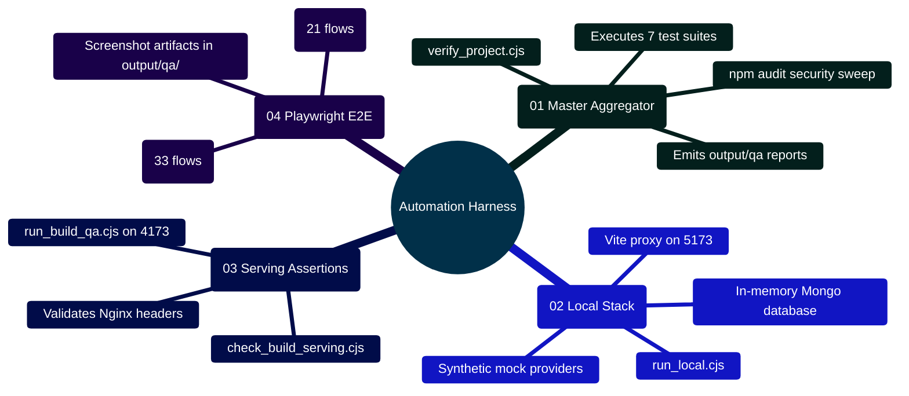

# MedAssist AI — Automation Scripts, Verification Harness & QA Runbook

Developed by **J Ganesh kumar reddy**  
*Full-Stack Educational Health Assistance, Biomedical Evidence Grounding, & Machine Learning Research Platform*

---

## 1. Automation & Verification Architecture Topology

The `scripts/` directory hosts the continuous verification harness, local development servers, and automated browser regression test suites:

```
========================================================================================================================
                                     MEDASSIST AI — VERIFICATION PIPELINE TOPOLOGY
========================================================================================================================

    [ DEVELOPER COMMAND / CI RUNNER: node scripts/verify_project.cjs ]
                                   │
         ┌─────────────────────────┼─────────────────────────┐
         │                         │                         │
         ▼                         ▼                         ▼
    ┌─────────────────────┐   ┌─────────────────────┐   ┌─────────────────────┐
    │ BACKEND UNIT TESTS  │   │ FRONTEND TESTS & LINT│   │ PYTHON RESEARCH SUITE│
    │ ├── Node test runner│   │ ├── ESLint 9 sweep  │   │ ├── Dataset profiler│
    │ ├── MongoMemoryServ │   │ ├── Vitest + jsdom  │   │ ├── LoRA parameter  │
    │ └── 71 passed tests │   │ ├── Vite prod build │   │ │   math (147,456)  │
    │                     │   │ └── 55 passed tests │   │ └── 19 passed tests │
    └─────────────────────┘   └─────────────────────┘   └─────────────────────┘
                 │                         │                         │
                 └─────────────────────────┼─────────────────────────┘
                                           │
                                           ▼
    ┌─────────────────────────────────────────────────────────────────┐
    │ BUILT-OUTPUT GATEWAY VERIFICATION (check_build_serving.cjs)     │
    │ ├── Ingress security headers (CSP, HSTS, X-Frame-Options)       │
    │ ├── Reverse proxy API route handling (/api/*)                   │
    │ └── 7 passed HTTP assertions                                    │
    └─────────────────────────────────────────────────────────────────┘
                                           │
                                           ▼
    ┌─────────────────────────────────────────────────────────────────┐
    │ PLAYWRIGHT HEADLESS BROWSER REGRESSION SUITES                   │
    │ ├── browser_smoke.cjs: 21 E2E flows (Auth, Chat, Save, Export)  │
    │ └── browser_verify_dark_and_tools.cjs: 33 flows (18 Tools, ARIA)│
    │ └── 54 passed browser workflows                                 │
    └─────────────────────────────────────────────────────────────────┘
========================================================================================================================
```

---

## 2. Verification Harness Mindmap



---

## 3. Automation Scripts Catalog & Responsibilities

| Script Name | Environment | Core Responsibility |
|:---|:---|:---|
| **`verify_project.cjs`** | Node.js | Master multi-tier verification runner. Sequentially executes backend tests, frontend linting, Vitest suites, Vite production build, Python dataset tests, Python LoRA tests, and production security audits. |
| **`run_local.cjs`** | Node.js | Launches isolated local development environment using in-memory MongoDB (`MongoMemoryServer`) and synthetic mock services. No external API keys or cloud connections required. |
| **`run_build_qa.cjs`** | Node.js | Serves the compiled production Vite bundle alongside mock API endpoints on port 4173 for pre-deployment validation. |
| **`check_build_serving.cjs`** | Node.js | Performs 7 automated HTTP header assertions against the serving gateway, verifying CSP, HSTS, X-Frame-Options, and gzip content delivery. |
| **`browser_smoke.cjs`** | Playwright / Chromium | Executes 21 automated end-to-end browser workflows, verifying user registration, login, chat generation, two-phase commitment (`/api/save`), thread deletion, and conversation export. |
| **`browser_verify_dark_and_tools.cjs`** | Playwright / Chromium | Executes 33 automated browser workflows verifying WCAG AA contrast in dark mode, OS `prefers-color-scheme` synchronization, 18 clinical calculators, DDI alert banners, and WAI-ARIA tabpanel keyboard cycling. |
| **`generate_project_report.py`** | Python | Compiles architectural documentation, system metrics, and test logs into a unified, formal PDF project review report. |

---

## 4. Execution Commands & Operational Runbook

```powershell
# 1. Run master automated verification harness
node scripts/verify_project.cjs

# 2. Launch zero-dependency local development stack
node scripts/run_local.cjs

# 3. Serve production build with synthetic fixtures
node scripts/run_build_qa.cjs --fixtures

# 4. Verify HTTP serving headers and security gates
node scripts/check_build_serving.cjs

# 5. Run Playwright end-to-end smoke workflows
node scripts/browser_smoke.cjs

# 6. Run Playwright dark mode and clinical tools accessibility workflows
node scripts/browser_verify_dark_and_tools.cjs
```
